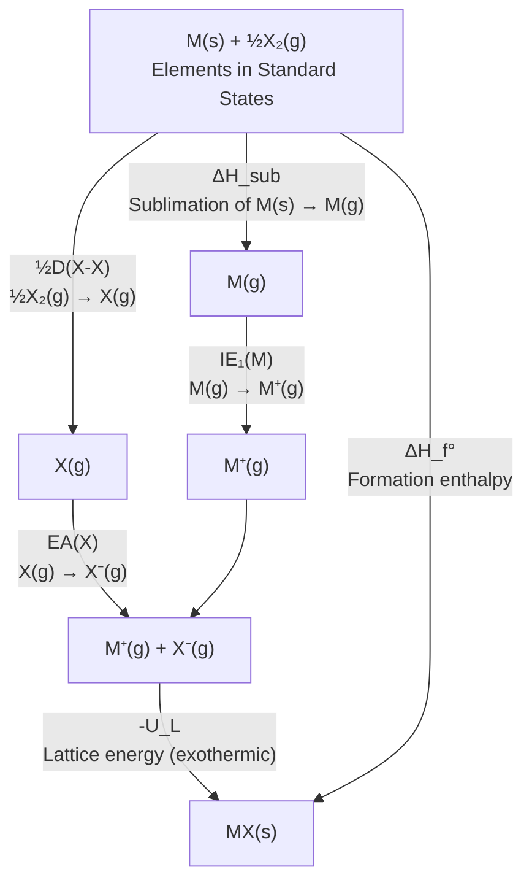
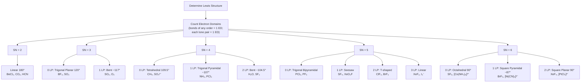

# Lesson 2: Bonding Theories, Hybridization, Molecular Geometry

## 1. First-Principles Intuition & Invariants

Every observable property of an inorganic compound — its melting point, electrical conductivity, solubility, color, reactivity — is ultimately a consequence of how its constituent atoms share or transfer electrons. Bonding theory is not an abstract convenience invented to satisfy examination boards; it is the mechanistic language that connects the quantum world of electron density to the macroscopic laboratory measurements a chemist actually takes. To read that language fluently, you need to understand not one bonding model but four, and to know precisely where each one breaks down.

The historical arc of bonding theory runs from purely ionic and covalent extremes toward an increasingly quantum-mechanical picture. G.N. Lewis introduced electron-pair notation in 1916, Linus Pauling extended it into valence bond theory through the 1930s, and Robert Mulliken simultaneously developed molecular orbital theory — a framework that ultimately proved more general and more computationally tractable. For the inorganic chemist, all of these models coexist: ionic lattice energy calculations predict solubility trends and Born-Haber thermochemistry; VSEPR gives geometry predictions in under a minute at the bench; MO theory is indispensable for interpreting UV-Vis spectra, magnetic susceptibility data, and the reactivity of transition metal complexes.

### Ionic Bonding and Lattice Energetics

Ionic bonding arises when the electronegativity difference between two atoms is large enough that complete electron transfer — rather than sharing — is thermodynamically favorable. The standard threshold of $\Delta \chi > 1.7$ on the Pauling scale is a practical guide rather than a sharp boundary; NaCl sits well above it, while species such as $\text{AlCl}_3$ sit near it and display significant covalent character.

The defining energetic quantity for an ionic solid is the **lattice energy** $U_L$, defined as the enthalpy change when one mole of a gaseous ionic compound is assembled from its constituent gaseous ions at infinite separation:

$$
\text{M}^+(\text{g}) + \text{X}^-(\text{g}) \longrightarrow \text{MX}(\text{s}) \quad \Delta H = -U_L
$$

Lattice energy is not directly measurable by calorimetry. What you can measure directly is the standard enthalpy of formation $\Delta H_f^\circ$, and from that — using Hess's law systematically — you can extract $U_L$ through the **Born-Haber cycle**. The cycle decomposes the formation of a salt from its elements into a series of steps whose enthalpies are either tabulated or measurable independently:

$$
\Delta H_f^\circ = \Delta H_\text{sub} + \frac{1}{2} D_\text{X-X} + IE_1 + EA + (-U_L)
$$

where $\Delta H_\text{sub}$ is the sublimation enthalpy of the metal, $D_\text{X-X}/2$ is the bond dissociation enthalpy to produce one mole of gaseous halogen atoms, $IE_1$ is the first ionization energy of the metal, $EA$ is the electron affinity of the nonmetal (taken as a negative number when exothermic), and $U_L$ is what you solve for. For NaCl, this arithmetic yields $U_L \approx 787\ \text{kJ mol}^{-1}$, which agrees well with the theoretical Madelung-based calculation. The sign convention matters: $U_L$ is defined as a positive quantity representing the energy *released* on formation.

The theoretical approach to lattice energy begins with the **Born-Landé equation**, which models the crystal as a lattice of point charges interacting through Coulombic attraction and a short-range repulsion arising from electron-cloud overlap:

$$
U_L = \frac{N_A M z^+ z^- e^2}{4\pi\epsilon_0 r_0}\left(1 - \frac{1}{n}\right)
$$

Here $N_A$ is Avogadro's number, $M$ is the **Madelung constant** specific to the crystal geometry, $z^+$ and $z^-$ are the ion charges, $r_0$ is the equilibrium interionic distance (sum of ionic radii), and $n$ is the Born exponent derived from the electronic configuration of the ions (typically 5–12). The Madelung constant encodes the geometry of the lattice: $M = 1.7476$ for the rock-salt (NaCl) structure, $M = 1.6381$ for the zinc-blende (ZnS) structure, and $M = 2.5194$ for rutile ($\text{TiO}_2$). It is computed by summing the alternating series of Coulomb interactions over all lattice sites — a conditionally convergent series that requires careful treatment (the Ewald summation method in modern computational work).

The practical power of the Born-Haber cycle becomes clear when you encounter a compound whose lattice energy deviates systematically from the Born-Landé prediction. Significant deviations signal covalent character: when the experimental $U_L$ exceeds the theoretical value, the actual bonding has additional stabilization beyond pure electrostatics. This is the Kapustinskii refinement territory — using the Born-Haber cycle to diagnose bonding character rather than simply confirm it.

Ionic radii govern both $r_0$ in the Born-Landé equation and the structural outcome of ionic crystal formation. The **radius ratio rule** predicts which coordination geometry is stable:

| Radius ratio $r^+/r^-$ | Predicted coordination | Example structure |
|---|---|---|
| $< 0.155$ | Linear (2) | — |
| $0.155 – 0.225$ | Trigonal planar (3) | — |
| $0.225 – 0.414$ | Tetrahedral (4) | ZnS (zinc blende) |
| $0.414 – 0.732$ | Octahedral (6) | NaCl (rock salt) |
| $0.732 – 1.000$ | Cubic (8) | CsCl |

The rule works well for truly ionic compounds but fails for systems with significant covalent character — a recurring reminder that no single model is universally valid.

### Covalent Bonding: Lewis Structures and VSEPR

When two atoms of similar electronegativity interact, electron transfer is energetically unfavorable compared to sharing. The Lewis model captures this qualitatively: a bond is a shared electron pair, lone pairs are non-bonding electron pairs localized on individual atoms, and the octet rule (or its hypervalent exceptions) governs electron bookkeeping. The formal charge on an atom within a Lewis structure is:

$$
FC = V - L - \frac{B}{2}
$$

where $V$ is the number of valence electrons in the free atom, $L$ is the number of lone-pair electrons on that atom in the structure, and $B$ is the total number of bonding electrons involving that atom. Resonance structures arise when multiple Lewis diagrams of equal formal charge distribution are possible — a situation signaling electron delocalization that the localized Lewis picture cannot fully represent.

**VSEPR (Valence Shell Electron Pair Repulsion)** theory, developed by Gillespie and Nyholm in 1957, converts a Lewis structure into a 3D geometry by minimizing repulsive interactions among all electron domains (bonding pairs and lone pairs) around a central atom. The hierarchy of repulsion is:

$$
\text{lone pair–lone pair} > \text{lone pair–bonding pair} > \text{bonding pair–bonding pair}
$$

This ordering explains why $\text{H}_2\text{O}$ has an H–O–H angle of $104.5°$ rather than the tetrahedral $109.5°$ of four equal domains: two lone pairs compress the bonding pairs inward. Similarly, $\text{NH}_3$ has angles of $107°$ because one lone pair pushes the three N–H bonds toward each other. For a practitioner, VSEPR is a rapid geometry predictor requiring only pen and paper, accurate to within a few degrees for main-group compounds without transition metals.

The steric number (SN) is the total electron domain count:

$$
SN = \text{(bonding domains)} + \text{(lone pair domains)}
$$

A central atom with $SN = 2$ adopts linear geometry ($\text{CO}_2$, $\text{BeF}_2$); $SN = 3$ gives trigonal planar ($\text{BF}_3$, $\text{SO}_3$) or bent ($\text{SO}_2$, $\text{O}_3$); $SN = 4$ gives tetrahedral ($\text{CH}_4$), trigonal pyramidal ($\text{NH}_3$), or bent ($\text{H}_2\text{O}$); $SN = 5$ gives trigonal bipyramidal ($\text{PCl}_5$) or its derivatives; $SN = 6$ gives octahedral ($\text{SF}_6$) or square planar ($\text{XeF}_4$). The power of this framework is that it scales to hypervalent species without requiring quantum mechanical input.

### Valence Bond Theory and Hybridization

VSEPR predicts geometry; it does not explain it mechanistically. Valence Bond (VB) theory provides that mechanism by invoking orbital hybridization: atomic orbitals on the same atom mix quantum mechanically to form hybrid orbitals of equivalent energy and direction, oriented to minimize electron-pair repulsions. The mathematical basis is straightforward — hybridization is a unitary transformation of the atomic orbital basis set that diagonalizes the inter-orbital overlap in the new basis.

For carbon bonded to four equivalent ligands ($\text{CH}_4$), the $2s$ and three $2p$ orbitals mix to form four equivalent $sp^3$ hybrid orbitals directed toward the vertices of a tetrahedron, each pointing $109.5°$ from the others. The energy of the $sp^3$ hybrid lies between that of the $2s$ and $2p$ orbitals, weighted by the mixing coefficient. For $\text{BF}_3$, three-way mixing of $2s$ and $2p_x$, $2p_y$ gives three $sp^2$ hybrids at $120°$ in a plane, with the $2p_z$ orbital remaining unhybridized and perpendicular — available for $\pi$-system formation. For a linear molecule like $\text{BeCl}_2$, only one $p$ orbital mixes with the $s$ to form two $sp$ hybrids at $180°$.

The hybridization scheme for a given atom is determined directly from its steric number: $SN = 2$ implies $sp$, $SN = 3$ implies $sp^2$, $SN = 4$ implies $sp^3$, $SN = 5$ implies $sp^3d$, and $SN = 6$ implies $sp^3d^2$. The $d$ orbitals involved in hypervalent species (period 3 and beyond) are the $3d$ for sulfur and phosphorus, though the degree of genuine $d$-orbital participation in bonding remains a nuanced issue — computational studies suggest the dominant effect is Coulombic rather than hypervalent orbital expansion, particularly for high-oxidation-state species.

The energetics of hybridization bear closer inspection. The promotion energy required to elevate an electron from $s$ to $p$ levels before forming hybrids is paid for by the greater bond strength achieved through directional, concentrated hybrid orbitals. This trade-off is what makes carbon's $sp^3$ hybridization energetically favorable in $\text{CH}_4$ even though the unhybridized ground state of carbon is $2s^2 2p^2$. The bond energy gain (four equivalent C–H bonds each at $413\ \text{kJ mol}^{-1}$) vastly exceeds the promotion cost.

A sigma ($\sigma$) bond arises from head-on overlap of hybrid or atomic orbitals along the internuclear axis. A pi ($\pi$) bond arises from lateral overlap of unhybridized $p$ orbitals above and below the internuclear axis. Double bonds consist of one $\sigma$ and one $\pi$; triple bonds consist of one $\sigma$ and two mutually perpendicular $\pi$ bonds. The $\pi$ bond is weaker than the $\sigma$ bond in the same molecule because lateral overlap is less efficient than axial overlap, and because $\pi$ electrons are more diffuse and further from the stabilizing nuclear core.

### Molecular Orbital Theory for Diatomics and Polyatomics

Valence bond theory, despite its intuitive appeal, struggles with two critical experimental facts: the paramagnetism of $\text{O}_2$ (two unpaired electrons revealed by its attraction to a magnet) and the delocalization implicit in the resonance of species like $\text{SO}_3^{2-}$. Molecular orbital (MO) theory resolves both by treating electrons as occupying orbitals that extend over the entire molecule — the orbitals are formed by the linear combination of atomic orbitals (LCAO), and they belong to the molecule as a whole, not to individual atoms or bonds.

For a diatomic molecule AB, the LCAO procedure combines atomic orbital wavefunctions $\phi_A$ and $\phi_B$ to generate two molecular orbitals:

$$
\psi_\pm = c_A \phi_A \pm c_B \phi_B
$$

The bonding MO $\psi_+$ has constructive interference between the nuclei, lowering the energy relative to the separate atomic orbitals. The antibonding MO $\psi_-$ has a nodal plane between the nuclei, raising the energy. For homonuclear diatomics, $c_A = c_B$ by symmetry. For heteronuclear diatomics, the coefficient is larger on the atom whose atomic orbital lies closer in energy to the MO — meaning the bonding MO has greater character on the more electronegative atom, while the antibonding MO has greater character on the less electronegative atom.

The MO energy level ordering for second-row homonuclear diatomics is an empirically established sequence that changes at $\text{N}_2$/$\text{O}_2$. For $\text{Li}_2$ through $\text{N}_2$, the $\sigma_{2p}$ orbital lies *above* the $\pi_{2p}$ orbitals because $s$–$p$ mixing (between the $\sigma_{2s}^*$ and $\sigma_{2p}$ of like symmetry) pushes the $\sigma_{2p}$ up. For $\text{O}_2$ and $\text{F}_2$, the $\text{O}$ and $\text{F}$ $2s$–$2p$ energy gap is large enough that $s$–$p$ mixing is negligible, restoring the $\sigma_{2p}$ below the $\pi_{2p}$:

$$
\sigma_{1s} < \sigma_{1s}^* < \sigma_{2s} < \sigma_{2s}^* < \pi_{2p} < \sigma_{2p} < \pi_{2p}^* < \sigma_{2p}^* \quad (\text{Li}_2 \text{ to } \text{N}_2)
$$

$$
\sigma_{1s} < \sigma_{1s}^* < \sigma_{2s} < \sigma_{2s}^* < \sigma_{2p} < \pi_{2p} < \pi_{2p}^* < \sigma_{2p}^* \quad (\text{O}_2 \text{ to } \text{F}_2)
$$

The bond order is computed from the MO filling:

$$
BO = \frac{(\text{bonding electrons}) - (\text{antibonding electrons})}{2}
$$

For $\text{O}_2$, filling the orbitals with 16 electrons under the second ordering gives bond order $(8 - 4)/2 = 2$, consistent with a double bond, and the two degenerate $\pi_{2p}^*$ orbitals each receive one electron by Hund's rule, explaining the observed paramagnetism. This was one of the early triumphs of MO theory over the Lewis/VB picture, which had predicted a diamagnetic double bond with all electrons paired.

For polyatomic molecules, the MO treatment becomes more involved but no less powerful. Consider the $\pi$ system of $\text{SO}_3^{2-}$ or $\text{NO}_3^-$: the sulfur (or nitrogen) center and three oxygen atoms each contribute a $p$ orbital perpendicular to the molecular plane, forming a $4 \times 4$ secular determinant whose eigenvalues are the delocalized $\pi$ MO energies. The lowest $\pi$ MO is fully bonding with no nodes, the two degenerate MOs are nonbonding, and the highest is fully antibonding. The electrons distribute across all three bonds equally — the resonance of the Lewis picture is revealed as a consequence of genuine electron delocalization in MO theory, not a failure of a single localized description.

The frontier molecular orbitals — the **HOMO** (highest occupied molecular orbital) and **LUMO** (lowest unoccupied molecular orbital) — govern reactivity in a way that raw Lewis structures cannot. In an electrophilic reaction, the reagent's LUMO interacts with the substrate's HOMO; in a nucleophilic reaction, the reagent's HOMO interacts with the substrate's LUMO. The energy gap between HOMO and LUMO directly controls the ease of optical excitation (a small gap gives colored compounds) and chemical reactivity (a small gap means soft, polarizable character in the HSAB sense).

### Metallic Bonding and Band Theory

Metallic bonding emerges when atoms with low ionization energies pack together so densely that their valence orbitals overlap continuously across the entire solid. The electrons are no longer associated with individual atoms or pairs; they form a delocalized "sea" that accounts for electrical conductivity, thermal conductivity, luster, and ductility — properties that neither ionic nor covalent models explain.

The quantum mechanical treatment begins with the **tight-binding (LCAO-band) model**: imagine assembling $N$ lithium atoms one by one into a linear chain. Two atoms give two MOs — one bonding, one antibonding — separated by an energy gap. Four atoms give four MOs. As $N \to N_A$ (Avogadro's number, the scale of a real crystal), the discrete MO energies merge into a quasi-continuous **band** of $N$ levels spanning a width determined by the resonance integral $\beta$ — the quantum mechanical overlap integral between adjacent atoms. The valence band (from valence orbital combinations) may be fully occupied, partially occupied, or overlap with an adjacent band.

The key distinction between conductors, semiconductors, and insulators lies in the occupancy and gap of these bands. In a metal like sodium, the $3s$-derived conduction band is half-filled (one electron per Na contributes to $N$ levels, filling only the lower $N/2$). The Fermi level $\epsilon_F$ sits in the middle of this band, so an infinitesimally small applied field can excite electrons above $\epsilon_F$, allowing current flow. In an insulator like diamond, the valence band is completely filled and separated from the empty conduction band by a large band gap ($\Delta E_g \approx 5.5\ \text{eV}$ for diamond). Thermal energy $k_BT \approx 0.025\ \text{eV}$ at room temperature is entirely inadequate to bridge this gap. A semiconductor like silicon has an intermediate gap ($\Delta E_g \approx 1.12\ \text{eV}$), so a small but non-negligible fraction of electrons are thermally promoted across it at room temperature, giving modest conductivity that increases with temperature — the opposite of a metal, whose conductivity decreases with temperature because lattice vibrations scatter conduction electrons.

The free electron density of states $g(\epsilon)$ — the number of electronic states per unit energy interval — takes a characteristic form in a 3D metallic solid:

$$
g(\epsilon) = \frac{V}{2\pi^2}\left(\frac{2m_e}{\hbar^2}\right)^{3/2} \epsilon^{1/2}
$$

This parabolic density of states, combined with the Fermi-Dirac distribution $f(\epsilon) = [e^{(\epsilon - \epsilon_F)/k_BT} + 1]^{-1}$, gives the total number of conduction electrons and the electronic heat capacity — a prediction confirmed by experimental calorimetry on metals. The transition metal series adds complexity: partially filled $d$ bands overlap with the broader $s$ band, producing a high density of states near the Fermi level and accounting for the exceptional hardness, high melting points, and multiple oxidation states of transition metals.

---

## 2. Core Architecture & Mechanics

### The Born-Haber Cycle: Structural Decomposition

The Born-Haber cycle is a closed thermodynamic path, and every step must be explicitly accounted for in a Hess's law summation. Constructing it correctly is a practitioner skill that requires precise sign discipline. The standard architecture for a MX salt ($\text{M}^+\text{X}^-$) is:



Applying Hess's law:

$$
\Delta H_f^\circ = \Delta H_\text{sub} + \frac{1}{2}D_{X-X} + IE_1 - EA_{X} - U_L
$$

Solving for lattice energy:

$$
U_L = \Delta H_\text{sub} + \frac{1}{2}D_{X-X} + IE_1 - EA_X - \Delta H_f^\circ
$$

**Worked example: NaCl.** Using tabulated values in $\text{kJ mol}^{-1}$:

| Quantity | Value ($\text{kJ mol}^{-1}$) |
|---|---|
| $\Delta H_\text{sub}(\text{Na})$ | $+108$ |
| $\frac{1}{2}D_\text{Cl-Cl}$ | $+121$ |
| $IE_1(\text{Na})$ | $+496$ |
| $EA(\text{Cl})$ | $-349$ |
| $\Delta H_f^\circ(\text{NaCl})$ | $-411$ |

$$
U_L = 108 + 121 + 496 - 349 - (-411) = \mathbf{+787\ \text{kJ mol}^{-1}}
$$

This compares with the Born-Landé theoretical value of $+770\ \text{kJ mol}^{-1}$ for NaCl (using $M = 1.748$, $r_0 = 282\ \text{pm}$, $n = 8$), a discrepancy of $\sim 2\%$ attributable to van der Waals contributions and slight covalent character — entirely normal and within the model's expected accuracy.

### MO Diagram Construction: Diatomic Workflow

Building an MO diagram correctly requires matching atomic orbital symmetry, estimating relative energies, and filling electrons in order of increasing energy. The workflow for a homonuclear diatomic $\text{X}_2$ proceeds as follows. First, identify the valence AO energies from ionization data or tabulated Hartree-Fock values. Second, determine which AO combinations have the correct symmetry to interact: $s+s$, $p_z+p_z$ (along bond axis) form $\sigma$ MOs; $p_x+p_x$, $p_y+p_y$ form $\pi$ MOs; $s$ and $p_z$ on the same center mix if the energy gap is small enough (the $s$–$p$ mixing responsible for the orbital ordering switch at $N_2/O_2$). Third, place bonding MOs below and antibonding MOs above the AO energies, with the energy splitting proportional to the overlap integral $S_{AB}$. Fourth, fill from lowest to highest with the total valence electron count, applying Hund's rule to degenerate levels.

For the heteronuclear diatomic CO — isoelectronic with $\text{N}_2$ but with a large electronegativity difference — the AO energies are unequal: oxygen's $2p$ orbitals lie about $5\ \text{eV}$ lower than carbon's. This means bonding MOs have more oxygen character and antibonding MOs have more carbon character. The HOMO of CO is a $\sigma$-type orbital (the $3\sigma$ in spectroscopic notation) that has predominantly *carbon* character because it is derived from the antibonding combination between C $2s$ and O $2p$ pushed high in energy, acting effectively as a lone pair on carbon. This is why CO is such an effective $\sigma$-donor ligand in metal carbonyls — the HOMO lone pair is on the carbon end, explaining CO's unusual metal-binding orientation (through carbon, not oxygen).

### VSEPR Geometry Decision Tree



### Band Theory Architecture: From Atom to Solid

The progressive emergence of band structure from discrete MO levels can be visualized as a function of the number of interacting atoms $N$:

```text
N=1 (atom)       N=2 (dimer)      N=4             N→∞ (solid)
                                                 ┌──────────┐
     ─ ─               ─ ─ *          ─ ─ ─ ─ * │  empty   │ Conduction
   [2s AO]         ─ ─ ─ ─            ─ ─ ─ ─   │          │ band
                                      ─ ─ ─ ─   ├──────────┤
                                      ─ ─ ─ ─ * │  filled  │ Valence
                       ─ ─            ─ ─ ─ ─   │          │ band
                                                 └──────────┘
                 E gap → narrows     → narrows     → Δε → 0
                 as overlap increases with N
```

For a metal (Na), the $3s$-derived valence band holds $N$ levels and is half-filled by $N$ electrons. For an insulator (NaCl), complete electron transfer from Na to Cl fills the Cl-derived valence band completely, leaving the Na-derived conduction band empty and the two separated by several eV. For a semiconductor (Si), covalent crystal bonding fills the valence band and leaves a moderate gap.

The electrical conductivity in SI units follows from the Drude model as:

$$
\sigma = \frac{ne^2\tau}{m_e}
$$

where $n$ is the carrier density ($\text{m}^{-3}$), $e$ is the electron charge, $\tau$ is the mean free time between collisions, and $m_e$ is the electron mass. Temperature affects $\tau$ in metals (phonon scattering reduces $\tau$ as $T$ rises, decreasing $\sigma$) but affects $n$ in semiconductors (thermal excitation across the gap raises $n$ exponentially, dominating over any decrease in $\tau$).

---

## 3. High-Performance Optimization & Failure Modes

### Experimental Measurement of Lattice Energy: Precision Calorimetry

The experimental chain leading to a Born-Haber cycle is only as strong as its weakest calorimetric measurement. The standard enthalpy of formation of an ionic solid is measured by **solution calorimetry**: the salt and its constituent elements are dissolved separately in a common solvent (typically dilute aqueous HCl for chlorides), and the enthalpy differences are referenced to the enthalpy of solution. The cycle requires that all measurements be taken to high precision because lattice energy is computed as a difference of several large numbers — enthalpy errors accumulate additively.

A concrete protocol for solution calorimetry of an alkali metal chloride uses a **constant-pressure isobaric calorimeter** (a commercial Calvet calorimeter or a Dewar-flask assembly). The apparatus must be calibrated using electrical Joule heating: pass a known current $I$ through a resistor $R$ immersed in the solvent for time $t$, and the heat deposited is $q = I^2 R t$. Record the temperature rise $\Delta T$ with a platinum resistance thermometer (PRT) calibrated against NIST standards. The heat capacity of the calorimeter $C_\text{cal}$ is then:

$$
C_\text{cal} = \frac{I^2 R t}{\Delta T}
$$

Repeat this calibration at the beginning and end of each experimental day; $C_\text{cal}$ drifts with solvent evaporation and thermal equilibration. Typical precision for a Calvet instrument is $\pm 0.5\ \text{J mol}^{-1}$, which translates to $\pm 0.1\%$ uncertainty on the final $U_L$ for a compound like NaCl. Atmospheric moisture introduces systematic error for hygroscopic compounds (essentially all alkali metal halides above a few percent relative humidity) — handle samples in a glovebox or dry room below $5\ \text{ppm}$ $\text{H}_2\text{O}$, and weigh immediately before dissolution.

### Measuring Bond Angles: Gas-Phase Electron Diffraction

VSEPR predicts angles to within a few degrees, but the definitive experimental verification of molecular geometry for small gaseous inorganic molecules comes from **gas-phase electron diffraction (GED)**. A monochromatic beam of electrons ($\lambda \approx 6\ \text{pm}$ at $60\ \text{keV}$) scatters from a gaseous sample jet, producing a diffraction pattern recorded on a rotating sector photographic plate or CCD. The scattered intensity as a function of scattering angle $s = (4\pi/\lambda)\sin(\theta/2)$ contains a molecular interference term:

$$
I_M(s) = \sum_{i \neq j} \frac{g_{ij}}{r_{ij}} \exp\left(-\frac{l_{ij}^2 s^2}{2}\right) \sin(r_{ij} s)
$$

where $r_{ij}$ is the internuclear distance between atoms $i$ and $j$, $l_{ij}$ is the root-mean-square vibrational amplitude, and $g_{ij}$ contains the atomic scattering factors. The Fourier transform of the radial distribution function extracted from $I_M(s)$ gives peaks at all interatomic distances in the molecule. Bond lengths are determined to $\pm 0.1\ \text{pm}$ and bond angles to $\pm 0.1°$ for favorable cases.

For a GED experiment on $\text{PCl}_3$ (expected to be trigonal pyramidal by VSEPR), the sample must be loaded into the stainless-steel reservoir heated to sufficient vapor pressure (typically $50–100°\text{C}$ for most volatile inorganic chlorides). The nozzle temperature must exceed the sample temperature to avoid condensation. The electron beam current is maintained at $20–50\ \mu\text{A}$ with accelerating voltage stability better than $0.01\%$ to prevent beam-energy drift that distorts the $s$-axis calibration. Data collection typically requires $3–5$ exposures at two nozzle-to-plate distances ($25\ \text{cm}$ and $50\ \text{cm}$) to cover a wide $s$-range, maximizing both short and long internuclear distance resolution.

### UV-Vis Spectroscopy and MO Validation

Molecular orbital energy gaps are directly observable through electronic absorption spectroscopy. The energy of the photon absorbed in an $n \to \pi^*$ or $\pi \to \pi^*$ transition equals the HOMO-LUMO gap (corrected for orbital relaxation and electron-electron correlation in the excited state):

$$
\Delta E = h\nu = \frac{hc}{\lambda_\text{max}}
$$

A UV-Vis spectrometer (double-beam, wavelength range $190–1100\ \text{nm}$, spectral bandwidth $\leq 1\ \text{nm}$) measures absorbance $A = \log_{10}(I_0/I)$, and the **Beer-Lambert law** connects absorbance to concentration:

$$
A = \varepsilon c l
$$

where $\varepsilon$ ($\text{L mol}^{-1} \text{cm}^{-1}$) is the molar absorption coefficient, $c$ is the molar concentration, and $l$ is the path length in centimeters. To measure $\varepsilon$ accurately: prepare a minimum of five standard solutions spanning a concentration range that keeps $A$ between $0.1$ and $1.5$ (the linear range of most detectors; at $A > 2$, stray light and detector nonlinearity introduce systematic error). Use a $1.0000\ \text{cm}$ quartz cuvette (glass absorbs below $320\ \text{nm}$). Blank the instrument against pure solvent, and record spectra at the same temperature because $\varepsilon$ and peak positions are mildly temperature-dependent for many inorganic chromophores. A plot of $A$ vs. $c$ should be linear through the origin with slope $\varepsilon l$; nonlinearity signals aggregation, instrument saturation, or chemical side-reactions.

For transition metal complexes, the HOMO-LUMO gap corresponds to the ligand field splitting energy $\Delta_o$ (for octahedral complexes), observable in the $d$–$d$ absorption band. For the archetypal $[\text{Ti}(\text{H}_2\text{O})_6]^{3+}$, the single $d$-electron absorption at $\lambda_\text{max} \approx 500\ \text{nm}$ gives $\Delta_o = hc/\lambda = 20{,}000\ \text{cm}^{-1} \approx 240\ \text{kJ mol}^{-1}$ — a quantity central to the spectrochemical series and to predicting whether a complex is high-spin or low-spin.

### Failure Modes and Model Boundaries

Every bonding model has a domain of validity that, when violated, produces wrong predictions. The Lewis/VSEPR framework fails predictably for transition metal compounds: $[\text{PtCl}_4]^{2-}$ has a steric number of 6 on VSEPR logic ($d^2sp^3$), which would suggest octahedral geometry, yet the compound is square planar because the $5d^8$ configuration on Pt(II) exhibits crystal field splitting in which the $d_{z^2}$ orbital (axial) is destabilized, excluding ligands from axial positions. VSEPR ignores the energetic contribution of $d$ electrons, which is why crystal field and MO treatments are mandatory for transition metal chemistry.

Valence bond theory's failure mode is delocalization: any system where two or more equivalent resonance structures exist has electrons that VB theory can only represent as a superposition, requiring resonance hybrid notation that is fundamentally ad hoc. MO theory handles delocalization naturally, but its failure mode is the mean-field approximation: standard Hartree-Fock MO theory treats each electron as moving in the average field of all others, missing electron correlation — the tendency of electrons to avoid each other beyond the exchange correlation enforced by the Pauli principle. Correlation energy for a molecule like $\text{F}_2$ is on the order of $1–2\ \text{eV}$, which is comparable to the bond dissociation energy and must be recovered through post-Hartree-Fock methods (MP2, CCSD, or DFT with correlation functionals) for accurate thermochemical predictions.

The Born-Landé equation fails when ions are significantly polarizable. Fajans' rules capture this: small, highly charged cations (high charge density) polarize large, diffuse anions (high polarizability) to draw electron density from anion toward cation, introducing covalent character. For AgI vs. NaI, the Ag$^+$ ion ($r = 115\ \text{pm}$, $d^{10}$ configuration) is far more polarizing than Na$^+$ ($r = 102\ \text{pm}$, noble-gas configuration) despite its larger size, because the $d^{10}$ electrons provide poor shielding, giving Ag$^+$ an unusually high charge density for its ionic radius. The experimental $U_L$ of AgI exceeds the Born-Landé prediction by $\sim 60\ \text{kJ mol}^{-1}$ — the covalent correction. This excess energy correlates with AgI's lower solubility in water than NaI despite the similar ionic sizes, because the covalent contribution to lattice energy is not recovered by hydration of the ions.

Band theory's free-electron model fails in strongly correlated materials — transition metal oxides like NiO, which the free-electron picture predicts should be metallic (Ni has an incompletely filled $3d$ band) but are experimentally wide-gap insulators. The correct description invokes the Hubbard model, where the on-site Coulomb repulsion $U$ between two electrons occupying the same Ni $3d$ orbital exceeds the bandwidth $W$ of the $3d$ band, localizing electrons on individual sites and opening a Mott-Hubbard gap. This is the entry point to the physics of strongly correlated electron systems — materials where Hund's rules, superexchange interactions, and spin-orbit coupling all compete, and where the standard MO/band picture is not merely inaccurate but qualitatively wrong.

Recognizing these boundaries is not a limitation; it is what separates a practitioner who applies models judiciously from one who applies them mechanically. Each model — ionic, covalent, VB, MO, tight-binding — is a lens that reveals certain features of chemical bonding clearly while blurring others. Facility with inorganic chemistry means knowing which lens to pick up for a given compound, interpreting the experimental data it was designed to describe, and knowing when to reach for a more sophisticated treatment.
