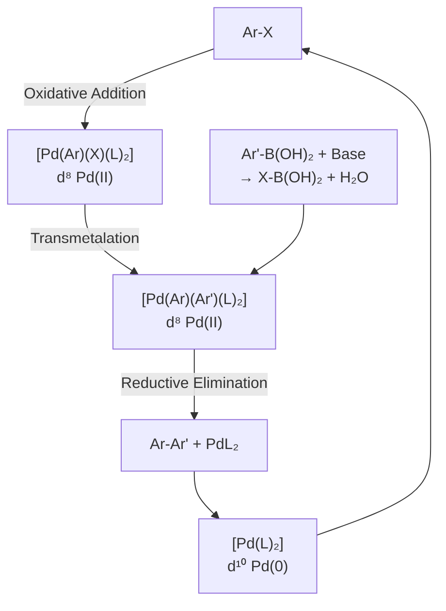

# Lesson 5: Organometallic Chemistry, Reaction Mechanisms, Catalysis

## 1. First-Principles Intuition & Invariants

Organometallic chemistry occupies a unique intersection between organic molecular frameworks and transition metal coordination complexes, creating a domain where the electronic structure of d-orbital manifolds governs the formation and cleavage of carbon-metal bonds. The field emerged from Zeise's salt (K[PtCl₃(C₂H₄)]·H₂O) in 1827, but the mechanistic understanding of how transition metals activate C-H, C-C, and C-X bonds through reversible coordination remained opaque until the mid-twentieth century, when Fischer, Wilkinson, and Ziegler elucidated the role of metal-centered electron counting and orbital symmetry matching in stabilizing reactive intermediates.

At the foundation of organometallic reactivity lies the 18-electron rule, a quantum mechanical constraint analogous to the octet rule in main-group chemistry but adapted for the expanded valence shell of transition metals. A metal center with 18 valence electrons achieves a closed-shell configuration resembling the nearest noble gas, filling the outermost ns, (n-1)d, and np orbitals. For a generic d-block metal in oxidation state M with z d-electrons, the total electron count $N_e$ sums the metal's valence electrons, electrons donated by ligands, and any ionic charge correction:

$$N_e = z + 2n_{\sigma} + 2n_{\pi} - q$$

where $n_{\sigma}$ counts sigma-donating ligands (each contributing 2 electrons), $n_{\pi}$ counts pi-accepting ligands (which remove electron density but stabilize through backbonding), and $q$ represents the formal oxidation state charge. Coordinatively saturated 18-electron complexes exhibit kinetic inertness because HOMO-LUMO gaps widen sufficiently to suppress ligand substitution. Conversely, 16-electron species possess accessible vacant orbitals that enable associative substitution pathways, oxidative addition, and substrate activation—properties exploited systematically in homogeneous catalysis.

The electronic structure of metal-ligand bonds transcends simple Lewis acid-base dative bonding. Transition metals engage in synergistic sigma-donation and pi-backbonding interactions, a phenomenon first articulated in the Dewar-Chatt-Duncanson model for metal-olefin complexes. When an alkene coordinates to a metal center, the filled π bonding orbital of the C=C double bond donates electron density into an empty metal d-orbital (or hybrid orbital with significant d-character), forming a sigma-type donor interaction. Simultaneously, filled metal d-orbitals with appropriate symmetry overlap with the empty π* antibonding orbital of the alkene, transferring electron density back into the ligand framework. This pi-backbonding weakens the C=C bond (observable via IR spectroscopy as a red-shift in the C=C stretch) while strengthening the metal-ligand interaction through covalent character.

Carbon monoxide serves as the prototypical pi-acceptor ligand. The CO molecule possesses a filled σ bonding orbital localized on carbon and a pair of degenerate π* antibonding orbitals perpendicular to the molecular axis. Upon coordination, the carbon lone pair donates into a vacant metal orbital (sigma-donation), while filled metal $d_{xz}$ and $d_{yz}$ orbitals backbond into the π* manifold. Strong backbonding lowers the C-O stretching frequency from 2143 cm⁻¹ in free CO to as low as 1850 cm⁻¹ in electron-rich metal carbonyls, a diagnostic signature measured via transmission FTIR spectroscopy in dichloromethane or hexane solution cells.

Phosphine ligands (PR₃) exhibit tunable electronic properties through substituent variation. Electron-donating alkyl groups (e.g., PMe₃, PCy₃) enhance sigma-donation, stabilizing metals in low oxidation states and increasing electron density at the metal center. Electron-withdrawing aryl or fluorinated substituents (e.g., P(C₆F₅)₃) reduce sigma-donation while maintaining pi-accepting capability through low-lying phosphorus d-orbitals, a property quantified by Tolman's electronic parameter $\chi$ (derived from CO stretching frequencies in Ni(CO)₃(PR₃) complexes). Bulky phosphines like P(t-Bu)₃ impose steric congestion, measured by Tolman's cone angle $\theta$, which influences coordination number and selectivity in catalytic intermediates.

The mechanistic lexicon of organometallic transformations revolves around four fundamental reaction classes: oxidative addition, reductive elimination, migratory insertion, and beta-hydride elimination. These elementary steps interconvert coordination geometries, oxidation states, and ligand connectivities in predictable patterns governed by orbital symmetry and electron-counting constraints.

Oxidative addition constitutes the microscopic reverse of reductive elimination. A coordinatively unsaturated metal complex inserts into a σ bond (commonly C-H, C-X, or H-H), increasing the metal's formal oxidation state by two units and the coordination number by two ligands. For a square planar d⁸ 16-electron complex such as [Rh(Cl)(PPh₃)₃], oxidative addition of H₂ generates an octahedral d⁶ 18-electron dihydride [Rh(H)₂(Cl)(PPh₃)₃]. The reaction proceeds via a three-center transition state where the substrate σ bond polarizes and the metal's filled d-orbital donates into the σ* antibonding orbital while accepting electron density from the σ bonding orbital. Electron-rich metals with high-lying d-orbitals facilitate oxidative addition, whereas electron-poor metals resist this transformation due to insufficient orbital overlap.

Reductive elimination represents the microscopic reverse, where two ligands couple on the metal center to form a new σ bond, reducing the oxidation state by two units and regenerating a coordinatively unsaturated species. In catalytic cycles, reductive elimination typically constitutes the product-releasing turnover step. The reaction demands that the two coupling ligands adopt mutually cis coordination sites, as trans geometries preclude the necessary orbital overlap for bond formation. Sterically bulky ancillary ligands accelerate reductive elimination by destabilizing crowded octahedral or square planar geometries, driving the equilibrium toward the lower-coordinate product.

Migratory insertion involves the formal migration of a ligand (typically a hydride, alkyl, or aryl group) from the metal into the π system of a coordinated unsaturate such as CO, alkene, or alkyne. In practice, the unsaturate migrates into the M-R bond, but the operational terminology persists. For CO insertion, an alkyl ligand R migrates into a cis-coordinated carbonyl, generating an acyl intermediate M-C(O)R. The reaction proceeds through a four-center transition state where the R group shifts onto the carbon atom while the CO π* orbital accepts electron density from the metal. This transformation underpins hydroformylation catalysis, where alkenes convert to aldehydes through sequential migratory insertion and hydrogenolysis.

Beta-hydride elimination serves as the chain-termination pathway in many catalytic processes, particularly polymerization and alkene isomerization. A metal-bound alkyl chain with a hydrogen atom on the β-carbon (the carbon adjacent to the metal-bound carbon) undergoes concerted elimination, transferring the β-H to the metal and generating a coordinated alkene. The reaction requires that the β-C-H bond align coplanar with the empty metal d-orbital, a geometric constraint satisfied in square planar and octahedral geometries with vacant coordination sites. Catalysts designed to suppress β-hydride elimination (e.g., early transition metals with no accessible β-hydrogens or sterically encumbered ligand environments) achieve high-molecular-weight polymer synthesis.

Cross-coupling reactions represent the synthetic zenith of organometallic catalysis, enabling the formation of C-C, C-N, and C-O bonds under mild conditions with exquisite functional group tolerance. The Suzuki-Miyaura coupling typifies the operational logic: an aryl or vinyl halide (R-X) couples with an organoboron reagent (R'-B(OH)₂ or R'-BF₃K) in the presence of a palladium catalyst and base. The catalytic cycle initiates with oxidative addition of R-X to a Pd(0) species (typically generated in situ from Pd(OAc)₂ and a phosphine ligand), forming a Pd(II) intermediate [Pd(R)(X)(L)₂]. The base (commonly K₃PO₄, Cs₂CO₃, or KF) activates the boronic acid, generating a nucleophilic boronate [R'-B(OH)₃]⁻ that transmetalates with the palladium center, displacing the halide and installing R' trans to R. Reductive elimination from the resulting [Pd(R)(R')(L)₂] complex forges the new C-C bond, regenerating Pd(0) and releasing the coupled product R-R'.

The Heck reaction couples aryl or vinyl halides with alkenes, generating substituted olefins through a mechanistically distinct pathway. Oxidative addition of R-X to Pd(0) generates [Pd(R)(X)(L)₂], which then coordinates the alkene substrate in a vacant cis site. Migratory insertion transfers the aryl group onto the alkene β-carbon, forming a σ-alkyl intermediate with the Pd center at the terminal position. Beta-hydride elimination regenerates the Pd(II)-hydride complex and releases the substituted alkene. Base-mediated deprotonation and halide ligand exchange regenerate Pd(0), closing the catalytic cycle. Regioselectivity follows Markovnikov's rule when electron-withdrawing groups (esters, nitriles) on the alkene stabilize the β-carbon radical character in the migratory insertion transition state.

Homogeneous catalysis operates in the same phase as the reactants, typically in solution where molecular diffusion ensures intimate contact between catalyst and substrate. Soluble transition metal complexes with well-defined structures enable mechanistic interrogation through spectroscopic techniques (NMR, UV-Vis, IR) and kinetic analysis. The Wilkinson catalyst [Rh(Cl)(PPh₃)₃] exemplifies homogeneous alkene hydrogenation: the square planar Rh(I) complex dissociates one triphenylphosphine ligand under H₂ atmosphere, creating a vacant coordination site for oxidative addition of H₂. The resulting Rh(III) dihydride coordinates the alkene, undergoes migratory insertion to form an alkyl-hydride intermediate, and releases the saturated alkane via reductive elimination, regenerating the active Rh(I) catalyst. Turnover frequencies reach 10³-10⁴ h⁻¹ under mild conditions (1-10 bar H₂, 25-80°C), with exquisite stereoselectivity controlled by chiral phosphine ligands in asymmetric variants.

Heterogeneous catalysis employs solid-phase catalysts (typically metal nanoparticles dispersed on high-surface-area supports like alumina, silica, or activated carbon) that interact with gas- or liquid-phase reactants at surface active sites. The Ziegler-Natta catalyst system revolutionized polyolefin synthesis by enabling controlled ethylene and propylene polymerization at atmospheric pressure and moderate temperature. The classical formulation combines TiCl₄ with Al(C₂H₅)₃ to generate surface-anchored Ti(III) alkyl species on MgCl₂ crystallite facets. Ethylene coordinates to the electrophilic titanium center, inserts into the Ti-C bond through a four-center transition state, and propagates the growing polymer chain. The crystalline support enforces a stereoregular coordination environment, achieving isotactic polypropylene (90-95% isotactic pentad fraction) with melting points exceeding 160°C. Modern metallocene catalysts (Cp₂ZrCl₂/methylaluminoxane) offer improved molecular weight control and comonomer incorporation but operate on analogous coordination-insertion principles.

The dichotomy between homogeneous and heterogeneous catalysis trades off activity, selectivity, and practical separability. Homogeneous catalysts achieve unparalleled turnover frequencies and enantioselectivities through precise ligand engineering but demand costly product separation and catalyst recovery. Heterogeneous catalysts enable continuous flow reactors and simple filtration-based separation but suffer from ill-defined active sites, mass-transfer limitations, and sintering-induced deactivation. Hybrid approaches—such as anchoring molecular catalysts to solid supports or employing metal-organic frameworks (MOFs) as porous scaffolds—attempt to unify the advantages while mitigating the limitations.

## 2. Core Architecture & Mechanics

The mechanistic architecture of organometallic catalysis operates as a closed-loop state machine, where the metal center cycles through discrete oxidation states and coordination geometries while mediating substrate transformations. Each elementary step corresponds to a quantum-mechanically allowed orbital interaction, constrained by symmetry selection rules and electron-counting invariants. Understanding the geometric and electronic structure of intermediates enables rational catalyst design, where ligand modifications tune reaction barriers and selectivity.

### Electron Counting and Coordination Geometry

The 18-electron rule predicts coordination preferences through orbital occupancy analysis. For octahedral d⁶ complexes like [Cr(CO)₆] or [Fe(CO)₅(L)], the six ligands donate 12 electrons, supplementing the metal's six d-electrons to achieve 18-electron saturation. Removal of one CO ligand generates a 16-electron species with a vacant coordination site, activating the complex toward ligand substitution or substrate coordination. The activation energy for ligand dissociation correlates with the metal-ligand bond strength, measurable through variable-temperature NMR coalescence experiments or UV-photolysis quantum yield measurements.

Square planar d⁸ complexes such as [Pt(Cl)₂(NH₃)₂] (cisplatin) and [Rh(Cl)(PPh₃)₃] (Wilkinson's catalyst) possess 16 electrons due to the absence of axial ligands. The vacant z-axis coordination sites enable trans-effect-driven substitution, where strong σ-donor ligands (hydride, alkyl, CO) weaken the trans M-L bond through competition for metal d-orbital electron density. In Pt(II) anticancer complexes, chloride substitution by water or DNA nucleobases exploits this trans-labilization to achieve selective biomolecular targeting.

Tetrahedral d¹⁰ complexes like [Ni(CO)₄] and [Zn(CH₃)₄]²⁻ achieve 18-electron saturation through four two-electron donor ligands. The absence of ligand field splitting (due to the non-centrosymmetric geometry) renders these complexes highly labile, undergoing rapid ligand exchange on the NMR timescale. Nickel tetracarbonyl serves as a key intermediate in the Mond process for nickel purification, where volatile Ni(CO)₄ forms at 50-80°C and decomposes at 200-250°C to deposit high-purity metallic nickel.

### Oxidative Addition: Orbital Interaction Diagram

Oxidative addition of a substrate H-X to a square planar d⁸ M(I) complex proceeds through a three-center, two-electron transition state. The metal's filled d$_{z^2}$ orbital (or an appropriate d-hybrid) donates electron density into the σ* antibonding orbital of H-X, weakening the substrate bond. Simultaneously, the H-X σ bonding orbital donates into a vacant metal p-orbital or hybrid orbital, forming nascent M-H and M-X bonds.

```
          H-X substrate
          σ    σ*
           \  /
            \/
            /\
           /  \
    M(dz²) ← → M(p or hybrid)
    filled      vacant

Transition State:
         H···X
          \ /
           M
         /   \
        L     L

Product (octahedral d⁶ M(III)):
         H
         |
         M—X
        / \
       L   L
```

The reaction's feasibility depends on the oxidation potential of the metal center (measured via cyclic voltammetry) and the bond dissociation energy of H-X (tabulated from gas-phase thermochemistry or electrochemical reduction potentials). Electron-rich metals with low M(I)/M(III) reduction potentials (e.g., Rh(I), Ir(I), Pd(0)) readily undergo oxidative addition, whereas electron-poor metals (e.g., Pt(II)) resist oxidation. The substrate's leaving group ability governs kinetics: aryl iodides react faster than bromides, which exceed chlorides, following the bond strength trend I-C < Br-C < Cl-C.

Experimental execution of oxidative addition kinetics employs stopped-flow UV-Vis spectroscopy to monitor metal complex concentration in real time. For the reaction [Rh(Cl)(PPh₃)₃] + H₂ → [Rh(H)₂(Cl)(PPh₃)₃], prepare a 1 mM solution of Wilkinson's catalyst in degassed toluene under argon. Transfer the solution to the stopped-flow syringe, and inject H₂-saturated toluene (prepared by bubbling H₂ through solvent for 30 minutes) through the second syringe. Monitor the absorbance at λ = 380 nm (d-d transition) as a function of time, fitting the exponential decay to pseudo-first-order kinetics when [H₂] >> [Rh]. The observed rate constant $k_{obs}$ scales linearly with [H₂], yielding the second-order rate constant $k_2 = k_{obs}/[H_2]$. Arrhenius analysis across the temperature range 15-45°C extracts the activation energy $E_a$ and pre-exponential factor $A$ through linear regression of $\ln(k_2)$ vs. $1/T$.

### Reductive Elimination: Geometric Constraints

Reductive elimination from an octahedral d⁶ M(III) complex to form a new C-C bond requires that the two coupling ligands occupy mutually cis coordination sites. Trans-disposed ligands cannot overlap orbitally to form a direct bond, necessitating an isomerization pre-equilibrium (Berry pseudorotation or Bailar twist) to bring the ligands into proximity. The activation energy for reductive elimination correlates inversely with the steric bulk of ancillary ligands: bulky phosphines destabilize the octahedral geometry, lowering the barrier to the four-coordinate product.

For the complex [Pd(CH₃)₂(PPh₃)₂], ethane elimination proceeds via a T-shaped transition state where the two methyl groups approach each other while the metal center slips toward a Pd(0) coordination geometry:

```
Initial (square planar):
     CH₃
      |
  Ph₃P—Pd—CH₃
      |
     PPh₃

Transition State (T-shaped):
     CH₃···CH₃
         |
      Pd (Pd⁰)
      /  \
   PPh₃  PPh₃

Product:
   C₂H₆ (g) + [Pd(PPh₃)₂] (14e⁻)
```

Kinetic measurements via thermolysis NMR spectroscopy track the disappearance of the dimethyl complex and appearance of ethane and the Pd(0) species. Seal a J-Young NMR tube with 10 mM [Pd(CH₃)₂(dppe)] (dppe = 1,2-bis(diphenylphosphino)ethane) in d₈-toluene under argon. Acquire ¹H NMR spectra at 10-minute intervals while maintaining the probe temperature at 60°C. Integrate the Pd-CH₃ resonance (δ ≈ 0.5 ppm) and the ethane peak (δ = 0.85 ppm), fitting the decay/growth profiles to first-order kinetics. The rate constant $k$ scales with temperature according to the Eyring equation:

$$k = \frac{k_B T}{h} \exp\left(-\frac{\Delta G^\ddagger}{RT}\right)$$

where $\Delta G^\ddagger = \Delta H^\ddagger - T\Delta S^\ddagger$ represents the free energy of activation. Eyring analysis (plotting $\ln(k/T)$ vs. $1/T$) separates enthalpic and entropic contributions, revealing whether the transition state is associative (negative $\Delta S^\ddagger$) or dissociative (positive $\Delta S^\ddagger$).

### Suzuki-Miyaura Coupling: Full Catalytic Cycle Workflow

The Suzuki-Miyaura coupling synthesizes biaryl compounds through palladium-catalyzed cross-coupling of aryl halides with arylboronic acids. The catalytic cycle integrates oxidative addition, transmetalation, and reductive elimination, with turnover frequencies reaching 10²-10³ h⁻¹ under optimized conditions.



**Laboratory Protocol for Suzuki Coupling (1 mmol scale):**

1. **Reagent Preparation:** Weigh 1.0 mmol aryl bromide (e.g., 4-bromoacetophenone, 199 mg), 1.2 mmol arylboronic acid (e.g., phenylboronic acid, 146 mg), 2.0 mmol base (K₃PO₄, 424 mg), and 2 mol% catalyst precursor (Pd(OAc)₂, 4.5 mg). Add 4 mol% ligand (SPhos: 2-dicyclohexylphosphino-2',6'-dimethoxybiphenyl, 16.4 mg) if using a monodentate phosphine system.

2. **Reaction Setup:** Transfer solids to a 25 mL two-neck round-bottom flask equipped with a magnetic stir bar and rubber septum. Evacuate and backfill with argon three times using a Schlenk line. Inject 10 mL degassed solvent mixture (toluene/EtOH 9:1 v/v) via syringe through the septum.

3. **Thermal Activation:** Immerse the flask in an 80°C oil bath and stir at 400 rpm. Monitor reaction progress via TLC (hexane/EtOAc 4:1 eluent, UV visualization at 254 nm) at 30-minute intervals. Complete conversion typically occurs within 2-6 hours.

4. **Workup and Isolation:** Cool the reaction mixture to room temperature. Dilute with 20 mL diethyl ether and filter through a short silica plug to remove palladium black and inorganic salts. Wash the plug with an additional 30 mL ether. Concentrate the filtrate under reduced pressure (rotary evaporator, 40°C, 100 mbar). Purify the crude product via flash chromatography (SiO₂, hexane → hexane/EtOAc gradient).

5. **Characterization:** Confirm structure via ¹H and ¹³C{¹H} NMR spectroscopy in CDCl₃, high-resolution mass spectrometry (ESI or APCI), and IR spectroscopy (KBr pellet or ATR). Expect diagnostic biaryl C-C stretch near 1480 cm⁻¹ and aromatic C-H out-of-plane bending modes at 700-900 cm⁻¹.

Mechanistic probes include kinetic isotope effect measurements (replacing Ar-Br with Ar-I to assess the rate-determining step), Hammett analysis (correlating electron-donating/withdrawing substituents on the aryl halide with log(k_rel)), and ³¹P{¹H} NMR monitoring to detect phosphine coordination/dissociation equilibria. An inverse isotope effect (k_H/k_D < 1) in the transmetalation step suggests a pre-equilibrium boronate formation, whereas a normal isotope effect (k_H/k_D > 1) in reductive elimination indicates C-H/C-D bond formation in the transition state.

### Hydrogenation Catalysis: Wilkinson's Catalyst Mechanism

The Wilkinson catalyst [Rh(Cl)(PPh₃)₃] hydrogenates terminal and internal alkenes under mild conditions with high chemoselectivity, leaving carbonyl, ester, and nitrile groups intact. The mechanism proceeds through a five-step cycle: phosphine dissociation, oxidative addition of H₂, alkene coordination, migratory insertion, and reductive elimination.

```
Mechanistic Steps:

[Rh(Cl)(PPh₃)₃]  ⇌  [Rh(Cl)(PPh₃)₂] + PPh₃
     (1)                    (2)

[Rh(Cl)(PPh₃)₂] + H₂  →  [Rh(H)₂(Cl)(PPh₃)₂]
     (2)                         (3)

[Rh(H)₂(Cl)(PPh₃)₂] + C₂H₄  →  [Rh(H)₂(Cl)(PPh₃)₂(C₂H₄)]
     (3)                              (4)

[Rh(H)₂(Cl)(PPh₃)₂(C₂H₄)]  →  [Rh(H)(Cl)(C₂H₅)(PPh₃)₂]
     (4)                              (5)

[Rh(H)(Cl)(C₂H₅)(PPh₃)₂]  →  C₂H₆ + [Rh(Cl)(PPh₃)₂]
     (5)                              (2)
```

**High-Pressure Hydrogenation Protocol:**

1. **Catalyst Activation:** Dissolve 50 mg Wilkinson's catalyst in 50 mL benzene in a 100 mL Parr autoclave under inert atmosphere. Seal the reactor and purge with H₂ (3 × 10 bar pressure cycles) to displace argon.

2. **Substrate Introduction:** Inject 10 mmol alkene substrate (e.g., 1-octene, 1.12 g) via a PTFE injection port using a gas-tight syringe. Ensure complete mixing with magnetic stirring at 600 rpm.

3. **Pressurization and Reaction:** Pressurize the reactor to 5 bar H₂ using a precision regulator. Monitor pressure decay with a digital manometer; hydrogen uptake correlates directly with substrate conversion. For a 10 mmol substrate charge, expect a pressure drop of ~0.25 bar per mmol H₂ consumed in a 100 mL headspace.

4. **Kinetic Monitoring:** Record pressure as a function of time at 1-minute intervals. The pseudo-zero-order kinetics (constant rate) during the initial phase confirms saturating substrate and H₂ concentrations. Deviation to first-order kinetics signals substrate depletion.

5. **Product Analysis:** After complete H₂ uptake (typically 1-4 hours at 25°C), vent the reactor slowly in a fume hood. Transfer the solution to a separatory funnel, wash with water (2 × 20 mL) to remove residual catalyst, dry over MgSO₄, and analyze via GC-MS (30 m HP-5 column, 60°C → 250°C at 10°C/min). Quantify conversion via internal standard calibration (dodecane).

Stereochemical outcomes can be probed using deuterium-labeled substrates. For example, hydrogenation of (E)-2-butene-d₄ with Wilkinson's catalyst proceeds with syn-addition of H₂ across the double bond, generating meso-2,3-dideuteriobutane. This stereochemical fidelity arises from the cis coordination geometry of the hydride and alkyl ligands in intermediate (5), which enforces coplanar alignment during reductive elimination.

### Ziegler-Natta Polymerization: Heterogeneous Active Site Structure

The classical Ziegler-Natta catalyst for propylene polymerization consists of TiCl₄ deposited on MgCl₂ microcrystals, activated with Al(C₂H₅)₃ as a cocatalyst and external donor molecules (esters or ethers) to control stereoselectivity. The active site resides at coordinatively unsaturated Ti(III) centers on the (110) lateral facets of MgCl₂ crystallites, where chloride vacancies create Lewis-acidic coordination pockets.

```
Active Site Geometry (simplified):

      Cl      Cl
       \     /
        Ti(III)—alkyl
       /     \
   MgCl₂  (support)

Propylene Insertion:

      Cl      Cl
       \     /
        Ti—CH₂CH(CH₃)-polymer
       /     \
   MgCl₂

   + CH₂=CH-CH₃
       ↓
      Cl      Cl
       \     /
        Ti—CH₂CH(CH₃)CH₂CH(CH₃)-polymer
       /     \
   MgCl₂
```

The regioselectivity (1,2- vs. 2,1-insertion) and stereoselectivity (isotactic vs. syndiotactic) depend on the chiral environment imposed by the crystallographic facets and the external donor. Electron-donating ethers (e.g., 2,2-diisobutyl-1,3-dimethoxypropane) coordinate to Ti(III) opposite the growing chain, sterically directing incoming propylene to adopt a specific enantioface orientation. Isotactic polypropylene results when successive propylene insertions occur with the same enantioface selectivity, generating a helical polymer backbone with all methyl substituents on the same side.

**Laboratory-Scale Ziegler-Natta Polymerization:**

1. **Catalyst Preparation:** Suspend 1.0 g high-surface-area MgCl₂ (pre-activated by ball-milling with TiCl₄ in an inert-atmosphere glovebox) in 50 mL anhydrous heptane in a 250 mL Schlenk flask. Add 0.5 mL TiCl₄ dropwise via syringe with vigorous stirring. Heat to 80°C under argon for 2 hours to graft Ti species onto the MgCl₂ surface. Cool to room temperature and wash with heptane (3 × 30 mL) to remove excess TiCl₄.

2. **Cocatalyst Addition:** Transfer the catalyst slurry to a 1 L Büchi glass autoclave equipped with an overhead mechanical stirrer. Inject 1.0 M Al(C₂H₅)₃ in heptane (10 mL, 10 mmol Al) via a gastight syringe. The solution turns dark gray as Ti(IV) reduces to Ti(III).

3. **Propylene Polymerization:** Pressurize the reactor with propylene gas to 5 bar at 60°C. Maintain constant pressure by feeding propylene from a reservoir cylinder through a mass-flow controller. Monitor propylene consumption via the mass-flow controller totalizer. Polymerization rates of 5-20 kg polymer per gram Ti per hour are typical for optimized catalysts.

4. **Quenching and Isolation:** After the desired polymerization time (30-120 minutes), vent propylene and quench the reaction by injecting 10 mL acidified methanol (1% HCl in MeOH) to deactivate the catalyst. Filter the polymer slurry through a sintered glass funnel, wash with methanol (3 × 100 mL) and acetone (2 × 50 mL), and dry under vacuum at 60°C overnight.

5. **Microstructure Characterization:** Dissolve 10 mg polymer in 0.6 mL 1,2,4-trichlorobenzene-d₃ at 120°C and acquire ¹³C{¹H} NMR spectra at 125 MHz (probe temperature 120°C). The methyl region (δ 19-23 ppm) exhibits pentad splitting patterns diagnostic of stereosequence distribution. Deconvolute the multiplet using published chemical shift assignments to quantify isotactic pentad ([mmmm]), atactic ([mmmr], [mmrr], [mrrm]), and syndiotactic ([rrrr]) fractions.

Gel permeation chromatography (GPC) in 1,2,4-trichlorobenzene at 145°C measures molecular weight distribution using triple detection (refractive index, viscometry, light scattering). Number-average molecular weight ($M_n$) and weight-average molecular weight ($M_w$) quantify chain length, while the polydispersity index ($M_w/M_n$) indicates the breadth of the distribution. Narrow distributions (PDI < 2.5) suggest single-site catalyst behavior, whereas broad distributions (PDI > 5) reflect multiple active site populations with differing propagation rates.

## 3. High-Performance Optimization & Failure Modes

Organometallic catalysis operates at the intersection of thermodynamic favorability and kinetic accessibility, where catalyst efficiency depends on minimizing competing side reactions, maximizing turnover frequency, and ensuring long-term stability under operating conditions. Optimization strategies balance electronic tuning (modifying ligand donor/acceptor strength), steric engineering (controlling coordination geometry and substrate approach trajectories), and solvent/additive selection to suppress deactivation pathways.

### Ligand Electronic Parameter Optimization

The Tolman electronic parameter $\nu$ quantifies phosphine ligand donicity through the C-O stretching frequency in Ni(CO)₃(PR₃) complexes, measured via FTIR spectroscopy in cyclohexane solution. Electron-rich phosphines (low $\nu$ values, e.g., PCy₃ at 2056 cm⁻¹) increase metal electron density, facilitating oxidative addition but retarding reductive elimination due to stronger M-C bond strengths. Electron-poor phosphines (high $\nu$ values, e.g., P(OPh)₃ at 2085 cm⁻¹) accelerate reductive elimination but slow oxidative addition.

For the Suzuki coupling, optimal ligand selection depends on the aryl halide reactivity. Electron-deficient, activated halides (e.g., 4-nitrochlorobenzene) couple efficiently with weakly donating phosphines like P(o-tolyl)₃, whereas electron-rich, deactivated halides (e.g., 4-methoxybromobenzene) require strongly donating alkyl phosphines like P(t-Bu)₃ or chelating diphosphines like dppf (1,1'-bis(diphenylphosphino)ferrocene). Screening ligand libraries (commercially available assortments containing 12-24 structurally diverse phosphines) enables rapid identification of optimal electronic properties through parallel microscale reactions in 96-well plates.

**Rapid Ligand Screening Protocol:**

1. **Stock Solution Preparation:** Prepare 0.01 M solutions of Pd(OAc)₂ in degassed THF and 0.04 M solutions of each ligand in THF (to achieve a 4:1 ligand-to-Pd ratio). Store under argon in septum-sealed vials.

2. **Reaction Setup:** Using a calibrated pipette or liquid handler, dispense 50 μL Pd stock (0.5 μmol Pd), 50 μL ligand stock (2.0 μmol ligand), 100 μL aryl halide solution (0.1 M in THF, 10 μmol), 120 μL boronic acid solution (0.1 M in EtOH, 12 μmol), and 100 μL base solution (K₃PO₄, 0.2 M in H₂O, 20 μmol) into each well of a glass-lined 96-well plate.

3. **Heating and Sampling:** Seal the plate with a silicone mat and heat at 80°C in a thermostated aluminum block reactor for 4 hours. Cool to room temperature, dilute each well with 1 mL EtOAc containing internal standard (biphenyl, 50 μg/mL), and filter through a 0.45 μm PTFE membrane into HPLC vials.

4. **Analytical Quantification:** Inject 10 μL samples into an HPLC system equipped with a C18 reverse-phase column (150 mm × 4.6 mm, 5 μm particle size) and UV detector (λ = 254 nm). Elute with MeCN/H₂O 70:30 at 1 mL/min. Quantify product yield by integrating the biaryl peak relative to the internal standard, using calibration curves prepared from authentic standards.

This high-throughput workflow identifies lead ligands within 24 hours, accelerating catalyst development cycles from months to weeks. Hit ligands advance to gram-scale validation and mechanistic characterization.

### Steric Parameter Tuning: Cone Angle and Buried Volume

Tolman's cone angle $\theta$ measures the three-dimensional space occupied by a ligand, defined as the apex angle of a cone centered on the metal and encompassing the van der Waals radii of the outermost ligand atoms at a fixed M-P distance (2.28 Å). Small-bite-angle ligands (e.g., PMe₃, $\theta$ = 118°) allow high coordination numbers and stabilize octahedral geometries, whereas bulky ligands (e.g., P(t-Bu)₃, $\theta$ = 182°) enforce low coordination numbers and accelerate reductive elimination by destabilizing crowded intermediates.

The percent buried volume (%V_bur) provides a more accurate steric descriptor for unsymmetrical ligands, calculated from crystallographic coordinates or DFT-optimized structures using the SambVca web tool. The parameter quantifies the fraction of a 3.5 Å radius sphere centered on the metal that is occupied by ligand atoms. High %V_bur values (>40%) correlate with enhanced reductive elimination rates and suppression of β-hydride elimination, enabling selective C-C bond formation over alkene isomerization.

For Buchwald-Hartwig amination (Pd-catalyzed coupling of aryl halides with amines), bulky dialkylbiaryl phosphines like XPhos (2-dicyclohexylphosphino-2',4',6'-triisopropylbiphenyl) achieve turnover numbers exceeding 10⁴ due to accelerated reductive elimination from sterically congested [Pd(Ar)(NR₂)(XPhos)] intermediates. The biaryl backbone adopts a nonplanar conformation, creating a chiral pocket that also enhances enantioselectivity in asymmetric variants.

### Solvent and Additive Effects

Solvent polarity influences catalyst speciation, substrate solubility, and ionic intermediate stability. Nonpolar solvents (toluene, hexane) favor neutral coordination complexes and suppress ligand dissociation, whereas polar aprotic solvents (DMF, DMA, NMP) stabilize ionic intermediates such as [Pd(Ar)(solvent)L]⁺ cations formed via halide dissociation. Protic solvents (MeOH, water) enable protodepalladation side reactions, where Pd-C bonds undergo protonolysis instead of productive reductive elimination.

For Suzuki couplings, aqueous cosolvent (water/dioxane or water/THF mixtures) accelerates transmetalation by facilitating boronate formation [R'-B(OH)₃]⁻ through base-mediated hydrolysis of boronic acid. The optimal water content depends on substrate hydrophobicity: lipophilic substrates require low water content (5-10 vol%) to maintain solubility, whereas hydrophilic substrates tolerate higher water fractions (30-50 vol%).

Phase-transfer catalysts (quaternary ammonium salts like tetrabutylammonium bromide) shuttle ionic reagents between aqueous and organic phases, enabling reactions in biphasic solvent systems. For Heck couplings, the addition of 10 mol% Bu₄NBr increases reaction rates by solubilizing the base and facilitating halide/acetate exchange at the palladium center.

### Catalyst Deactivation Pathways

Transition metal catalysts deactivate through multiple competing mechanisms: irreversible reduction to metallic nanoparticles (palladium black), ligand oxidation or decomposition, formation of catalytically inactive dimers or oligomers, and poisoning by impurities (oxygen, peroxides, sulfur compounds). Understanding these failure modes enables rational design of stabilization strategies.

Palladium black formation arises from reductive elimination without subsequent reoxidation, generating Pd(0) species that aggregate into colloids. The process accelerates at high temperatures (>120°C) and in the presence of reducing agents (hydrides, boranes). Mitigating strategies include operating at lower temperatures, using excess ligand to stabilize monomeric Pd(0) species, and employing oxidative additives (benzoquinone, oxygen) to regenerate Pd(II).

Ligand oxidation affects phosphines with air-sensitive P(III) centers, which oxidize to phosphine oxides (R₃P=O) upon exposure to oxygen or peroxides. Phosphine oxides bind weakly to metals and do not support catalysis, effectively sequestering active metal. Preventive measures include rigorous degassing (freeze-pump-thaw cycles), storage under inert atmosphere, and use of oxidation-resistant ligands (N-heterocyclic carbenes, chelating amines).

Dimer formation through bridging ligands (e.g., μ-halide or μ-hydride bridges) creates coordinatively saturated, inactive species. For example, [Rh(Cl)(PPh₃)₃] dimerizes under H₂ atmosphere to form [Rh₂(μ-Cl)₂(H)₂(PPh₃)₄], which exhibits negligible hydrogenation activity. Preventing dimerization requires maintaining high ligand-to-metal ratios and employing chelating ligands that occupy multiple coordination sites, sterically precluding bridging geometries.

Impurity poisoning affects catalyst performance at ppm levels. Oxygen reversibly binds to low-valent metals, forming peroxo or superoxo complexes that oxidize substrates or ligands. Sulfur-containing impurities (thiophene, thiols) irreversibly bind to metals through soft Lewis acid-base interactions, blocking coordination sites. Deoxygenation via freeze-pump-thaw degassing (three cycles minimum) and sulfur removal via activated alumina column chromatography ensure impurity levels below detection thresholds (< 1 ppm).

### Enantioselective Catalysis: Chiral Ligand Engineering

Asymmetric hydrogenation employs chiral phosphine ligands to generate enantioenriched products through diastereoselective migratory insertion. The Rh(I) complex [Rh(COD)(R,R)-DiPAMP]⁺ (COD = 1,5-cyclooctadiene; DiPAMP = 1,2-bis[(o-methoxyphenyl)phenylphosphino]ethane) achieves >95% enantiomeric excess in the hydrogenation of α-acetamidocinnamic acid (a precursor to L-DOPA). The chiral pocket created by the DiPAMP ligand enforces a specific binding mode for the prochiral substrate, directing H₂ addition to the re or si face with high fidelity.

Mechanistic investigations via X-ray crystallography and 2D NMR spectroscopy (NOESY, ROESY) reveal that substrate binding occurs through a bidentate coordination mode, where both the alkene and the acetamido carbonyl oxygen coordinate to Rh(I). This dual coordination locks the substrate into a rigid geometry, amplifying the chiral discrimination imposed by the ligand backbone. Quantitative structure-selectivity relationships correlate ligand bite angle (P-Rh-P angle) with enantiomeric excess, with optimal angles near 85-95° balancing steric encumbrance and electronic activation.

**Asymmetric Hydrogenation: Experimental Protocol**

1. **Catalyst Synthesis:** In a glovebox, dissolve 100 mg [Rh(COD)₂]BF₄ (0.25 mmol) and 200 mg (R,R)-DiPAMP (0.27 mmol) in 10 mL degassed dichloromethane. Stir for 30 minutes to form the orange [Rh(COD)(DiPAMP)]BF₄ complex. Precipitate with 30 mL diethyl ether, filter, wash with ether, and dry under vacuum.

2. **Hydrogenation Reaction:** Dissolve 500 mg substrate (α-acetamidocinnamic acid, 2.0 mmol) in 20 mL degassed MeOH in a 100 mL Parr reactor. Add 5 mg catalyst (S/C = 400:1). Seal, purge with H₂ (3 cycles), and pressurize to 3 bar H₂ at 25°C. Stir at 600 rpm for 12 hours.

3. **Enantiomeric Excess Determination:** Evaporate solvent, dissolve the residue in 1 mL MeOH, and inject 10 μL into a chiral HPLC system equipped with a Chiralpak AD-H column (250 mm × 4.6 mm). Elute with hexane/IPA 85:15 + 0.1% TFA at 1 mL/min, detecting at λ = 254 nm. Integrate the enantiomer peaks and calculate ee = (|A_R - A_S|)/(A_R + A_S) × 100%, where A_R and A_S represent the areas of the R and S enantiomers.

Alternative chiral ligands include BINAP (2,2'-bis(diphenylphosphino)-1,1'-binaphthyl) for ruthenium-catalyzed hydrogenation of β-keto esters, DuPhos (1,2-bis(phospholano)benzene) for rhodium-catalyzed hydrogenation of enamides, and Josiphos (ferrocene-based diphosphine) for iridium-catalyzed hydrogenation of imines. Ligand selection follows empirical screening, as subtle structural variations produce unpredictable enantioselectivity changes.

### Computational Catalyst Design: DFT-Guided Optimization

Density functional theory (DFT) calculations predict reaction barriers, intermediates, and transition state geometries, accelerating catalyst development by narrowing the experimental search space. Computational workflows typically employ the B3LYP or ωB97X-D functionals with polarized triple-zeta basis sets (def2-TZVP) and implicit solvation models (SMD, CPCM) to capture solution-phase energetics.

For a generic oxidative addition reaction M + H-X → [M(H)(X)], the computational protocol involves:

1. **Geometry Optimization:** Optimize the reactant (M), substrate (H-X), and product [M(H)(X)] geometries using DFT, verifying that all optimized structures exhibit zero imaginary vibrational frequencies (confirmed via harmonic frequency analysis).

2. **Transition State Search:** Locate the transition state using the synchronous transit-guided quasi-Newton (STQN) method or the nudged elastic band (NEB) approach. The converged TS structure should exhibit exactly one imaginary frequency corresponding to the H-X stretching mode.

3. **Intrinsic Reaction Coordinate (IRC):** Confirm that the TS connects the reactant and product by following the IRC in both forward and reverse directions, verifying that the pathway smoothly descends to the optimized structures.

4. **Thermochemical Corrections:** Compute Gibbs free energies at the reaction temperature by adding zero-point energy, thermal enthalpy, and entropy corrections (from the frequency calculation) to the electronic energy. The activation free energy $\Delta G^\ddagger = G_{\text{TS}} - G_{\text{reactants}}$ predicts the kinetic barrier.

Benchmark studies comparing DFT predictions to experimental kinetics reveal that hybrid functionals (B3LYP, M06-2X) reproduce activation barriers within 2-4 kcal/mol for organometallic reactions, sufficient accuracy to rank catalyst candidates and identify rate-limiting steps. Dispersion-corrected functionals (B97-D3, ωB97X-D) improve accuracy for systems with significant van der Waals interactions, such as bulky phosphine ligands or π-stacking substrates.

Machine learning models trained on DFT datasets enable rapid screening of thousands of virtual catalysts. Descriptor-based models correlate ligand properties (bite angle, electronic parameter, %V_bur) with reaction outcomes (yield, ee) using Gaussian process regression or neural networks. Active learning workflows iteratively refine the model by experimentally validating high-scoring predictions and retraining on augmented datasets, converging to optimal catalyst structures within 3-5 design cycles.

### Scale-Up Considerations: Flow Chemistry and Continuous Processing

Batch organometallic catalysis suffers from mixing limitations, exotherm control challenges, and accumulation of inhibitory byproducts. Flow chemistry addresses these limitations by conducting reactions in continuous microreactors, where high surface-area-to-volume ratios enable efficient heat and mass transfer and steady-state operation eliminates batch-to-batch variability.

For Suzuki couplings, a representative flow setup employs a heated stainless steel capillary reactor (1 mm inner diameter, 10 m length, heated to 100°C) with two syringe pumps delivering substrate/catalyst solution and base solution at controlled flow rates (0.1-1.0 mL/min). The residence time $\tau = V_{\text{reactor}} / Q_{\text{total}}$ determines the extent of reaction, tunable by adjusting flow rates. Residence times of 5-20 minutes achieve complete conversion for activated aryl halides.

Online analytical monitoring via inline UV-Vis or Raman spectroscopy tracks product formation in real time, enabling automated feedback control to optimize conversion and selectivity. Integration with automated valves and back-pressure regulators permits unattended multi-day operation, generating kilogram quantities of product with consistent quality.

Heterogeneous catalysts amenable to packed-bed flow reactors include Pd/C for hydrogenation, polymer-supported phosphine-Pd complexes for cross-coupling, and immobilized enzymes for biocatalytic reductions. The fixed catalyst bed eliminates product contamination by leached metal, simplifying downstream purification and enabling catalyst recycling over hundreds of reactor volumes.

### Sustainability Metrics: Atom Economy and E-Factor

Green chemistry principles prioritize atom-efficient transformations that minimize waste generation and energy consumption. The atom economy quantifies the fraction of reactant mass incorporated into the desired product:

$$\text{Atom Economy} = \frac{M_{\text{product}}}{M_{\text{reactants}}} \times 100\%$$

For the Suzuki coupling Ar-Br + Ar'-B(OH)₂ → Ar-Ar', the atom economy is (M_biaryl) / (M_Ar-Br + M_Ar'-B(OH)₂) × 100%. Byproducts include boronic acid (wasted boron), bromide salts, and water, reducing atom economy to 60-75% depending on molecular weights.

The environmental factor (E-factor) accounts for total waste (solvents, reagents, workup chemicals) per kilogram of product:

$$E\text{-factor} = \frac{\text{mass of waste}}{\text{mass of product}}$$

Pharmaceutical-scale catalytic processes target E-factors below 10, achieved through solvent recycling, aqueous workup, and elimination of chromatographic purification. Water-based Suzuki couplings using surfactants (e.g., TPGS-750-M) enable reactions in neat aqueous media, reducing organic solvent consumption to zero and lowering E-factors to 2-5.

Alternative green metrics include process mass intensity (PMI = total mass input / product mass, targeting PMI < 20 for commercial processes) and cumulative energy demand (CED, quantifying fossil fuel consumption across the entire synthetic route). Life-cycle assessments (LCA) integrate these metrics to compare the environmental impact of alternative catalytic strategies, guiding selection of sustainable methods.
