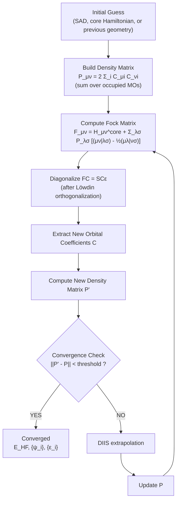

# Lesson 2: Quantum Chemistry

## 1. First-Principles Intuition & Invariants

The story of quantum chemistry begins with a failure. Classical physics, triumphant in its ability to describe planetary orbits and electromagnetic waves, collapsed completely when confronted with the atom. The Rutherford model of a nuclear atom with orbiting electrons was thermodynamically suicidal: an accelerating charge radiates energy, and by classical electrodynamics, every electron should spiral inward and annihilate the nucleus in roughly ten picoseconds. The atom, the bedrock of chemistry, was classically impossible.

Bohr's 1913 quantization postulate was an empirical patch, not a theory. It correctly reproduced the hydrogen spectrum by asserting that angular momentum comes in integer multiples of $\hbar$, but it offered no mechanical justification and failed entirely for multi-electron atoms. The resolution required something more radical: the abandonment of the trajectory as a physical concept, and its replacement by a wavefunction.

### The Wavefunction as the Fundamental Object

In 1926, Erwin Schrödinger synthesized de Broglie's matter-wave hypothesis with Hamilton's formulation of classical mechanics to produce an equation of motion for the wavefunction $\Psi(\mathbf{r}, t)$. The time-dependent Schrödinger equation reads:

$$i\hbar \frac{\partial \Psi}{\partial t} = \hat{H}\Psi$$

where the Hamiltonian operator $\hat{H}$ encodes the total energy of the system. For a single particle of mass $m$ moving in a potential $V(\mathbf{r}, t)$, the Hamiltonian is:

$$\hat{H} = -\frac{\hbar^2}{2m}\nabla^2 + V(\mathbf{r}, t)$$

The term $-\frac{\hbar^2}{2m}\nabla^2$ is the kinetic energy operator, obtained from the classical expression $p^2/2m$ by the canonical substitution $\hat{\mathbf{p}} = -i\hbar\nabla$. The Laplacian $\nabla^2$ measures the spatial curvature of the wavefunction; states with high spatial curvature carry high kinetic energy. This is the quantum mechanical origin of zero-point energy: confining a particle sharpens its wavefunction spatially, necessarily steepening its curvature, and therefore raising its kinetic energy regardless of temperature.

The wavefunction $\Psi$ is not a physical wave in three-dimensional space in the same sense as a water wave. For an $N$-electron system, $\Psi$ lives in a $3N$-dimensional configuration space, and this high-dimensionality is precisely why quantum chemistry is computationally brutal. The physical content of $\Psi$ is encoded in Born's probability interpretation: the probability of finding the particle in a volume element $d^3r$ around position $\mathbf{r}$ at time $t$ is:

$$dP = |\Psi(\mathbf{r}, t)|^2 \, d^3r$$

This demands the normalization condition $\int |\Psi|^2 \, d^3r = 1$ over all space. Any wavefunction violating normalization is physically inadmissible. In practice, the first diagnostic check on any numerically computed wavefunction is to verify that its norm integrates to unity over the computational grid.

### The Time-Independent Equation and Stationary States

When the potential $V$ is time-independent, the Schrödinger equation admits separable solutions of the form $\Psi(\mathbf{r}, t) = \psi(\mathbf{r}) e^{-iEt/\hbar}$. Substituting this ansatz yields the time-independent Schrödinger equation:

$$\hat{H}\psi = E\psi$$

This is an eigenvalue problem. The spatial wavefunction $\psi$ is an eigenfunction of $\hat{H}$, and the scalar $E$ is the corresponding eigenvalue, which carries the dimensions of energy. These eigenstates are stationary in the sense that the probability density $|\psi(\mathbf{r})|^2$ is constant in time. All of chemistry ultimately reduces to solving this equation, or finding controlled approximations to its solution, for systems ranging from the hydrogen atom to enzymes with thousands of electrons.

The set of all normalizable, well-behaved eigenfunctions of a Hermitian Hamiltonian forms a complete orthonormal basis for the Hilbert space $\mathcal{H}$ of the system. Orthonormality means:

$$\langle \psi_m | \psi_n \rangle = \int \psi_m^*(\mathbf{r}) \psi_n(\mathbf{r}) \, d^3r = \delta_{mn}$$

Completeness means that any admissible state can be expressed as a linear superposition $|\Psi\rangle = \sum_n c_n |\psi_n\rangle$, where the coefficients $|c_n|^2$ give the probabilities of measuring energy $E_n$. The Dirac bra-ket notation $\langle \cdot | \cdot \rangle$ is not merely aesthetic convenience; it makes manifest the linear-algebraic structure underlying every quantum measurement.

### Operators, Observables, and the Uncertainty Principle

In quantum mechanics, every measurable physical quantity—position, momentum, energy, angular momentum—corresponds to a Hermitian linear operator acting on the Hilbert space. A Hermitian operator $\hat{A}$ satisfies $\hat{A}^\dagger = \hat{A}$, which guarantees that its eigenvalues are real, as required for physically measured quantities. The expectation value of an observable $\hat{A}$ in state $|\psi\rangle$ is:

$$\langle \hat{A} \rangle = \langle \psi | \hat{A} | \psi \rangle = \int \psi^*(\mathbf{r}) \hat{A} \psi(\mathbf{r}) \, d^3r$$

The variance $\sigma_A^2 = \langle \hat{A}^2 \rangle - \langle \hat{A} \rangle^2$ measures the spread of outcomes in repeated measurements. When two observables $\hat{A}$ and $\hat{B}$ fail to commute, their simultaneous precise measurement is forbidden. The canonical commutator between position and momentum:

$$[\hat{x}, \hat{p}_x] = i\hbar$$

leads directly to the Heisenberg uncertainty relation:

$$\sigma_x \sigma_{p_x} \geq \frac{\hbar}{2}$$

This is not an instrumental limitation or a consequence of measurement disturbance. It is a structural property of the wavefunction: a state sharply localized in position necessarily has broad momentum spread, because narrow spatial features require a broad superposition of de Broglie wavelengths. This relation governs bond lengths, vibrational zero-point energies, and the very stability of matter.

### The Hydrogen Atom: Exact Solution and Atomic Orbitals

The hydrogen atom—one proton, one electron—is the only chemically relevant system with an exact analytical solution. In the center-of-mass frame, the Hamiltonian is:

$$\hat{H} = -\frac{\hbar^2}{2\mu}\nabla^2 - \frac{e^2}{4\pi\epsilon_0 r}$$

where $\mu = m_e m_p / (m_e + m_p) \approx m_e$ is the reduced mass and $r = |\mathbf{r}|$ is the electron-nucleus separation. Separating this in spherical coordinates $(r, \theta, \phi)$ yields eigenfunctions of the form:

$$\psi_{nlm}(r, \theta, \phi) = R_{nl}(r) \cdot Y_l^m(\theta, \phi)$$

The radial functions $R_{nl}(r)$ involve associated Laguerre polynomials, and the angular functions $Y_l^m(\theta, \phi)$ are spherical harmonics. Three quantum numbers emerge naturally from the separation: the principal quantum number $n = 1, 2, 3, \ldots$ sets the energy scale; the azimuthal quantum number $l = 0, 1, \ldots, n-1$ determines orbital angular momentum magnitude $\sqrt{l(l+1)}\hbar$; and the magnetic quantum number $m = -l, \ldots, +l$ specifies the $z$-projection of angular momentum.

The energy eigenvalues are:

$$E_n = -\frac{\mu e^4}{8\epsilon_0^2 h^2} \cdot \frac{1}{n^2} = -\frac{13.6 \text{ eV}}{n^2}$$

The ground state ($n=1$) energy of $-13.6$ eV defines the ionization energy of hydrogen. The spatial extent of the ground-state wavefunction is characterized by the Bohr radius:

$$a_0 = \frac{4\pi\epsilon_0\hbar^2}{\mu e^2} \approx 0.529 \text{ Å}$$

This is the most probable electron-nucleus distance in the $1s$ state. The $1s$ orbital itself has the form $\psi_{100} \propto e^{-r/a_0}$—a purely exponential decay with no angular dependence. The $2p$ orbitals carry angular dependence through the spherical harmonics: the real linear combinations $2p_x$, $2p_y$, and $2p_z$ familiar from introductory chemistry are formed by taking specific sums and differences of the complex $Y_1^{\pm 1}$ harmonics to produce real, directional lobes.

A quantity of immense practical value in interpreting spectra and chemical reactivity is the radial probability distribution:

$$P(r) = r^2 |R_{nl}(r)|^2$$

where the $r^2$ factor is the spherical shell volume element. For the $2s$ orbital, $P(r)$ has two maxima: an inner maximum near $0.76$ Å and a dominant outer maximum near $5.2$ Å, with a radial node between them. This inner lobe is not a curiosity. It is responsible for the penetration of the $2s$ electron into the core electron density, shielding it less effectively than the $2p$ orbital and thus making $2s$ lower in energy than $2p$ in multielectron atoms—the foundation of the Aufbau principle and periodic trends in ionization energy.

### Electron Spin and the Pauli Exclusion Principle

Spin angular momentum has no classical analogue. For electrons, spin is a two-valued quantity characterized by the spin quantum number $s = 1/2$, with $z$-projection $m_s = \pm 1/2$ corresponding to spin-up $|\alpha\rangle$ and spin-down $|\beta\rangle$ states. The complete quantum state of an electron requires a four-component specification: $(n, l, m, m_s)$.

The Pauli exclusion principle states that no two electrons in the same system can share all four quantum numbers. This is a consequence of the deeper requirement that the many-electron wavefunction must be antisymmetric under the exchange of any two electrons:

$$\Psi(\ldots, \mathbf{x}_i, \ldots, \mathbf{x}_j, \ldots) = -\Psi(\ldots, \mathbf{x}_j, \ldots, \mathbf{x}_i, \ldots)$$

where $\mathbf{x}$ denotes both spatial and spin coordinates. This antisymmetry requirement is not an add-on correction; it is a structural constraint on the allowed wavefunction solutions for fermions, and it single-handedly explains the shell structure of the periodic table, the stability of matter against collapse, and the chemical inertness of noble gases.

---

## 2. Core Architecture & Mechanics

### The Many-Electron Problem and Its Intractability

The hydrogen atom is exactly solvable. Helium is not. The helium Hamiltonian for two electrons at positions $\mathbf{r}_1$ and $\mathbf{r}_2$ around a nucleus of charge $Z=2$ is:

$$\hat{H} = -\frac{\hbar^2}{2m_e}(\nabla_1^2 + \nabla_2^2) - \frac{Ze^2}{4\pi\epsilon_0 r_1} - \frac{Ze^2}{4\pi\epsilon_0 r_2} + \frac{e^2}{4\pi\epsilon_0 r_{12}}$$

The final term—electron-electron repulsion, with $r_{12} = |\mathbf{r}_1 - \mathbf{r}_2|$—couples the two electrons together and prevents analytical separation of the equation. For an $N$-electron molecule, this coupling term becomes a sum over all $N(N-1)/2$ electron pairs, and the problem scales catastrophically. The full configuration interaction (FCI) wavefunction for $N$ electrons in $M$ basis functions grows as $\binom{M}{N}$, rendering exact solutions computationally inaccessible beyond a handful of electrons. Every practical method in quantum chemistry is therefore an approximation scheme designed to tame this $r_{12}$ interaction.

The solution architectures in modern quantum chemistry form a well-defined hierarchy, ordered by both accuracy and computational cost.

```text
Full Many-Electron Problem
│
│   Exact: H, He (analytical)
│   FCI: ~20 electrons max
│
├─── Hartree-Fock (HF) ──────────────────── O(N^3) to O(N^4)
│         │
│         │  Missing: electron correlation
│         │
│    ┌────┴─────────────────────────────────────┐
│    │          Post-HF Methods                 │
│    │                                          │
│    ├── MP2 (Møller-Plesset 2nd order) ─── O(N^5)
│    ├── CCSD (Coupled Cluster SD) ──────── O(N^6)
│    ├── CCSD(T) ("gold standard") ──────── O(N^7)
│    └── FCI (Full CI) ──────────────────── O(N!)
│
└─── DFT (Density Functional Theory) ─────── O(N^3)
          │
          ├── LDA (Local Density Approximation)
          ├── GGA (PBE, BLYP)
          ├── Hybrid (B3LYP, PBE0) ───── includes HF exchange
          └── Range-separated (ωB97X-D)
```

### Hartree-Fock Theory: The Mean-Field Architecture

The Hartree-Fock (HF) method attacks the electron-electron repulsion by replacing the exact two-electron interaction with a mean field: each electron moves independently in the average electrostatic potential created by all other electrons. This converts the intractable $3N$-dimensional problem into $N$ coupled three-dimensional problems.

The HF wavefunction is a single Slater determinant, constructed to automatically satisfy the antisymmetry requirement:

$$\Psi_{HF} = \frac{1}{\sqrt{N!}} \begin{vmatrix} \chi_1(\mathbf{x}_1) & \chi_2(\mathbf{x}_1) & \cdots & \chi_N(\mathbf{x}_1) \\ \chi_1(\mathbf{x}_2) & \chi_2(\mathbf{x}_2) & \cdots & \chi_N(\mathbf{x}_2) \\ \vdots & & \ddots & \vdots \\ \chi_1(\mathbf{x}_N) & \chi_2(\mathbf{x}_N) & \cdots & \chi_N(\mathbf{x}_N) \end{vmatrix}$$

Each $\chi_i(\mathbf{x})$ is a spin orbital—a product of a spatial orbital $\phi_i(\mathbf{r})$ and a spin function $(\alpha$ or $\beta)$. The Slater determinant changes sign when any two rows are swapped, which corresponds to swapping two electrons, and vanishes when two rows are identical, automatically implementing the Pauli exclusion principle.

Applying the variational principle to minimize $\langle \Psi_{HF} | \hat{H} | \Psi_{HF} \rangle$ subject to orbital orthonormality yields the Hartree-Fock equations:

$$\hat{f}(i) \chi_i = \epsilon_i \chi_i$$

where $\hat{f}(i)$ is the Fock operator, a one-electron effective Hamiltonian:

$$\hat{f}(i) = \hat{h}(i) + \sum_{j \neq i} \left[ \hat{J}_j(i) - \hat{K}_j(i) \right]$$

Here $\hat{h}(i) = -\frac{\hbar^2}{2m_e}\nabla_i^2 - \sum_A \frac{Z_A e^2}{r_{iA}}$ contains kinetic energy and electron-nucleus attraction. The Coulomb operator $\hat{J}_j(i)$ represents the classical electrostatic repulsion between electron $i$ and the smeared-out density of electron $j$:

$$\hat{J}_j(i)\chi_i(\mathbf{x}_1) = \left[ \int \chi_j^*(\mathbf{x}_2) \frac{e^2}{r_{12}} \chi_j(\mathbf{x}_2) \, d\mathbf{x}_2 \right] \chi_i(\mathbf{x}_1)$$

The exchange operator $\hat{K}_j(i)$ has no classical analogue—it arises entirely from the antisymmetry of the wavefunction and acts by swapping the electron indices. Its non-local character is what makes HF self-interaction-free: the unphysical interaction of an electron with its own charge density, which plagues simpler methods, cancels exactly between the Coulomb and exchange terms.

Because the Fock operator depends on its own solutions through the orbitals $\{\chi_j\}$, the HF equations must be solved iteratively. This is the Self-Consistent Field (SCF) procedure.

### The Roothaan-Hall Equations and Basis Sets

The practical route to solving the HF equations for molecules is to expand the spatial orbitals in a finite basis set of known functions, transforming the integro-differential eigenvalue equations into a matrix problem. Roothaan and Hall showed independently in 1951 that expanding each molecular orbital (MO) as a linear combination of atomic orbital (LCAO) basis functions $\{\phi_\mu\}$:

$$\phi_i(\mathbf{r}) = \sum_\mu C_{\mu i} \phi_\mu(\mathbf{r})$$

converts the HF equations into the matrix eigenvalue problem:

$$\mathbf{FC} = \mathbf{SC\epsilon}$$

Here $\mathbf{F}$ is the Fock matrix with elements $F_{\mu\nu} = \langle \phi_\mu | \hat{f} | \phi_\nu \rangle$, $\mathbf{C}$ is the matrix of MO coefficients, $\mathbf{S}$ is the overlap matrix with elements $S_{\mu\nu} = \langle \phi_\mu | \phi_\nu \rangle$, and $\boldsymbol{\epsilon}$ is a diagonal matrix of orbital energies. The non-orthogonality of atomic basis functions is encoded in $\mathbf{S}$, and the generalized eigenvalue problem reduces to a standard one after Löwdin orthogonalization via $\mathbf{S}^{-1/2}$.

The choice of basis set is one of the most consequential practical decisions in a quantum chemistry calculation. Gaussian-type orbitals (GTOs) with the form $g(\mathbf{r}) \propto x^l y^m z^n e^{-\alpha r^2}$ are universally employed because the product of two GTOs on different centers is itself a GTO on a third center, making all molecular integrals analytically tractable. Slater-type orbitals (STOs), proportional to $e^{-\zeta r}$, are physically more accurate for the nuclear cusp condition, but their multicenter integrals require numerical quadrature, making them computationally expensive for molecules.

The Pople basis sets (3-21G, 6-31G, 6-311G) are defined by contracting multiple primitive Gaussians to represent each atomic orbital, using different contraction schemes for the core and valence shells. Split-valence bases like 6-31G assign two functions to each valence orbital, allowing the valence electron density to expand or contract in response to the chemical environment. Polarization functions—$d$ functions on heavy atoms, $p$ functions on hydrogen—allow the orbital shape to distort from spherical symmetry, capturing the polarization of electron density in chemical bonds. Diffuse functions (denoted by $+$ or $++$ in Pople notation, or augmented in Dunning notation) are low-exponent Gaussians that describe electron density far from the nucleus, essential for anions, excited states, and hydrogen-bonded systems where electron density extends far into the interstitial region.

The Dunning correlation-consistent basis sets (cc-pVDZ, cc-pVTZ, cc-pVQZ) are constructed systematically to converge the correlation energy as the basis set size increases. Augmented versions (aug-cc-pVTZ) add diffuse functions. Because the HF energy and the correlation energy converge at different rates with basis set size, practitioners commonly extrapolate to the complete basis set (CBS) limit using dual-point formulas of the type:

$$E_\infty = E_X - \frac{A}{X^3}$$

where $X$ is the cardinal number of the basis set (2 for DZ, 3 for TZ, etc.) and the $X^{-3}$ convergence is specific to the correlation energy contribution.

### The SCF Convergence Procedure

The SCF cycle is iterative by necessity and can fail in ways that are instructive to understand mechanically.



The DIIS (Direct Inversion in the Iterative Subspace) algorithm of Pulay dramatically accelerates SCF convergence by constructing the next density matrix as a weighted linear combination of several previous iterates, minimizing the norm of the DIIS error vector. Without DIIS or similar acceleration, SCF convergence for systems with low-lying excited states or near-degenerate frontier orbitals can oscillate indefinitely.

The correlation energy is defined as the difference between the exact non-relativistic energy and the HF limit:

$$E_{corr} = E_{exact} - E_{HF}$$

It is always negative—the electrons in reality avoid each other more efficiently than the mean-field picture captures—and typically represents 0.5–1.0 eV per electron pair in organic molecules. While small relative to total energies, it dominates relative energetics: reaction barriers, bond dissociation energies, and conformational preferences often differ by only tens of kJ/mol, well within the magnitude of correlation effects. This is why HF is qualitatively useful but quantitatively unreliable for thermochemistry.

### Molecular Orbital Theory and Electronic Structure

Molecular orbital theory reinterprets the LCAO expansion as a physical picture: the molecular orbital $\phi_i(\mathbf{r}) = \sum_\mu C_{\mu i} \phi_\mu(\mathbf{r})$ is a one-electron wavefunction delocalized across the entire molecule. The sign pattern of the coefficients $C_{\mu i}$ determines the bonding character of the orbital.

Consider the simplest case, $\text{H}_2^+$, with one electron and two protons separated by distance $R$. Using a minimal basis of one $1s$ hydrogen orbital on each center, $\phi_A$ and $\phi_B$, the LCAO combinations yield two MOs:

$$\sigma_g = \frac{1}{\sqrt{2(1+S)}}(\phi_A + \phi_B), \quad \sigma_u^* = \frac{1}{\sqrt{2(1-S)}}(\phi_A - \phi_B)$$

where $S = \langle \phi_A | \phi_B \rangle$ is the overlap integral. The bonding orbital $\sigma_g$ places electron density constructively between the nuclei, lowering the energy by both nuclear attraction and kinetic energy delocalization. The antibonding orbital $\sigma_u^*$ has a nodal plane midway between the nuclei—the electron avoids the internuclear region, reducing its ability to screen the nuclear repulsion and raising the energy above the separated-atom limit.

The Hückel molecular orbital (HMO) method systematizes this for conjugated $\pi$ systems by neglecting overlap and all integrals except the on-site Coulomb integral $\alpha$ and nearest-neighbor resonance integral $\beta$. For benzene, the six $p_z$ carbon orbitals yield six $\pi$ MOs with energies:

$$\epsilon_k = \alpha + 2\beta \cos\left(\frac{2\pi k}{6}\right), \quad k = 0, 1, \ldots, 5$$

The three bonding orbitals (energies $\alpha + 2\beta$, $\alpha + \beta$, $\alpha + \beta$) accommodate the six $\pi$ electrons, and the delocalization energy—the stabilization below the energy of three isolated double bonds—is $2|\beta|$, with $|\beta| \approx 2.4$ eV for carbon. Despite its drastic approximations, HMO correctly predicts orbital degeneracy, aromaticity criteria, and the qualitative shapes of frontier orbitals in alternant hydrocarbons.

The frontier molecular orbital (FMO) theory of Fukui identifies the highest occupied molecular orbital (HOMO) and lowest unoccupied molecular orbital (LUMO) as the controlling orbitals for chemical reactivity. In a nucleophilic attack, the nucleophile's HOMO interacts with the electrophile's LUMO; orbital overlap and energy matching together determine regioselectivity. The HOMO-LUMO gap, $\Delta\epsilon = \epsilon_{LUMO} - \epsilon_{HOMO}$, governs optical absorption (via the first singlet excitation energy), kinetic stability against reaction, and electrical conductivity in extended systems. DFT calculations routinely report Kohn-Sham orbital energies whose gaps track experimental optical gaps reasonably well for organic chromophores, though systematic underestimation of the gap by semi-local functionals requires range-separated hybrids or $GW$ corrections for quantitative work.

### Density Functional Theory: From Wavefunction to Density

Hohenberg and Kohn proved in 1964 that the ground-state electronic energy is a unique functional of the electron density $\rho(\mathbf{r})$—a three-dimensional quantity—rather than the full $3N$-dimensional wavefunction. The first Hohenberg-Kohn theorem establishes existence: there is a one-to-one mapping between the external potential $V_{ext}(\mathbf{r})$ (nuclear charges and positions), the ground-state density $\rho(\mathbf{r})$, and the ground-state wavefunction. The second theorem establishes the variational character: the true ground-state density minimizes the energy functional.

The Kohn-Sham (KS) scheme makes DFT practical. Rather than computing $T[\rho]$ (the kinetic energy functional, whose exact form for interacting electrons is unknown), KS introduces a fictitious reference system of non-interacting electrons with the same density as the real system:

$$E[\rho] = T_s[\rho] + \int V_{ext}(\mathbf{r})\rho(\mathbf{r}) \, d^3r + J[\rho] + E_{xc}[\rho]$$

Here $T_s[\rho]$ is the kinetic energy of the non-interacting reference, $J[\rho] = \frac{e^2}{2}\int\int \frac{\rho(\mathbf{r})\rho(\mathbf{r}')}{|\mathbf{r}-\mathbf{r}'|} d^3r \, d^3r'$ is the classical Hartree (Coulomb) energy, and $E_{xc}[\rho]$ is the exchange-correlation energy functional, which absorbs all many-body effects not captured by $T_s$ and $J$. This functional is the fundamental unknown of DFT; every DFT calculation is an approximation to $E_{xc}$.

The Kohn-Sham equations have exactly the same algebraic structure as the HF equations:

$$\hat{h}_{KS}(i)\phi_i^{KS}(\mathbf{r}) = \epsilon_i^{KS}\phi_i^{KS}(\mathbf{r})$$

with the KS Hamiltonian:

$$\hat{h}_{KS} = -\frac{\hbar^2}{2m_e}\nabla^2 + V_{ext}(\mathbf{r}) + V_H(\mathbf{r}) + V_{xc}(\mathbf{r})$$

where $V_{xc}(\mathbf{r}) = \delta E_{xc}/\delta\rho(\mathbf{r})$ is the exchange-correlation potential, the functional derivative of $E_{xc}$ with respect to the density. The KS orbitals are solved self-consistently through the same SCF machinery as HF, but instead of computing nonlocal exchange integrals, one evaluates the local or semi-local $V_{xc}(\mathbf{r})$ on a numerical quadrature grid, reducing the formal scaling from $O(N^4)$ to $O(N^3)$ and enabling calculations on systems with thousands of atoms.

The Jacob's Ladder of DFT approximations, introduced by Perdew, organizes functionals by their ingredients and accuracy. The Local Density Approximation (LDA) uses only $\rho(\mathbf{r})$ and overbinds most molecules. Generalized Gradient Approximations (GGAs) like PBE and BLYP add $\nabla\rho(\mathbf{r})$ and represent a substantial improvement. Hybrid functionals (B3LYP, PBE0) mix a fraction of exact HF exchange into the GGA, partially correcting the self-interaction error inherited by LDA and GGAs. Meta-GGAs (TPSS, M06-L) additionally use the kinetic energy density $\tau(\mathbf{r}) = \sum_i |\nabla\phi_i|^2$. Double hybrid functionals (B2-PLYP) incorporate MP2 correlation and approach CCSD(T) accuracy for well-behaved systems. The practical choice among these rungs is a constant negotiation between accuracy and computational cost, governed by the chemical question being asked.

### Perturbation Theory: Møller-Plesset and Beyond

When a problem has an exactly solvable zeroth-order Hamiltonian $\hat{H}^{(0)}$ perturbed by a small correction $\hat{H}' = \lambda\hat{V}$, Rayleigh-Schrödinger perturbation theory expands both the energy and wavefunction in powers of $\lambda$:

$$E = E^{(0)} + \lambda E^{(1)} + \lambda^2 E^{(2)} + \cdots$$
$$|\psi\rangle = |\psi^{(0)}\rangle + \lambda|\psi^{(1)}\rangle + \lambda^2|\psi^{(2)}\rangle + \cdots$$

Substituting into the Schrödinger equation and collecting terms order by order yields the standard results. The first-order energy correction is:

$$E^{(1)} = \langle \psi^{(0)} | \hat{V} | \psi^{(0)} \rangle$$

The second-order correction requires summing over excited states:

$$E^{(2)} = \sum_{n \neq 0} \frac{|\langle \psi_n^{(0)} | \hat{V} | \psi^{(0)} \rangle|^2}{E^{(0)} - E_n^{(0)}}$$

This second-order expression shows that the perturbation mixes the ground state with excited states, with mixing proportional to the coupling matrix element and inversely proportional to the energy gap. States close in energy to the ground state contribute most strongly—a fact with direct implications for near-degenerate systems where low-order perturbation theory diverges.

Møller-Plesset perturbation theory applies this framework to the many-electron problem by taking $\hat{H}^{(0)}$ as the sum of Fock operators (the HF Hamiltonian) and treating the difference between the true Hamiltonian and the HF mean field as the perturbation. At second order (MP2), the energy correction captures the leading-order pair correlation between electrons:

$$E_{MP2} = \sum_{i<j}^{occ} \sum_{a<b}^{virt} \frac{|\langle ij | ab \rangle - \langle ij | ba \rangle|^2}{\epsilon_i + \epsilon_j - \epsilon_a - \epsilon_b}$$

where $i,j$ label occupied orbitals, $a,b$ label virtual (unoccupied) orbitals, and $\langle ij|ab\rangle$ are two-electron repulsion integrals. The denominator shows that pairs of occupied orbitals with small gaps to virtual orbitals (small HOMO-LUMO gaps) contribute large correlation corrections. MP2 recovers approximately 80–90% of the correlation energy for well-behaved closed-shell molecules at $O(N^5)$ cost and is the cheapest method that takes electron correlation seriously.

Higher-order Møller-Plesset terms (MP3, MP4) are rarely used directly because the MP series can be oscillatory or divergent for systems with significant static correlation. Coupled cluster methods, which resum certain classes of perturbation diagrams to infinite order through the exponential ansatz $|\Psi_{CC}\rangle = e^{\hat{T}}|\Phi_{HF}\rangle$, provide a more systematic and size-consistent treatment. CCSD(T)—coupled cluster with single, double, and perturbative triple excitations—is empirically the gold standard for single-reference systems, achieving thermochemical accuracy within $\pm 1$ kcal/mol for most organic reactions when combined with a large enough basis set.

### The Variational Principle and Trial Wavefunctions

The variational principle is the theoretical foundation for virtually every quantum chemical method. It states that for any normalized trial wavefunction $|\tilde{\psi}\rangle$:

$$\langle \tilde{\psi} | \hat{H} | \tilde{\psi} \rangle \geq E_0$$

where $E_0$ is the exact ground-state energy. Equality holds only when $|\tilde{\psi}\rangle = |\psi_0\rangle$, the true ground state. The implication is profound: any improvement in the trial wavefunction—any modification of its parameters that lowers the expectation value of the Hamiltonian—brings the energy closer to the truth from above. The trial wavefunction space can be parametrized by expansion coefficients (as in FCI and CI methods), orbital shapes (as in HF via the Roothaan-Hall equations), or Jastrow correlation factors (as in quantum Monte Carlo).

The Ritz variational method expresses the trial state as a linear combination of basis functions $|\tilde{\psi}\rangle = \sum_k c_k |\phi_k\rangle$ and minimizes $\langle\hat{H}\rangle$ with respect to the coefficients $c_k$. Setting $\partial\langle\hat{H}\rangle/\partial c_k = 0$ yields the secular equation:

$$(\mathbf{H} - E\mathbf{S})\mathbf{c} = \mathbf{0}$$

where $H_{kl} = \langle\phi_k|\hat{H}|\phi_l\rangle$ and $S_{kl} = \langle\phi_k|\phi_l\rangle$. This matrix generalized eigenvalue problem is ubiquitous in quantum chemistry: it appears in HF/LCAO, the secular determinant of HMO theory, the Davidson diagonalization of the CI Hamiltonian, and the TDDFT linear-response equations. Nontrivial solutions exist only when:

$$\det(\mathbf{H} - E\mathbf{S}) = 0$$

Solving this secular determinant yields $k$ eigenvalues, the lowest of which is the variational estimate of the ground-state energy, and the remaining eigenvalues are upper bounds to excited-state energies—provided the excited states have different spatial symmetry or the basis is rich enough. This fact forms the basis of configuration interaction calculations for UV-visible spectra and photochemical pathways.

---

## 3. High-Performance Optimization & Failure Modes

### Practical Workflow: From Geometry to Property

A complete quantum chemistry calculation follows a well-defined protocol. Skipping or improperly executing any step produces results that may be numerically precise but physically meaningless.

The first task is always geometry optimization. Physical observables depend sensitively on molecular geometry, and a single-point energy at an incorrect structure conflates geometric and electronic errors. Geometry optimization requires gradients of the energy with respect to nuclear coordinates, computed analytically in modern codes (Gaussian, ORCA, Psi4, PySCF, NWChem) via coupled-perturbed HF or coupled-perturbed KS equations. The optimization iterates until the maximum Cartesian gradient component falls below a threshold—typically $4.5 \times 10^{-4}$ hartree/bohr in Gaussian's default settings and the maximum displacement falls below $1.8 \times 10^{-3}$ bohr. Using loose thresholds for a geometry that will be used in subsequent high-accuracy single-point calculations is a common source of error. The geometry optimization should be performed at a level of theory consistent with or higher than the level used for the subsequent property calculation.

After geometry optimization, a frequency calculation at the same level of theory verifies that the stationary point is a true minimum (all real frequencies) rather than a saddle point (one imaginary frequency, indicating a transition state). The absence of this check is a fundamental error. Beyond verification, the harmonic vibrational frequencies yield the zero-point vibrational energy (ZPVE):

$$E_{ZPE} = \frac{1}{2}\sum_i h\nu_i$$

which corrects the electronic energy for the quantum mechanical ground-state vibrational energy. At room temperature, thermodynamic functions (enthalpy, entropy, Gibbs free energy) are computed within the rigid-rotor harmonic-oscillator (RRHO) approximation by standard statistical mechanics. The RRHO approximation overestimates entropic contributions from low-frequency modes (below roughly 100 cm⁻¹), and the quasi-RRHO correction of Grimme, which smoothly interpolates between the harmonic and free-rotor limits for soft modes, is the current best practice for solution-phase thermochemistry.

A recommended protocol for routine organic thermochemistry uses the following tiered approach:

| Task | Level of Theory | Basis Set |
|------|----------------|-----------|
| Initial geometry | B3LYP-D3(BJ) | def2-SVP |
| Final geometry + frequencies | B3LYP-D3(BJ) | def2-TZVP |
| Single-point energy | DLPNO-CCSD(T) | def2-TZVPP |
| Solvation correction | SMD or COSMO-RS | at DFT level |

The D3(BJ) suffix denotes Grimme's third-generation dispersion correction with Becke-Johnson damping. Dispersion is a pure correlation effect entirely absent from semi-local DFT; without it, non-covalent complexes, stacking interactions, and long-range geometries are described qualitatively incorrectly.

### Basis Set Superposition Error and Counterpoise Correction

When computing interaction energies between fragments A and B, a subtle artifact called basis set superposition error (BSSE) systematically overestimates binding. Each fragment uses not only its own basis functions but also borrows the basis functions centered on the partner fragment to improve its own description. This artificial borrowing lowers the energy of each monomer computed within the dimer basis, inflating the interaction energy. For small basis sets, BSSE can be as large as the interaction energy itself.

The Boys-Bernardi counterpoise (CP) correction addresses this by computing monomer energies in the full dimer basis set, with ghost atoms placed at the positions of the absent fragment:

$$\Delta E_{int}^{CP} = E_{AB}(\text{dimer basis}) - E_A^{\text{ghost B}}(\text{dimer basis}) - E_B^{\text{ghost A}}(\text{dimer basis})$$

Modern large basis sets (aug-cc-pVTZ and larger) reduce BSSE to below 0.1 kcal/mol for typical non-covalent interactions, making CP correction optional. For smaller bases or high-accuracy work, the CP correction should always be applied, and reporting interaction energies without specifying whether CP correction was used is poor practice.

### Identifying and Handling Multireference Character

The most consequential diagnostic in quantum chemistry is distinguishing single-reference systems from multireference ones. HF theory, MP2, and standard CCSD(T) all assume that a single Slater determinant dominates the wavefunction. This assumption fails for bond-breaking processes, biradicals, transition metal complexes, and electronically excited states—anywhere that two or more electronic configurations have comparable weights.

The $T_1$ diagnostic of Lee and Taylor measures the magnitude of single-excitation amplitudes in the CCSD wavefunction:

$$T_1 = \frac{\|\mathbf{t}_1\|}{\sqrt{N_{elec}}}$$

For closed-shell organic molecules, $T_1 < 0.02$ indicates reliable single-reference character; values above 0.02 (and certainly above 0.05) signal that multireference effects are significant and that CCSD(T) results should be treated cautiously. The $D_1$ diagnostic, based on the largest singular value of the $t_1$ amplitude matrix, is a stricter indicator: values above 0.05 for closed-shell and 0.15 for open-shell systems warrant multireference treatment.

The appropriate tools for multireference systems are Complete Active Space Self-Consistent Field (CASSCF) and its perturbation-theory-corrected variant CASPT2, or the equivalent NEVPT2. CASSCF optimizes both the orbital shapes and the CI expansion coefficients within an active space of $n$ electrons in $m$ orbitals, denoted CAS($n$,$m$). The choice of active space is part science and part art: it must include all orbitals and electrons directly involved in the chemical process—the $\sigma$ and $\sigma^*$ of the breaking bond, the $d$ orbitals of the metal center, the $\pi$ system of a biradical. Including irrelevant orbitals wastes computational resources; excluding crucial ones produces qualitatively wrong potential energy surfaces.

Active spaces beyond CAS(16,16) are computationally inaccessible by conventional FCI diagonalization. The density matrix renormalization group (DMRG) algorithm, implemented in codes like Block2, CheMPS2, and ORCA's DMRG interface, extends the accessible active space to CAS(50,50) or beyond by exploiting the entanglement structure of the wavefunction. For extended $\pi$ systems, polynuclear metal clusters, and strongly correlated materials, DMRG-CASPT2 currently represents the most rigorous route to accurate energetics.

### SCF Convergence Failures and Their Diagnosis

SCF convergence failure is one of the most common obstacles in production quantum chemistry. It manifests as oscillation between successive iterations rather than monotonic decrease in the error. The most frequent causes are near-degenerate frontier orbitals (a small HOMO-LUMO gap), which cause charge sloshing between configurations, a poor initial guess, or an incorrect spin state.

The initial guess deserves more attention than it typically receives. The superposition of atomic densities (SAD) guess, which constructs the initial density matrix from spherically averaged atomic densities, is robust for most closed-shell organic molecules. For transition metal complexes, a better starting point is provided by a preliminary calculation at a lower level of theory (HF/STO-3G, then HF/def2-SVP, then DFT/def2-SVP) using the previous converged orbitals as the initial guess for each subsequent step. This orbital following strategy threads convergence through a sequence of easier problems.

For open-shell systems, specifying the multiplicity explicitly and using the unrestricted formalism (UHF or UKS) is mandatory. Spin contamination—the mixing of higher-spin states into the nominally doublet or triplet wavefunction—is diagnosed by the expectation value $\langle\hat{S}^2\rangle$. The ideal values are $s(s+1) = 0.75$ for a doublet, $2.00$ for a triplet. Spin contamination greater than 10% of the ideal value ($\langle\hat{S}^2\rangle > 0.825$ for a doublet) degrades energy and geometry quality and should prompt investigation of the electronic structure before proceeding.

Level shifting—adding a large artificial energy gap between occupied and virtual orbitals during early SCF iterations—is a simple and effective tool for forcing convergence in difficult cases. ORCA's `%scf ShiftErrAct` and `SlowConv` keywords automate this. Once the initial iterations establish a reasonable density, the shift is removed and DIIS is engaged. For extreme cases (polynuclear metal clusters with many low-lying states), the more aggressive DampFac and TRAH (trust-radius augmented Hessian) second-order SCF methods are necessary.

### Solvation, Thermochemical Protocols, and Error Budgeting

Gas-phase quantum chemistry captures none of the electrostatic stabilization, specific hydrogen bonding, and entropic effects that determine reactivity in solution. Implicit solvation models represent the solvent as a polarizable dielectric continuum that responds to the solute's charge distribution. The SMD model of Truhlar (implemented in Gaussian, ORCA, and Psi4) parametrizes the solvation free energy as:

$$\Delta G_{solv} = \Delta G_{elec} + \Delta G_{CDS}$$

where $\Delta G_{elec}$ is computed by solving the Poisson equation (or its generalized Born approximation) for a charge distribution embedded in a cavity, and $\Delta G_{CDS}$ is an empirical surface tension term accounting for cavitation, dispersion, and short-range solvent-solute interactions. The SMD model achieves mean unsigned errors of roughly 1 kcal/mol for neutral molecules and 3–4 kcal/mol for ions in common solvents.

The COSMO-RS (conductor-like screening model for real solvents) approach is physically richer: it computes a statistical thermodynamic average over contact interactions between solvent and solute surfaces using probability distributions of surface charge density ($\sigma$-profiles), making it predictive for arbitrary solvent compositions without empirical reparametrization. COSMO-RS is the method of choice for liquid-phase equilibria, extraction partition coefficients, and vapor pressure prediction in chemical process design.

For high-accuracy thermochemistry, composite methods such as G4, W1, and W4 combine multiple single-point calculations at different levels of theory and basis sets with additive corrections for core-valence correlation, scalar relativistic effects, and spin-orbit coupling. The W4 protocol achieves a mean absolute deviation of 0.1 kcal/mol against the Active Thermochemical Tables benchmark for small molecules—close to the uncertainty of the best experimental calorimetric data. The key insight of composite methods is that the dominant sources of error are basis set incompleteness and neglect of higher excitations, and they converge at different rates: by computing each correction separately and combining them, accuracy beyond any single calculation level is achieved at a fraction of the cost of a single high-level large-basis calculation.

The final principle governing all quantum chemical work is rigorous error budgeting. Every reported energy difference carries contributions from the electronic structure method error, basis set incompleteness error, ZPVE approximation error, solvation model error, and conformational sampling error. For a barrier of $\pm 1$ kcal/mol significance, each of these contributions must be individually below $0.3$–$0.5$ kcal/mol. Achieving this requires not merely running a single CCSD(T)/aug-cc-pVTZ calculation but constructing a thoughtful composite protocol in which each error source has been systematically controlled, estimated, or bounded. The practitioner who understands the error budget controls the science; the one who takes the number at face value is merely operating the software.
