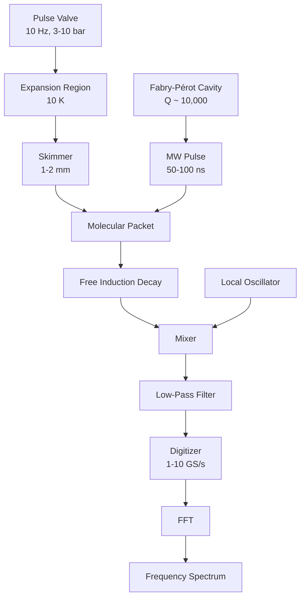

# Lesson 5: Spectroscopy of Molecular Structure

## 1. First-Principles Intuition & Invariants

Spectroscopy stands as the most powerful non-destructive analytical technique in the molecular sciences, providing a direct window into the quantum mechanical structure of matter through its interaction with electromagnetic radiation. At its foundation lies a deceptively simple principle: molecules possess discrete, quantized energy levels arising from the solutions to the time-independent Schrödinger equation for their constituent nuclei and electrons. When electromagnetic radiation of precisely the right frequency impinges upon a molecular system, the molecule can undergo a transition from one quantum state to another, absorbing or emitting a photon whose energy exactly matches the energy difference between the initial and final states. This resonance condition, expressed through Bohr's frequency relation $\Delta E = h\nu$, transforms spectroscopy from mere light measurement into a precise probe of molecular structure, bonding, and dynamics.

The quantum mechanical origin of spectroscopic transitions begins with the time-dependent perturbation theory treatment of light-matter interaction. When a molecule in an initial eigenstate $|\psi_i\rangle$ with energy $E_i$ encounters an oscillating electromagnetic field, the perturbation Hamiltonian $\hat{H}'(t) = -\boldsymbol{\mu} \cdot \mathbf{E}(t)$ couples this state to other eigenstates $|\psi_f\rangle$ with energies $E_f$. Here $\boldsymbol{\mu}$ represents the electric dipole moment operator, and $\mathbf{E}(t) = \mathbf{E}_0 \cos(\omega t)$ is the time-varying electric field vector. Fermi's golden rule, derived from first-order time-dependent perturbation theory, yields the transition rate between states as proportional to the square of the transition dipole matrix element $\langle \psi_f | \boldsymbol{\mu} | \psi_i \rangle$ and the density of final states at the resonance frequency. This fundamental result immediately reveals why certain transitions are allowed while others are forbidden: if the transition dipole integral vanishes due to symmetry constraints, no radiative transition can occur regardless of the photon energy.

The molecular energy landscape naturally decomposes into three hierarchically ordered contributions due to the Born-Oppenheimer separation of time scales. Electronic energies, arising from the quantum mechanical arrangement of electrons in molecular orbitals, typically span several electron volts and correspond to ultraviolet and visible photon frequencies. Vibrational energies, associated with the periodic stretching and bending of chemical bonds, fall in the range of tens to hundreds of millielectron volts, resonating with infrared radiation. Rotational energies, reflecting the quantized angular momentum of the entire molecule tumbling through space, measure in millielectron volts and couple to microwave frequencies. This energy hierarchy permits us to write the total molecular energy as $E_{\text{total}} = E_{\text{elec}} + E_{\text{vib}} + E_{\text{rot}}$, and consequently to treat rotational, vibrational, and electronic spectroscopy as distinct experimental domains, each revealing complementary structural information.

Rotational spectroscopy, operating in the microwave and far-infrared regions, directly measures molecular geometry through moments of inertia. For a rigid rotor—the idealized model of a non-vibrating diatomic or linear polyatomic molecule—the rotational energy levels follow the exact quantum mechanical formula $E_J = BJ(J+1)$ where $J$ is the rotational quantum number and $B = \hbar^2/(2I)$ is the rotational constant expressed in terms of the moment of inertia $I$. The transition selection rule $\Delta J = \pm 1$ for electric dipole transitions, arising from the angular momentum properties of photons, restricts the observed spectrum to a series of nearly evenly spaced lines separated by approximately $2B$. By measuring these line spacings with sub-megahertz precision using cavity-based Fourier transform microwave spectrometers, one obtains the moment of inertia and thereby the bond length to within picometers. For diatomic molecules, the relationship $I = \mu r^2$ connecting moment of inertia to reduced mass $\mu$ and equilibrium bond length $r$ permits immediate structural determination. Polyatomic molecules require analysis of multiple rotational constants corresponding to rotation about distinct principal axes, yielding complete three-dimensional structures when combined with isotopologue measurements.

Vibrational spectroscopy probes the potential energy surface governing nuclear motion about equilibrium geometry. In the harmonic oscillator approximation, valid near the minimum of the potential well, the vibrational energy levels adopt the form $E_v = \hbar\omega(v + 1/2)$ where $v$ is the vibrational quantum number and $\omega = \sqrt{k/\mu}$ is the classical vibrational frequency determined by the force constant $k$ and reduced mass. The fundamental selection rule $\Delta v = \pm 1$ for harmonic transitions arises from the dipole moment matrix elements between adjacent harmonic oscillator states, which vanish for all but unit changes in quantum number. Real molecular potentials exhibit anharmonicity, causing the potential to deviate from the parabolic form and introducing higher-order terms like $V(x) = \frac{1}{2}kx^2 - \frac{1}{6}k'x^3 + \ldots$ that permit overtone transitions with $\Delta v = 2, 3, \ldots$ and combination bands involving multiple vibrational modes. The anharmonicity constant $\omega_e x_e$, extracted from the progressive compression of vibrational energy spacings, provides direct information about the shape of the dissociation curve and the bond's resistance to large-amplitude motion.

Electronic spectroscopy, accessing ultraviolet and visible wavelengths, reveals the quantum chemistry of molecular bonding through transitions between different electronic configurations. The Franck-Condon principle, a consequence of the vastly different time scales of electronic and nuclear motion, dictates that electronic transitions occur vertically on a potential energy diagram—the nuclei remain essentially frozen during the femtosecond electronic rearrangement. This principle manifests experimentally as vibrational progressions in electronic spectra, where a single electronic transition generates multiple absorption bands corresponding to different vibrational levels of the excited electronic state. The relative intensities of these vibronic bands follow the Franck-Condon factors $|\langle \chi_{v'}|\chi_{v''}\rangle|^2$, the squared overlap integrals between vibrational wavefunctions of the ground ($v''$) and excited ($v'$) electronic states. When the excited state equilibrium geometry differs significantly from the ground state—as occurs when an electron promotes from a bonding to an antibonding orbital—the Franck-Condon progression exhibits maximum intensity at higher vibrational quanta, reflecting the poor overlap between the ground vibrational wavefunction and the displaced excited-state wavefunctions.

Selection rules, the quantum mechanical constraints determining which transitions are allowed, emerge from the symmetry properties of the transition moment integral. For a transition to be electric dipole allowed, the direct product $\Gamma_{\psi_f} \otimes \Gamma_{\mu} \otimes \Gamma_{\psi_i}$ must contain the totally symmetric irreducible representation of the molecular point group. This group-theoretical criterion provides a systematic way to predict spectroscopic activity without explicit wavefunction calculation. For instance, in a molecule with inversion symmetry such as carbon dioxide or benzene, states of $g$ (gerade, even) parity can only transition to states of $u$ (ungerade, odd) parity via electric dipole radiation, immediately forbidding all $g \leftrightarrow g$ and $u \leftrightarrow u$ transitions. Similarly, the permanent dipole moment of a molecule must transform as one of the cartesian coordinates ($x$, $y$, or $z$) for the molecule to exhibit a pure rotational spectrum, explaining why homonuclear diatomics like nitrogen and oxygen are microwave-inactive despite their rotational energy levels.

Molecular symmetry and group theory provide the mathematical framework for systematically classifying molecular states and predicting spectroscopic observables. Every molecule belongs to a point group defined by its symmetry operations—rotations, reflections, and inversions that leave the molecule invariant. The character table of a point group lists its irreducible representations and provides the transformation properties of atomic orbitals, vibrational modes, and electronic states under these symmetry operations. By decomposing molecular wavefunctions into symmetry-adapted linear combinations that transform as irreducible representations, we can immediately apply selection rules, identify degenerate energy levels, and predict the splitting patterns that occur when symmetry is broken by external fields or distortions. For example, benzene's $D_{6h}$ symmetry dictates that its six $\pi$ electrons occupy molecular orbitals of $a_{2u}$, $e_{1g}$, and $e_{2u}$ symmetry, and that its lowest-energy electronic transition ($\pi \to \pi^*$) transforms as $E_{1u}$, making it electric dipole allowed but polarized in the molecular plane.

Nuclear magnetic resonance spectroscopy, though operating at radio frequencies far below the energy scales of electronic and vibrational transitions, reveals molecular structure through a fundamentally different mechanism: the interaction of nuclear magnetic moments with external magnetic fields and local electronic environments. Nuclei with non-zero spin quantum number $I$ possess magnetic moments $\boldsymbol{\mu}_I = \gamma_I \mathbf{I}$ where $\gamma_I$ is the gyromagnetic ratio. In an external field $\mathbf{B}_0$, these nuclear spins precess about the field direction with a Larmor frequency $\omega_0 = \gamma_I B_0$, and the quantum mechanical energy levels split into $2I+1$ states with energies $E_m = -\gamma_I \hbar m B_0$ where $m$ ranges from $-I$ to $+I$. For protons ($I = 1/2$), this produces two states separated by $\Delta E = \gamma_p \hbar B_0$, yielding resonance frequencies in the range of hundreds of megahertz for typical laboratory field strengths of several tesla. The chemical shift, arising from the diamagnetic shielding of nuclei by surrounding electron density, shifts these resonance frequencies by parts per million, encoding information about local bonding environment. Spin-spin coupling through bonding electrons produces multiplet splitting patterns that reveal connectivity and dihedral angles, making NMR an unparalleled tool for determining three-dimensional molecular structure in solution.

The transition probability for radiative processes, quantified by Einstein's $A$ and $B$ coefficients, governs the spontaneous emission rate and stimulated absorption and emission cross-sections. For a transition between states $i$ and $f$, the Einstein $A$ coefficient (spontaneous emission rate) scales as $A_{fi} \propto \omega^3 |\langle f|\boldsymbol{\mu}|i\rangle|^2$, revealing the strong cubic frequency dependence that makes ultraviolet electronic transitions orders of magnitude faster than infrared vibrational transitions, which in turn vastly exceed microwave rotational decay rates. This frequency scaling has profound experimental consequences: electronic excited states decay on nanosecond time scales, while vibrationally excited molecules persist for milliseconds, and rotationally excited states can survive for seconds in collision-free environments. The Einstein $B$ coefficient relates absorption intensity to transition moment through $B_{if} \propto |\langle f|\boldsymbol{\mu}|i\rangle|^2$, and the principle of detailed balance at thermal equilibrium requires the relation $g_i B_{if} = g_f B_{fi}$ between absorption and stimulated emission, where $g$ denotes state degeneracy.

Photochemistry extends spectroscopy from passive observation to active control of molecular transformations. When a molecule absorbs an ultraviolet or visible photon, the deposited energy can initiate bond cleavage, isomerization, or electron transfer processes that would be thermally inaccessible at ambient temperature. The Jablonski diagram provides the conceptual framework for understanding photochemical pathways: following photoexcitation to a high-lying singlet state, molecules rapidly relax via internal conversion to the lowest excited singlet state $S_1$ on sub-picosecond time scales. From $S_1$, the molecule can return to the ground state via fluorescence emission (nanosecond lifetime), undergo intersystem crossing to a triplet state $T_1$ through spin-orbit coupling (microsecond), or react along an excited-state potential energy surface before decay. The quantum yield $\Phi$ of a photochemical process, defined as the number of product molecules formed per photon absorbed, depends on the branching ratio between reactive and non-reactive decay pathways. High quantum yields require that the reactive channel compete favorably with radiative and non-radiative deactivation, a condition met in systems where the excited-state barrier to reaction is low or absent.

## 2. Core Architecture & Mechanics

The experimental architecture of molecular spectroscopy divides naturally into three subsystems: the electromagnetic radiation source, the sample interaction region, and the detector system. Each spectroscopic domain—rotational, vibrational, electronic, and nuclear magnetic resonance—employs domain-specific implementations of these components optimized for the relevant frequency range, signal strength, and spectral resolution requirements.

Microwave rotational spectroscopy employs coherent radiation sources in the 1–100 GHz range, typically realized through frequency multiplication of stable crystal oscillators or direct synthesis from voltage-controlled oscillators phase-locked to atomic standards. In cavity-based Fourier transform microwave (FTMW) spectrometers, the sample—often a supersonic molecular beam expansion that cools rotational and vibrational degrees of freedom to a few Kelvin—enters a high-quality factor Fabry-Pérot resonator. A microwave pulse, precisely timed to coincide with the molecular packet's arrival, coherently excites the rotational transition of interest. The macroscopic polarization induced in the sample then radiates as a free induction decay signal, which the spectrometer detects through heterodyne mixing with a local oscillator. Fourier transformation of the time-domain interferogram yields the frequency-domain spectrum with resolution limited only by the molecular decay time, routinely achieving sub-kilohertz linewidths that permit resolution of hyperfine structure from nuclear quadrupole coupling.

The supersonic expansion technique deserves detailed examination, as it provides the population inversion and cooling essential for high-resolution rotational spectroscopy. A high-pressure gas pulse (typically 3–10 bar backing pressure) expands through a small orifice (0.5–1 mm diameter) into a vacuum chamber maintained at $10^{-5}$ to $10^{-6}$ torr. The rapid adiabatic expansion converts the random thermal energy of gas molecules into directed flow along the expansion axis, reducing the internal temperature from ambient 300 K to 1–10 K within a few nozzle diameters downstream. This cooling collapses the Boltzmann distribution over rotational states to predominantly populate the lowest few $J$ levels, simultaneously simplifying the spectrum by removing hot-band transitions and enhancing signal intensity by concentrating molecules into fewer quantum states. For weakly bound clusters and van der Waals complexes, the low temperature stabilizes species that would dissociate at room temperature, enabling structural determination of hydrogen-bonded and dispersion-bound systems.



Infrared vibrational spectroscopy operates across the 400–4000 cm$^{-1}$ wavenumber range (2.5–25 μm wavelength), encompassing the fundamental stretching and bending modes of most chemical bonds. Modern Fourier transform infrared (FTIR) spectrometers employ a Michelson interferometer configuration where broadband infrared radiation from a thermal source (silicon carbide globar or mercury arc lamp) splits at a beamsplitter, with one arm reflecting from a fixed mirror and the other from a mirror mounted on a precision translation stage. The recombined beams create an interference pattern that modulates the intensity reaching the detector as a function of mirror displacement. The sample, positioned in one or both arms, imparts its wavelength-dependent absorption onto this interferogram. Fourier transformation converts the mirror-position domain signal to the frequency domain, yielding a complete absorption spectrum from a single mirror scan with resolution determined by the maximum optical path difference $\Delta_{\text{max}}$ through $\Delta\nu = 1/(2\Delta_{\text{max}})$. Standard FTIR instruments achieve 0.5–4 cm$^{-1}$ resolution, sufficient to resolve rotational fine structure in gas-phase spectra and distinguish closely spaced vibrational bands.

Sample preparation for infrared spectroscopy varies dramatically with phase and concentration requirements. Gas-phase samples fill evacuated cells with path lengths of 10 cm to several meters, often employing multi-pass White cells or integrating spheres to enhance effective path length for trace analysis. Liquid samples utilize demountable cells with precision-ground salt windows (typically potassium bromide, sodium chloride, or calcium fluoride) separated by Teflon or lead spacers to define path lengths of 0.01–1 mm. The choice of window material balances transmission range (KBr: 400–40,000 cm$^{-1}$; NaCl: 600–40,000 cm$^{-1}$; CaF$_2$: 1100–77,000 cm$^{-1}$) against hygroscopicity and cost. Solid samples typically require formation of potassium bromide pellets through grinding and pressing under vacuum to create transparent disks, or dispersion in mineral oil mulls. Attenuated total reflection (ATR) accessories provide an alternative for solids and viscous liquids, exploiting the evanescent wave that penetrates a few micrometers beyond a high-refractive-index crystal (diamond, germanium, or zinc selenide) to probe surface and interfacial chemistry without sample destruction.

Raman spectroscopy complements infrared vibrational analysis through a fundamentally different selection rule mechanism based on polarizability rather than dipole moment changes. When monochromatic laser light—typically 532 nm (frequency-doubled Nd:YAG), 633 nm (HeNe), or 785 nm (diode laser)—illuminates a sample, the oscillating electric field induces a time-varying dipole moment $\boldsymbol{\mu}(t) = \boldsymbol{\alpha} \cdot \mathbf{E}(t)$ where $\boldsymbol{\alpha}$ is the polarizability tensor. For a vibrating molecule, the polarizability modulates at the vibrational frequency $\omega_{\text{vib}}$, creating sidebands in the scattered radiation at $\omega_{\text{laser}} \pm \omega_{\text{vib}}$. The Stokes scattering (red-shifted) and anti-Stokes scattering (blue-shifted) components constitute the Raman spectrum. Vibrational modes are Raman-active if molecular vibration modulates at least one component of the polarizability tensor, a criterion that renders many symmetric stretching modes strongly Raman-active despite being infrared-forbidden. For centrosymmetric molecules, the mutual exclusion principle dictates that modes cannot be simultaneously infrared and Raman active, making the techniques complementary rather than redundant.

Dispersive Raman spectrometers direct the scattered light through a subtractive double monochromator or holographic notch filter to reject Rayleigh scattering (elastically scattered light at the laser frequency), then diffract the transmitted light with a grating onto a CCD array detector. The spectral resolution, determined by the grating groove density (typically 1200–1800 grooves/mm) and entrance slit width, reaches 1–2 cm$^{-1}$ in high-performance instruments. Confocal microscopy Raman systems achieve spatial resolution approaching the optical diffraction limit (~300 nm) by focusing the laser through a microscope objective and collecting scattered light through a confocal pinhole, enabling chemical mapping of heterogeneous materials and identification of micrometer-scale domains in composite samples. Surface-enhanced Raman spectroscopy (SERS) amplifies Raman signals by factors of $10^6$ to $10^{14}$ when molecules adsorb onto nanostructured noble metal surfaces, enabling single-molecule sensitivity through the excitation of localized surface plasmon resonances that concentrate electromagnetic fields into nanoscale hot spots.

Electronic absorption spectroscopy in the ultraviolet-visible range (200–800 nm) measures the wavelength-dependent attenuation of light passing through a sample according to the Beer-Lambert law $A(\lambda) = \epsilon(\lambda) c l$ where $A$ is absorbance, $\epsilon$ is the molar extinction coefficient, $c$ is concentration, and $l$ is path length. Dual-beam UV-Vis spectrometers split the source beam (deuterium lamp for UV, tungsten-halogen for visible) between sample and reference cuvettes, continuously comparing transmitted intensities to compensate for source fluctuations and baseline drift. The monochromator, typically a Czerny-Turner configuration with holographically ruled gratings blazed for peak efficiency in the UV or visible, scans the wavelength while photomultiplier tubes or photodiode arrays measure transmitted intensity. Spectral resolution of 0.1–2 nm suffices for most solution-phase work where solvent broadening dominates line shapes, but gas-phase studies of vibronic structure demand sub-0.01 nm resolution achievable only with high-dispersion echelle spectrographs or Fourier transform spectrometers.

For time-resolved electronic spectroscopy probing photochemical dynamics, pump-probe configurations replace steady-state illumination with precisely timed laser pulse pairs. An intense pump pulse (typically 100 fs to 10 ps duration) photoexcites the sample, initiating the photochemical process of interest. A delayed probe pulse, generated by splitting the pump output and passing it through a variable optical delay line, interrogates the transient population through absorption, fluorescence, or nonlinear optical response. By systematically varying the pump-probe delay from femtoseconds to microseconds and recording the probe spectrum or intensity at each delay, one reconstructs the time evolution of excited-state populations and monitors the appearance of photoproducts. Transient absorption spectroscopy reveals both ground-state depletion (bleaching) and excited-state absorption features, providing a complete picture of population flow through the manifold of electronic states. Fluorescence upconversion techniques achieve sub-100 fs time resolution by sum-frequency mixing the time-delayed fluorescence with a gate pulse in a nonlinear crystal, temporally gating the fluorescence detection window to the gate pulse duration.

Nuclear magnetic resonance spectroscopy requires the highest magnetic field homogeneity of any spectroscopic technique, as the chemical shift scale spans only parts per million of the Larmor frequency. Superconducting magnets wound from niobium-titanium or niobium-tin wire, immersed in liquid helium at 4.2 K and thermally shielded by liquid nitrogen, generate fields of 7–23.5 tesla (corresponding to proton Larmor frequencies of 300–1000 MHz). Active shim coils superimpose precisely calibrated gradient fields to compensate residual inhomogeneities, achieving field variations below 0.01 Hz across the 5 mm sample volume after careful shimming. The radiofrequency detection system surrounds the sample with a resonant LC circuit tuned to the Larmor frequency of the nucleus under study (proton, carbon-13, nitrogen-15, phosphorus-31, or fluorine-19 most commonly). Pulsed radiofrequency excitation, typically 90° and 180° pulses lasting 10–50 μs, rotates the nuclear magnetization away from equilibrium, and the precessing transverse magnetization induces a voltage in the detection coil that decays with time constant $T_2^*$ (the inhomogeneous transverse relaxation time).

```mermaid
flowchart TD
    A["RF Pulse<br/>Sequence"] --> B["Nuclear Spin<br/>Dynamics<br/>(Bloch Eqs)"]
    B --> C["Free Induction Decay<br/>Signal (time domain)"]
    C --> D["Complex Time Series<br/>I(t) + iQ(t)"]
    D --> E["Windowed FID"]
    E --> F["Extended time array"]
    F --> G["Frequency-domain spectrum<br/>Real["S(ω)"] and Imag["S(ω)"]"]
    G --> H["Absorption-mode spectrum"]
    H --> I["Final NMR spectrum<br/>δ (ppm) vs. Intensity"]
    
    C -.->|"Digitize (10-100 MHz)"| D
    D -.->|"Apodization (exponential/Gaussian)"| E
    E -.->|"Zero filling"| F
    F -.->|"Fast Fourier Transform"| G
    G -.->|"Phase correction (φ₀, φ₁)"| H
    H -.->|"Baseline correction"| I
```

Multidimensional NMR experiments extend the information content by correlating resonances through chemical bonds or through space. In a two-dimensional (2D) experiment such as COSY (correlation spectroscopy), the pulse sequence consists of preparation, evolution ($t_1$), mixing, and detection ($t_2$) periods. During the evolution period, the spin system develops chemical shift and J-coupling modulation encoded in the phase and amplitude of the coherence. The mixing period transfers this modulation between coupled spins through scalar coupling. The detection period records the FID as a function of $t_2$ for each value of the incremented evolution time $t_1$. Double Fourier transformation with respect to $t_1$ and $t_2$ yields a 2D frequency spectrum $S(\omega_1, \omega_2)$ displaying cross-peaks at coordinates $(\delta_A, \delta_B)$ whenever nuclei A and B couple. NOESY (nuclear Overhauser effect spectroscopy) replaces scalar coupling transfer with dipolar coupling through space, revealing internuclear distances up to 5 Å and providing the distance constraints essential for protein structure determination. HSQC (heteronuclear single quantum coherence) and HMBC (heteronuclear multiple bond correlation) experiments correlate protons with directly bonded and long-range coupled carbons, respectively, enabling unambiguous connectivity assignment in complex organic molecules.

Solid-state NMR confronts severe line-broadening mechanisms absent in solution: chemical shift anisotropy (orientation-dependent resonance frequency), dipolar coupling (direct magnetic interaction between nuclear spins), and quadrupolar coupling (interaction between nuclear quadrupole moment and electric field gradients). Magic angle spinning (MAS) averages these interactions by rapidly rotating the sample about an axis inclined at $54.74°$ (the magic angle $\theta_m = \arccos(1/\sqrt{3})$) to the magnetic field direction. The rotational motion modulates the spatial part of the anisotropic interactions as $P_2(\cos\theta) = (3\cos^2\theta - 1)/2$, which vanishes at the magic angle, leaving only the isotropic component. Spinning frequencies of 10–100 kHz, achieved using air-driven cylindrical rotors containing 1–4 mm diameter samples, narrow proton linewidths from tens of kilohertz to a few hundred hertz, revealing resolved chemical shifts in powders and solids. Cross-polarization (CP) pulse sequences transfer magnetization from abundant spins (protons) to dilute spins (carbon-13), enhancing sensitivity by the gyromagnetic ratio ratio (~4 for C-13) and enabling shorter recycle delays limited by proton rather than carbon relaxation times.

## 3. High-Performance Optimization & Failure Modes

Achieving maximum information content from spectroscopic measurements demands careful optimization of signal-to-noise ratio, spectral resolution, and sample preparation protocols while avoiding systematic errors and instrumental artifacts that compromise quantitative analysis.

In FTIR spectroscopy, the multiplex advantage (Fellgett advantage) and throughput advantage (Jacquinot advantage) confer superior signal-to-noise over dispersive instruments, but careful attention to sampling parameters prevents distortion. The spectral resolution $\Delta\nu = 1/(2L_{\text{max}})$ where $L_{\text{max}}$ is the maximum mirror displacement sets the minimum spacing between resolvable features, but increasing resolution beyond the intrinsic linewidth wastes acquisition time without improving accuracy. For gas-phase samples with Doppler-broadened lines of ~0.005 cm$^{-1}$ full-width at half-maximum, 0.1 cm$^{-1}$ resolution captures the line shape adequately while maintaining short scan times. Conversely, liquid and solid samples exhibit ~10 cm$^{-1}$ linewidths dominated by inhomogeneous broadening, rendering 4 cm$^{-1}$ resolution appropriate. The number of scans co-added improves signal-to-noise as the square root of scan count, so 64–256 scans typically suffice for routine analysis while quantitative work on weak absorptions may justify 1000–10,000 scans.

Sample thickness optimization in transmission infrared measurements balances signal strength against Beer-Lambert law nonlinearity. For an absorption band with peak absorbance $A$, accurate quantitation requires $0.1 < A < 1.0$ to avoid detector nonlinearity at high absorbance and baseline noise domination at low absorbance. Since $A = \epsilon c l$, this constraint determines the appropriate path length for a given concentration and extinction coefficient. Strong bands (O-H stretches, C=O stretches) with $\epsilon \sim 100$ L mol$^{-1}$ cm$^{-1}$ require path lengths of 0.01–0.1 mm for millimolar solutions, necessitating demountable cells with precision Teflon spacers. Weak bands (overtones, combination modes) with $\epsilon \sim 1$ L mol$^{-1}$ cm$^{-1}$ tolerate centimeter path lengths. The failure mode of excessive path length manifests as absorption band saturation where the peak absorbance exceeds 2.0, causing complete transmission blockage and distorting the apparent band shape toward a flat-topped profile.

Water vapor and carbon dioxide absorb strongly throughout the mid-infrared, producing sharp rotational-vibrational bands at 3500–4000 cm$^{-1}$ (water O-H stretch), 1400–1800 cm$^{-1}$ (water bend and CO$_2$ asymmetric stretch), and 2300–2400 cm$^{-1}$ (CO$_2$ symmetric stretch) that interfere with sample features. Purging the spectrometer optical path with dry nitrogen or compressed air reduces these contaminants, but achieving complete elimination demands vacuum operation or inert atmosphere gloveboxes for hygroscopic samples. Spectral subtraction algorithms can partially compensate for residual water and CO$_2$ absorption by recording and subtracting a background spectrum collected immediately before the sample scan, but this approach fails when atmospheric concentrations drift during the measurement or when sample and background path lengths differ.

Raman spectroscopy sensitivity optimization centers on maximizing photon collection efficiency while managing sample fluorescence and photodamage. The Raman scattering cross-section scales as $\omega^4$ (the fourth power of frequency), favoring ultraviolet excitation for maximum signal. However, many organic compounds fluoresce when excited with UV or blue light, producing broadband emission orders of magnitude more intense than the Raman signal and completely obscuring the vibrational spectrum. Near-infrared excitation (785–1064 nm) avoids electronic absorption in most molecules, suppressing fluorescence while sacrificing Raman intensity. The optimal excitation wavelength represents a compromise between these competing factors, often requiring empirical determination for each sample class. Photobleaching strategies that expose the sample to high laser power for several minutes before spectrum acquisition can quench fluorescence by photodegrading the emissive species, but risk concurrent degradation of the analyte.

Resonance Raman spectroscopy exploits the $10^3$–$10^6$ enhancement in Raman cross-section when the excitation frequency coincides with an electronic absorption band. The Raman tensor becomes resonant when the denominator of the Kramers-Heisenberg-Dirac expression $\alpha_{\rho\sigma} \propto \sum_e \frac{\langle g|\mu_\rho|e\rangle\langle e|\mu_\sigma|g\rangle}{\omega_{eg} - \omega_L - i\Gamma_e}$ approaches zero, where $|g\rangle$ and $|e\rangle$ are ground and excited electronic states, $\omega_{eg}$ is the transition frequency, $\omega_L$ is the laser frequency, and $\Gamma_e$ is the excited-state damping. Vibrational modes that strongly couple to the electronic transition (those appearing in the Franck-Condon progression) dominate the resonance Raman spectrum, providing selective enhancement of chromophore vibrations while suppressing signals from the surrounding molecular framework. This selectivity enables detection of active sites in metalloproteins, tracking of photochemical intermediates, and identification of chromophore structure in complex biological assemblies.

Time-resolved Raman spectroscopy with picosecond and femtosecond pulses reveals the structural dynamics of photoinduced processes. Stimulated Raman techniques such as femtosecond stimulated Raman spectroscopy (FSRS) achieve simultaneous high temporal (~50 fs) and spectral (~10 cm$^{-1}$) resolution by employing a narrowband picosecond Raman pump pulse and a broadband femtosecond probe pulse. The Raman pump stimulates vibrational coherence on the excited-state potential surface, and the time-delayed probe experiences Raman gain or loss at frequencies corresponding to excited-state vibrational modes. Scanning the pump-probe delay maps the evolution of vibrational frequencies and intensities as the system relaxes from the Franck-Condon geometry to the excited-state minimum and eventually returns to the ground state, providing a molecular movie of bond-length changes during the reaction.

Electronic absorption spectroscopy sample preparation requires stringent purity standards because trace impurities with large extinction coefficients generate spurious absorption features. Chromatographic purification (HPLC, column chromatography) to >99% purity represents standard practice for quantitative UV-Vis work. Solvent selection balances transparency windows against solubility and photostability. Water, methanol, and ethanol transmit down to ~200 nm, covering the near-UV range for most chromophores. Acetonitrile and hexane extend transparency to ~190 nm, enabling far-UV spectroscopy of small molecules and peptide bonds. Chlorinated solvents (chloroform, dichloromethane) exhibit strong absorption below 240 nm and should be avoided for UV studies. Dissolved oxygen quenches triplet states and can alter photochemistry, so degassing by freeze-pump-thaw cycles or nitrogen purging is essential for quantitative triplet yield measurements and phosphorescence studies.

Cuvette path length and concentration jointly determine the optimal absorbance range. The Beer-Lambert law linear regime extends to $A \approx 1.0$, above which stray light and detector nonlinearity introduce error. For a typical organic chromophore with $\epsilon \sim 10^4$ L mol$^{-1}$ cm$^{-1}$, a 1 cm path length cuvette requires micromolar concentrations. When sample quantity is limited, 1 mm or 0.1 mm path length cuvettes permit use of hundred-micromolar to millimolar solutions while maintaining absorbances in the linear range. The failure mode of too-high absorbance manifests as apparent deviation from Beer's law linearity in concentration series and distortion of band shapes toward triangular profiles due to the logarithmic relationship between absorbance and transmittance.

Temperature control stabilizes absorption spectra and enables thermodynamic analysis of equilibria through variable-temperature spectroscopy. Jacketed cuvette holders circulating thermostated water or ethylene glycol maintain temperature to ±0.1 K across the range 273–373 K. Lower temperatures down to 77 K (liquid nitrogen) require cryogenic optical dewars with strain-free quartz windows and inert atmosphere to prevent condensation. High-temperature cells for molten salts or high-boiling solvents employ sapphire windows and vacuum jackets for thermal insulation. Van't Hoff analysis of temperature-dependent equilibrium constants extracted from absorption intensities yields reaction enthalpies $\Delta H^\circ$ and entropies $\Delta S^\circ$ through the relation $\ln K(T) = -\Delta H^\circ/(RT) + \Delta S^\circ/R$.

Nuclear magnetic resonance sensitivity scales as the $3/2$ power of magnetic field strength for direct detection and even more steeply for inverse-detection experiments, driving the adoption of ultra-high-field instruments despite their cost and complexity. A 900 MHz (21.1 T) spectrometer provides approximately 3-fold higher signal-to-noise than a 600 MHz (14.1 T) instrument for the same sample and acquisition time, translating to 9-fold reduction in required measurement time to achieve equivalent precision. Carbon-13 natural abundance (1.1%) necessitates concentration-enriched samples (>10 mM for direct detection) or isotopic labeling in biomolecular NMR. Nitrogen-15, with 0.37% natural abundance and 10-fold lower gyromagnetic ratio than proton, demands milligram quantities and isotopic enrichment except for cryogenically cooled probes that enhance sensitivity 4-fold through reduced thermal noise.

Shimming the magnetic field to achieve optimal homogeneity represents the most critical optimization step in NMR. Automated shim procedures adjust 20–40 shim coil currents to minimize the linewidth of a standard sample (typically 0.1% chloroform in deuterated acetone), iterating through gradient and curvature shims in multiple orders until convergence. Well-shimmed spectrometers achieve 0.3 Hz full-width at half-maximum linewidths for the chloroform proton singlet at 500 MHz (0.6 ppb resolution). Failure to shim adequately manifests as broad, distorted multiplets, loss of resolution between closely spaced peaks, and distorted integration that compromises quantitative analysis. Spinning sidebands—satellite peaks flanking the main resonance at intervals equal to the spinning frequency—arise from sample tube imperfections or magnetic susceptibility mismatches and can be suppressed by using high-quality NMR tubes, adjusting spinner depth, and reducing spinning rate when spectral width permits.

Solvent selection in solution NMR prioritizes deuteration to avoid overwhelming proton signals from residual solvent peaks. Deuterated chloroform (CDCl$_3$, 99.8% D), dimethyl sulfoxide (DMSO-$d_6$), water (D$_2$O), benzene (C$_6$D$_6$), acetone (acetone-$d_6$), and methanol (CD$_3$OD) cover polarity ranges from nonpolar to highly polar. Residual proton signals from incomplete deuteration appear at characteristic chemical shifts (7.26 ppm for CHCl$_3$, 2.50 ppm for DMSO, 4.79 ppm for HOD) that can obscure sample resonances, requiring solvent suppression pulse sequences (presaturation or gradient-based methods) when analyte peaks overlap. Oxygen dissolved from air causes paramagnetic broadening and accelerated relaxation by interacting with unpaired electrons; degassing by freeze-pump-thaw cycles or nitrogen purging sharpens lines and extends $T_1$ relaxation times, particularly important for quantitative integration and multidimensional experiments with long mixing times.

Quantitative NMR demands careful attention to relaxation delays, pulse angles, and integration procedures. For accurate integration reflecting true stoichiometric ratios, the recycle delay between scans must exceed $5T_1$ where $T_1$ is the longest longitudinal relaxation time among all nuclei in the molecule. Proton $T_1$ values span milliseconds to tens of seconds depending on molecular size and mobility, so conservative recycle delays of 30–60 seconds ensure full magnetization recovery but severely limit throughput. Partial saturation can be tolerated when comparing relative peak areas within the same compound (all affected equally) but destroys quantitation when comparing different molecules with different relaxation characteristics. Small flip-angle pulses (30° instead of 90°) permit shorter recycle delays by leaving a larger component of magnetization along the field axis, at the cost of reduced signal per scan. The Ernst angle $\alpha_E = \arccos(\exp(-\tau_R/T_1))$ maximizes signal-to-noise per unit time when $\tau_R < 5T_1$, providing a quantitative optimization criterion.

Two-dimensional NMR acquisition parameters balance resolution, sensitivity, and experiment time. The number of $t_1$ increments determines resolution in the indirect dimension; 256–512 increments typically suffice for COSY and HSQC experiments on small molecules, while large biomolecules may require 1024–2048 increments to resolve crowded spectral regions. Each increment necessitates a complete $t_2$ acquisition with averaging, so total experiment time equals (number of $t_1$ increments) × (number of scans per increment) × (recycle delay + acquisition time). A 512 × 2048 point COSY with 8 scans and 2-second recycle delay consumes (512)(8)(2 s) = 2.3 hours. Linear prediction and maximum entropy reconstruction algorithms can extend the apparent $t_1$ dimension beyond the actually acquired points, improving resolution without proportionately increasing measurement time. Non-uniform sampling (NUS), where only a randomly chosen subset of the full $t_1$ grid is acquired, reduces experiment time by factors of 2–4 while achieving comparable resolution after compressed sensing reconstruction.

Hyperpolarization techniques bypass the Boltzmann distribution limitation that aligns only one nucleus per $10^5$ at thermal equilibrium. Dynamic nuclear polarization (DNP) transfers spin polarization from electron paramagnetic centers to nuclear spins via microwave irradiation at the electron-nuclear difference frequency, enhancing nuclear polarization by factors of 660 (for electrons relative to protons at the same field). Dissolution DNP polarizes samples at 1.2 K in a 3.35 T field, then rapidly dissolves and transfers the hyperpolarized solution to the high-field NMR spectrometer, providing three to four orders of magnitude sensitivity enhancement with polarization decay governed by $T_1$ relaxation. Parahydrogen-induced polarization (PHIP) transfers the singlet spin order of parahydrogen (the antisymmetric nuclear spin state of H$_2$) to substrate molecules during catalytic hydrogenation, generating strongly polarized reaction products observable with single-scan sensitivity.

Spectroscopic absolute intensity calibration transforms measured absorbances, Raman intensities, or NMR integrals into quantitative concentrations and quantum yields. For UV-Vis absorption, the Beer-Lambert law $A = \epsilon c l$ permits direct calculation of concentration once the extinction coefficient $\epsilon$ is established through calibration with gravimetrically prepared standard solutions. The accuracy of this procedure depends on path length verification using interference fringes or physical measurement and on ensuring that the reference standard has precisely known purity, typically validated by elemental analysis or NMR. Fluorescence quantum yield determination requires integrating the emission spectrum and comparing to a standard of known quantum yield, with correction for differences in absorption at the excitation wavelength and refractive index of the solvent. Quinine sulfate in 0.1 M sulfuric acid ($\Phi_f = 0.546$ at 25°C) and fluorescein in 0.1 M sodium hydroxide ($\Phi_f = 0.95$) serve as common quantum yield references spanning the visible range.

Instrument response function correction accounts for wavelength-dependent detector sensitivity and optical throughput that distort measured spectra relative to true emission profiles. Spectrofluorimeters exhibit strongly wavelength-dependent sensitivity due to grating efficiency curves, detector quantum efficiency, and mirror reflectivities. A calibrated light source of known spectral radiance—typically a NIST-traceable tungsten-halogen lamp with color temperature 3200 K—provides the reference spectrum for generating correction factors. After correction, emission intensities reported in photons per second per nanometer wavelength interval represent the true molecular emission independent of instrumental artifacts. Failure to apply correction functions leads to systematic distortion of emission band shapes, artifactual peak shifts of 5–20 nm, and errors in Franck-Condon progression intensity ratios used to extract excited-state geometry changes.

Mass spectrometry coupled to laser spectroscopy provides simultaneous mass and structural identification through resonant two-photon ionization (R2PI) or photoelectron spectroscopy. In R2PI, the first photon excites a specific electronic transition, and a second photon (from the same or a different laser) ionizes the excited state if the photon energy exceeds the ionization potential from that state. Mass-analyzing the resulting ions while scanning the first photon wavelength yields an action spectrum revealing the electronic absorption profile with mass resolution, enabling identification of specific cluster sizes, isomers, or complexes contributing to spectroscopic features. Photoelectron spectroscopy measures the kinetic energy distribution of electrons ejected by photoionization; the photoelectron kinetic energy $E_e = h\nu - IP - E_{\text{int}}$ where IP is ionization potential and $E_{\text{int}}$ is internal (vibrational/rotational) energy, directly probing the cation vibrational structure and providing ionization energies accurate to 5 meV. These combined approaches deliver unprecedented specificity for complex mixtures and weakly bound clusters where conventional mass spectrometry alone cannot distinguish isobaric species.
