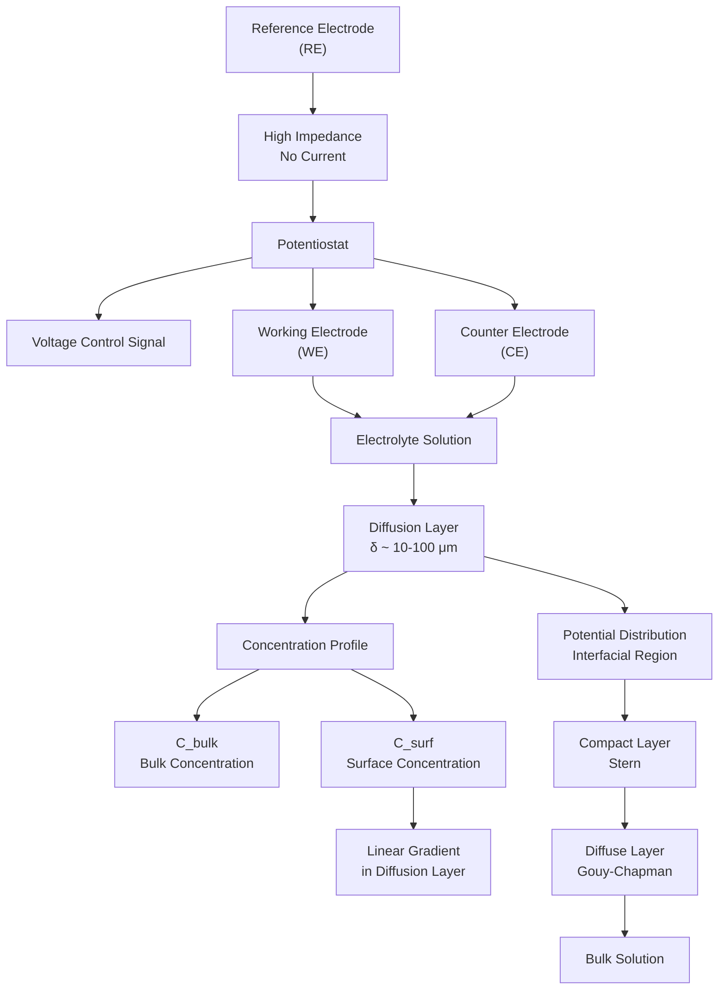

# Lesson 6: Electrochemistry, Surface Phenomena, Transport

## 1. First-Principles Intuition & Invariants

Electrochemistry stands at the confluence of thermodynamics, kinetics, and electrostatics, governing phenomena as diverse as battery discharge, neural signal propagation, corrosion, and electroplating. At its heart lies a deceptively simple principle: charge transfer across phase boundaries couples electronic conduction in metallic or semiconducting electrodes to ionic conduction in electrolyte solutions, creating measurable electrical work from spontaneous chemical reactions or driving non-spontaneous reactions through applied potentials. This coupling transforms chemical free energy into electrical potential differences, establishing the theoretical foundation for galvanic cells, electrolytic cells, and every electrochemical sensor deployed in modern analytical laboratories.

The Gibbs free energy change for a redox reaction, $\Delta G$, relates directly to the cell potential $E_{\text{cell}}$ through the fundamental electrochemical invariant:

$$\Delta G = -nFE_{\text{cell}}$$

where $n$ denotes the number of moles of electrons transferred in the balanced half-reactions, and $F = 96485\,\text{C}\,\text{mol}^{-1}$ represents the Faraday constant, the charge per mole of electrons. This equation encapsulates the reversible conversion between chemical and electrical energy domains. Under standard conditions (unit activities, 298.15 K, 1 bar pressure), the standard cell potential $E^\circ_{\text{cell}}$ emerges as the difference between the standard reduction potentials of the cathode and anode half-reactions:

$$E^\circ_{\text{cell}} = E^\circ_{\text{cathode}} - E^\circ_{\text{anode}}$$

These standard reduction potentials, tabulated relative to the standard hydrogen electrode (SHE) assigned zero potential by convention, form a ladder of relative oxidizing and reducing power. A positive standard cell potential signals a spontaneous reaction under standard conditions, while a negative potential indicates thermodynamic non-spontaneity requiring external electrical work.

Real electrochemical systems rarely operate at standard conditions. Concentration gradients, partial pressures, and ionic activities deviate from unity, shifting cell potentials away from their standard values. The Nernst equation governs this concentration dependence, derived by combining the general Gibbs free energy expression $\Delta G = \Delta G^\circ + RT\ln Q$ with the electrochemical relation above:

$$E_{\text{cell}} = E^\circ_{\text{cell}} - \frac{RT}{nF}\ln Q$$

At 298.15 K, converting natural logarithms to base-10 and substituting numerical values yields the practical form:

$$E_{\text{cell}} = E^\circ_{\text{cell}} - \frac{0.05916\,\text{V}}{n}\log_{10} Q$$

The reaction quotient $Q$ encodes the instantaneous activities of all species participating in the redox equilibrium. For a generic half-reaction $\text{Ox} + ne^- \rightarrow \text{Red}$, the Nernst equation for the electrode potential becomes:

$$E = E^\circ - \frac{RT}{nF}\ln\frac{a_{\text{Red}}}{a_{\text{Ox}}}$$

This logarithmic dependence produces remarkable sensitivity: a tenfold change in concentration ratio shifts the potential by approximately 59 mV per electron transferred at room temperature. This sensitivity underlies potentiometric sensors including pH electrodes, ion-selective electrodes, and reference electrode stability requirements.

While thermodynamics dictates the equilibrium potential difference, it provides no information about the rate at which equilibrium is approached. Electrode kinetics governs the temporal evolution of charge transfer, determining current densities, overpotentials, and the departure from thermodynamic reversibility. The activation barrier for electron transfer across the electrode-electrolyte interface reflects the reorganization energy required to adjust solvation shells, bond lengths, and charge distributions to accommodate the change in oxidation state. The Marcus theory of electron transfer quantifies this barrier, but for practical electrochemical systems, the phenomenological Butler-Volmer equation provides the essential kinetic description.

The Butler-Volmer equation relates the net current density $j$ to the overpotential $\eta = E - E_{\text{eq}}$, the deviation from the equilibrium potential:

$$j = j_0\left[\exp\left(\frac{\alpha_a nF\eta}{RT}\right) - \exp\left(-\frac{\alpha_c nF\eta}{RT}\right)\right]$$

The exchange current density $j_0$ represents the magnitude of the balanced anodic and cathodic current densities at equilibrium, serving as a measure of the intrinsic kinetic facility of the electrode reaction. Large exchange current densities characterize facile reactions with low activation barriers and rapid electron transfer rates, while small values indicate sluggish kinetics requiring substantial overpotentials to drive appreciable current. The transfer coefficients $\alpha_a$ and $\alpha_c$ (summing to approximately unity for simple one-step reactions) quantify the symmetry of the activation barrier, describing how the transition state energy changes with applied potential. A transfer coefficient near 0.5 indicates a symmetric barrier, while deviations reflect asymmetric potential-dependent reorganization.

At large anodic overpotentials ($\eta \gg RT/nF$, typically greater than +100 mV), the cathodic exponential term becomes negligible, reducing the Butler-Volmer equation to the Tafel equation:

$$\eta = \frac{RT}{\alpha_a nF}\ln j - \frac{RT}{\alpha_a nF}\ln j_0 = a + b\log_{10} j$$

This linear relationship between overpotential and the logarithm of current density, with Tafel slope $b = 2.303RT/\alpha_a nF$ (approximately 120 mV per decade at 298 K for $\alpha_a = 0.5$ and $n=1$), provides the experimental basis for extracting exchange current densities and transfer coefficients from polarization curves. The Tafel analysis requires steady-state measurements free from mass transport limitations, achieved through vigorous stirring, rotating disk electrodes, or sufficiently small current densities that the interfacial concentrations remain near bulk values.

Mass transport phenomena couple intimately with charge transfer kinetics in real electrochemical systems. Three mechanisms govern species transport: diffusion driven by concentration gradients, migration driven by electric field gradients, and convection driven by fluid motion. In well-designed electrochemical cells employing excess supporting electrolyte to suppress migration and controlled hydrodynamics to manage convection, diffusion often dominates the transport of electroactive species. The diffusion-controlled limiting current density $j_{\text{lim}}$ for a planar electrode emerges from Fick's first law when the interfacial concentration of the reactant reaches zero:

$$j_{\text{lim}} = \frac{nFDC_{\text{bulk}}}{\delta}$$

where $D$ represents the diffusion coefficient of the electroactive species, $C_{\text{bulk}}$ denotes the bulk concentration, and $\delta$ characterizes the diffusion layer thickness. Rotating disk electrodes impose well-defined hydrodynamics through the Levich equation, providing quantitative control over diffusion layer thickness and enabling mechanistic discrimination between kinetic and mass-transport-limited regimes.

Surface phenomena extend beyond electrochemical interfaces to encompass all phase boundaries where molecular interactions differ dramatically from bulk behavior. Adsorption, the accumulation of molecules at interfaces, fundamentally alters surface properties including catalytic activity, wetting behavior, and mechanical stability. The Gibbs adsorption equation relates surface tension changes to the surface excess concentration $\Gamma_i$ of species $i$:

$$d\gamma = -\sum_i \Gamma_i d\mu_i$$

where $\gamma$ denotes surface tension and $\mu_i$ represents the chemical potential of component $i$. This thermodynamic relation reveals that species reducing surface tension (surfactants) exhibit positive surface excess, accumulating at the interface, while species increasing surface tension are depleted from the interface.

Adsorption isotherms provide quantitative models relating surface coverage $\theta$ to bulk concentration or partial pressure at fixed temperature. The Langmuir isotherm, derived assuming monolayer coverage, equivalent adsorption sites, and no lateral interactions between adsorbed molecules, yields:

$$\theta = \frac{KP}{1 + KP}$$

for gas-phase adsorption at partial pressure $P$, where $K = K_0\exp(\Delta H_{\text{ads}}/RT)$ encodes the temperature-dependent equilibrium constant governed by the adsorption enthalpy. At low coverage ($KP \ll 1$), the isotherm reduces to Henry's law $\theta \approx KP$, while at high coverage, saturation behavior emerges with $\theta \to 1$. The Langmuir model underpins heterogeneous catalysis rate laws, where catalytic turnover frequencies depend on the fractional coverage of adsorbed reactants and intermediates.

Real surfaces exhibit energetic heterogeneity, lateral interactions, and multilayer adsorption, requiring more sophisticated isotherms. The Freundlich isotherm $\theta = K_F P^{1/n}$ empirically captures heterogeneous surfaces through the parameter $n > 1$, while the BET (Brunauer-Emmett-Teller) isotherm extends the Langmuir framework to multilayer physisorption:

$$\frac{P}{V(P_0 - P)} = \frac{1}{V_m C} + \frac{C-1}{V_m C}\frac{P}{P_0}$$

where $V$ represents the volume of gas adsorbed at pressure $P$, $V_m$ denotes the monolayer capacity, $P_0$ is the saturation vapor pressure, and $C$ relates to the enthalpy difference between first-layer and multilayer adsorption. BET analysis of nitrogen adsorption isotherms at 77 K provides the standard method for determining specific surface areas of porous materials, catalysts, and adsorbents.

Surface tension, the excess free energy per unit area at an interface, governs capillary phenomena, droplet formation, and wetting behavior. The Young-Laplace equation quantifies the pressure difference $\Delta P$ across a curved interface with principal radii of curvature $R_1$ and $R_2$:

$$\Delta P = \gamma\left(\frac{1}{R_1} + \frac{1}{R_2}\right)$$

For a spherical droplet of radius $r$, this reduces to $\Delta P = 2\gamma/r$, explaining the tendency of small droplets to evaporate (higher internal vapor pressure) and the mechanical stability of emulsions and foams through surfactant-mediated surface tension reduction. Contact angle measurements on solid substrates, governed by Young's equation $\gamma_{SV} = \gamma_{SL} + \gamma_{LV}\cos\theta$, probe the balance between solid-vapor ($\gamma_{SV}$), solid-liquid ($\gamma_{SL}$), and liquid-vapor ($\gamma_{LV}$) interfacial tensions, diagnosing wetting behavior ranging from complete spreading ($\theta = 0$) to non-wetting ($\theta > 90°$).

Colloidal systems, dispersions of particles with dimensions between 1 nm and 1 μm, exhibit unique properties dominated by interfacial phenomena and thermal fluctuations rather than gravitational settling. The stability of colloidal dispersions against aggregation reflects the competition between attractive van der Waals forces and repulsive interactions arising from electrical double layers (charge stabilization) or adsorbed polymer layers (steric stabilization). The DLVO (Derjaguin-Landau-Verwey-Overbeek) theory quantifies the total interaction potential $V_{\text{total}}(h)$ between charged spherical particles separated by distance $h$ as the sum of van der Waals attraction $V_{\text{vdW}}(h) \approx -A r / 12h$ (where $A$ is the Hamaker constant and $r$ the particle radius) and electrostatic double-layer repulsion $V_{\text{EDL}}(h) \propto \exp(-\kappa h)$, with the Debye screening length $\kappa^{-1} = \sqrt{\epsilon_r\epsilon_0 RT / 2F^2I}$ depending inversely on the square root of ionic strength $I$.

Transport phenomena in condensed phases govern the approach to equilibrium in systems with spatial inhomogeneities. Diffusion, the random walk of molecules driven by thermal motion and concentration gradients, obeys Fick's second law:

$$\frac{\partial C}{\partial t} = D\nabla^2 C$$

This parabolic partial differential equation describes the time evolution of concentration fields, with characteristic diffusion length scale $\sqrt{Dt}$ growing as the square root of elapsed time. The diffusion coefficient $D$, typically $10^{-9}$ to $10^{-10}\,\text{m}^2\text{s}^{-1}$ for small molecules in aqueous solution, relates to molecular mobility through the Stokes-Einstein equation $D = k_B T / 6\pi\eta r$ for spherical particles of radius $r$ diffusing through a medium of viscosity $\eta$. This equation reveals the inverse proportionality between diffusion coefficient and particle size, explaining the dramatically slower diffusion of proteins and polymers compared to small ions.

Ionic conductivity in electrolyte solutions arises from the migration of charged species under applied electric fields. The molar conductivity $\Lambda_m = \kappa/c$ (where $\kappa$ denotes the conductivity and $c$ the concentration) relates to the ionic mobilities $u_+$ and $u_-$ through:

$$\Lambda_m = F(z_+ u_+ + |z_-| u_-)$$

for a symmetric electrolyte with cation charge $z_+$ and anion charge $z_-$. At infinite dilution, interionic interactions vanish, yielding the limiting molar conductivity $\Lambda_m^\circ$ that sums the independent ionic contributions according to Kohlrausch's law of independent migration. For weak electrolytes, the degree of dissociation $\alpha = \Lambda_m / \Lambda_m^\circ$ varies with concentration according to the dissociation equilibrium, enabling determination of acid dissociation constants from conductivity measurements.

Non-equilibrium thermodynamics provides the unified framework connecting transport phenomena through linear phenomenological laws. The entropy production rate $\sigma = \sum_i J_i X_i$, expressed as the sum of products of thermodynamic fluxes $J_i$ (such as heat flow, particle flux, or chemical reaction rates) and their conjugate thermodynamic forces $X_i$ (temperature gradients, chemical potential gradients, or affinities), must be non-negative for spontaneous processes. Near equilibrium, linear relations $J_i = \sum_j L_{ij} X_j$ connect fluxes to forces through phenomenological coefficients $L_{ij}$. Onsager's reciprocal relations $L_{ij} = L_{ji}$, proven through microscopic reversibility and time-reversal symmetry, reduce the number of independent transport coefficients and predict coupling phenomena such as thermoelectric effects (Seebeck and Peltier effects), thermal diffusion (Soret effect), and electrokinetic phenomena (electro-osmosis and streaming potentials).

## 2. Core Architecture & Mechanics

Electrochemical cells transform between chemical and electrical energy through spatially separated oxidation and reduction half-reactions connected by external electronic conductors and internal ionic conductors. The architectural distinction between galvanic cells (spontaneous reactions generating electrical work) and electrolytic cells (non-spontaneous reactions driven by external power) rests entirely on the sign of the cell potential relative to the applied voltage, with the underlying charge transfer mechanisms remaining identical.

A prototypical galvanic cell, such as the Daniell cell, employs a zinc anode immersed in zinc sulfate solution and a copper cathode immersed in copper sulfate solution, with the half-cell compartments connected through a salt bridge or porous membrane. The spontaneous dissolution of zinc metal ($\text{Zn}(s) \to \text{Zn}^{2+}(aq) + 2e^-$, $E^\circ = -0.76\,\text{V}$) liberates electrons that flow through the external circuit to the copper electrode, where cupric ions undergo reduction ($\text{Cu}^{2+}(aq) + 2e^- \to \text{Cu}(s)$, $E^\circ = +0.34\,\text{V}$). The standard cell potential $E^\circ_{\text{cell}} = 0.34 - (-0.76) = 1.10\,\text{V}$ predicts spontaneous operation, with the Nernst equation adjusting this value according to the concentration ratio:

$$E_{\text{cell}} = 1.10\,\text{V} - \frac{0.05916\,\text{V}}{2}\log_{10}\frac{a_{\text{Zn}^{2+}}}{a_{\text{Cu}^{2+}}}$$

As the cell discharges, zinc ion activity increases while copper ion activity decreases, progressively reducing the cell potential until equilibrium is reached at $E_{\text{cell}} = 0$. The salt bridge maintains electroneutrality by allowing ion migration without bulk mixing, preventing direct chemical reaction between the oxidant and reductant that would dissipate the free energy as heat rather than delivering electrical work.

Practical measurement of electrode potentials requires a reference electrode with stable, reproducible potential. The standard hydrogen electrode (SHE), defined as the platinum electrode in contact with 1 M proton activity and 1 bar hydrogen gas, serves as the absolute reference but proves cumbersome for routine laboratory use. Secondary reference electrodes including the saturated calomel electrode (SCE, $E = +0.241\,\text{V}$ vs. SHE at 298 K) and the silver-silver chloride electrode (Ag/AgCl in saturated KCl, $E = +0.197\,\text{V}$ vs. SHE) provide stable, reproducible potentials based on heterogeneous equilibria between metals, sparingly soluble salts, and saturated electrolyte solutions.

The three-electrode configuration, ubiquitous in electrochemical kinetics and analytical voltammetry, separates current passage from potential measurement to eliminate ohmic distortions. The working electrode (where the reaction of interest occurs), counter electrode (completing the current path), and reference electrode (monitoring the working electrode potential without drawing current) form a controlled-potential circuit through a potentiostat. This feedback-controlled amplifier adjusts the counter electrode current to maintain the desired working-reference potential difference, enabling precise potential control even at high current densities where solution resistance would otherwise cause substantial ohmic drops.

Cyclic voltammetry, the workhorse technique of electrochemical characterization, sweeps the working electrode potential linearly between cathodic and anodic limits while recording the resulting current. For a reversible redox couple under semi-infinite linear diffusion, the voltammogram exhibits characteristic oxidation and reduction peaks separated by $\Delta E_p = 59\,\text{mV}/n$ at 298 K, with peak current proportional to the square root of scan rate according to the Randles-Ševčík equation:

$$i_p = 0.4463 nFAC\sqrt{\frac{nFvD}{RT}}$$

where $A$ denotes the electrode area, $C$ the bulk concentration, and $v$ the scan rate. This square-root dependence on scan rate diagnostically confirms diffusion-controlled kinetics. Quasi-reversible systems exhibiting slower electron transfer rates display larger peak separations and diminished peak currents, while irreversible systems show only the forward peak without a reverse feature.

Rotating disk electrodes impose well-defined convective transport through the hydrodynamic boundary layer established by the rotating disk. The Levich equation relates the limiting current $i_{\text{lim}}$ to the rotation rate $\omega$ (in radians per second):

$$i_{\text{lim}} = 0.620 nFA D^{2/3} \nu^{-1/6} C \omega^{1/2}$$

where $\nu$ represents the kinematic viscosity. The square-root dependence on rotation rate experimentally confirms mass-transport-limited behavior, while deviations at low rotation rates reveal kinetic limitations amenable to Koutecký-Levich analysis. Plotting $1/i$ versus $\omega^{-1/2}$ yields a linear relationship with kinetic information encoded in the intercept and diffusion parameters in the slope.

Electrochemical impedance spectroscopy probes electrode processes through small-amplitude sinusoidal potential perturbations across a wide frequency range, typically 100 kHz to 1 mHz. The complex impedance $Z(\omega) = E(\omega)/I(\omega)$ encodes both resistive (real) and capacitive/inductive (imaginary) components, with characteristic frequency dependencies revealing mechanistic information. A simple electrode process exhibits a semicircular Nyquist plot (imaginary versus real impedance) with the high-frequency intercept corresponding to solution resistance and the semicircle diameter yielding the charge transfer resistance $R_{\text{ct}} = RT/nFj_0 A$, directly probing the exchange current density. At low frequencies, a linear Warburg impedance component emerges from semi-infinite diffusion, with slope 45° characteristic of coupled diffusion and charge transfer.

The electrical double layer at electrode-electrolyte interfaces governs both the capacitive charging currents and the potential distribution affecting charge transfer kinetics. The Helmholtz-Stern-Goman-Chapman-Gouy model partitions the interfacial region into a compact layer of adsorbed ions and solvent molecules (Stern layer, typical thickness ~0.5 nm) and a diffuse layer where mobile ions distribute according to the Boltzmann equation modified by electrostatic interactions. The differential capacitance $C_{\text{dl}}$, typically 10-40 μF cm⁻² for metallic electrodes in aqueous electrolytes, behaves as two capacitors in series: the Helmholtz capacitance $C_H$ of the compact layer and the diffuse layer (Gouy-Chapman) capacitance $C_{GC}$. At high ionic strengths (compressed diffuse layers), $C_H$ dominates, while at low ionic strengths, the diffuse layer contribution becomes significant.

Surface phenomena on solid substrates exhibit distinct physics from fluid interfaces due to structural heterogeneity, crystallographic anisotropy, and reconstruction phenomena. Chemisorption, involving chemical bond formation between adsorbate and substrate, contrasts with physisorption driven by weak van der Waals interactions. The transition between these regimes manifests in adsorption enthalpies: physisorption typically releases 5-40 kJ mol⁻¹, comparable to condensation enthalpies, while chemisorption liberates 40-400 kJ mol⁻¹, approaching chemical bond strengths. Temperature-programmed desorption experiments, monitoring the desorption rate while linearly ramping substrate temperature, reveal activation energies through the Redhead equation relating peak temperature to heating rate and desorption order.

Heterogeneous catalysis fundamentally relies on adsorption thermodynamics and kinetics. The Langmuir-Hinshelwood mechanism for bimolecular surface reactions requires both reactants to adsorb on the catalyst surface before reaction, yielding a rate law:

$$r = \frac{k K_A K_B P_A P_B}{(1 + K_A P_A + K_B P_B)^2}$$

where $K_A$ and $K_B$ represent the adsorption equilibrium constants for reactants A and B, and $k$ denotes the surface reaction rate constant. This expression exhibits complex concentration dependencies: at low coverage (weak adsorption or low pressure), the rate becomes second-order in partial pressures, while at high coverage (strong adsorption or high pressure), competitive adsorption leads to inhibition and reduced reaction orders. The Eley-Rideal mechanism, where one reactant adsorbs while the other reacts directly from the gas phase, produces a simpler rate law $r = k K_A P_A P_B / (1 + K_A P_A)$ with first-order dependence on the non-adsorbing reactant.

Colloidal stability analysis through DLVO theory requires evaluating both interaction potential components. The van der Waals attraction between spherical particles of radius $r$ separated by distance $h$ (measured surface-to-surface), for $h \ll r$, simplifies to:

$$V_{\text{vdW}}(h) = -\frac{Ar}{12h}$$

The Hamaker constant $A$, typically $10^{-20}$ to $10^{-19}$ J for condensed phases, encodes the material-specific dispersion interactions. The electrostatic repulsion, arising from overlap of electrical double layers, depends on the surface potential $\psi_0$ (or more practically, the zeta potential $\zeta$) and the Debye screening length $\kappa^{-1}$:

$$V_{\text{EDL}}(h) = 2\pi\epsilon_r\epsilon_0 r\psi_0^2 e^{-\kappa h}$$

for constant surface potential boundary conditions (valid when surface charge can adjust during interaction). The total potential $V_{\text{total}}(h) = V_{\text{vdW}}(h) + V_{\text{EDL}}(h)$ exhibits characteristic features: a primary minimum at contact (irreversible aggregation), a maximum at intermediate separation (energy barrier preventing aggregation), and sometimes a secondary minimum at larger separation (weak, reversible flocculation). Increasing ionic strength compresses the double layer (reducing $\kappa^{-1}$), lowering the energy barrier and destabilizing the colloid, explaining salt-induced coagulation.

Transport in multicomponent systems couples diffusion of different species through cross-diffusion terms. The generalized Fick's law in matrix form reads:

$$\mathbf{J} = -\mathbf{D} \nabla \mathbf{C}$$

where the diffusion coefficient matrix $\mathbf{D}$ contains both main-term diffusion coefficients (diagonal) and cross-diffusion coefficients (off-diagonal). Cross-diffusion becomes particularly important in charged systems where electroneutrality constraints couple cation and anion fluxes. The Nernst-Planck equation explicitly includes both diffusion and migration contributions:

$$J_i = -D_i\nabla C_i - \frac{z_i F D_i C_i}{RT}\nabla\phi$$

where the second term represents migration driven by the electric potential gradient $\nabla\phi$. In the presence of excess supporting electrolyte, the potential gradient caused by concentration polarization of the electroactive species becomes negligible (migration flux suppressed), justifying diffusion-only analysis. However, in low-conductivity media or for highly concentrated electroactive species, coupled diffusion-migration transport requires solution of the coupled Nernst-Planck and Poisson equations.

The Einstein relation connects diffusion coefficients to electrical mobility $u_i$:

$$D_i = \frac{RT}{|z_i|F}u_i = \frac{k_B T}{|z_i|e}u_i$$

This fluctuation-dissipation relation, derived from both thermodynamic and kinetic arguments, reveals that species experiencing strong friction (low mobility) also exhibit slow diffusion. The ionic conductivity contribution from species $i$ follows as $\kappa_i = F|z_i|u_i C_i = F^2 z_i^2 D_i C_i / RT$, linking macroscopic conductivity measurements to microscopic diffusion coefficients.

Transient diffusion problems, governed by Fick's second law, exhibit characteristic time scales and concentration profiles depending on boundary conditions. Semi-infinite linear diffusion from a planar electrode held at constant potential produces a concentration profile:

$$C(x,t) = C_{\text{bulk}} - (C_{\text{bulk}} - C_{\text{surf}})\text{erfc}\left(\frac{x}{2\sqrt{Dt}}\right)$$

where the complementary error function $\text{erfc}$ describes the diffusion layer spreading with characteristic thickness $\delta(t) \approx \sqrt{Dt}$. The time-dependent current density follows the Cottrell equation:

$$j(t) = \frac{nFD^{1/2}C_{\text{bulk}}}{\pi^{1/2} t^{1/2}}$$

This $t^{-1/2}$ decay signature diagnostically confirms planar diffusion control in chronoamperometry experiments. Finite diffusion geometries, such as thin-layer cells or microelectrodes with convergent diffusion, produce fundamentally different time dependencies, approaching steady-state currents rather than decaying to zero.

## 3. High-Performance Optimization & Failure Modes

Electrochemical cell design for quantitative measurements demands careful attention to solution resistance, reference electrode placement, electrode surface preparation, and mass transport control. Ohmic drop between working and reference electrodes, $\Delta V = iR_{\text{sol}}$, distorts the applied potential, particularly at high current densities. Solution resistance $R_{\text{sol}}$ depends on electrolyte conductivity and geometric factors through $R_{\text{sol}} = \rho \ell / A$, where $\rho$ denotes resistivity, $\ell$ the current path length, and $A$ the effective cross-sectional area. In poorly conducting media such as non-aqueous solvents or low ionic strength solutions, even modest current densities generate substantial ohmic errors. Positioning the reference electrode as close as possible to the working electrode minimizes the uncompensated resistance $R_u$ appearing between them. Modern potentiostats employ positive feedback iR compensation circuits that inject a correction voltage proportional to the measured current, effectively nullifying up to 95% of the ohmic drop, though excessive compensation induces oscillatory instability.

Electrode surface condition critically affects measured electrochemical responses. Oxide films, adsorbed impurities, and surface roughness alter both the effective surface area and the charge transfer kinetics. Metallic electrodes require rigorous cleaning protocols: mechanical polishing with successively finer alumina slurries (1.0 μm, 0.3 μm, 0.05 μm) generates fresh surfaces, followed by sonication to remove embedded particles and electrochemical cycling in supporting electrolyte to stabilize the surface. Carbon electrodes demand distinct protocols—glassy carbon responds well to mechanical polishing and brief anodic pretreatment, while carbon paste electrodes require surface renewal by shaving away the used layer and polishing the exposed material. Gold electrodes benefit from flame annealing to remove organic contamination and produce large single-crystal domains, followed by electrochemical oxide stripping cycles.

Mass transport control distinguishes electrochemical regime boundaries. Quiescent solutions develop concentration gradients governed solely by diffusion, appropriate for studying intrinsic charge transfer kinetics at low overpotentials where diffusion layers remain thin. Vigorous stirring imposes forced convection, minimizing concentration polarization and enabling measurements at higher current densities, though turbulent flow introduces noise and irreproducibility. Rotating disk electrodes provide the optimal compromise: laminar flow with well-defined hydrodynamics described by the Levich equation, enabling quantitative deconvolution of kinetic and mass transport contributions through Koutecký-Levich analysis. At each potential, the reciprocal current $1/i$ combines reciprocals of the kinetic current $i_k$ and mass-transport-limited current $i_{\text{lim}}$:

$$\frac{1}{i} = \frac{1}{i_k} + \frac{1}{i_{\text{lim}}} = \frac{1}{nFAk_f C} + \frac{1}{0.620 nFAD^{2/3}\nu^{-1/6}C\omega^{1/2}}$$

Plotting $1/i$ versus $\omega^{-1/2}$ at constant potential yields a straight line with intercept $1/i_k$ revealing the heterogeneous rate constant $k_f$, while the slope confirms diffusion coefficients and stoichiometry. Deviations from linearity diagnose mechanistic complications such as coupled chemical reactions, adsorption phenomena, or non-first-order kinetics.

Microelectrodes, with characteristic dimensions below ~25 μm, exploit convergent (spherical or cylindrical) diffusion to achieve steady-state currents without convection. For a disk microelectrode of radius $r_0$, the steady-state current approaches:

$$i_{\text{ss}} = 4nFDCr_0$$

independent of time, with a diffusion layer thickness $\delta \approx r_0$ comparable to the electrode radius. This steady-state behavior enables measurements in resistive media (organic solvents, ionic liquids) where ohmic drop would otherwise preclude quantitative electrochemistry. The small absolute currents (picoamperes to nanoamperes) minimize ohmic drop even when solution resistance reaches megaohms. Additionally, the short diffusion lengths produce millisecond response times, enabling high scan rate voltammetry for studying fast coupled homogeneous reactions and rapid charge transfer kinetics.

Temperature control stabilizes thermodynamic and kinetic parameters—the Nernst equation predicts approximately 0.2 mV K⁻¹ temperature coefficient for typical cell potentials, while rate constants often exhibit Arrhenius activation energies of 20-60 kJ mol⁻¹, corresponding to doubling or tripling per 10 K increase. Maintaining ±0.1 K stability through jacketed cells and circulating thermostats ensures reproducible measurements. For temperature-dependent studies aiming to extract activation parameters, the temperature range should span at least 20 K with measurements at five or more temperatures, fitting $\ln k$ versus $T^{-1}$ to extract the activation energy from the Arrhenius slope $-E_a/R$.

Reference electrode stability governs measurement reproducibility across experiments. The standard hydrogen electrode, while defining the absolute potential scale, suffers from practical difficulties: hydrogen gas handling hazards, platinum poisoning by trace impurities, and sensitivity to oxygen. The saturated calomel electrode (SCE) offers superior stability based on the equilibrium $\text{Hg}_2\text{Cl}_2(s) + 2e^- \rightleftharpoons 2\text{Hg}(\ell) + 2\text{Cl}^-(aq)$ with saturated potassium chloride ensuring constant chloride activity. The liquid junction potential, arising at the interface between the internal KCl solution and the sample electrolyte, introduces a small (typically < 10 mV) systematic error depending on the difference in ionic mobilities and concentrations. Junction potentials minimize with salt bridges containing high-concentration symmetric electrolytes (such as saturated KCl) where the cation and anion exhibit similar mobilities, producing nearly equal migration contributions that cancel.

Silver-silver chloride reference electrodes provide a compact, non-toxic alternative based on the equilibrium $\text{AgCl}(s) + e^- \rightleftharpoons \text{Ag}(s) + \text{Cl}^-(aq)$. The potential depends logarithmically on chloride activity through the Nernst equation, necessitating constant chloride concentration via saturation or defined buffer solutions. Commercial Ag/AgCl electrodes use porous frits to contain the chloride solution while maintaining electrical contact, though slow chloride leakage limits lifetime and contaminates samples sensitive to halides. Pseudo-reference electrodes (such as bare silver or platinum wires) offer convenience for non-aqueous or molten salt electrochemistry where traditional aqueous references fail, but require calibration against an internal standard (commonly ferrocene/ferrocenium couple) in each experiment due to drifting potentials.

Cyclic voltammetry optimization balances resolution, signal-to-noise ratio, and minimization of non-Faradaic contributions. Scan rates typically span 10 mV s⁻¹ to 10 V s⁻¹, selected based on the diffusion coefficient and mechanistic objectives. Slow scans (10-100 mV s⁻¹) approximate steady-state conditions, appropriate for thermodynamic measurements and studies of slow coupled chemical reactions. Fast scans (1-100 V s⁻¹) probe rapid electron transfer kinetics and short-lived intermediates, though capacitive charging currents $i_c = C_{\text{dl}} A v$ scale linearly with scan rate and eventually obscure Faradaic currents. Background subtraction, measuring voltammograms in the absence of electroactive species under otherwise identical conditions, removes capacitive contributions, though perfect cancellation requires identical electrode history and surface state between background and analyte scans.

Potential step chronoamperometry measures current transients following a potential jump, cleanly separating Faradaic (time-dependent) from capacitive (instantaneous) responses. The capacitive current, $i_c(t) = (E/R_{\text{sol}})\exp(-t/R_{\text{sol}}C_{\text{dl}})$, decays exponentially with time constant $\tau = R_{\text{sol}}C_{\text{dl}}$, typically microseconds, while the Faradaic current follows the Cottrell equation with characteristic time scale $\tau_D = d^2/D$, where $d$ represents the diffusion length. Measuring current after the capacitive transient decays (typically >5$\tau$) isolates the Faradaic response. Double potential step chronoamperometry, applying a reverse potential step after controlled forward electrolysis time, probes the stability of the electrode product—the ratio of reverse to forward charge quantifies chemical decomposition or desorption of the product.

Electrochemical impedance spectroscopy extracts mechanistic information from frequency-dependent impedance spectra spanning mHz to MHz. Low-frequency impedance (1-10 mHz) probes diffusion processes, with Warburg impedance $Z_W(\omega) = \sigma\omega^{-1/2}(1-j)$ producing the characteristic 45° line in Nyquist plots. Mid-frequency impedance (1 Hz to 1 kHz) reveals charge transfer resistance and double layer capacitance through semicircular features with characteristic frequency $f_{\text{max}} = 1/(2\pi R_{\text{ct}}C_{\text{dl}})$. High-frequency impedance (>1 kHz) diagnoses solution resistance and inductance from cell wiring. Equivalent circuit modeling fits the impedance spectrum to networks of resistors, capacitors, constant phase elements, and Warburg components, extracting quantitative parameters. However, multiple circuits often produce indistinguishable fits, necessitating mechanistic constraints from complementary techniques.

Surface area determination for porous electrodes employs either double-layer capacitance or hydrogen underpotential deposition measurements. Capacitance-based methods measure non-Faradaic charging currents in a potential region free from redox processes, calculating capacitance from $C = i/v$ in cyclic voltammetry or from impedance measurements at appropriate frequencies. Assuming a specific capacitance (typically 20-40 μF cm⁻² for metallic electrodes in aqueous media), the real surface area follows as $A_{\text{real}} = C_{\text{measured}}/C_{\text{specific}}$. Hydrogen underpotential deposition on platinum group metals, where a monolayer of adsorbed hydrogen forms at potentials positive of the reversible hydrogen potential, provides surface area calibration from the integrated charge density, assuming 210 μC cm⁻² for complete monolayer coverage on polycrystalline platinum.

Adsorption isotherm measurements require equilibrium conditions and accurate determination of both bulk and surface concentrations. Gas-phase isotherms employ volumetric or gravimetric methods: volumetric systems measure pressure changes upon exposing a known adsorbent mass to calibrated gas doses, calculating adsorbed amount from the ideal gas law; gravimetric systems directly weigh the adsorbent using sensitive microbalances while controlling gas atmosphere. Solution-phase isotherms measure the depletion of solute concentration after equilibration with adsorbent, determining surface excess from mass balance $\Gamma = (C_0 - C_{\text{eq}})V/m A_s$, where $C_0$ denotes the initial concentration, $C_{\text{eq}}$ the equilibrium concentration, $V$ the solution volume, $m$ the adsorbent mass, and $A_s$ the specific surface area. Equilibration times vary dramatically—microporous adsorbents may require days for small molecules to penetrate tortuous pore networks, while macroporous materials equilibrate within hours.

Brunauer-Emmett-Teller surface area analysis from nitrogen adsorption isotherms at 77 K requires careful experimental technique. Sample preparation begins with degassing at elevated temperature (80-300°C depending on thermal stability) under vacuum (< 10⁻³ Pa) for 2-12 hours to remove physisorbed water and volatile contaminants without inducing structural changes. The adsorption isotherm is measured in 15-30 pressure steps from $P/P_0 \approx 0.05$ to $P/P_0 \approx 0.35$, the range where monolayer-multilayer transition occurs and the BET model applies. The BET plot of $P/[V(P_0-P)]$ versus $P/P_0$ should yield a straight line with positive slope and intercept; deviations diagnose microporosity (causing upward curvature at low pressure) or inappropriate pressure range selection. The monolayer capacity $V_m$ computed from the slope and intercept converts to surface area through $A_{\text{BET}} = V_m N_A \sigma_N / V_{\text{mol}}$, where $\sigma_N = 0.162\,\text{nm}^2$ represents the cross-sectional area of a nitrogen molecule and $V_{\text{mol}} = 22.4\,\text{L}\,\text{mol}^{-1}$ is the molar volume at STP.

Colloidal stability evaluation couples electrophoretic mobility measurements (determining zeta potential) with time-resolved aggregation kinetics. Electrophoretic mobility $\mu_e$, the steady-state velocity per unit electric field, relates to zeta potential through the Smoluchowski equation $\zeta = \mu_e\eta/\epsilon_r\epsilon_0$ for thin double layers ($\kappa r \gg 1$). Dynamic light scattering monitors temporal evolution of the particle size distribution: stable dispersions maintain constant hydrodynamic radius, while aggregating systems exhibit growing mean size and broadening size distribution. The aggregation rate quantifies stability—fast aggregation (diffusion-limited) occurs when the energy barrier vanishes, while slow aggregation (reaction-limited) reflects finite energy barriers that reduce sticking probability. The stability ratio $W$, the ratio of fast to slow aggregation rates, connects to DLVO interaction energy through $W = \int_0^\infty \exp[V_{\text{total}}(h)/k_B T]/r^2 dr$.

Diffusion coefficient measurements employ multiple complementary techniques. Taylor dispersion in capillary flow monitors the spatial spreading of an injected plug, relating the dispersion coefficient $D$ to the variance of the concentration profile after traversing known distance. Pulsed-field-gradient nuclear magnetic resonance (PFG-NMR) encodes spatial information through gradient pulses, measuring molecular displacement via spin-echo attenuation. Dynamic light scattering measures temporal intensity fluctuations from Brownian motion, extracting the diffusion coefficient from the autocorrelation decay time. Electrochemical methods—chronoamperometry (Cottrell analysis), steady-state voltammetry at microelectrodes, or rotating disk voltammetry (Levich analysis)—derive diffusion coefficients from current-concentration relationships. Cross-validation using multiple techniques provides confidence, as systematic errors differ: hydrodynamics affect Taylor dispersion and rotating disk measurements but not NMR, while electrochemical methods probe only electroactive species.

Conductivity measurements span twelve decades of conductance from ultrapure water (~10⁻⁶ S m⁻¹) to concentrated acids (~10⁶ S m⁻¹), requiring different cell configurations and frequencies. For moderate conductivities (10⁻² to 10³ S m⁻¹), two-electrode AC conductivity cells with platinized platinum electrodes minimize polarization effects, measuring impedance at frequencies 1-10 kHz where capacitive contributions become negligible but electrode polarization remains suppressed. The cell constant $K_{\text{cell}} = \ell/A$ (dimension: m⁻¹) requires calibration using standard KCl solutions of known conductivity. Highly resistive media demand four-electrode cells or guarded electrodes to eliminate parasitic capacitance, while highly conductive media require small cell constants achieved through closely spaced electrodes.

Temperature-dependent conductivity reveals activation energies for ionic motion through $\Lambda_m(T) = \Lambda_m^\infty \exp(-E_a/RT)$, typically yielding $E_a = 10-25\,\text{kJ}\,\text{mol}^{-1}$ for aqueous solutions. Pressure-dependent conductivity, less commonly measured, probes the activation volume $\Delta V^\ddagger$ through $\Lambda_m(P) = \Lambda_m(P_0)\exp(-P\Delta V^\ddagger/RT)$, revealing the volume change associated with the transition state for ionic hopping. Positive activation volumes indicate expansion during migration, while negative values suggest compression or void collapse.

Failure mode analysis in electrochemical measurements identifies artifacts and systematic errors. Adsorption of electroactive species or products dramatically alters voltammetric responses, producing non-diffusional features including pre-peaks, post-peaks, and current maxima. Distinguishing adsorption from diffusion requires scan rate analysis: adsorbed species produce peak currents proportional to $v$, while diffusion-controlled peaks scale as $v^{1/2}$. Coupled chemical reactions following electron transfer (EC mechanism) accelerate the apparent electron transfer by regenerating the oxidized form, shifting peak potentials and enhancing forward-to-reverse peak current ratios. Varying scan rate tunes the chemical reaction time window—slow scans allow equilibration and regeneration, while fast scans outrun the chemical step, approaching simple electron transfer behavior.

Oxygen contamination plagues electrochemical measurements through its irreversible two-electron reduction producing peroxide or four-electron reduction yielding water, generating large cathodic currents that obscure analyte signals at negative potentials. Rigorous deoxygenation by sparging with inert gas (nitrogen or argon) for 15-30 minutes before measurement and maintaining an inert blanket during acquisition prevents oxygen interference. Glove box electrochemistry eliminates oxygen completely but introduces complications from trace water in nominally anhydrous environments affecting non-aqueous and ionic liquid systems.

Impurity effects become prominent at low analyte concentrations—trace metal contamination from glassware, reagents, or electrodes generates spurious signals, while organic impurities adsorb on electrodes, passivating surfaces or catalyzing undesired reactions. Ultrapure reagents (semiconductor grade or better), acid-cleaned glassware, and blank measurements establish contamination baselines. Supporting electrolyte purity critically affects background currents—commercial salts often contain electroactive impurities requiring recrystallization or alternative purification before use in trace analysis.
