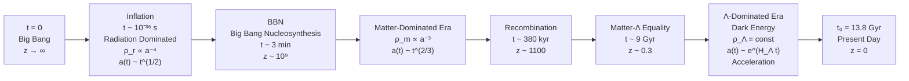

# Lesson 1: Fundamental Laws, Cosmological Framework

## 1. First-Principles Intuition & Invariants

The universe, when observed at sufficiently large scales, presents a profound puzzle that requires abandoning our terrestrial intuitions about space, time, and gravity. Newtonian mechanics, despite its spectacular success in describing planetary motion and terrestrial phenomena, fundamentally breaks down when confronted with velocities approaching the speed of light or gravitational fields strong enough to curve spacetime itself. To understand cosmology—the physics of the universe as a whole—we must reconstruct our understanding of reality from first principles, beginning with Einstein's profound insight that space and time are not separate, absolute entities but rather unified components of a single dynamical fabric that responds to the presence of mass and energy.

Special relativity emerges from two deceptively simple postulates that Einstein formulated in 1905: first, the laws of physics are identical in all inertial reference frames, and second, the speed of light in vacuum is constant for all observers regardless of their relative motion. These principles force us to abandon the notion of absolute simultaneity. Events that appear simultaneous to one observer occur at different times for another observer in relative motion. The mathematical structure encoding this radical revision is the Lorentz transformation, which relates coordinates between inertial frames moving at constant velocity $\vec{v}$ relative to one another. For motion along the $x$-axis, these transformations take the form:

$$x' = \gamma(x - vt), \quad t' = \gamma\left(t - \frac{vx}{c^2}\right), \quad \gamma = \frac{1}{\sqrt{1 - v^2/c^2}}$$

where $\gamma$ is the Lorentz factor, diverging to infinity as $v \to c$. The quantity $c \approx 2.998 \times 10^8 \, \text{m/s}$ represents not merely the speed of electromagnetic radiation but rather the maximum causal propagation speed in the universe—the conversion factor between space and time in the geometry of spacetime.

These transformations reveal that time dilation and length contraction are not optical illusions but genuine physical effects. A clock moving at velocity $v$ relative to an observer ticks more slowly by the factor $\gamma$, while a ruler oriented along the direction of motion appears contracted by the factor $1/\gamma$. The experimental confirmation of these predictions is overwhelming: high-energy particle accelerators routinely observe muons (unstable particles with rest-frame lifetimes of $\tau_0 \approx 2.2 \, \mu\text{s}$) traveling dozens of meters before decay, a distance impossible without time dilation extending their laboratory-frame lifetimes to $\gamma \tau_0$.

Special relativity unifies space and time into a four-dimensional manifold called Minkowski spacetime, endowed with a metric structure that encodes causal relationships. Events are represented as four-vectors $x^\mu = (ct, x, y, z)$ where Greek indices run from 0 to 3. The invariant spacetime interval between two events is:

$$\Delta s^2 = -c^2 \Delta t^2 + \Delta x^2 + \Delta y^2 + \Delta z^2 = \eta_{\mu\nu} \Delta x^\mu \Delta x^\nu$$

where $\eta_{\mu\nu} = \text{diag}(-1, +1, +1, +1)$ is the Minkowski metric tensor. This interval is Lorentz-invariant: all observers, regardless of their state of motion, compute the same value for $\Delta s^2$. Events are classified by the sign of this interval: timelike-separated ($\Delta s^2 < 0$) for causally connected events, spacelike-separated ($\Delta s^2 > 0$) for events that cannot influence each other, and null-separated ($\Delta s^2 = 0$) for events connected by light rays.

The four-momentum of a particle with rest mass $m_0$ is $p^\mu = (E/c, \vec{p})$ where the energy-momentum relation $E^2 = (pc)^2 + (m_0 c^2)^2$ replaces the classical kinetic energy formula. For massless particles like photons, this reduces to $E = pc$, establishing the wave-particle duality relationship $E = h\nu = \hbar\omega$ and $p = h/\lambda = \hbar k$ that forms the foundation of quantum mechanics. The relativistic Doppler shift for light emitted by a source moving radially at velocity $v$ is:

$$\frac{\lambda_{\text{obs}}}{\lambda_{\text{emit}}} = \sqrt{\frac{1 + v/c}{1 - v/c}}$$

This formula will become critical when we discuss cosmological redshift, though we must carefully distinguish between Doppler shifts (kinematic effects in flat spacetime) and redshifts caused by the expansion of space itself.

General relativity extends these ideas to incorporate gravity, which Einstein reinterpreted not as a force but as curvature of spacetime induced by mass-energy. The equivalence principle—the empirical observation that inertial mass and gravitational mass are identical—suggests that an observer in free fall experiences no gravitational field, while an observer at rest in a gravitational field is equivalent to an observer accelerating in flat spacetime. This principle led Einstein to the profound conclusion that gravity is not a field living in spacetime but rather a property of spacetime geometry itself.

The mathematical formalism of general relativity describes spacetime as a four-dimensional pseudo-Riemannian manifold endowed with a metric tensor $g_{\mu\nu}(x)$ that varies from point to point. The metric determines proper time intervals along worldlines through:

$$d\tau^2 = -\frac{1}{c^2} g_{\mu\nu} dx^\mu dx^\nu$$

where we adopt the signature convention $(-,+,+,+)$. The curvature of spacetime is encoded in the Riemann curvature tensor $R^\rho_{\,\,\sigma\mu\nu}$, constructed from second derivatives of the metric. From this tensor we construct the Ricci tensor $R_{\mu\nu} = R^\rho_{\,\,\mu\rho\nu}$ and the Ricci scalar $R = g^{\mu\nu} R_{\mu\nu}$. The Einstein field equations, which govern the relationship between matter-energy and spacetime curvature, take the elegant form:

$$R_{\mu\nu} - \frac{1}{2} g_{\mu\nu} R + \Lambda g_{\mu\nu} = \frac{8\pi G}{c^4} T_{\mu\nu}$$

Here $T_{\mu\nu}$ is the stress-energy tensor encoding the distribution of matter and energy, $G \approx 6.674 \times 10^{-11} \, \text{m}^3 \text{kg}^{-1} \text{s}^{-2}$ is Newton's gravitational constant, and $\Lambda$ is the cosmological constant that Einstein originally introduced to allow static universe solutions before abandoning it as his "greatest blunder" upon learning of cosmic expansion—only for modern cosmology to resurrect it as dark energy.

The left side of Einstein's equations represents pure geometry: it describes how spacetime curves. The right side represents matter-energy content. The equation states that matter tells spacetime how to curve, and curved spacetime tells matter how to move. Particles follow geodesics—paths of extremal proper time—in this curved geometry, which we perceive as gravitational attraction. The deviation of geodesics from straight lines in flat space is what we experience as gravitational acceleration.

The cosmological principle asserts that on sufficiently large scales (beyond roughly 100 Mpc, where 1 megaparsec $\approx 3.086 \times 10^{22}$ m), the universe is homogeneous (the same at every location) and isotropic (the same in every direction). This symmetry assumption is not a logical necessity but an empirical observation supported by multiple independent datasets: the cosmic microwave background radiation exhibits temperature fluctuations of only $\Delta T / T \sim 10^{-5}$ after subtracting the dipole anisotropy from our motion relative to the CMB rest frame, and galaxy surveys show statistical uniformity when volumes larger than $(100 \, \text{Mpc})^3$ are considered.

These symmetries drastically constrain the form of the metric. A spacetime that is spatially homogeneous and isotropic at each instant of cosmic time $t$ must have a metric of the Robertson-Walker form:

$$ds^2 = -c^2 dt^2 + a^2(t) \left[ \frac{dr^2}{1 - kr^2} + r^2(d\theta^2 + \sin^2\theta \, d\phi^2) \right]$$

Here $a(t)$ is the dimensionless scale factor describing how distances between comoving observers grow or shrink with time, while $k$ is the spatial curvature parameter taking values $+1$ (closed, positive curvature like a 3-sphere), $0$ (flat, Euclidean geometry), or $-1$ (open, negative curvature like a hyperbolic space). The coordinates $(r, \theta, \phi)$ are comoving coordinates that expand with the universe itself, so galaxies at rest in these coordinates maintain constant $(r, \theta, \phi)$ values even as physical distances grow proportional to $a(t)$.

The physical distance between two comoving observers separated by coordinate distance $\Delta r$ is $d_{\text{phys}}(t) = a(t) \Delta r$. The Hubble parameter $H(t) = \dot{a}/a$ (where overdot denotes time derivative) quantifies the expansion rate at time $t$. Its present value $H_0 = H(t_0)$, called the Hubble constant, is measured to be $H_0 \approx 70 \, \text{km/s/Mpc}$ with ongoing tension between different measurement methods. The inverse $H_0^{-1} \approx 14 \, \text{Gyr}$ sets the characteristic age and size scale of the observable universe.

Inserting the Robertson-Walker metric into Einstein's field equations yields the Friedmann equations, which govern cosmic evolution. The first Friedmann equation is:

$$H^2 = \left(\frac{\dot{a}}{a}\right)^2 = \frac{8\pi G}{3}\rho - \frac{kc^2}{a^2} + \frac{\Lambda c^2}{3}$$

where $\rho(t)$ is the total energy density of the universe. The second Friedmann equation, derivable from the first combined with energy conservation, is:

$$\frac{\ddot{a}}{a} = -\frac{4\pi G}{3}\left(\rho + \frac{3p}{c^2}\right) + \frac{\Lambda c^2}{3}$$

where $p$ is the pressure. These equations are supplemented by the continuity equation expressing energy conservation:

$$\dot{\rho} + 3\frac{\dot{a}}{a}\left(\rho + \frac{p}{c^2}\right) = 0$$

Each cosmic component—matter, radiation, dark energy—contributes to the total energy density and obeys an equation of state $p = w\rho c^2$ where $w$ is a dimensionless parameter. For non-relativistic matter (baryons and cold dark matter), pressure is negligible so $w_m \approx 0$ and $\rho_m \propto a^{-3}$ (density dilutes as volume expands). For radiation (photons and relativistic particles), $w_r = 1/3$ and $\rho_r \propto a^{-4}$ (the extra $a^{-1}$ factor arises because photon wavelengths stretch with expansion, reducing energy). For a cosmological constant representing vacuum energy, $w_\Lambda = -1$ and $\rho_\Lambda$ remains constant.

It is conventional to express densities as fractions of the critical density $\rho_c = 3H^2/(8\pi G)$ required for a flat universe: $\Omega_i = \rho_i/\rho_c$. The first Friedmann equation can then be written:

$$\Omega_m + \Omega_r + \Omega_\Lambda + \Omega_k = 1$$

where $\Omega_k = -kc^2/(a^2 H^2)$ represents curvature. Current observations from the Planck satellite and other sources indicate $\Omega_m \approx 0.31$, $\Omega_\Lambda \approx 0.69$, $\Omega_r \approx 10^{-4}$, and $\Omega_k \approx 0$ to high precision, establishing that we live in a spatially flat, accelerating universe dominated by dark energy and dark matter.

Cosmological redshift arises not from Doppler motion through space but from the expansion of space itself. A photon emitted at cosmic time $t_e$ with wavelength $\lambda_e$ travels through expanding space and is observed at time $t_0$ with wavelength $\lambda_0$. The ratio of wavelengths equals the ratio of scale factors:

$$1 + z = \frac{\lambda_0}}{\lambda_e} = \frac{a(t_0)}{a(t_e)}$$

where $z$ is the redshift parameter. For nearby objects where $(t_0 - t_e)$ is small, Taylor expansion gives $z \approx H_0 d/c$ (Hubble's law), but for distant objects the relationship between redshift and distance becomes nonlinear and depends on the full expansion history $a(t)$.

The proper distance to an object at redshift $z$ (the distance measured by a chain of rulers at the present time $t_0$) is:

$$d_{\text{proper}} = c \int_{t_e}^{t_0} \frac{dt}{a(t)} = c \int_0^z \frac{dz'}{H(z')}$$

where $H(z) = H_0 \sqrt{\Omega_m (1+z)^3 + \Omega_r (1+z)^4 + \Omega_k (1+z)^2 + \Omega_\Lambda}$. This integral cannot be evaluated in closed form for general $\Omega_i$ values, requiring numerical integration for observational cosmology. The luminosity distance $d_L = d_{\text{proper}}(1+z)$ and angular diameter distance $d_A = d_{\text{proper}}/(1+z)$ differ from proper distance due to expansion effects on photon energies and solid angles.

The particle horizon—the maximum comoving distance from which light could have reached us by time $t$—is:

$$\chi_{\text{horizon}}(t) = c \int_0^t \frac{dt'}{a(t')} = c \int_z^\infty \frac{dz'}{H(z')}$$

For our universe with dark energy, this integral converges, yielding a finite observable universe with comoving radius $\chi_{\text{horizon}}(t_0) \approx 14 \, \text{Gpc}$ corresponding to a present-day proper distance (accounting for expansion during light travel time) of roughly $46 \, \text{Gpc}$. Objects beyond this horizon are causally disconnected from us; their light has not yet had time to reach us.

## 2. Core Architecture & Mechanics

The mathematical machinery of general relativity operates through tensor calculus on curved manifolds, requiring careful attention to coordinate systems, covariant derivatives, and index notation conventions. The metric tensor $g_{\mu\nu}$ serves as the fundamental field variable, encoding both the geometry of spacetime and the gravitational potential. In local inertial coordinates (freely falling frames), the metric reduces to the Minkowski form $\eta_{\mu\nu}$ at a point, but curvature manifests through tidal forces—gradients of the gravitational field that cannot be transformed away.

The connection between geometry and dynamics flows through the Christoffel symbols, which encode how basis vectors change from point to point in curved space:

$$\Gamma^\lambda_{\mu\nu} = \frac{1}{2} g^{\lambda\rho} \left( \partial_\mu g_{\nu\rho} + \partial_\nu g_{\mu\rho} - \partial_\rho g_{\mu\nu} \right)$$

These symbols are not tensors—they transform inhomogeneously under coordinate changes—but they allow construction of the covariant derivative operator $\nabla_\mu$, which generalizes the ordinary partial derivative to curved spaces while preserving tensor transformation properties. The geodesic equation describing free-fall trajectories takes the form:

$$\frac{d^2 x^\lambda}{d\tau^2} + \Gamma^\lambda_{\mu\nu} \frac{dx^\mu}{d\tau} \frac{dx^\nu}{d\tau} = 0$$

where $\tau$ is proper time along the worldline. This second-order differential equation determines the motion of particles and photons in curved spacetime, replacing Newton's $\vec{F} = m\vec{a}$ in the gravitational context.

For the Robertson-Walker metric, the Christoffel symbols simplify considerably due to high symmetry. The only nonzero time-space components involve the Hubble parameter and its derivative. Computing the Ricci tensor and Ricci scalar from these symbols and substituting into Einstein's equations yields the Friedmann equations directly. This calculation, while tedious, reveals that cosmic expansion is a purely geometric phenomenon: galaxies recede from each other not because they move through space but because space itself expands.

The stress-energy tensor for a perfect fluid—an excellent approximation for cosmic matter and radiation—takes the diagonal form:

$$T^{\mu\nu} = (\rho c^2 + p) u^\mu u^\nu + p g^{\mu\nu}$$

where $u^\mu = dx^\mu/d\tau$ is the four-velocity of the fluid. For comoving observers at rest in the cosmic rest frame, $u^\mu = (1/c, 0, 0, 0)$ and the stress-energy tensor reduces to $T^{00} = \rho c^2$, $T^{ii} = p$ (no summation). The $00$-component of Einstein's equations yields the first Friedmann equation, while the trace yields the acceleration equation. The contracted Bianchi identity $\nabla_\mu T^{\mu\nu} = 0$ guarantees local energy-momentum conservation, producing the continuity equation.

Physical observables in cosmology are constructed from the metric and matter fields. Redshift measurements come from comparing observed and rest-frame spectral lines: hydrogen Lyman-alpha at 121.6 nm, oxygen forbidden lines, or supernova light curves. Type Ia supernovae serve as standardizable candles with absolute magnitude $M \approx -19.3$ in the $B$-band after width-luminosity corrections. The distance modulus:

$$\mu = m - M = 5\log_{10}\left(\frac{d_L}{\text{10 pc}}\right)$$

relates apparent magnitude $m$ to luminosity distance $d_L$. Plotting $\mu(z)$ for distant supernovae revealed cosmic acceleration in 1998, establishing the existence of dark energy.

The cosmic microwave background provides a snapshot of the universe at $z \approx 1100$ when photons decoupled from matter. The angular power spectrum of CMB temperature fluctuations, expanded in spherical harmonics as:

$$\frac{\Delta T}{T}(\hat{n}) = \sum_{\ell m} a_{\ell m} Y_{\ell m}(\hat{n})$$

encodes information about curvature (through the angular scale of the first acoustic peak), matter density (through peak heights), and baryon density (through peak positions). The power spectrum $C_\ell = \langle |a_{\ell m}|^2 \rangle$ fits the Lambda-CDM model to sub-percent precision, constraining cosmological parameters with extraordinary accuracy.

The concordance Lambda-CDM model—cold dark matter plus cosmological constant—successfully describes cosmic evolution from Big Bang nucleosynthesis at $t \sim 3$ minutes through structure formation to the present accelerating epoch. Its six free parameters ($\Omega_m h^2$, $\Omega_b h^2$, $h$, $\tau$, $n_s$, $\sigma_8$) are measured to percent-level precision through complementary probes: CMB, supernovae, baryon acoustic oscillations, weak gravitational lensing, and galaxy clustering.

## 3. High-Performance Optimization & Failure Modes

Practical astrophysics and cosmology demand both analytical insight and computational power. Solving Einstein's equations for realistic matter distributions requires numerical relativity codes that evolve the metric tensor on discrete spacetime grids. The Friedmann equations, though ordinary differential equations in the homogeneous case, require integration with high precision across many decades in scale factor when computing distance-redshift relations for observational programs.

Standard integration techniques for cosmological distances employ adaptive Runge-Kutta or Gauss-Legendre quadrature, taking care to handle the integrand's behavior near singularities. The integral $d_L(z) = \frac{c(1+z)}{H_0} \int_0^z \frac{dz'}{\sqrt{\Omega_m(1+z')^3 + \Omega_\Lambda}}$ (for flat universes) requires evaluating the square root for redshifts spanning $z \in [0, 10]$ or beyond for the highest-redshift quasars and galaxies. Tabulating this function on a logarithmic $z$-grid and interpolating avoids repeated integration, reducing computational cost by orders of magnitude in survey analysis pipelines processing millions of galaxies.

Bayesian parameter estimation from cosmological datasets involves exploring high-dimensional parameter spaces using Markov Chain Monte Carlo (MCMC) or nested sampling algorithms. The likelihood function $\mathcal{L}(\text{data}|\theta)$ for a set of cosmological parameters $\theta = (\Omega_m, \Omega_\Lambda, h, \ldots)$ is computed by predicting observables (distances, CMB angular power spectra, matter power spectra) for each proposed $\theta$ and comparing with measurements including covariance matrices. Modern CMB analyses like Planck require evaluating thousands of multipoles $\ell \in [2, 2500]$, each involving line-of-sight integrals through recombination and reionization. Codes like CAMB and CLASS accelerate this by using transfer function approximations and parallel processing across parameter chains.

Systematic uncertainties dominate statistical errors in contemporary cosmology. Distance ladder measurements of $H_0$ using Cepheid variables and supernovae yield $H_0 = 73.0 \pm 1.0 \, \text{km/s/Mpc}$, while CMB-based determinations in Lambda-CDM give $H_0 = 67.4 \pm 0.5 \, \text{km/s/Mpc}$. This "$H_0$ tension" at $4\text{-}5\sigma$ significance remains unresolved and may indicate new physics beyond Lambda-CDM: evolving dark energy, interactions between dark matter and dark energy, or modified gravity at cosmological scales.

Observational systematics include photometric calibration errors, dust extinction corrections, peculiar velocity contamination at low redshift, and selection biases in flux-limited surveys. The "cosmic variance" from finite sampling of density fluctuations imposes fundamental statistical limits: measuring large-scale structure modes with wavelength $\lambda \sim 100 \, \text{Mpc}$ in a survey volume $(1 \, \text{Gpc})^3$ samples only $\sim (1000/100)^3 = 1000$ independent modes, yielding $\sim 3\%$ fractional uncertainty.

Weak gravitational lensing measurements require exquisite control of point-spread functions and shear systematics. Galaxy shapes are distorted by percent-level effects from intervening large-scale structure, but atmospheric seeing and telescope optics produce much larger PSF anisotropies that must be modeled and removed. Next-generation surveys like Rubin Observatory LSST and ESA Euclid will image billions of galaxies, probing dark energy equation of state evolution through $w(z) = w_0 + w_a(1-a)$ parameterizations with sub-percent precision.

Theoretical uncertainties in nonlinear structure formation affect predictions for small-scale clustering and lensing. The matter power spectrum transitions from linear perturbation theory ($\delta \rho / \rho \ll 1$) on large scales to nonlinear N-body dynamics ($\delta \rho / \rho \gg 1$) on scales below $\sim 10 \, \text{Mpc}$. Baryonic physics—gas cooling, star formation, supernova feedback, AGN jets—further complicates predictions. Hydrodynamic simulations like IllustrisTNG and EAGLE model these processes, but residual uncertainties limit precision cosmology from small-scale observables.

The robustness of Lambda-CDM against modifications illustrates both its success and potential fragility. Modified gravity theories like $f(R)$ gravity or scalar-tensor theories alter the Friedmann equations and growth of structure, producing observational signatures in weak lensing and redshift-space distortions. Early dark energy models attempt to resolve the $H_0$ tension by increasing the expansion rate at recombination. Distinguishing these models requires combining multiple probes to break degeneracies: CMB constrains early-universe physics, supernovae probe intermediate redshifts, and large-scale structure tests late-time growth.

The cosmological constant problem—why $\rho_\Lambda$ is $10^{120}$ times smaller than naive quantum field theory predictions—remains one of physics' deepest mysteries. Vacuum energy contributions from particle physics should gravitate, yet observations require extraordinary fine-tuning or new symmetry principles. Anthropic arguments in the multiverse context suggest that only universes with small $\Lambda$ permit structure formation and observers, but this explanation remains controversial and non-falsifiable.

Precision cosmology also confronts foundational questions about the cosmological principle itself. Does the universe remain homogeneous and isotropic on sufficiently large scales, or do we inhabit a special location in an inhomogeneous cosmos? Tests using the kinetic Sunyaev-Zeldovich effect, gravitational lensing, and redshift-space distortions constrain bulk flows and dipole anisotropies, finding consistency with the cosmological principle to current precision, but ongoing surveys will probe ever-larger volumes.

Numerical simulations of cosmic structure formation integrate the trajectories of billions of dark matter particles and gas cells from early perturbations to present-day galaxies and clusters. The Millennium Simulation (2005) and its successors track $(2.16 \times 10^{10})$ particles in a $(500 \, \text{Mpc})^3$ box, resolving halos down to $10^{10} M_\odot$. These simulations validate the cold dark matter paradigm's predictions for halo mass functions, concentration-mass relations, and assembly histories, though small-scale tensions persist: simulations predict cuspy halo density profiles while observations favor cores, and more satellite galaxies than observed (the "missing satellites problem").

Particle horizon calculations reveal causal paradoxes in the standard big bang model. The CMB exhibits uniform temperature $T = 2.7255 \, \text{K}$ to $10^{-5}$ precision across regions separated by angles far exceeding the causal horizon size at recombination. This "horizon problem" finds resolution in cosmic inflation—a brief epoch of exponential expansion $a(t) \propto e^{Ht}$ at $t \sim 10^{-36} \, \text{s}$ driven by a scalar inflaton field. Inflation stretches quantum fluctuations to cosmological scales, generating the initial density perturbations that seed all structure. The near-scale-invariant primordial power spectrum $P(k) \propto k^{n_s}$ with $n_s \approx 0.96$ measured by Planck provides smoking-gun evidence, though the microphysics of inflation remains unknown.

Gravitational wave observations by LIGO-Virgo-KAGRA probe spacetime dynamics directly through the propagation of metric perturbations at light speed. Binary black hole mergers at cosmological distances produce measurable redshifts in the gravitational waveform, offering independent distance estimates and new constraints on cosmic expansion. Future detectors like LISA will observe supermassive black hole mergers at $z \sim 10$, potentially revealing the equation of state of dark energy and modified gravity effects through gravitational wave luminosity distances.

The convergence of multi-messenger astronomy—electromagnetic, gravitational, and neutrino observations—inaugurates precision cosmology's mature phase. The combined constraints from Planck CMB, Pantheon supernovae, DES weak lensing, and BOSS baryon acoustic oscillations yield sub-percent measurements of $\Omega_m$ and $\Omega_\Lambda$, confirming Lambda-CDM as the standard cosmological model. Yet the $H_0$ tension, dark matter's particle identity, and dark energy's fundamental nature ensure that cosmology remains a frontier where theoretical predictions confront observational reality, driving the search for physics beyond the Standard Model and general relativity.
