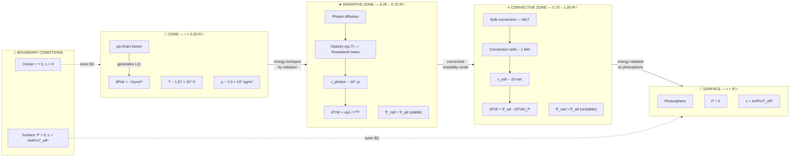
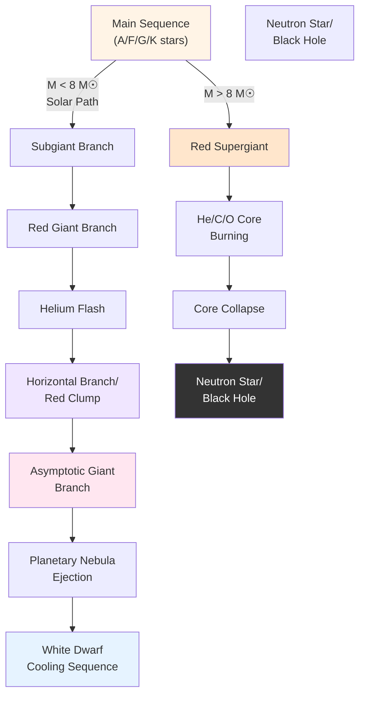

# Lesson 2: Stellar Structure & Evolution

## 1. First-Principles Intuition & Invariants

There is a profound paradox at the heart of every star. A mass of plasma numbering in the range of $10^{57}$ hydrogen atoms is simultaneously trying to collapse under its own gravity and explode outward from the thermonuclear inferno ignited at its core. The fact that stars exist at all, that the Sun has burned steadily for 4.6 billion years without either imploding into a black hole or vaporizing the solar system, is a consequence of one of the most elegant balancing acts in all of physics: hydrostatic equilibrium.

Understanding stellar structure means understanding this balance not as a lucky coincidence but as a dynamical attractor. Stars settle into equilibrium because they are self-regulating thermostats. If the core overheats, it expands, cools, and reduces fusion rate. If it undercooks, gravity compresses the plasma until temperatures rise and fusion reignites. This feedback loop is the engine of stellar stability, and unraveling its precise mathematical form is the central task of stellar structure theory.

### Hydrostatic Equilibrium

Consider a thin spherical shell of stellar material at radius $r$ from the center, with thickness $dr$ and density $\rho(r)$. The shell experiences a gravitational pull inward from all the mass $M(r)$ interior to it, and a net pressure force from the pressure gradient across its thickness. Setting these forces equal per unit volume yields the fundamental equation of stellar structure:

$$\frac{dP}{dr} = -\frac{G M(r) \rho(r)}{r^2}$$

where $P(r)$ is the local pressure, $G$ is the gravitational constant, $M(r)$ is the enclosed mass at radius $r$, and $\rho(r)$ is the local mass density. This is not an approximation; it is an exact statement of static mechanical equilibrium. The companion equation, which tracks how mass accumulates with radius, is:

$$\frac{dM}{dr} = 4\pi r^2 \rho(r)$$

Together, these two equations constitute the structural backbone of any stellar model. Every other equation of stellar structure — energy generation, radiative transport, convection — feeds into the pressure and density profiles that these two equations constrain. Notice the dimensional content: pressure carries units of $\text{Pa} = \text{kg m}^{-1}\text{s}^{-2}$, while the right-hand side delivers $\text{kg m}^{-2} \cdot \text{m}^{-3} \cdot \text{m}^{-2} \cdot \text{m} \cdot \text{m}^3 = \text{kg m}^{-1}\text{s}^{-2}$, which is dimensionally consistent.

The pressure itself in a stellar interior is not simply the ideal gas pressure of classical thermodynamics. It is composite, receiving contributions from thermal gas pressure, radiation pressure from the photon field, and in degenerate objects like white dwarfs, quantum electron degeneracy pressure. For a fully ionized plasma of mean molecular weight $\mu$ (measured in atomic mass units), the total pressure can be written:

$$P = \frac{\rho k_B T}{\mu m_H} + \frac{1}{3}aT^4$$

where $k_B$ is Boltzmann's constant, $m_H$ is the hydrogen mass, and $a = 4\sigma/c$ is the radiation constant with $\sigma$ the Stefan-Boltzmann constant. The first term dominates in lower-mass stars; the second term becomes significant in massive stars above roughly $10\, M_\odot$, where radiation pressure can destabilize the outer envelope and drive strong stellar winds.

### The Virial Theorem

Before descending into the machinery of energy transport and nuclear burning, it is worth pausing to establish the virial theorem as the deepest physical intuition behind stellar structure. For a gravitationally bound gas in equilibrium, the total thermal kinetic energy $U$ and the gravitational potential energy $\Omega$ obey:

$$2U + \Omega = 0$$

This has a remarkable and counterintuitive consequence. When a star loses energy by radiating photons into space, it does not simply cool down. It contracts, and by contracting, it converts gravitational potential energy into thermal energy. Half of that released gravitational energy goes into heating the star, while the other half is radiated away. Stars get hotter as they lose energy. This is the negative heat capacity of self-gravitating systems, and it governs every phase of stellar evolution from pre-main-sequence contraction through the death of massive stars.

### Energy Transport: Radiation and Convection

Generating energy in the core is only half the stellar problem. That energy must be transported from the core to the photosphere and ultimately radiated into space, and the mechanism by which this happens fundamentally shapes the internal structure. Two mechanisms compete: radiative diffusion and convective overturn.

In the radiative transport regime, photons execute a random walk outward through the plasma. Each photon is absorbed and re-emitted by ions and electrons on a mean free path of order millimeters to centimeters in the solar interior. The net outward energy flux from this diffusive process is governed by the radiative temperature gradient:

$$\frac{dT}{dr}\bigg|_\text{rad} = -\frac{3\kappa \rho L(r)}{64\pi \sigma r^2 T^3}$$

where $\kappa$ is the Rosseland mean opacity (units of $\text{cm}^2\, \text{g}^{-1}$, measuring how opaque the plasma is to radiation), and $L(r)$ is the luminosity — the total power flowing outward through the shell at radius $r$. The opacity $\kappa$ depends on temperature, density, and chemical composition through processes including electron scattering, free-free absorption (bremsstrahlung), and bound-free photoionization. In the solar interior, electron scattering opacity dominates, with $\kappa \approx 0.2(1+X)\, \text{cm}^2\,\text{g}^{-1}$ where $X$ is the hydrogen mass fraction.

Convection activates when the actual temperature gradient that radiation requires exceeds the adiabatic temperature gradient that a rising blob of plasma would experience. This is the Schwarzschild stability criterion:

$$\nabla_\text{rad} > \nabla_\text{ad}$$

where $\nabla \equiv d\ln T / d\ln P$ is the logarithmic temperature gradient, and $\nabla_\text{ad} = (\gamma-1)/\gamma = 2/5$ for a monatomic ideal gas with $\gamma = 5/3$. When this inequality holds, the plasma becomes convectively unstable. Hot, buoyant blobs rise, cool blobs sink, and the dominant energy transport mechanism switches from photon diffusion to bulk fluid motion. The Sun's outer envelope, from roughly $0.7\,R_\odot$ to the photosphere, is convectively unstable. This convection zone is directly observable in the granulation pattern on the solar surface, where individual convective cells up to 1,000 km in diameter churn on timescales of roughly ten minutes.

For the practical stellar modeler, mixing-length theory (MLT) provides the standard treatment of convection. MLT parameterizes the efficiency of convective transport through the mixing-length parameter $\alpha_\text{MLT}$, defined as the ratio of the characteristic eddy scale to the local pressure scale height $H_P = -dr/d\ln P$. Despite being a crude one-parameter model, MLT calibrated against the Sun ($\alpha_\text{MLT} \approx 1.5$–$2.0$) works remarkably well for solar-type stars. Its failure modes are most severe in the convective envelopes of red giants and in the convective cores of massive main-sequence stars, where three-dimensional hydrodynamic simulations with codes like MUSIC or PROMPI increasingly supplement or replace it.

### Nuclear Fusion Chains

The energy source that keeps stars alive against gravitational collapse is thermonuclear fusion. In the solar core, where temperatures reach $1.57 \times 10^7$ K and densities reach $1.5 \times 10^5\, \text{kg m}^{-3}$, hydrogen nuclei fuse into helium through the proton-proton (pp) chain. The dominant branch, pp-I, proceeds as:

$$p + p \to\, ^2\text{H} + e^+ + \nu_e \qquad (Q = 0.42\,\text{MeV})$$

$$^2\text{H} + p \to\, ^3\text{He} + \gamma \qquad (Q = 5.49\,\text{MeV})$$

$$^3\text{He} +\, ^3\text{He} \to\, ^4\text{He} + 2p \qquad (Q = 12.86\,\text{MeV})$$

The net reaction converts four protons into one helium-4 nucleus, two positrons, and two neutrinos, releasing approximately 26.7 MeV per reaction cycle. The first step, the diproton weak interaction, is excruciatingly slow — a single proton in the solar core waits on average around $10^{10}$ years before fusing — and this bottleneck is precisely why the Sun burns at a measured, stellar pace rather than detonating. The rate of the pp-I chain scales approximately as $\epsilon_\text{pp} \propto \rho X^2 T^4$, making it relatively insensitive to temperature compared to higher-order chains.

In stars more massive than roughly $1.3\,M_\odot$, where core temperatures exceed $\sim 1.8 \times 10^7$ K, the CNO cycle dominates hydrogen burning. Carbon, nitrogen, and oxygen serve as catalysts, cycling through a sequence of proton captures and beta decays:

$$^{12}\text{C} + p \to\, ^{13}\text{N} + \gamma \to\, ^{13}\text{C} + e^+ + \nu_e$$

$$^{13}\text{C} + p \to\, ^{14}\text{N} + \gamma$$

$$^{14}\text{N} + p \to\, ^{15}\text{O} + \gamma \to\, ^{15}\text{N} + e^+ + \nu_e$$

$$^{15}\text{N} + p \to\, ^{12}\text{C} +\, ^4\text{He}$$

The net result is the same as the pp chain: four protons become one helium-4 nucleus with the release of $\sim 26.7$ MeV. However, the CNO cycle has a dramatically steeper temperature sensitivity, with $\epsilon_\text{CNO} \propto T^{20}$ near $T \sim 2 \times 10^7$ K. This steep dependence drives a sharp, steep temperature gradient in the core that triggers the Schwarzschild instability, producing a convective core in higher-mass main-sequence stars.

---

## 2. Core Architecture & Mechanics

### The Complete System of Stellar Structure Equations

A stellar model in hydrostatic equilibrium is fully specified by four coupled ordinary differential equations. With the stellar mass as an independent variable (the Lagrangian mass coordinate $m$, which replaces $r$ and simplifies the numerics), these are:

$$\frac{\partial r}{\partial m} = \frac{1}{4\pi r^2 \rho}$$

$$\frac{\partial P}{\partial m} = -\frac{Gm}{4\pi r^4}$$

$$\frac{\partial L}{\partial m} = \epsilon_\text{nuc} - \epsilon_\nu + \epsilon_\text{grav}$$

$$\frac{\partial T}{\partial m} = -\frac{GmT}{4\pi r^4 P}\nabla$$

where $\nabla = \nabla_\text{rad}$ in radiatively stable zones and $\nabla \approx \nabla_\text{ad}$ in convectively unstable zones (the adiabatic approximation, valid for efficient convection). The term $\epsilon_\text{nuc}$ is the nuclear energy generation rate per unit mass, $\epsilon_\nu$ accounts for neutrino losses (critical in evolved stars), and $\epsilon_\text{grav}$ captures the gravitational energy released or absorbed during contraction or expansion. These four equations are supplemented by an equation of state $P(\rho, T, X_i)$, opacity tables $\kappa(\rho, T, X_i)$, and nuclear reaction network equations that evolve the composition vector $X_i$ in time.

This system is a two-point boundary value problem. At the center, the boundary conditions are $r(0) = 0$ and $L(0) = 0$ (no net flux through the center). At the surface, the conditions are $P(M_*) \approx 0$, $T(M_*) = T_\text{eff}$, and $L(M_*) = 4\pi R_*^2 \sigma T_\text{eff}^4$. Numerical stellar evolution codes solve this system using shooting methods or relaxation methods on a mass mesh of typically $10^3$ to $10^4$ zones.

### Polytropic Models

Before the era of numerical computation, the complexity of these equations was tamed through polytropic approximations, which remain indispensable for physical intuition and for benchmarking numerical codes. A polytrope assumes a power-law equation of state relating pressure and density:

$$P = K \rho^{1 + 1/n}$$

where $n$ is the polytropic index and $K$ is a constant set by composition and entropy. When this is substituted into the equation of hydrostatic equilibrium together with Poisson's equation for gravity, the result is the Lane-Emden equation:

$$\frac{1}{\xi^2}\frac{d}{d\xi}\left(\xi^2 \frac{d\theta}{d\xi}\right) = -\theta^n$$

Here $\xi = r/\alpha$ is a dimensionless radial coordinate with $\alpha^2 = (n+1)K\rho_c^{(1/n - 1)}/(4\pi G)$, and $\theta(\xi)$ is the dimensionless temperature, defined so that $\rho = \rho_c \theta^n$. The boundary conditions are $\theta(0) = 1$ and $\theta'(0) = 0$. The stellar surface is at the first zero of $\theta$, denoted $\xi_1$.

The Lane-Emden equation admits closed-form analytical solutions for $n=0$ (uniform density sphere), $n=1$, and $n=5$ (infinite radius). For the physically important cases $n=3/2$ (fully convective star, non-relativistic degenerate gas, also the Eddington standard model for $\gamma = 5/3$ adiabats) and $n=3$ (Eddington standard model, radiative pressure-dominated star, relativistically degenerate electron gas), numerical integration is required. The Sun is reasonably approximated by $n \approx 3$, while fully convective low-mass M dwarfs and pre-main-sequence protostars are well described by $n = 3/2$.

The mass-radius relation that emerges from polytropic models takes the form:

$$R \propto K^{n/(3-n)} M^{(1-n)/(3-n)}$$

For $n=3$, this relation becomes independent of $K$ and implies a unique mass for any value of $K$, the physical meaning of which emerges when applied to white dwarfs: the $n=3$ relativistic degeneracy limit gives the Chandrasekhar mass $M_\text{Ch} \approx 1.44\,M_\odot$, the maximum mass a cold degenerate object can support before gravitational collapse overcomes electron degeneracy pressure.

### The Hertzsprung-Russell Diagram as a Structural Map

The Hertzsprung-Russell (HR) diagram is not merely a cataloging tool. It is a direct projection of the stellar structure equations onto observable space. Each point on the diagram corresponds to a unique combination of surface temperature $T_\text{eff}$ and bolometric luminosity $L$, related through the Stefan-Boltzmann law:

$$L = 4\pi R^2 \sigma T_\text{eff}^4$$

Lines of constant radius therefore appear as diagonal lines of slope $-4$ in log $L$ versus log $T_\text{eff}$ space. The main sequence — that narrow diagonal band running from hot, luminous O-type stars in the upper left to cool, faint M dwarfs in the lower right — is the locus of core hydrogen-burning stars in thermal equilibrium. Stars spend the majority of their nuclear lifetime on the main sequence, which is why it is so heavily populated in any observed cluster.

The main sequence exists because the central pressure required for hydrostatic equilibrium uniquely determines the central temperature, which in turn determines the nuclear burning rate and hence the luminosity for a given mass. This is the mass-luminosity relation, one of the most powerful empirical and theoretical results in stellar astrophysics. For main-sequence stars, dimensional analysis and polytropic models predict:

$$L \propto M^{4-n}$$

For $n=3$ (Eddington standard model in the electron-scattering opacity regime), this gives $L \propto M^3$, which matches observations reasonably well: the empirical fit across the mass range $0.3$–$30\,M_\odot$ is roughly $L \propto M^{3.5}$ to $M^4$. The physical origin of this steep scaling is that more massive stars must generate more luminosity to maintain pressure support, requiring higher core temperatures, which drive dramatically faster nuclear burning because of the steep temperature sensitivity of the pp chain and especially the CNO cycle.

The main-sequence lifetime follows immediately from the mass-luminosity relation. The nuclear timescale — the time to exhaust the core hydrogen fuel — is:

$$\tau_\text{MS} = \frac{\epsilon_\text{nuc} M_\text{core}}{L} \approx \frac{0.007 \times 0.1 M c^2}{L} \propto M^{1-3.5} = M^{-2.5}$$

where the factor 0.007 is the mass-to-energy conversion efficiency of hydrogen burning, and $\sim 10\%$ of the total mass participates in core burning. The Sun's main-sequence lifetime is approximately $10^{10}$ yr, while a $10\,M_\odot$ star exhausts its hydrogen fuel in roughly $20$ Myr, and a $0.3\,M_\odot$ red dwarf will burn for hundreds of billions of years — longer than the current age of the universe.

### Post-Main-Sequence Evolution and Stellar Death

When a star exhausts the hydrogen in its convective core (or in its radiative core, once the central abundance $X \to 0$), the core can no longer sustain nuclear burning and contracts. The gravitational energy released heats the surrounding hydrogen-rich shell, which ignites in a thin shell-burning configuration. The energy generated in this shell is too great to be carried by radiation alone in the overlying envelope; the stellar envelope expands dramatically and cools, moving the star to the right on the HR diagram — evolving off the main sequence onto the subgiant and then red-giant branch. This envelope expansion is not driven by pressure from the core but by a subtle mirror principle: the Kelvin-Helmholtz contraction of the core is mirrored by the expansion of the envelope, maintaining hydrostatic equilibrium across the hydrogen-burning shell.

For stars with $M \lesssim 8\,M_\odot$, the degenerate helium core ignites in a thermal runaway called the helium flash when the core reaches roughly $10^8$ K and $\sim 0.45\,M_\odot$. After the flash lifts degeneracy and re-establishes thermal equilibrium, the star settles onto the horizontal branch (HB) burning helium in the core via the triple-alpha process:

$$^4\text{He} +\, ^4\text{He} \to\, ^8\text{Be} \quad (\text{unstable, lifetime } 8.2 \times 10^{-17}\, \text{s})$$

$$^8\text{Be} +\, ^4\text{He} \to\, ^{12}\text{C} + \gamma \qquad (Q = 7.275\,\text{MeV})$$

The triple-alpha process depends on a remarkable nuclear physics coincidence: the Hoyle state, a $0^+$ resonance in $^{12}$C at 7.6542 MeV predicted by Fred Hoyle in 1953 on purely astrophysical grounds and subsequently confirmed experimentally. Without this resonance, the cross-section for the triple-alpha process would be negligibly small, carbon would not form in stellar interiors, and carbon-based life would be impossible. The energy generation rate scales as $\epsilon_{3\alpha} \propto \rho^2 Y^3 T^{40}$ near the ignition temperature, where $Y$ is the helium mass fraction — an astonishing temperature sensitivity that makes helium burning extremely concentrated and prone to thermal pulses on the asymptotic giant branch (AGB).

After helium exhaustion, the AGB phase is characterized by alternating hydrogen and helium shell burning, with periodic thermal pulses driven by the steep temperature sensitivity of the triple-alpha process. The third dredge-up episodes during thermal pulses mix carbon-enriched material from the core into the convective envelope, transforming oxygen-rich M-type AGB stars into carbon stars. Mass loss rates during the AGB phase can reach $10^{-4}\,M_\odot\,\text{yr}^{-1}$, with Reimers mass loss parameterized as $\dot{M} \propto L R / M$. The ejected envelope forms a planetary nebula, and the remnant $\sim 0.6\,M_\odot$ carbon-oxygen core becomes a white dwarf cooling slowly at constant mass.

For stars with $M \gtrsim 8\,M_\odot$, the thermonuclear lifecycle does not end at carbon. The core becomes hot and dense enough to ignite carbon burning ($T \sim 5 \times 10^8$ K), then neon photodisintegration ($T \sim 1.5 \times 10^9$ K), oxygen burning ($T \sim 2 \times 10^9$ K), and finally silicon burning ($T \sim 3 \times 10^9$ K), which produces an iron-peak core in nuclear statistical equilibrium. Iron is the endpoint of exothermic nuclear burning: the binding energy per nucleon peaks at $^{56}$Fe, and no further energy can be extracted by fusion. With the iron core growing by shell burning above it, the moment it exceeds the Chandrasekhar mass of $\sim 1.44\,M_\odot$, electron degeneracy pressure is overwhelmed. The core collapses on a free-fall timescale of roughly 100 ms, density rises from $\sim 10^{10}\,\text{kg m}^{-3}$ to nuclear density $\sim 10^{17}\,\text{kg m}^{-3}$, and the core bounces as a nascent neutron star. The rebound shock, supplemented by neutrino energy deposition in the gain region (the delayed neutrino mechanism), drives a core-collapse supernova. The star releases $\sim 3 \times 10^{46}$ J of energy, 99% in neutrinos, in roughly ten seconds.

---

## 3. High-Performance Optimization & Failure Modes

### Numerical Stellar Evolution: MESA and the Practitioner's Workflow

The Modules for Experiments in Stellar Astrophysics (MESA) code is the community standard for one-dimensional stellar evolution calculations. Working with MESA effectively demands a clear mental model of its numerical architecture. MESA solves the stellar structure equations on an adaptive Lagrangian mesh using a fully implicit Newton-Raphson relaxation scheme. At each timestep, it iterates the corrections $\delta \mathbf{y}$ to the solution vector $\mathbf{y}$ (containing $\ln P$, $\ln T$, $\ln r$, $\ln L$, and all composition variables $X_i$ on each mesh cell) by solving:

$$\mathbf{J} \cdot \delta\mathbf{y} = -\mathbf{F}(\mathbf{y})$$

where $\mathbf{J}$ is the Jacobian of the residual vector $\mathbf{F}$ and the matrix is banded because the stellar structure equations only couple adjacent mesh zones. Convergence is declared when $|\delta\mathbf{y}| / |\mathbf{y}| < \epsilon_\text{tol}$, typically $10^{-6}$. The practical performance bottleneck in MESA runs is the equation of state and opacity interpolation calls, which dominate wall-clock time for evolved models with large nuclear networks.

A minimal MESA inlist for a solar-calibration run sets the initial mass, metallicity, and mixing-length parameter, then evolves the model from pre-main-sequence contraction through the terminal-age main sequence, minimizing the residuals in $L_\odot$, $R_\odot$, and $(Z/X)_\odot$ simultaneously by adjusting $\alpha_\text{MLT}$, initial helium abundance $Y_\text{init}$, and initial metal abundance $Z_\text{init}$. The solar calibration procedure is in practice a three-dimensional root-finding problem, and MESA exposes it cleanly through its `star/calibrate` module.

The key performance parameters to control in a MESA run are mesh resolution (`mesh_delta_coeff`, default 1.0; reducing to 0.5 roughly doubles zone count and quarantically increases computation time), timestep control (`varcontrol_target`, default $10^{-4}$; tightening to $10^{-5}$ can resolve helium shell flashes), and nuclear network size (the `approx21` network balances accuracy and speed for most main-sequence applications; `sagb_NeNa_MgAl` or the full `mesa_75.net` are required for AGB nucleosynthesis studies).

### Opacity Uncertainty and the Solar Abundance Problem

The single largest systematic uncertainty in solar models is not the equation of state or the nuclear reaction rates but the opacity. The Rosseland mean opacity $\kappa_R$ is computed by integrating the frequency-dependent opacity $\kappa_\nu$ over the Planck weighting function:

$$\frac{1}{\kappa_R} = \frac{\int_0^\infty \frac{1}{\kappa_\nu} \frac{\partial B_\nu}{\partial T} d\nu}{\int_0^\infty \frac{\partial B_\nu}{\partial T} d\nu}$$

This integral is computed numerically in opacity tables such as OPAL (the OP project tabulations from Rogers & Iglesias) and OP (Seaton et al.). The solar abundance problem — the persistent discrepancy between helioseismic measurements of the sound speed profile and solar models computed with the revised low-metallicity solar abundances of Asplund et al. (2009) — is fundamentally a tension in this opacity. The low-metallicity models predict a shallower convective zone base at $r/R_\odot \approx 0.728$ versus the helioseismically determined value of $0.713 \pm 0.001$. Increasing the opacity by roughly 15–20% in the region $2 \times 10^6 < T < 10^7$ K brings models into agreement, and experimental measurements at the National Ignition Facility and the Sandia Z-machine are actively testing whether iron and other metal opacities have been systematically underestimated in existing theoretical tables.

### Convective Overshooting and Core Mass Inflation

A critical failure mode in stellar evolution models is the treatment of convective boundary overshooting. The Schwarzschild criterion identifies the boundary of a convective zone as the radius where $\nabla_\text{rad} = \nabla_\text{ad}$. However, convective fluid elements arrive at this boundary with nonzero velocity and penetrate some distance into the formally stable region before braking to a halt. This overshooting extends the mixed core beyond the formal convective boundary, increasing the hydrogen fuel reservoir and lengthening main-sequence lifetimes by up to $\sim 15$–$30\%$ in stars above $\sim 1.3\,M_\odot$.

MESA implements overshooting through two schemes: the exponential diffusive overshooting scheme of Herwig (2000), which extends mixing beyond the boundary with a diffusion coefficient $D_\text{ov} = D_\text{conv}\exp(-2z/f_\text{ov} H_P)$ where $z$ is the distance into the stable region and $f_\text{ov} \approx 0.016$ is calibrated against binary star observations, and the step-function scheme, which simply extends the fully mixed convective core by $\alpha_\text{ov} H_P$ with $\alpha_\text{ov} \approx 0.1$–$0.3$. The two prescriptions produce different internal structure profiles even when calibrated to the same observed main-sequence width in open clusters, and distinguishing between them requires asteroseismic data from missions like Kepler and TESS.

### Asteroseismic Diagnostics: Probing Stellar Interiors

Asteroseismology provides the only method to constrain stellar structure beyond surface observables. The Sun and solar-type stars exhibit stochastically excited acoustic oscillations (p-modes) in a frequency range of roughly 1–5 mHz, driven by turbulent convection near the surface. The frequencies of these modes depend sensitively on the internal sound speed profile:

$$c_s(r) = \sqrt{\frac{\gamma P}{\rho}}$$

The global structure of the p-mode frequency spectrum is determined by the large frequency separation $\Delta\nu$, the inverse acoustic travel time across the stellar diameter:

$$\Delta\nu \approx \left(2\int_0^R \frac{dr}{c_s}\right)^{-1} \propto \sqrt{\bar{\rho}}$$

and the small frequency separation $\delta\nu_{n\ell}$ between modes of degree $\ell$ and $\ell+2$ with the same radial order $n$, which is sensitive to the sound-speed gradient in the core and hence to the core hydrogen abundance. The asteroseismic HR diagram, plotting $\Delta\nu$ versus $\nu_\text{max}$ (the frequency of maximum power, related to $g/\sqrt{T_\text{eff}}$ through the acoustic cutoff frequency), is used to derive model-independent estimates of stellar mass and radius through the scaling relations:

$$\frac{M}{M_\odot} \approx \left(\frac{\nu_\text{max}}{\nu_{\text{max},\odot}}\right)^3 \left(\frac{\Delta\nu}{\Delta\nu_\odot}\right)^{-4} \left(\frac{T_\text{eff}}{T_{\text{eff},\odot}}\right)^{3/2}$$

$$\frac{R}{R_\odot} \approx \left(\frac{\nu_\text{max}}{\nu_{\text{max},\odot}}\right) \left(\frac{\Delta\nu}{\Delta\nu_\odot}\right)^{-2} \left(\frac{T_\text{eff}}{T_{\text{eff},\odot}}\right)^{1/2}$$

These relations have been validated against eclipsing binaries to roughly 2% in mass and 1% in radius, making them one of the most precise astrophysical scaling tools available. The practical workflow for asteroseismic parameter extraction combines time-series photometry from Kepler or TESS, frequency analysis via period-folding and power-spectrum techniques with Lomb-Scargle periodograms or Bayesian peak-bagging codes like DIAMONDS or pySYD, and forward modelling with MESA grids to constrain age, composition, and internal rotation profiles simultaneously. This pipeline is now routinely applied to field stars in Galactic archaeology surveys, turning the entire Milky Way disk into a sample of stars with precisely known masses, radii, and ages.

### Failure Modes in Stellar Evolution Codes

Numerical stellar evolution codes fail in predictable ways that experienced practitioners learn to anticipate and diagnose. The first is timestep collapse near the helium flash. As the degenerate helium core ignites, the energy generation rate rises as $T^{40}$, driving a thermal runaway that MESA responds to by reducing the timestep toward zero in an attempt to maintain convergence. The mitigation is to enable the `Henyey` solver with relaxed convergence tolerances during the flash peak and to use the `relax_Y` option to gradually introduce helium without triggering the flash from a cold start. The second failure mode is mesh pinching near sharp composition gradients — the hydrogen-helium interface left by a retreating convective core, for example. When the opacity and energy generation rate change sharply across a few mesh zones, the Jacobian becomes ill-conditioned. Increasing mesh resolution near composition boundaries with MESA's `mesh_dq_min` control, or switching to the `convection_premix` scheme to soften the boundary, restores convergence.

The third failure mode, and perhaps the most physically interesting, is the onset of dynamical instability in evolved massive stars. When radiation pressure dominates and the electron-scattering Eddington luminosity:

$$L_\text{Edd} = \frac{4\pi G M c}{\kappa_\text{es}} \approx 1.3 \times 10^{31} \left(\frac{M}{M_\odot}\right)\, \text{W}$$

is approached, the stellar envelope becomes subject to strange-mode pulsational instabilities and optically thick, continuum-driven winds. Stars above $\sim 150\,M_\odot$ never reach a stable main sequence; pulsational mass loss reduces them below the Eddington limit on a timescale shorter than the nuclear burning timescale. This mass-loss physics sits at the intersection of radiation-hydrodynamics and stellar structure theory, requiring non-local radiation transport and time-dependent convection treatments that push beyond the quasi-static approximations built into MESA and demand multi-dimensional codes like ATHENA++ or FLASH to properly resolve.

Understanding these failure modes is not an admission that stellar physics is intractable. It is recognition that the same nonlinear coupling between gravity, thermodynamics, radiation, and nuclear physics that makes stellar structure so difficult to simulate is precisely what makes stars the most productive laboratories for fundamental physics available to observational science. Every gravitational wave signal from a merging neutron star binary, every r-process abundance pattern in a metal-poor halo star, every Cepheid period-luminosity relation used to calibrate the extragalactic distance ladder carries the imprint of stellar structure physics developed through the theoretical and observational machinery described in this lesson.
