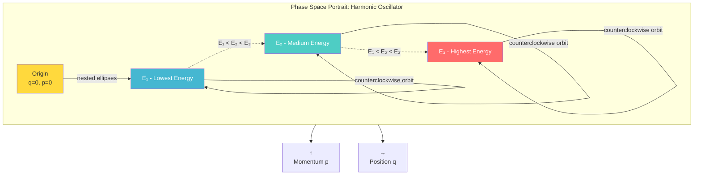

# Lesson 4: Hamiltonian Mechanics

## 1. First-Principles Intuition & Invariants

The Lagrangian formulation of mechanics, which we explored in previous lessons, transforms the dynamical description of physical systems from vectorial force laws into a variational principle operating in configuration space. While this representation elegantly encodes the equations of motion through a single scalar function and automatically respects constraints, it treats positions and velocities asymmetrically—velocities appear as time derivatives of positions rather than as independent dynamical variables. This asymmetry, though mathematically consistent, obscures profound geometric structures that govern the evolution of mechanical systems.

Hamiltonian mechanics resolves this asymmetry by elevating the system description into **phase space**, a mathematical arena where positions and momenta stand as equal partners in the dynamical narrative. Instead of tracking a system's trajectory through an $n$-dimensional configuration space parameterized by generalized coordinates $q^i$, we now navigate through a $2n$-dimensional phase space where each point simultaneously specifies both position $q^i$ and its canonically conjugate momentum $p_i$. This doubling of dimensions is not mere mathematical extravagance; it reflects a fundamental duality in classical mechanics that mirrors the position-momentum uncertainty relation in quantum theory and provides the natural setting for statistical mechanics, where ensembles of systems populate regions of phase space according to probability distributions.

The Hamiltonian function $H(q, p, t)$ replaces the Lagrangian as the central dynamical object. Where the Lagrangian $\mathcal{L}(q, \dot{q}, t)$ represents the difference between kinetic and potential energies expressed in terms of velocities, the Hamiltonian typically represents the total energy expressed in terms of momenta. The transformation between these descriptions proceeds through a Legendre transformation, a mathematical operation that exchanges functional dependencies while preserving the physical content encoded in the action principle.

To construct the Hamiltonian from a given Lagrangian, we first define the **canonical momentum** conjugate to each generalized coordinate through the partial derivative:

$$p_i = \frac{\partial \mathcal{L}}{\partial \dot{q}^i}$$

This definition transforms the velocity dependence of the Lagrangian into a momentum dependence. For systems where the kinetic energy takes the standard quadratic form $T = \frac{1}{2}\sum_{ij} m_{ij}(q)\dot{q}^i\dot{q}^j$, the canonical momentum often corresponds to our intuitive notion of momentum, though for systems with velocity-dependent potentials (such as charged particles in electromagnetic fields) or non-Cartesian coordinates, the canonical momentum may differ substantially from the mechanical momentum $m\vec{v}$.

The Hamiltonian function then emerges from the Legendre transformation:

$$H(q, p, t) = \sum_i p_i \dot{q}^i - \mathcal{L}(q, \dot{q}, t)$$

where the velocities $\dot{q}^i$ on the right-hand side must be expressed as functions of the momenta by inverting the momentum definitions. For conservative systems with time-independent constraints and velocity-independent potentials, this Hamiltonian coincides with the total mechanical energy $H = T + V$. The Legendre transformation exchanges the natural variables from $(q, \dot{q}, t)$ in the Lagrangian formulation to $(q, p, t)$ in the Hamiltonian formulation, maintaining the same physical information but reorganizing it into a form that reveals new symmetries and conservation laws.

The fundamental dynamical evolution in Hamiltonian mechanics follows from **Hamilton's equations**, a pair of coupled first-order differential equations that govern the time evolution of coordinates and momenta:

$$\dot{q}^i = \frac{\partial H}{\partial p_i}, \quad \dot{p}_i = -\frac{\partial H}{\partial q^i}$$

These equations exhibit a striking symmetry: the rate of change of position depends on the momentum derivative of the Hamiltonian, while the rate of change of momentum depends on the negative position derivative. This symmetry reflects a deep geometric structure—phase space possesses a natural **symplectic structure**, a mathematical object that defines how phase space volumes transform under dynamical evolution and ensures that Hamilton's equations preserve certain geometric invariants.

The physical content of Hamilton's equations becomes transparent when we examine specific systems. For a single particle moving in one dimension under a potential $V(q)$, the Hamiltonian takes the form $H = \frac{p^2}{2m} + V(q)$. Hamilton's equations then yield:

$$\dot{q} = \frac{\partial H}{\partial p} = \frac{p}{m}, \quad \dot{p} = -\frac{\partial H}{\partial q} = -\frac{dV}{dq}$$

The first equation simply states that velocity equals momentum divided by mass, recovering the kinematic relation between these quantities. The second equation reproduces Newton's second law in the form $\dot{p} = F$, where the force derives from the potential through $F = -dV/dq$. Though we have merely reformulated Newtonian mechanics in new variables, this reformulation positions us to exploit powerful analytical techniques unavailable in the Newtonian framework.

One immediate advantage of the Hamiltonian formulation emerges when we examine the time evolution of any observable quantity $f(q, p, t)$ that depends on the phase space coordinates. The total time derivative of this function along a dynamical trajectory is:

$$\frac{df}{dt} = \frac{\partial f}{\partial t} + \sum_i \left( \frac{\partial f}{\partial q^i}\dot{q}^i + \frac{\partial f}{\partial p_i}\dot{p}_i \right)$$

Substituting Hamilton's equations into this expression and rearranging terms yields:

$$\frac{df}{dt} = \frac{\partial f}{\partial t} + \{f, H\}$$

where we have introduced the **Poisson bracket**, a bilinear operation on phase space functions defined by:

$$\{f, g\} = \sum_i \left( \frac{\partial f}{\partial q^i}\frac{\partial g}{\partial p_i} - \frac{\partial f}{\partial p_i}\frac{\partial g}{\partial q^i} \right)$$

The Poisson bracket encodes the infinitesimal generator of dynamical evolution. If a quantity $f$ has a vanishing Poisson bracket with the Hamiltonian, $\{f, H\} = 0$, and does not depend explicitly on time, then $df/dt = 0$ and $f$ represents a conserved quantity—a constant of the motion. This observation provides a systematic method for identifying conservation laws: we search for phase space functions that Poisson-commute with the Hamiltonian.

The fundamental Poisson brackets between canonical coordinates and momenta reveal the algebraic structure underlying classical mechanics:

$$\{q^i, p_j\} = \delta^i_j, \quad \{q^i, q^j\} = 0, \quad \{p_i, p_j\} = 0$$

These relations express the canonical commutation structure of phase space—coordinates and momenta mix under the Poisson bracket in a precisely defined manner that generalizes to arbitrary canonical transformations. The Poisson bracket satisfies several crucial mathematical properties: it is antisymmetric ($\{f, g\} = -\{g, f\}$), bilinear, satisfies the Leibniz rule for products, and obeys the Jacobi identity:

$$\{f, \{g, h\}\} + \{g, \{h, f\}\} + \{h, \{f, g\}\} = 0$$

These properties endow the space of phase space functions with the structure of a Lie algebra, connecting classical mechanics to the mathematical framework of continuous symmetry groups. This algebraic structure anticipates the commutator relations of quantum mechanics, where Poisson brackets transform into commutators of operators through the correspondence principle $\{f, g\}_{\text{classical}} \rightarrow \frac{1}{i\hbar}[\hat{f}, \hat{g}]_{\text{quantum}}$.

## 2. Core Architecture & Mechanics

The geometric architecture of Hamiltonian mechanics rests on the mathematical structure of phase space as a symplectic manifold. To develop practical facility with this framework, we must first establish how to visualize and navigate this doubled-dimensional arena where mechanical systems evolve.

Consider the conceptually simplest non-trivial system: a one-dimensional harmonic oscillator with mass $m$ and spring constant $k$. The Lagrangian for this system is $\mathcal{L} = \frac{1}{2}m\dot{q}^2 - \frac{1}{2}kq^2$, yielding canonical momentum $p = \partial \mathcal{L}/\partial \dot{q} = m\dot{q}$ and Hamiltonian:

$$H = p\dot{q} - \mathcal{L} = \frac{p^2}{2m} + \frac{1}{2}kq^2$$

In the two-dimensional phase space with axes labeled by position $q$ and momentum $p$, each state of the oscillator corresponds to a single point $(q, p)$. As the system evolves in time, this representative point traces out a trajectory—a phase space orbit that encodes the complete dynamical history. Hamilton's equations for the harmonic oscillator become:

$$\dot{q} = \frac{p}{m}, \quad \dot{p} = -kq$$

These coupled first-order equations possess a characteristic structure: they can be combined into the familiar second-order equation $m\ddot{q} = -kq$, but retaining them in first-order form reveals the phase space geometry more transparently.

The trajectories in phase space exhibit remarkable regularity. For a given total energy $E$, the Hamiltonian constraint $H(q, p) = E$ defines a curve in phase space—a contour of constant energy. For the harmonic oscillator, this contour is an ellipse:

$$\frac{p^2}{2mE} + \frac{q^2}{2E/k} = 1$$

As time advances, the representative point flows along this elliptical trajectory with a circulation direction determined by Hamilton's equations. In the upper half-plane where $p > 0$, we have $\dot{q} > 0$, so the point moves rightward (toward increasing $q$). In the right half-plane where $q > 0$, we have $\dot{p} < 0$, so the point moves downward (toward decreasing $p$). This circulation pattern—counterclockwise for the harmonic oscillator—characterizes the phase flow of the system.

The closure of these orbits reflects the periodic nature of harmonic oscillation—after one complete circuit in phase space, the system returns to its initial state and begins the cycle anew. The period of this circulation can be computed by integrating $dt = dq/\dot{q} = (m/p)dq$ around one complete orbit, though for the harmonic oscillator we know from elementary considerations that this period is $T = 2\pi\sqrt{m/k}$, independent of the energy.

For more general systems, phase space trajectories need not close. A particle moving in an anharmonic potential, for instance, traces out distorted closed curves if the motion remains bounded, or open trajectories if the particle escapes to infinity. The topology and geometry of these trajectories encode essential information about the qualitative behavior of the dynamics—whether motion is periodic, quasi-periodic, or chaotic.

A fundamental theorem of Hamiltonian mechanics, **Liouville's theorem**, states that the volume of any region in phase space remains constant under Hamiltonian evolution. If we paint a patch of initial conditions in phase space and allow it to evolve, the patch may stretch, twist, and contort into elaborate shapes, but its phase space volume—measured as $\int dq\,dp$ for one degree of freedom or $\int \prod_i dq^i\,dp_i$ for many—remains invariant. This volume preservation reflects the incompressibility of the Hamiltonian flow and provides the foundation for statistical mechanics, where phase space volumes correspond to statistical weights of ensembles.

To verify Liouville's theorem explicitly, consider a small phase space volume element $dV = \prod_i dq^i\,dp_i$. Under time evolution, this element transforms according to the Jacobian determinant of the flow map. Computing this Jacobian from Hamilton's equations and using the antisymmetry of the Poisson bracket structure, one can show that the determinant equals unity, confirming volume preservation. This geometric property distinguishes Hamiltonian systems from dissipative systems, where phase space volumes contract as trajectories converge toward attractors.

The power of the Hamiltonian framework becomes especially apparent when we consider **canonical transformations**—changes of phase space coordinates that preserve the fundamental Poisson bracket structure. A transformation from old coordinates $(q, p)$ to new coordinates $(Q, P)$ is canonical if the new variables satisfy the same canonical Poisson bracket relations:

$$\{Q^i, P_j\}_{\text{new}} = \delta^i_j, \quad \{Q^i, Q^j\}_{\text{new}} = 0, \quad \{P_i, P_j\}_{\text{new}} = 0$$

where the Poisson brackets on the left are computed using the new coordinates but evaluated with respect to the old coordinate derivatives through the chain rule. Canonical transformations generalize the notion of coordinate transformations to phase space, allowing us to seek coordinate systems that simplify the Hamiltonian or reveal hidden symmetries.

Not every change of variables qualifies as canonical. For a transformation to preserve the symplectic structure, it must satisfy certain integrability conditions. One systematic approach to constructing canonical transformations employs **generating functions**, scalar functions that encode the transformation through their partial derivatives. There exist four standard types of generating functions, depending on which pair of old and new variables are taken as independent:

**Type 1 generating function** $F_1(q, Q, t)$ generates a canonical transformation through:

$$p_i = \frac{\partial F_1}{\partial q^i}, \quad P_i = -\frac{\partial F_1}{\partial Q^i}, \quad K = H + \frac{\partial F_1}{\partial t}$$

where $K(Q, P, t)$ is the transformed Hamiltonian. The choice of independent variables $(q, Q)$ seems odd at first—we are mixing old positions with new positions—but this mixed representation proves essential for capturing the transformation structure. The partial derivatives with respect to $q$ yield the old momenta, while derivatives with respect to $Q$ yield the negative of the new momenta, with appropriate signs ensuring canonical consistency.

**Type 2 generating function** $F_2(q, P, t)$ uses old positions and new momenta as independent variables:

$$p_i = \frac{\partial F_2}{\partial q^i}, \quad Q^i = \frac{\partial F_2}{\partial P_i}, \quad K = H + \frac{\partial F_2}{\partial t}$$

This formulation often proves most convenient in practice, as it allows direct specification of how we wish the new momenta to depend on the old coordinates. Many textbook examples of canonical transformations employ type 2 generating functions.

The remaining types handle alternative pairings: **type 3** uses $F_3(p, Q, t)$ with independent variables $(p, Q)$, and **type 4** uses $F_4(p, P, t)$ with independent variables $(p, P)$. These four types are related through Legendre transformations in the same sense that the Lagrangian and Hamiltonian are related. In any specific problem, one type typically offers computational advantages over the others based on which variables remain most tractable.

As a concrete illustration, consider the generating function:

$$F_2(q, P, t) = qP + \frac{\alpha t P^2}{2}$$

where $\alpha$ is a parameter. Computing the required partial derivatives yields:

$$p = \frac{\partial F_2}{\partial q} = P, \quad Q = \frac{\partial F_2}{\partial P} = q + \alpha t P$$

This transformation leaves the momentum unchanged ($p = P$) while shifting the position by an amount proportional to momentum and time. If we apply this to the free particle Hamiltonian $H = p^2/(2m)$, the transformed Hamiltonian becomes:

$$K = H + \frac{\partial F_2}{\partial t} = \frac{P^2}{2m} + \frac{\alpha P^2}{2}$$

The generating function has introduced a time-dependent canonical transformation that, depending on the choice of $\alpha$, can compensate for the free particle motion or introduce controlled modifications to the dynamics.

More sophisticated canonical transformations allow us to simplify complex Hamiltonians into forms where the equations of motion become trivially integrable. The **action-angle variables** provide one particularly elegant example. For systems with one degree of freedom and bounded motion, we can often find a canonical transformation $(q, p) \rightarrow (I, \theta)$ where $I$ is the action variable and $\theta$ is the angle variable, such that the transformed Hamiltonian depends only on the action: $K = K(I)$. Hamilton's equations in these variables become:

$$\dot{I} = -\frac{\partial K}{\partial \theta} = 0, \quad \dot{\theta} = \frac{\partial K}{\partial I} = \omega(I)$$

The action $I$ is a constant of the motion, while the angle $\theta$ increases linearly with time at frequency $\omega(I)$. This reduction transforms the dynamics into the simplest possible form—uniform circular motion in the $(I, \theta)$ phase space.

For the harmonic oscillator, the action-angle transformation can be constructed explicitly. The action variable is defined as:

$$I = \frac{1}{2\pi}\oint p\,dq$$

where the integral extends over one complete cycle of the motion. For the harmonic oscillator with energy $E$, this integral evaluates to $I = E/\omega_0$ where $\omega_0 = \sqrt{k/m}$ is the natural frequency. The angle variable $\theta$ is chosen such that $(I, \theta)$ form canonical coordinates, and the transformed Hamiltonian becomes $K(I) = \omega_0 I$, confirming that the frequency is constant and equal to $\omega_0$.

The systematic exploration of canonical transformations leads naturally to the question of which transformations are accessible through generating functions and which transformations preserve not just the Poisson bracket structure but also the form of Hamilton's equations under time evolution. This investigation culminates in the **Hamilton-Jacobi theory**, a reformulation of mechanics that treats the problem of solving Hamilton's equations as equivalent to solving a single partial differential equation for a generating function.

The Hamilton-Jacobi equation emerges when we seek a canonical transformation that converts the Hamiltonian into a form that is trivially integrable—ideally, a Hamiltonian that vanishes identically or depends only on the new momenta as constants. Consider a type 2 generating function $S(q, P, t)$ that we will call **Hamilton's principal function**. The transformation equations are:

$$p_i = \frac{\partial S}{\partial q^i}, \quad Q^i = \frac{\partial S}{\partial P_i}$$

with the new Hamiltonian:

$$K = H\left(q, \frac{\partial S}{\partial q}, t\right) + \frac{\partial S}{\partial t}$$

If we demand that the new Hamiltonian vanish identically, $K = 0$, then the new momenta $P_i$ will be constants of the motion, and the new coordinates $Q^i$ will be trivial linear functions of time. This requirement that $K = 0$ translates into a partial differential equation for $S$:

$$H\left(q, \frac{\partial S}{\partial q}, t\right) + \frac{\partial S}{\partial t} = 0$$

This is the **time-dependent Hamilton-Jacobi equation**. If the Hamiltonian does not depend explicitly on time, we can separate variables by writing $S(q, P, t) = W(q, P) - Et$, where $E$ is the constant energy. The function $W(q, P)$, called **Hamilton's characteristic function**, then satisfies the **time-independent Hamilton-Jacobi equation**:

$$H\left(q, \frac{\partial W}{\partial q}\right) = E$$

Solving this equation for $W$ as a function of the coordinates $q$ and a set of constants $P$ (which will become the new constant momenta) generates a complete solution to the mechanical problem. The trajectories are then obtained by differentiating $W$:

$$Q^i = \frac{\partial W}{\partial P_i}$$

where the $Q^i$ are constants (the initial values of the angle-like variables), allowing us to invert these relations to find $q^i(t)$.

For the one-dimensional harmonic oscillator, the time-independent Hamilton-Jacobi equation is:

$$\frac{1}{2m}\left(\frac{\partial W}{\partial q}\right)^2 + \frac{1}{2}kq^2 = E$$

Solving for $\partial W/\partial q$ and integrating:

$$W = \int \sqrt{2mE - mkq^2}\,dq$$

This integral can be evaluated in terms of inverse trigonometric functions, though the detailed form matters less than the principle: once we have $W$, we have transformed the problem into action-angle variables where the solution is immediate. The Hamilton-Jacobi method converts the problem of solving $2n$ first-order ordinary differential equations (Hamilton's equations) into the problem of solving one first-order partial differential equation, which for separable systems often proves more tractable.

The true power of the Hamilton-Jacobi formulation emerges in systems with symmetries that allow separation of variables. For a multi-dimensional system where the Hamiltonian is separable in certain coordinates, we can write the characteristic function as a sum $W = \sum_i W_i(q^i, P_i)$, reducing the partial differential equation to a set of ordinary differential equations for each $W_i$. This separation technique, combined with the identification of ignorable coordinates (coordinates that do not appear explicitly in the Hamiltonian), provides a systematic route to complete solution of integrable systems.

## 3. High-Performance Optimization & Failure Modes

The theoretical elegance of Hamiltonian mechanics translates into powerful analytical and computational strategies, but practical implementation requires careful attention to numerical stability, approximation accuracy, and recognition of dynamical pathologies where standard techniques fail.

The most immediate computational advantage of Hamilton's formulation manifests in numerical integration of trajectories. Standard integration schemes for second-order differential equations (such as Runge-Kutta methods applied to Newton's equations $m\ddot{q} = F(q)$) do not automatically respect the geometric structure of phase space. Over long integration times, these methods accumulate errors that can cause spurious energy drift—the computed trajectory gains or loses total energy even though the true dynamics conserve energy exactly. For a harmonic oscillator integrated with a standard fourth-order Runge-Kutta scheme, the computed energy may drift linearly or quadratically with time, causing the phase space trajectory to spiral outward or inward rather than maintaining its elliptical orbit.

**Symplectic integrators** resolve this pathology by constructing numerical schemes that preserve the symplectic structure of phase space and thus guarantee long-term energy stability. The simplest symplectic integrator is the **symplectic Euler method** (also called the semi-implicit Euler method), which alternates between updating momentum and position:

$$p_{n+1} = p_n - h\frac{\partial H}{\partial q}\bigg|_{q_n}$$

$$q_{n+1} = q_n + h\frac{\partial H}{\partial p}\bigg|_{p_{n+1}}$$

where $h$ is the time step. Note the crucial asymmetry: the position update uses the new momentum $p_{n+1}$ rather than the old momentum $p_n$. This subtle modification ensures that the numerical map $(q_n, p_n) \rightarrow (q_{n+1}, p_{n+1})$ defines a canonical transformation, preserving the symplectic two-form and preventing secular energy drift.

For systems with separable Hamiltonians of the form $H = T(p) + V(q)$, the symplectic Euler method can be interpreted as alternating between exact flows generated by the kinetic and potential terms. This interpretation motivates higher-order symplectic integrators constructed through composition of symplectic Euler steps with carefully chosen coefficients. The **Verlet algorithm** (also called the Störmer method or leapfrog integration) represents a second-order symplectic integrator widely used in molecular dynamics simulations:

$$q_{n+1/2} = q_n + \frac{h}{2}\frac{\partial H}{\partial p}\bigg|_{p_n}$$

$$p_{n+1} = p_n - h\frac{\partial H}{\partial q}\bigg|_{q_{n+1/2}}$$

$$q_{n+1} = q_{n+1/2} + \frac{h}{2}\frac{\partial H}{\partial p}\bigg|_{p_{n+1}}$$

This scheme evaluates the force at the half-step position, achieving second-order accuracy while maintaining symplecticity. For long-time simulations of conservative systems (planetary orbits, molecular dynamics, particle accelerator design), symplectic integrators provide qualitatively superior behavior compared to non-symplectic schemes of the same computational cost.

The choice of coordinates dramatically affects both analytical tractability and numerical efficiency. For systems with strong anharmonicity or singular potentials (such as the Coulomb potential in atomic physics), standard Cartesian coordinates may lead to stiff differential equations requiring prohibitively small time steps. Canonical transformations to action-angle variables or other adapted coordinates can soften these stiffness issues. In celestial mechanics, transformations to Delaunay variables (action-angle variables constructed from orbital elements) regularize the equations of motion for highly eccentric orbits, preventing numerical breakdown when particles approach close encounters.

Perturbation theory in the Hamiltonian framework offers systematic approximation schemes for nearly integrable systems. A Hamiltonian of the form $H = H_0(I) + \epsilon H_1(I, \theta)$, where $H_0$ is integrable and $\epsilon$ is a small parameter, can be analyzed through canonical perturbation theory. The unperturbed Hamiltonian $H_0$ defines action-angle variables $(I, \theta)$ where the dynamics are trivial. The perturbation $\epsilon H_1$ induces slow drifts in the action variables and modulations of the frequencies. The goal of canonical perturbation theory is to find a near-identity canonical transformation that eliminates the perturbation to some order in $\epsilon$, isolating the leading-order effects and computing secular drifts systematically.

For weakly anharmonic oscillators described by Hamiltonians like $H = \omega_0 I + \epsilon I^2$, first-order canonical perturbation theory predicts a frequency shift proportional to the amplitude. For planetary systems where one planet's mass is much smaller than the others, perturbation theory computes the slow precession of orbital elements induced by planetary interactions. The mathematical apparatus of Lie series and Lie transforms provides a modern algebraic formulation of canonical perturbation theory, expressing coordinate transformations through exponentiated Poisson bracket operations.

Failure modes in Hamiltonian mechanics arise most dramatically in the phenomenon of **chaos**—extreme sensitivity to initial conditions despite deterministic evolution. Not all Hamiltonian systems are integrable; indeed, the Kolmogorov-Arnold-Moser (KAM) theorem demonstrates that for generic perturbations of integrable systems, most (but not all) of phase space remains filled with quasi-periodic tori, while certain resonant regions develop chaotic zones where trajectories wander ergodically. The transition from integrable to chaotic behavior as a perturbation parameter increases defines a central problem in nonlinear dynamics.

The **Poincaré surface of section** provides a powerful diagnostic tool for visualizing this transition. For a Hamiltonian system with two degrees of freedom (four-dimensional phase space), we can reduce the visualization to two dimensions by plotting the intersections of a trajectory with a chosen surface (for example, the plane $q_2 = 0$ with $p_2 > 0$). For an integrable system, these intersections trace out smooth curves corresponding to the intersection of invariant tori with the surface of section. As perturbations increase and chaos emerges, these smooth curves break into scattered point clouds exhibiting fractal structure—the signature of chaotic motion.

In the context of experimental classical mechanics laboratories, Hamiltonian methods guide the design and analysis of precision measurements. The motion of a charged particle beam in an accelerator storage ring obeys Hamiltonian dynamics with a time-periodic perturbation due to the accelerating cavities and focusing magnets. Engineers optimize the Hamiltonian structure to minimize resonances that would drive beam instability. The **Courant-Snyder parameters** (also called Twiss parameters) provide an action-angle-like description of transverse beam motion, allowing computation of beam emittance (the phase space area occupied by the beam) and matching conditions for efficient injection and extraction.

For mechanical systems with dissipation or external driving, the strict Hamiltonian framework requires extension. Dissipative forces can be incorporated by introducing time-dependent Hamiltonians or by embedding the system in a larger phase space where the dissipation appears as coupling to additional degrees of freedom. Alternatively, one can abandon the Hamiltonian formulation in favor of Lagrangian mechanics with velocity-dependent dissipative forces (Rayleigh dissipation functions) or transition to the framework of open systems and master equations when coupling to thermal baths dominates.

The Hamilton-Jacobi equation, while conceptually elegant, poses significant computational challenges except for separable systems. Numerical solution of the Hamilton-Jacobi partial differential equation requires careful treatment of characteristics and wavefront propagation. Modern computational approaches based on level-set methods and optimal control theory have revitalized Hamilton-Jacobi techniques in fields ranging from geometric optics to dynamic programming. In semiclassical quantum mechanics, the WKB (Wentzel-Kramers-Brillouin) approximation constructs quantum wavefunctions from solutions to the Hamilton-Jacobi equation, providing a bridge between classical and quantum descriptions in regimes where $\hbar$ is small compared to classical action scales.

Measurement of phase space densities in experimental systems presents unique challenges. While position measurements are often straightforward, simultaneous measurement of conjugate momenta requires indirect inference (through velocity measurement via Doppler shifts, time-of-flight detection, or reconstruction from position measurements at multiple times). In beam physics and plasma diagnostics, emittance measurement techniques reconstruct the phase space distribution from projections and correlations, applying tomographic reconstruction algorithms to infer the full six-dimensional phase space density from accessible two-dimensional projections.

Optimization of Hamiltonian structure for control applications has emerged as a major research area. By engineering potentials and designing time-dependent control Hamiltonians, one can steer a system's phase space trajectory toward desired target states. Optimal control theory, formulated in Hamiltonian language through Pontryagin's maximum principle, provides necessary conditions for time-optimal or energy-optimal trajectories. These techniques find application in spacecraft trajectory design, quantum optimal control, and robotic motion planning.

The long-term stability of Hamiltonian systems remains an active frontier. For gravitational N-body problems (such as the solar system), proving stability over timescales comparable to the age of the system represents a profound challenge. Numerical integration over billions of orbital periods reveals subtle resonances and chaotic diffusion that may eventually lead to orbital instabilities. The Arnold diffusion mechanism predicts slow chaotic transport across resonance chains in systems with three or more degrees of freedom, though rigorous analytical bounds remain elusive. Such considerations matter not only for celestial mechanics but also for the stability of particle beams in storage rings and the confinement of plasma in magnetic fusion devices.

In summary, Hamiltonian mechanics provides both a conceptual framework for understanding the geometric structure of classical dynamics and a practical toolkit for solving, approximating, and numerically integrating the equations of motion. Mastery of canonical transformations, generating functions, and the Hamilton-Jacobi equation elevates the practitioner beyond elementary solution techniques to a level where symmetries and invariants guide the search for analytical insight. Combined with symplectic numerical methods and perturbation theory, these tools enable quantitative analysis of complex nonlinear systems ranging from atomic physics to celestial mechanics, from accelerator design to semiclassical quantum theory. The phase space perspective, with its emphasis on conserved structures and geometric invariants, reveals unity across seemingly disparate physical phenomena and prepares the groundwork for the quantum mechanical transcription where Poisson brackets become commutators and phase space distributions evolve into wavefunctions.
