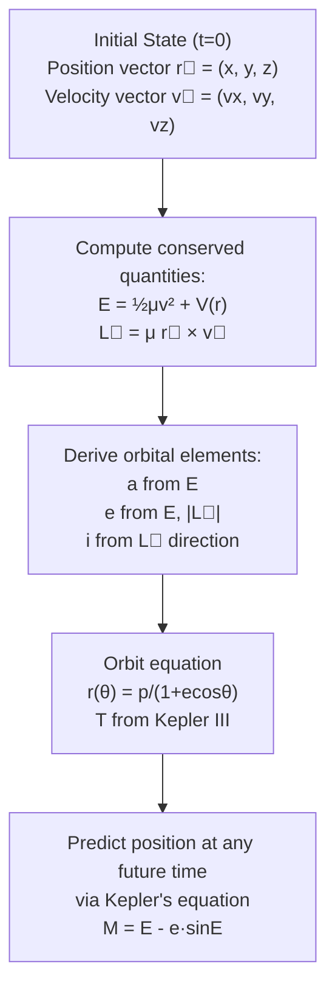

# Lesson 6: Central Forces, Gravitation

## 1. First-Principles Intuition & Invariants

The history of physics contains no more productive constraint than the one Nature imposes when two bodies interact through a force directed exclusively along the line joining them. Every gravitational orbit, every Rutherford scattering event, every hydrogen atom in the quantum limit traces its ancestry back to this single geometric fact: when the force on each body points toward the other, the angular momentum of the system is permanently conserved, and the problem collapses from six degrees of freedom to one. Understanding why this collapse happens, and exploiting it without reservation, is the central skill this lesson develops.

### The Two-Body Problem and the Reduction to One Body

Consider two point masses $m_1$ and $m_2$ located at positions $\vec{r}_1$ and $\vec{r}_2$ in an inertial frame. They interact through a potential $V(|\vec{r}_1 - \vec{r}_2|)$ that depends only on their separation — no preferred direction in space, no dependence on where the pair sits as a whole. The Lagrangian of the full system is

$$\mathcal{L} = \frac{1}{2}m_1\dot{\vec{r}}_1^{\,2} + \frac{1}{2}m_2\dot{\vec{r}}_2^{\,2} - V(|\vec{r}_1 - \vec{r}_2|)$$

The standard move is to introduce the center-of-mass coordinate and the relative coordinate:

$$\vec{R} = \frac{m_1\vec{r}_1 + m_2\vec{r}_2}{m_1 + m_2}, \qquad \vec{r} = \vec{r}_1 - \vec{r}_2$$

After substitution the Lagrangian separates cleanly into two independent pieces:

$$\mathcal{L} = \frac{1}{2}M\dot{\vec{R}}^2 + \frac{1}{2}\mu\dot{\vec{r}}^2 - V(r)$$

where $M = m_1 + m_2$ is the total mass, $r = |\vec{r}|$, and $\mu$ is the **reduced mass**:

$$\boxed{\mu = \frac{m_1 m_2}{m_1 + m_2}}$$

The first term describes a free particle of mass $M$ coasting through space; since the center of mass experiences no net force, it moves at constant velocity and can be transformed away entirely by working in the CM frame. What remains is a **one-body problem**: a fictitious particle of mass $\mu$ moving in a fixed central potential $V(r)$. This reduction is not an approximation. It is exact, and it is the reason every two-body gravitational problem in classical mechanics admits an analytic solution.

The reduced mass has a clear physical meaning. When $m_2 \gg m_1$ — say the Sun and the Earth — $\mu \approx m_1$, and the lighter body does essentially all the moving. When the masses are equal, $\mu = m/2$, and both particles contribute equally to the relative motion. In precision binary-star or binary-pulsar measurements, neglecting the correction $\mu \neq m_1$ introduces systematic errors at the level of $m_1/m_2$, which can be substantial.

### Conservation Laws as Geometric Constraints

With the problem reduced, the equation of motion for the relative coordinate is

$$\mu\ddot{\vec{r}} = -\nabla V(r) = -\frac{dV}{dr}\hat{r}$$

Since the force is purely radial, its torque about the origin is zero, and the angular momentum vector

$$\vec{L} = \mu\,\vec{r} \times \dot{\vec{r}}$$

is conserved in both magnitude and direction. The conserved direction of $\vec{L}$ means the motion is confined permanently to the plane perpendicular to $\vec{L}$ — a plane you can take to be the $xy$-plane without any loss of generality. Central force motion is therefore planar motion, and it is profitable to adopt polar coordinates $(r, \theta)$ within that plane.

The Lagrangian in polar form is

$$\mathcal{L} = \frac{1}{2}\mu(\dot{r}^2 + r^2\dot{\theta}^2) - V(r)$$

The coordinate $\theta$ is cyclic — it appears nowhere in $\mathcal{L}$ explicitly — so its conjugate momentum is conserved:

$$\ell = \frac{\partial \mathcal{L}}{\partial \dot{\theta}} = \mu r^2 \dot{\theta} = \text{const}$$

This is the scalar angular momentum of the reduced particle. The rate at which the position vector sweeps area is $\frac{dA}{dt} = \frac{1}{2}r^2\dot{\theta} = \frac{\ell}{2\mu}$, a constant. You have just derived **Kepler's Second Law** from the structure of the Lagrangian before specifying any particular force law — it holds for every central force, attractive or repulsive, inverse-square or otherwise.

### The Effective Potential and Orbital Intuition

Energy conservation provides a first-order differential equation for radial motion. The total energy is

$$E = \frac{1}{2}\mu\dot{r}^2 + \frac{\ell^2}{2\mu r^2} + V(r)$$

The term $\frac{\ell^2}{2\mu r^2}$ acts as a repulsive centrifugal barrier, rising steeply as $r \to 0$. It is conventional and deeply illuminating to absorb it into an **effective potential**:

$$V_{\text{eff}}(r) = V(r) + \frac{\ell^2}{2\mu r^2}$$

so that

$$E = \frac{1}{2}\mu\dot{r}^2 + V_{\text{eff}}(r)$$

The radial motion is now identical to one-dimensional motion in the potential $V_{\text{eff}}$. A particle with energy $E$ can only occupy regions where $E \geq V_{\text{eff}}(r)$; turning points occur where $E = V_{\text{eff}}(r)$ and $\dot{r} = 0$. The shape of $V_{\text{eff}}(r)$ therefore encodes everything about which orbital families are accessible.

For the gravitational potential $V(r) = -GMm/r$, writing the reduced mass $\mu$ and the two masses explicitly as $m$ (satellite) and $M$ (central body, $M \gg m$),

$$V_{\text{eff}}(r) = -\frac{GMm}{r} + \frac{\ell^2}{2mr^2}$$

The attractive $1/r$ term dominates at large $r$ and the repulsive $1/r^2$ centrifugal term dominates at small $r$. Their competition produces a minimum at

$$r_{\min} = \frac{\ell^2}{GMm^2}$$

which you can verify by setting $dV_{\text{eff}}/dr = 0$. At this radius $V_{\text{eff}}$ achieves its global minimum value $V_{\text{eff,min}} = -G^2M^2m^3/(2\ell^2)$. A particle sitting exactly at this energy with $\dot{r} = 0$ moves in a perfect circle. If $E$ exceeds this minimum but remains negative, the particle oscillates radially between two turning points $r_1$ and $r_2$ — the periapsis and apoapsis of an elliptical orbit. If $E = 0$ the orbit is parabolic, and if $E > 0$ it is hyperbolic. The entire zoo of Keplerian orbits emerges from reading a single graph of $V_{\text{eff}}(r)$.

---

## 2. Core Architecture & Mechanics

### The Orbit Equation and Conic Sections

To obtain the orbit shape $r(\theta)$ rather than the time evolution $r(t)$, the standard maneuver is a change of variable introduced by Binet. Define $u = 1/r$; then, using $\dot{r} = -\ell u' / \mu$ where primes denote $d/d\theta$, the radial equation of motion transforms into

$$\frac{d^2u}{d\theta^2} + u = -\frac{\mu}{\ell^2 u^2}F(1/u)$$

where $F(r)$ is the radial force. For the gravitational inverse-square law $F = -GMm/r^2 = -GMmu^2$, this simplifies to

$$\frac{d^2u}{d\theta^2} + u = \frac{GM\mu^2}{\ell^2}$$

which is a simple harmonic oscillator equation with a constant driving term. Its general solution is

$$u(\theta) = \frac{GM\mu^2}{\ell^2}\left(1 + e\cos(\theta - \theta_0)\right)$$

or equivalently, taking $\theta_0 = 0$ for periapsis alignment:

$$\boxed{r(\theta) = \frac{p}{1 + e\cos\theta}}$$

where $p = \ell^2/(GM\mu^2)$ is the **semi-latus rectum** and $e$ is the **eccentricity**, determined entirely by initial conditions. This is the polar equation of a conic section with the force center at one focus. The nature of the orbit is determined by $e$: a circle when $e = 0$, an ellipse when $0 < e < 1$, a parabola when $e = 1$, and a hyperbola when $e > 1$. The eccentricity is related to the energy and angular momentum by

$$e = \sqrt{1 + \frac{2E\ell^2}{G^2M^2m^3\mu}}$$

This is a profound result: the geometric classification of an orbit — ellipse versus hyperbola — is equivalent to the energetic classification $E < 0$ versus $E > 0$.

### Kepler's Laws from First Principles

**Kepler's First Law** — planets move in ellipses with the Sun at one focus — is the conic-section orbit equation above restricted to $e < 1$. It follows from the inverse-square force law and nothing else; a different force law would produce different orbit shapes, a point that proved decisive historically in establishing Newton's law of gravitation.

**Kepler's Second Law** — equal areas are swept in equal times — was derived already from angular momentum conservation. It is force-law independent.

**Kepler's Third Law** — the square of the orbital period is proportional to the cube of the semi-major axis — requires a short calculation. For an ellipse, the semi-major axis $a$ is related to $p$ and $e$ by $a = p/(1-e^2)$. The area of the ellipse is $A = \pi a b$ where $b = a\sqrt{1-e^2}$ is the semi-minor axis. Since area is swept at constant rate $\ell/(2\mu)$, the period is

$$T = \frac{A}{\ell/2\mu} = \frac{2\pi\mu ab}{\ell}$$

After substituting $b = \sqrt{ap}$ and $p = \ell^2/(GM\mu^2)$, all the $\ell$ and $\mu$ dependence cancels, yielding

$$\boxed{T^2 = \frac{4\pi^2}{GM}a^3}$$

The proportionality constant depends only on the central mass $M$. This allows $GM_\odot$ to be measured from any planet's orbit with a known period and semi-major axis — it does not require knowing $G$ and $M_\odot$ independently. Table 1 at the end of this section summarizes the orbital elements and their physical interpretations.

### Orbital Mechanics: Flow of Information Through the Equations

It is instructive to trace how initial conditions propagate through to observable orbital elements, because this is exactly what practitioners do when determining orbits from observations.

The bottleneck in this chain is the last step: inverting Kepler's equation $M = E_a - e\sin E_a$ (where $M$ is the mean anomaly and $E_a$ is the eccentric anomaly) has no closed-form solution and requires numerical iteration — typically Newton-Raphson, which converges in three to five iterations for $e < 0.9$.

### Gravitational Potential Theory

For extended bodies and distributed mass distributions, the scalar gravitational potential at position $\vec{r}$ is

$$\Phi(\vec{r}) = -G\int \frac{\rho(\vec{r}')}{|\vec{r} - \vec{r}'|}d^3r'$$

where $\rho(\vec{r}')$ is the mass density. This satisfies Poisson's equation

$$\nabla^2\Phi = 4\pi G\rho$$

which reduces to Laplace's equation $\nabla^2\Phi = 0$ in vacuum. The multipole expansion of $\Phi$ outside a body expresses deviations from spherical symmetry through the gravitational moments $J_n$. For Earth, the dominant correction to the spherical potential is the $J_2$ term arising from the equatorial bulge:

$$\Phi(r,\theta) = -\frac{GM}{r}\left[1 - J_2\left(\frac{R_\oplus}{r}\right)^2 P_2(\cos\theta) + \ldots\right]$$

where $P_2(\cos\theta) = \frac{1}{2}(3\cos^2\theta - 1)$ is the second Legendre polynomial and $J_2 \approx 1.083 \times 10^{-3}$ for Earth. This $J_2$ term causes the **nodal precession** of satellite orbits — the orbital plane rotates slowly about Earth's spin axis — which is exploited operationally in Sun-synchronous satellite orbits.

### Classical Scattering Theory

When $E > 0$ the orbit is hyperbolic and the two bodies scatter off one another, asymptotically approaching and receding along straight lines. The central quantity characterizing this process is the **scattering angle** $\Theta$ — the angle between the incoming and outgoing asymptotic velocity directions.

The geometry is specified by the **impact parameter** $b$, the perpendicular distance from the force center to the incoming trajectory if the projectile traveled in a straight line. Angular momentum at infinity is $\ell = \mu v_\infty b$ where $v_\infty$ is the asymptotic speed. For an inverse-square repulsive potential $V(r) = k/r$ (Coulomb or gravitational with sign flip), the relationship between $\Theta$ and $b$ is

$$\cot\frac{\Theta}{2} = \frac{2Eb}{k} = \frac{\mu v_\infty^2 b}{k}$$

This is the **Rutherford scattering formula** in its trajectory form. The observable in a scattering experiment is not $b$ directly but the **differential cross-section** $d\sigma/d\Omega$, which counts the fraction of incident flux scattered into a solid angle element $d\Omega = \sin\Theta\,d\Theta\,d\phi$. Particles incident within an annular ring of radius $b$ and width $|db|$ are scattered into the corresponding solid angle:

$$\frac{d\sigma}{d\Omega} = \frac{b}{\sin\Theta}\left|\frac{db}{d\Theta}\right| = \left(\frac{k}{4E}\right)^2\frac{1}{\sin^4(\Theta/2)}$$

The $\sin^{-4}(\Theta/2)$ divergence at small angles reflects the long-range nature of the $1/r$ potential — particles with very large impact parameters are deflected by very small angles, and their number is infinite for an infinite beam. The **total cross-section** diverges accordingly, which is a classical pathology cured only by quantum mechanics (Debye screening in the Coulomb case).

### The Virial Theorem

The virial theorem connects time-averaged kinetic energy to time-averaged potential energy for bound systems. For a system where all motions are bounded — no particle escaping to infinity — the time average of $\frac{d}{dt}(\vec{r}\cdot\vec{p})$ vanishes. The resulting identity is

$$\langle T \rangle = -\frac{1}{2}\sum_i \langle \vec{r}_i \cdot \vec{F}_i \rangle$$

For a potential that scales as $V \propto r^n$, the force $F \propto r^{n-1}$ and the right side evaluates to $\frac{n}{2}\langle V\rangle$, giving

$$\langle T \rangle = \frac{n}{2}\langle V\rangle$$

For gravity ($n = -1$):

$$\boxed{\langle T \rangle = -\frac{1}{2}\langle V \rangle}$$

This has immediate and powerful consequences. Since $E = \langle T\rangle + \langle V\rangle = -\langle T\rangle$, the total energy of a gravitational system is the negative of its mean kinetic energy. When a self-gravitating gas cloud contracts and loses energy (e.g., by radiation), half the released potential energy goes into kinetic energy — the cloud heats up — and the other half is radiated away. This **gravitational heating** mechanism underlies stellar formation and the energy source of pre-main-sequence stars.

| Orbital Element | Symbol | Physical Meaning | Determined By |
|---|---|---|---|
| Semi-major axis | $a$ | Average of periapsis and apoapsis | Total energy $E$ |
| Eccentricity | $e$ | Shape of conic section | $E$ and $\ell$ |
| Inclination | $i$ | Tilt of orbital plane | Direction of $\vec{L}$ |
| Semi-latus rectum | $p$ | $r$ at $\theta = 90°$ | $\ell$ alone |
| Period | $T$ | Time for one orbit | $a$ and $GM$ |
| Periapsis distance | $r_p$ | $a(1-e)$ | $a$ and $e$ |

---

## 3. High-Performance Optimization & Failure Modes

### Laboratory Protocol: Measuring Gravitational Acceleration with a Conical Pendulum

A conical pendulum is among the cleanest tabletop demonstrations of centripetal dynamics under gravity, and with careful execution it yields $g$ to better than 0.3% — competitive with a simple pendulum while being structurally distinct. The apparatus consists of a string of length $L$ attached at the top, with a bob of mass $m$ swinging in a horizontal circle of radius $r$ at angular velocity $\omega$. At steady state, the string makes half-angle $\alpha$ with the vertical, satisfying

$$T\cos\alpha = mg, \qquad T\sin\alpha = m\omega^2 r = m\omega^2 L\sin\alpha$$

Dividing these equations eliminates $T$ and $m$ entirely, yielding

$$g = \omega^2 L\cos\alpha$$

**Setup.** Suspend a 50 g brass bob from a fixed pivot using monofilament of precisely measured length $L$ (use a calibrated steel ruler, $\delta L \approx 0.5$ mm). Set the bob spinning by hand and allow it to reach steady state over approximately 20 revolutions. Measure $\alpha$ by photographing the steady-state configuration against a ruled background, or by measuring the vertical height $h = L\cos\alpha$ with a traveling microscope. Time 50 complete revolutions with a digital stopwatch ($\delta t \approx 0.01$ s) to suppress timing error.

**Error propagation.** The measurement equation $g = \omega^2 L\cos\alpha$ gives

$$\frac{\delta g}{g} = \sqrt{\left(\frac{2\delta T}{T}\right)^2 + \left(\frac{\delta L}{L}\right)^2 + \left(\tan\alpha\cdot\delta\alpha\right)^2}$$

where $T$ here is the period (not tension), $\delta T$ is the per-revolution timing uncertainty divided by the number of revolutions, and $\delta\alpha$ is the angular uncertainty in reading the half-angle. The dominant error is typically the $\tan\alpha$ term: at $\alpha = 60°$, an angular uncertainty of $0.5°$ contributes $0.9\%$ to the relative error in $g$. For this reason, working at $\alpha \leq 45°$ substantially improves precision without changing the physics.

Repeat the measurement at five values of $L$ between 20 cm and 80 cm. Plot $g_{\text{measured}}$ against $L$; the result should be a horizontal line within error bars, confirming that $g$ is a property of the gravitational field rather than the apparatus. Any systematic slope indicates a measurement artifact — most commonly, friction at the pivot causing $\omega$ to be overestimated if measured too early, or string elasticity introducing a length correction.

### Numerical Orbit Integration: Verlet and Symplectic Methods

Analytic Keplerian orbits exist only for the pure two-body problem. The moment a third body is added — Jupiter perturbing an asteroid, the Moon perturbing a satellite, a binary star system with a companion — numerical integration becomes the only route. The choice of integrator is not incidental; it determines whether energy drift kills the simulation over long timescales.

The standard Euler method advances $\vec{r}$ and $\vec{v}$ as

$$\vec{r}_{n+1} = \vec{r}_n + h\vec{v}_n, \qquad \vec{v}_{n+1} = \vec{v}_n + h\vec{a}_n$$

This is first-order and not time-reversible. For a gravitational orbit, it introduces a systematic energy drift proportional to $h$, causing the orbit to spiral inward or outward depending on the sign of the discretization error. Over thousands of orbits the error accumulates catastrophically.

The **Störmer-Verlet integrator** is the minimum viable method for conservative systems:

$$\vec{r}_{n+1} = 2\vec{r}_n - \vec{r}_{n-1} + h^2\vec{a}_n$$

It is second-order accurate, time-reversible, and symplectic — meaning it exactly conserves a shadow Hamiltonian close to the true one. Energy does not drift secularly; it oscillates about the true value with an amplitude proportional to $h^2$. For a 1000-orbit planetary integration with $h = T_{\text{orbit}}/1000$, Verlet keeps energy conservation at the $10^{-6}$ level while Euler accumulates percent-level errors after a hundred orbits.

For high-precision work, the **Wisdom-Holman symplectic map** splits the Hamiltonian into the dominant Keplerian part (analytically integrable) and the perturbation. Each step applies the exact Keplerian map followed by an impulse from the perturbation. This allows timesteps 10 to 20 times larger than Verlet for the same accuracy — the standard method in $N$-body planetary simulation codes such as REBOUND and Mercury6.

**Practical implementation.** To integrate a test particle in a Kepler potential using velocity-Verlet:

$$\vec{v}_{n+1/2} = \vec{v}_n + \frac{h}{2}\vec{a}(\vec{r}_n)$$
$$\vec{r}_{n+1} = \vec{r}_n + h\vec{v}_{n+1/2}$$
$$\vec{v}_{n+1} = \vec{v}_{n+1/2} + \frac{h}{2}\vec{a}(\vec{r}_{n+1})$$

where $\vec{a}(\vec{r}) = -GM\vec{r}/r^3$. After each step, compute $E = \frac{1}{2}v^2 - GM/r$ and $\ell = |\vec{r}\times\vec{v}|$ as diagnostic monitors. Relative variations exceeding $10^{-5}$ per orbit signal that $h$ must be reduced, or that the integrator should be upgraded to a higher-order scheme such as Yoshida's fourth-order symplectic method.

### Failure Modes and Edge Cases

**Near-radial orbits ($e \to 1$).** As eccentricity approaches unity, the periapsis $r_p = a(1-e)$ shrinks toward zero. The effective potential well steepens without bound, and the timestep required for accurate periapsis passage scales as $r_p^{3/2}/(GM)^{1/2}$ — far smaller than the timestep needed for the rest of the orbit. Fixed-step integrators fail here. The remedy is **adaptive timestepping**: reduce $h$ dynamically when $r < r_{\text{threshold}}$, or change to a regularized coordinate system such as Kustaanheimo-Stiefel variables which remove the $1/r$ singularity algebraically before integration begins.

**Energy measurement near close approaches.** When two bodies pass within a few body radii, numerical roundoff in computing $|\vec{r}_1 - \vec{r}_2|$ amplifies because you are subtracting nearly equal large numbers. Use the compensated summation trick (Kahan summation) for the potential energy, or switch to the relative coordinate $\vec{r} = \vec{r}_1 - \vec{r}_2$ computed in extended precision for the close-passage segment.

**Resonance and long-period chaos.** When orbital periods are commensurable — the 3:2 resonance of Neptune and Pluto, the Kirkwood gaps in the asteroid belt — perturbation series diverge. The KAM theorem guarantees that most orbits remain stable, but a measure-zero set of resonant orbits becomes chaotic. In $N$-body simulations, this manifests as Lyapunov divergence: two initially adjacent trajectories separate exponentially on the Lyapunov timescale, which for the inner solar system is approximately $5 \times 10^6$ years. Detecting chaos requires computing the **maximal Lyapunov exponent** $\lambda = \lim_{t\to\infty}\frac{1}{t}\ln\frac{|\delta\vec{x}(t)|}{|\delta\vec{x}(0)|}$ by evolving a shadow trajectory with a slight offset and monitoring its divergence rate.

**Virial equilibrium and $N$-body collapse.** In a self-gravitating $N$-body system initialized far from virial equilibrium — say, a star cluster with all kinetic energy absent — the system undergoes **violent relaxation**: rapid, large-amplitude oscillations of the gravitational potential drive the system toward the virial state $\langle T \rangle = -\frac{1}{2}\langle V\rangle$ on a crossing timescale $t_{\text{cross}} \sim R/\sigma_v$. Simulations that begin in this state must be run for at least $5 t_{\text{cross}}$ before orbital statistics are meaningful. Terminating the simulation early and treating a non-virial snapshot as an equilibrium state is one of the most common sources of incorrect mass estimates in observational stellar dynamics.

**Rutherford scattering at small angles.** The differential cross-section $d\sigma/d\Omega \propto \sin^{-4}(\Theta/2)$ diverges as $\Theta \to 0$. In a laboratory Coulomb-scattering experiment, the detector at zero degrees would record infinite counts — prevented physically by the finite beam size and detector solid angle. When comparing theory to data, always compute the **integrated cross-section over the detector acceptance** $[\Theta_{\min}, \Theta_{\max}]$ rather than the differential formula at a point, and account for the fact that the minimum resolvable angle is set by the beam divergence, not by any property of the target.

### Orbital Determination from Observations: Gauss's Method

In practice, an orbit must often be determined from a small number of angular observations — right ascension and declination measured at known times — without prior knowledge of distance. Gauss's method (1809) solves this problem for three observations separated by arcs short enough that the orbit can be approximated locally. The key insight is that the position vectors at the three observation times lie in the orbital plane and therefore satisfy a linear relation:

$$\vec{r}_2 = c_1\vec{r}_1 + c_3\vec{r}_3$$

where the coefficients $c_1$ and $c_3$ are related to the triangle areas swept by the radius vector — computable from the observation times via Kepler's Second Law. This yields an eighth-degree polynomial in the geocentric distance at the middle observation, which is solved numerically. Once the distance is known, the full state vector at $t_2$ is determined and the orbit follows immediately.

The practical workflow using Python and the `poliastro` library or SPICE kernel calls follows exactly this structure: ingest the three (time, RA, dec) tuples, convert to Cartesian unit vectors in an inertial frame (J2000 or ICRF), apply Gauss's sector-to-triangle ratio, solve the polynomial, and propagate to any desired epoch using the computed Keplerian elements. The dominant error source is not the mathematics but the astrometric measurement noise, typically $0.1''$ to $1''$ for ground-based telescopes, which propagates into semi-major axis uncertainty through the condition number of the geometric configuration — observations spread over too short an arc give a nearly singular system, while a $60°$ to $90°$ arc typically yields a well-conditioned determination.

The discipline of central forces and gravitational mechanics is therefore both a theoretical edifice of exceptional elegance and an immediately operational toolkit. From the Lagrangian reduction that halves the degrees of freedom, through the effective potential that turns orbit classification into graph reading, to the symplectic integrators and orbit-determination algorithms that underpin modern astrodynamics, every step carries the same character: a symmetry is identified, a constant of motion is extracted, and a problem that looked multidimensional collapses to something tractable. Mastery of this reduction chain — not just its results, but its operational mechanics — is what separates a practitioner who can solve the standard problems from one who can handle the perturbations, the edge cases, and the observations that the textbook never shows you.
