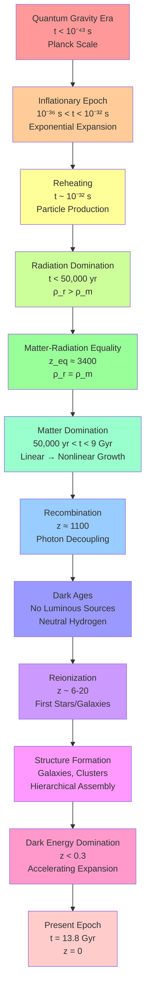

# Lesson 1: First-Principles Physical Laws & Conservation Invariants

## Curriculum Roadmap

This lesson establishes the bedrock physical laws governing cosmological evolution from the earliest moments of the universe through its current accelerating expansion. We anchor the entire cosmological masterclass in conservation principles, symmetry invariants, and the field equations that dictate spacetime curvature under extreme energy densities. Unlike idealized toy models, we ground every theoretical construct in observable consequences: redshift-distance relations measured through Type Ia supernovae light curves, cosmic microwave background angular power spectra extracted from Planck satellite data, and primordial nucleosynthesis abundances quantified through spectroscopic surveys of metal-poor stars. The curriculum progresses from Einstein's field equations and energy-momentum conservation through Friedmann-Lemaître-Robertson-Walker metric solutions, culminating in hands-on analysis of observational datasets that constrain cosmological parameters. Every mathematical structure introduced here connects directly to experimental protocols for measuring Hubble parameters, matter density fractions, and dark energy equation-of-state coefficients through telescope photometry, spectroscopic pipelines, and statistical likelihood fitting.

The subsequent lessons build systematically on these first principles. Lesson 2 dissects the observational apparatus and data reduction pipelines for extracting cosmological distances from standard candles and rulers. Lesson 3 confronts the horizon and flatness problems that motivate inflationary theory, then derives the scalar field dynamics producing exponential expansion and the quantum fluctuations seeding large-scale structure. Lesson 4 explores structure formation through gravitational instability, tracing density perturbations from linear growth through nonlinear collapse into dark matter halos. Lesson 5 examines cosmic microwave background physics, including photon-baryon fluid oscillations, Silk damping, and the acoustic peak structure encoding spatial curvature and matter content. Lesson 6 addresses dark energy phenomenology, modified gravity theories, and observational tests distinguishing cosmological constant from dynamical quintessence fields. Throughout this progression, we maintain strict adherence to the 80/20 practicality mandate: theoretical derivations serve only to illuminate the physical mechanisms underlying measurable quantities, while the majority of effort concentrates on data analysis workflows, systematic error budgets, and numerical computation techniques that working cosmologists deploy daily.

## 1. First-Principles Problem Space & Historical Phenomenon

The universe presents itself to observers as a dynamic, evolving entity whose fundamental properties emerge from the interplay between spacetime geometry and matter-energy content. This realization crystallized through decades of painstaking observational work that revealed systematic patterns inconsistent with static cosmological models. In 1912, Vesto Slipher measured Doppler shifts in galactic spectra at Lowell Observatory, discovering that most spiral nebulae exhibited redshifted spectral lines indicating recession velocities. By 1929, Edwin Hubble combined these velocity measurements with distance estimates derived from Cepheid variable stars, establishing a linear relationship between recession velocity and distance that quantified the expansion of space itself. This empirical law, $v = H_0 d$ where $H_0$ represents the present-day Hubble constant, transformed cosmology from philosophical speculation into quantitative science grounded in reproducible measurement.

The expansion discovery posed an immediate theoretical challenge: what physical mechanism drives galaxies apart, and what conservation laws govern this evolution? Albert Einstein had published his general relativistic field equations in 1915, relating spacetime curvature to energy-momentum content through the elegant tensor equation $G_{\mu\nu} = 8\pi G T_{\mu\nu}$, where $G_{\mu\nu}$ encodes geometric curvature and $T_{\mu\nu}$ describes matter-energy distribution. Initially, Einstein artificially modified these equations with a cosmological constant term to permit static solutions, believing the universe eternal and unchanging. The observational evidence for expansion rendered this modification unnecessary for static models, though the cosmological constant would return decades later to explain accelerating expansion. Alexander Friedmann and Georges Lemaître independently derived exact solutions to Einstein's equations for homogeneous, isotropic universes filled with matter and radiation, producing differential equations that track the scale factor $a(t)$ quantifying spatial expansion as cosmic time $t$ progresses.

These Friedmann equations emerge directly from applying Einstein's field equations to spacetime geometries possessing maximal symmetry. The assumption of homogeneity (identical properties at every spatial point) and isotropy (identical properties in every direction) reduces the full ten-component Einstein tensor to a manageable system of ordinary differential equations. This symmetry assumption rests on solid observational footing: galaxy surveys reveal statistical uniformity when averaged over scales exceeding 100 megaparsecs, and cosmic microwave background temperature measurements show isotropy to one part in $10^5$ after removing the dipole anisotropy caused by our motion relative to the CMB rest frame. The resulting Friedmann-Lemaître-Robertson-Walker metric takes the form:

$$ds^2 = -c^2 dt^2 + a(t)^2 \left[ \frac{dr^2}{1 - k r^2} + r^2 (d\theta^2 + \sin^2\theta \, d\phi^2) \right]$$

where $a(t)$ represents the cosmic scale factor normalized to unity at present time, $k$ encodes spatial curvature ($k = +1$ for closed spherical geometry, $k = 0$ for flat Euclidean geometry, $k = -1$ for open hyperbolic geometry), and $(r, \theta, \phi)$ constitute comoving spherical coordinates that expand with the universe. This metric structure implies that physical distances between comoving observers scale proportionally to $a(t)$, so the separation between two galaxies at coordinate distance $r$ equals $d = a(t) r$ at cosmic time $t$.

The physical interpretation of this expanding geometry requires careful distinction between proper distances measured by standard rulers at fixed cosmic time, comoving distances that factor out expansion, and various distance measures employed in observational cosmology. A photon emitted at time $t_e$ from a source at comoving coordinate $r$ travels along a null geodesic satisfying $ds^2 = 0$, yielding the lightlike trajectory equation:

$$c \int_{t_e}^{t_0} \frac{dt}{a(t)} = \int_0^r \frac{dr}{\sqrt{1 - k r^2}}$$

where $t_0$ denotes present time when the photon reaches the observer at coordinate origin. This integral relation connects emission time to comoving coordinate distance, enabling conversion between observed redshift and distance once the expansion history $a(t)$ is specified. The cosmological redshift parameter $z$ relates emission-time and observation-time scale factors through $1 + z = a(t_0)/a(t_e)$, capturing the fractional wavelength stretch experienced by photons traversing expanding space.

Measuring these distances requires standardizable astronomical objects whose intrinsic luminosities or physical sizes can be determined independently. Type Ia supernovae serve as excellent standard candles because their peak luminosities correlate tightly with light curve decay rates, enabling luminosity standardization to approximately 15% precision. The observed flux $F$ from a source with absolute luminosity $L$ located at luminosity distance $d_L$ follows the inverse-square relation $F = L/(4\pi d_L^2)$. In expanding spacetime, the luminosity distance incorporates both geometrical dilution and redshift effects, yielding $d_L = (1+z) r S_k(r)$ where $S_k(r)$ represents the transverse comoving distance function ($S_k(r) = r$ for flat geometry, $S_k(r) = \sin(r)$ for closed geometry, $S_k(r) = \sinh(r)$ for open geometry). Observational programs like the Supernova Cosmology Project and High-Z Supernova Search Team measured hundreds of high-redshift Type Ia supernovae between 1998 and 2003, discovering that distant supernovae appear systematically fainter than expected in decelerating cosmological models. This dimming directly evidences accelerating expansion driven by dark energy, a discovery recognized with the 2011 Nobel Prize in Physics.

Complementary distance measures arise from analyzing cosmic microwave background anisotropies. The acoustic oscillations of the tightly-coupled photon-baryon fluid before recombination imprint a characteristic angular scale on the CMB temperature map corresponding to the sound horizon at last scattering. The Planck satellite measured the angular extent of the first acoustic peak at $\ell \approx 220$ in the spherical harmonic decomposition of CMB temperature fluctuations, yielding a precision constraint on the angular diameter distance to the last scattering surface at redshift $z \approx 1100$. The angular diameter distance $d_A$ relates physical transverse size $s$ to observed angular extent $\delta\theta$ through $s = d_A \delta\theta$, and connects to luminosity distance via the Etherington reciprocity relation $d_L = (1+z)^2 d_A$ valid in any metric theory of gravity. Combining supernova luminosity distances with CMB angular diameter distances provides complementary constraints that break degeneracies in cosmological parameter estimation.

The energy content driving cosmic expansion comprises multiple components distinguished by their equations of state relating pressure $P$ to energy density $\rho$. Non-relativistic matter (baryonic atoms and cold dark matter) exhibits negligible pressure, characterized by equation of state parameter $w = P/(\rho c^2) = 0$. Relativistic radiation (photons and neutrinos) carries pressure $P = \rho c^2/3$, corresponding to $w = 1/3$. Dark energy modeled as a cosmological constant maintains constant energy density with negative pressure $P = -\rho c^2$, yielding $w = -1$. Each component dilutes differently as the universe expands: matter density scales as $\rho_m \propto a^{-3}$ since mass remains constant while volume increases, radiation density scales as $\rho_r \propto a^{-4}$ incorporating both volume dilution and wavelength redshift, and cosmological constant density remains fixed $\rho_\Lambda = \text{const}$ by definition.

These dilution laws imply that the universe transitions through distinct evolutionary epochs dominated by different energy components. At very early times when $a \ll 1$, radiation density overwhelms matter and dark energy, driving rapid expansion in the radiation-dominated era. The matter-radiation equality redshift $z_{\text{eq}} \approx 3400$ marks the transition to matter domination, which persists through most cosmic history until matter density dilutes below dark energy density at redshift $z \sim 0.3$. The present epoch exhibits dark energy domination characterized by accelerating expansion, with the scale factor evolving approximately as $a(t) \propto e^{H_0 t}$ in the asymptotic future. Observational determination of present-day density fractions $\Omega_m$, $\Omega_r$, $\Omega_\Lambda$ quantifies these components' relative contributions, enabling precise reconstruction of the entire expansion history $a(t)$ from the Big Bang through future evolution.

## 2. Conservation Invariants & Mathematical Laws

The Einstein field equations governing cosmological dynamics arise from a variational principle applied to the Einstein-Hilbert action, guaranteeing automatic satisfaction of fundamental conservation laws through Noether's theorem. The action integral for general relativity coupled to matter fields takes the form:

$$S = \frac{c^4}{16\pi G} \int R \sqrt{-g} \, d^4x + \int \mathcal{L}_m \sqrt{-g} \, d^4x$$

where $R$ denotes the Ricci scalar encoding spacetime curvature, $g$ represents the determinant of the metric tensor $g_{\mu\nu}$, and $\mathcal{L}_m$ specifies the matter Lagrangian density. Variation of this action with respect to the metric tensor yields Einstein's field equations $G_{\mu\nu} = 8\pi G T_{\mu\nu}/c^4$, where the Einstein tensor $G_{\mu\nu} = R_{\mu\nu} - \frac{1}{2} R g_{\mu\nu}$ automatically satisfies the Bianchi identity $\nabla^\mu G_{\mu\nu} = 0$. This geometric identity implies covariant conservation of the energy-momentum tensor: $\nabla^\mu T_{\mu\nu} = 0$. This conservation law represents the general relativistic generalization of energy-momentum conservation, accounting for gravitational work performed by spacetime curvature.

For the homogeneous, isotropic FLRW cosmology, the energy-momentum tensor assumes perfect fluid form with diagonal components determined by energy density $\rho$ and pressure $P$:

$$T^\mu_\nu = \text{diag}(-\rho c^2, P, P, P)$$

The timelike component of energy-momentum conservation $\nabla^\mu T_{\mu 0} = 0$ yields the continuity equation governing energy density evolution:

$$\frac{d\rho}{dt} + 3 \frac{\dot{a}}{a} (\rho + P/c^2) = 0$$

where overdot denotes differentiation with respect to cosmic time. This equation expresses the first law of thermodynamics for an expanding universe: the rate of energy density change equals the negative product of expansion rate and enthalpy density, representing work performed against pressure during expansion. Specifying an equation of state $P = w \rho c^2$ converts this to a separable differential equation integrable to $\rho \propto a^{-3(1+w)}$, recovering the scaling laws mentioned previously for matter ($w=0$ giving $\rho \propto a^{-3}$), radiation ($w=1/3$ giving $\rho \propto a^{-4}$), and cosmological constant ($w=-1$ giving $\rho = \text{const}$).

The Einstein tensor components for the FLRW metric reduce to two independent equations known as the Friedmann equations. The time-time component yields the primary Friedmann equation governing expansion rate:

$$H^2 = \left(\frac{\dot{a}}{a}\right)^2 = \frac{8\pi G \rho}{3} - \frac{k c^2}{a^2}$$

where $H = \dot{a}/a$ defines the Hubble parameter quantifying the instantaneous fractional expansion rate. This equation relates the expansion rate at any cosmic time to the total energy density and spatial curvature. The present-day Hubble constant $H_0 = H(t_0)$ sets the expansion rate scale, with current best-fit value $H_0 = 67.4 \pm 0.5$ km s$^{-1}$ Mpc$^{-1}$ from Planck CMB measurements, though local distance ladder determinations yield slightly higher values around $73$ km s$^{-1}$ Mpc$^{-1}$, creating the ongoing "Hubble tension" in cosmological parameter estimation.

The spatial-spatial component of Einstein's equations yields the acceleration equation governing second time derivative of the scale factor:

$$\frac{\ddot{a}}{a} = -\frac{4\pi G}{3} \left(\rho + \frac{3P}{c^2}\right)$$

This equation reveals the physical mechanism driving cosmic acceleration or deceleration. Normal matter and radiation possess positive energy density and non-negative pressure, producing negative acceleration (deceleration) that slows expansion over time. Only energy components with sufficiently negative pressure satisfying $P < -\rho c^2/3$ (equivalent to $w < -1/3$) generate positive acceleration. The cosmological constant with $w = -1$ satisfies this condition, providing the simplest explanation for observed accelerating expansion.

Expressing these equations in terms of dimensionless density parameters clarifies the physical interpretation and facilitates comparison with observational constraints. The critical density $\rho_c = 3 H^2/(8\pi G)$ represents the energy density required for spatially flat geometry ($k=0$), and individual density parameters $\Omega_i = \rho_i/\rho_c$ quantify each component's fractional contribution. The Friedmann equation rewritten in this notation becomes:

$$\sum_i \Omega_i + \Omega_k = 1$$

where $\Omega_k = -k c^2/(a^2 H^2)$ represents the effective density parameter associated with spatial curvature. This equation manifests as an algebraic constraint relating observable density fractions to spatial geometry. CMB measurements constrain total density to be extremely close to critical: $\sum_i \Omega_i = 1.000 \pm 0.001$, establishing spatial flatness to high precision and matching the prediction of inflationary cosmology that stretches any initial curvature to negligible levels.

The conservation of baryon number provides an additional invariant crucially important for primordial nucleosynthesis and large-scale structure formation. Unlike energy density which evolves according to the continuity equation, baryon number remains strictly conserved in standard cosmology, with the number density of baryons simply diluting with volume as $n_b \propto a^{-3}$. The baryon-to-photon ratio $\eta = n_b/n_\gamma$ remains constant throughout cosmic history, serving as a fundamental parameter characterizing the universe's matter content. Big Bang nucleosynthesis calculations predict primordial light element abundances as functions of $\eta$, with deuterium abundance particularly sensitive to this parameter. Observational measurements of primordial deuterium in high-redshift quasar absorption systems yield $\eta = (6.09 \pm 0.06) \times 10^{-10}$, corresponding to baryon density parameter $\Omega_b h^2 = 0.0224 \pm 0.0001$ (where $h = H_0/(100 \text{ km s}^{-1} \text{ Mpc}^{-1})$ parameterizes Hubble constant uncertainty). This measurement agrees remarkably with independent determinations from CMB acoustic peak ratios, providing powerful consistency validation of the standard cosmological model.

Entropy conservation constitutes another fundamental invariant with profound implications for early universe thermodynamics. In the absence of particle number-changing interactions, the entropy per comoving volume remains constant during adiabatic expansion. The entropy density for a thermal distribution of particles scales as $s \propto g_* T^3$ where $g_*$ counts effective relativistic degrees of freedom and $T$ denotes temperature. Since photon temperature redshifts as $T \propto a^{-1}$ and comoving volume scales as $a^3$, the product $s a^3 \propto g_* T^3 a^3 = \text{const}$ remains fixed. This conservation law enables reconstruction of temperature history from present-day CMB temperature $T_0 = 2.7255$ K through the simple relation $T(z) = T_0 (1+z)$, valid during epochs when $g_*$ remains constant.

However, entropy conservation breaks down at phase transitions where relativistic species become non-relativistic and transfer their entropy to remaining relativistic components. Electron-positron annihilation at temperature $T \sim m_e c^2/k_B \approx 6 \times 10^9$ K exemplifies this phenomenon: before annihilation, electrons and positrons contribute to $g_*$ and carry entropy; after annihilation when temperature drops below pair creation threshold, their entropy transfers to photons, slightly heating the photon bath relative to neutrinos that decoupled earlier. This differential heating establishes the neutrino temperature $T_\nu = (4/11)^{1/3} T_\gamma \approx 1.95$ K, with the numerical factor arising from detailed balance between photon heating and neutrino decoupling. Measurements of effective neutrino number $N_{\text{eff}}$ through CMB and big bang nucleosynthesis tests this thermal history, with current constraints $N_{\text{eff}} = 2.99 \pm 0.17$ consistent with the standard three-neutrino-family prediction.

Angular momentum conservation plays no direct role in homogeneous, isotropic cosmology since perfect symmetry eliminates preferred directions and rotation. However, angular momentum conservation becomes crucial when analyzing structure formation from primordial density perturbations. Collapsing overdensities convert gravitational potential energy into rotational kinetic energy, with the resulting angular momentum distribution determining galaxy morphologies and disk spin parameters. The tidal torque theory quantifies this process: aspherical proto-galactic regions experience torques from surrounding large-scale structure, generating angular momentum proportional to the product of the region's quadrupole moment and the tidal field gradient. Numerical simulations following dark matter halo formation yield a universal spin parameter distribution peaked around $\lambda \sim 0.035$, successfully explaining observed galaxy rotation curves and disk sizes when baryonic physics is included.

The equivalence principle underlying general relativity enforces a subtler conservation law through the weak equivalence principle: all test particles follow identical geodesic trajectories independent of composition when subjected to identical initial conditions. This principle guarantees that baryonic matter and dark matter experience identical gravitational effects, enabling gravitational lensing measurements to map total matter distribution without composition dependence. Strong lensing around massive galaxy clusters produces dramatic Einstein rings and multiple images, while weak lensing induces subtle coherent distortions in background galaxy shapes. Analyzing these distortions through shear correlation functions yields direct constraints on matter density $\Omega_m$ and clustering amplitude $\sigma_8$ independent of assumptions about galaxy formation physics.

Gauge symmetry in quantum field theory imposes additional conservation laws relevant for early-universe particle physics. The Standard Model possesses $U(1)_Y \times SU(2)_L \times SU(3)_C$ gauge symmetry, with electric charge conservation following from $U(1)_{EM}$ symmetry (a specific combination of $U(1)_Y$ and $SU(2)_L$ after electroweak symmetry breaking), weak isospin conservation from $SU(2)_L$, and color charge conservation from $SU(3)_C$. Baryon number and lepton number conservation remain accidental symmetries of the Standard Model Lagrangian, violated only by non-perturbative electroweak sphaleron processes at temperatures $T \gtrsim 10^{15}$ K. These baryon-number-violating processes potentially explain the observed matter-antimatter asymmetry if additional CP violation beyond the Standard Model operated during the electroweak phase transition or earlier leptogenesis epoch. The observed baryon asymmetry parameter $\eta$ mentioned earlier quantifies this asymmetry, requiring explanation through beyond-Standard-Model baryogenesis mechanisms satisfying Sakharov's three conditions: baryon number violation, C and CP violation, and departure from thermal equilibrium.

## 3. High-Level Phenomenological Model

The standard cosmological model synthesizes general relativistic dynamics, thermodynamic evolution, and quantum field theory into a coherent framework describing cosmic history from $10^{-43}$ seconds (the Planck time when quantum gravity effects dominate) through the present epoch 13.8 billion years later. This Lambda-Cold-Dark-Matter ($\Lambda$CDM) model rests on six essential parameters: the present-day Hubble constant $H_0$ setting expansion rate scale, baryon density $\Omega_b h^2$ quantifying normal matter, cold dark matter density $\Omega_c h^2$ specifying non-baryonic matter, cosmological constant $\Omega_\Lambda$ driving accelerated expansion, optical depth to reionization $\tau$ characterizing the ionization history, and primordial power spectrum parameters ($A_s$, $n_s$) quantifying initial density fluctuation amplitude and scale-dependence.

The earliest accessible epoch, cosmic inflation, addresses initial condition fine-tuning problems through a brief period of exponential expansion driven by a scalar field slowly rolling down its potential energy curve. Inflation stretches quantum vacuum fluctuations to astrophysical scales, generating the primordial density perturbations that seed all subsequent structure. The inflaton field $\phi$ obeys the Klein-Gordon equation in curved spacetime:

$$\ddot{\phi} + 3H\dot{\phi} + V'(\phi) = 0$$

where $V(\phi)$ represents the inflaton potential and prime denotes derivative with respect to $\phi$. During slow-roll inflation when $\ddot{\phi} \ll H\dot{\phi}$ and $V'(\phi) \ll V(\phi)$, the Hubble parameter remains approximately constant $H^2 \approx 8\pi G V(\phi)/(3c^2)$, producing exponential expansion $a(t) \propto e^{Ht}$. Quantum fluctuations of the inflaton field generate scalar density perturbations with nearly scale-invariant power spectrum $P(k) \propto k^{n_s-1}$ where $n_s \approx 0.965$ (slightly red-tilted, favoring larger scales). Tensor perturbations (gravitational waves) arise from spacetime metric fluctuations, with tensor-to-scalar ratio $r$ constraining inflation energy scale. Current upper limits $r < 0.036$ from CMB polarization measurements restrict inflationary models, ruling out simple large-field potentials like $V(\phi) \propto \phi^2$.

Following inflation, the universe undergoes reheating as inflaton decay transfers vacuum energy into Standard Model particles, establishing thermal equilibrium at temperatures $T \sim 10^{15}$ K. The subsequent radiation-dominated era extends from reheating through photon-baryon decoupling at redshift $z \sim 1100$. During this epoch, baryonic matter remains tightly coupled to photons through Thomson scattering, forming a photon-baryon fluid exhibiting acoustic oscillations driven by gravitational infall and radiation pressure. These oscillations imprint acoustic peaks in the CMB temperature power spectrum at angular scales corresponding to the sound horizon at recombination:

$$r_s = \int_0^{t_*} c_s(t) \, dt = \int_{z_*}^\infty \frac{c_s(z)}{H(z)(1+z)} \, dz$$

where $c_s = c/\sqrt{3(1 + 3\rho_b/(4\rho_\gamma))}$ denotes the sound speed in the coupled fluid and $z_* \approx 1100$ marks the redshift of last scattering when recombination renders the universe transparent to photons. The angular scale of the first acoustic peak $\theta_* = r_s/d_A(z_*)$ directly measures the angular diameter distance to last scattering, providing exquisite constraints on spatial curvature and matter content.

Matter-radiation equality at $z_{\text{eq}} \approx 3400$ marks the transition to matter domination, initiating gravitational instability growth that transforms tiny primordial density perturbations into galaxies and large-scale structure. Linear perturbation theory governs early growth: overdensities $\delta = \delta\rho/\bar{\rho}$ satisfying $\delta \ll 1$ evolve according to:

$$\ddot{\delta} + 2H\dot{\delta} - 4\pi G \bar{\rho} \delta = 0$$

During matter domination this equation admits growing mode solution $\delta \propto a \propto (1+z)^{-1}$, so perturbations amplify by factor $1+z$ from initial epoch to redshift $z$. Density perturbations entering the horizon during radiation domination experience suppressed growth due to radiation pressure support, establishing the turnover in the matter power spectrum at scale $k_{\text{eq}} = a_{\text{eq}} H_{\text{eq}}$ corresponding to horizon size at matter-radiation equality.

Nonlinear structure formation commences when overdensities reach $\delta \sim 1$, requiring N-body simulations to follow gravitational collapse into dark matter halos. The Press-Schechter formalism provides an analytic approximation for the halo mass function predicting the abundance of collapsed objects as a function of mass and redshift. Spherical collapse calculations show that overdensities reaching $\delta_c \approx 1.686$ at linear order detach from Hubble flow, collapse under self-gravity, and virialize at overdensity $\Delta_{\text{vir}} \approx 178$ (for matter-dominated epoch). Virialized halos exhibit approximately NFW density profiles $\rho(r) \propto r^{-1}(1+r/r_s)^{-2}$ characterized by concentration parameter $c = r_{\text{vir}}/r_s$ encoding formation history.

Baryonic matter collapses into dark matter potential wells, with complex hydrodynamic, radiative, and feedback processes determining galaxy formation efficiency. Gas cooling through atomic transitions enables star formation when cooling time drops below dynamical time, occurring most efficiently in halos with virial temperature $T_{\text{vir}} \sim 10^4$ K where atomic hydrogen cooling operates. More massive halos exhibit reduced star formation efficiency due to supernova and active galactic nucleus feedback ejecting gas from galactic potential wells. These feedback processes shape the galaxy stellar mass function, producing the observed Schechter function form $\phi(M) \propto M^{-\alpha} \exp(-M/M^*)$ with exponential cutoff at characteristic mass $M_* \sim 10^{11} M_\odot$.

The final cosmological transition occurs at redshift $z \sim 0.3$ when dark energy density surpasses matter density, initiating the current epoch of accelerating expansion. In the $\Lambda$CDM model, dark energy takes the form of a cosmological constant with equation of state $w = -1$ exactly. The acceleration equation shows that this negative pressure component drives $\ddot{a} > 0$, causing expansion rate to asymptotically approach the constant de Sitter value $H_\infty = \sqrt{\Lambda c^2/3} = H_0 \sqrt{\Omega_\Lambda}$. The scale factor evolves as $a(t) \propto \sinh^{2/3}(3H_\infty t/2)$ during the transition from matter domination to dark energy domination, approaching exponential growth $a(t) \propto e^{H_\infty t}$ in the far future.

Observational constraints on this cosmological model arise from multiple independent datasets exhibiting remarkable mutual consistency. Type Ia supernova Hubble diagrams extending to redshift $z \sim 1.5$ trace luminosity distance evolution $d_L(z)$, directly measuring the integrated expansion history. Baryon acoustic oscillation measurements in galaxy redshift surveys detect the characteristic 150 Mpc scale imprinted by pre-recombination sound waves, providing standard ruler distance calibration at multiple redshifts. Cosmic microwave background temperature and polarization power spectra encode the full cosmological parameter set through geometric projection effects (angular diameter distance to last scattering), early-time dynamics (matter-radiation equality epoch), and gravitational lensing (integrated matter distribution). Galaxy cluster abundance evolution quantifies the growth of structure, with the cluster mass function exponentially sensitive to matter density and fluctuation amplitude. Weak gravitational lensing cosmic shear correlations directly probe matter clustering, breaking degeneracies between galaxy formation physics and dark matter distribution.

Combining these complementary datasets through Bayesian parameter estimation yields the concordance cosmology: $H_0 = 67.4 \pm 0.5$ km s$^{-1}$ Mpc$^{-1}$, $\Omega_b h^2 = 0.0224 \pm 0.0001$, $\Omega_c h^2 = 0.120 \pm 0.001$, $\Omega_\Lambda = 0.685 \pm 0.007$, $n_s = 0.965 \pm 0.004$, $\sigma_8 = 0.811 \pm 0.006$. These parameters specify the cosmological model with percent-level precision, representing one of the great achievements of modern physics. Yet tensions persist: the Hubble constant determination from local distance ladder measurements exceeds Planck CMB inference by $4-5\sigma$, potentially indicating new physics or unrecognized systematic errors. Similarly, weak lensing measurements yield slightly lower clustering amplitude $\sigma_8$ than CMB-based predictions, motivating ongoing observational campaigns and theoretical investigations into possible standard model extensions.

The practical implementation of this cosmological framework for analyzing observational data requires numerical tools integrating the Friedmann equations, computing distance measures, and predicting observable spectra. Python cosmology codes like Astropy provide these essential functions. Computing luminosity distance as a function of redshift requires integrating the Hubble parameter:

$$d_L(z) = \frac{c(1+z)}{H_0} \int_0^z \frac{dz'}{E(z')}$$

where the dimensionless Hubble parameter $E(z) = H(z)/H_0 = \sqrt{\Omega_m (1+z)^3 + \Omega_k (1+z)^2 + \Omega_\Lambda}$ encodes matter, curvature, and dark energy contributions. For spatially flat $\Lambda$CDM cosmology ($\Omega_k = 0$), this simplifies to $E(z) = \sqrt{\Omega_m (1+z)^3 + \Omega_\Lambda}$. Numerical integration computes $d_L(z)$ for arbitrary cosmological parameters, enabling least-squares fitting to supernova distance modulus measurements.

Computing the cosmic microwave background power spectrum requires solving the full Boltzmann hierarchy of photon and matter perturbation evolution equations coupled through gravitational potentials and Thomson scattering. The CAMB (Code for Anisotropies in the Microwave Background) software package implements this calculation efficiently, taking cosmological parameters as input and producing CMB temperature and polarization power spectra as output. Comparing predicted spectra to Planck satellite measurements through Monte Carlo Markov Chain sampling explores the posterior probability distribution over parameter space, accounting for measurement uncertainties and parameter degeneracies.

Structure formation simulations follow the gravitational dynamics of millions to billions of dark matter particles using N-body integration schemes. The particle-mesh algorithm employs fast Fourier transforms to solve the Poisson equation relating matter density to gravitational potential on a regular grid, then interpolates forces to particle positions and advances positions using time integration. Modern simulations like Illustris-TNG incorporate hydrodynamics, radiative cooling, star formation, and feedback processes to model galaxy formation, producing synthetic galaxy catalogs directly comparable to observational surveys. These simulations validate the bottom-up hierarchical structure formation paradigm and test for signatures of alternative dark matter models like warm dark matter or self-interacting dark matter that suppress structure on small scales.

Redshift-space distortions provide a critical observational probe of gravity and structure growth. Peculiar velocities induced by gravitational infall toward overdensities Doppler-shift galaxy spectra, adding to cosmological redshift and distorting the apparent clustering pattern. On large scales, infall velocities correlate with underlying density field, enhancing clustering amplitude along the line of sight and producing the characteristic "finger of God" and "Kaiser effect" distortion patterns in redshift surveys. The distortion amplitude depends on the growth rate parameter $f = d\ln\delta/d\ln a \approx \Omega_m^{0.55}$ in general relativity, so measuring redshift-space distortions tests gravitational physics and distinguishes general relativity from modified gravity theories predicting different growth rates.

These observational techniques collectively establish the $\Lambda$CDM model on firm empirical ground while revealing tantalizing hints of potential extensions. The ultimate goal of modern cosmology extends beyond parameter measurement to addressing fundamental questions: What physical mechanism drove inflation? What comprises dark matter? Is dark energy truly a cosmological constant, or does it evolve dynamically? Does general relativity hold on cosmological scales, or do gravitational modifications operate? Answering these questions requires pushing observations to higher redshift, fainter fluxes, and greater precision while maintaining rigorous control over systematic errors. The next generation of surveys—Euclid, Vera Rubin Observatory, Roman Space Telescope—will measure billions of galaxy spectra and shapes, constraining dark energy evolution and testing gravity with unprecedented statistical power. These observational advances, combined with refined theoretical modeling incorporating baryonic feedback and alternative cosmologies, will either solidify the standard model or reveal the new physics lying just beyond current detection thresholds.
