# Lesson 1: First-Principles Physical Laws & Conservation Invariants

## Curriculum Roadmap

This opening lesson establishes the bedrock conceptual architecture upon which all cosmological thermodynamics rests. We begin by grounding our investigation in the historical phenomena that forced physicists to reconcile gravitational dynamics with thermal equilibrium, tracing the intellectual lineage from nineteenth-century steam engine efficiency studies through Boltzmann's statistical mechanics to Einstein's relativistic cosmology. From this empirical foundation, we construct the mathematical conservation laws that govern closed thermodynamic systems and expanding cosmological spacetimes alike. The lesson synthesizes classical thermodynamic potentials with general relativistic stress-energy tensors, preparing you to quantitatively model entropy production in the early universe, analyze cosmic microwave background radiation spectra, and compute adiabatic cooling rates during cosmological expansion. By the conclusion, you will possess a working fluency in the conservation invariants that constrain every observable phenomenon from stellar nucleosynthesis to black hole thermodynamics, equipped with both the theoretical machinery and the computational methods to extract measurable predictions from first principles.

## 1. First-Principles Problem Space & Historical Phenomenon

The cosmological study of thermodynamics emerged from a profound conceptual tension between two seemingly incompatible domains of nineteenth-century physics. On one hand, Clausius and Kelvin formulated the second law of thermodynamics, asserting that isolated systems inexorably evolve toward states of maximum entropy, a principle validated by countless laboratory experiments with heat engines, gas expansions, and chemical reactions. On the other hand, celestial mechanics from Newton through Lagrange had demonstrated that gravitational systems exhibit no intrinsic arrow of time—planetary orbits and stellar trajectories remain reversible under temporal inversion. This paradox intensified when astronomers began mapping the large-scale structure of the universe and discovered that cosmic evolution exhibits clear directionality: galaxies recede from one another, radiation cools as space expands, and structure formation proceeds hierarchically from quantum fluctuations to galaxy clusters.

The resolution of this tension required a radical reconceptualization of what constitutes a closed thermodynamic system when spacetime itself becomes dynamical. Einstein's field equations, published in 1915, revealed that matter-energy content curves spacetime geometry according to the fundamental relation $G_{\mu\nu} = \frac{8\pi G}{c^4} T_{\mu\nu}$, where the Einstein tensor $G_{\mu\nu}$ encodes spacetime curvature and the stress-energy tensor $T_{\mu\nu}$ represents the distribution of mass, momentum, and stress. This geometric framework transformed thermodynamics from a study of heat flow in fixed laboratory vessels into an investigation of entropy evolution within expanding or contracting spatial manifolds. The cosmological constant $\Lambda$, originally introduced by Einstein to permit static universe solutions, acquired new significance when Hubble's 1929 observations confirmed universal expansion, eventually leading to the modern $\Lambda$CDM concordance model where vacuum energy contributes a constant energy density $\rho_\Lambda = \Lambda c^4 / (8\pi G)$ to the cosmic energy budget.

Observational cosmology transformed from philosophical speculation into quantitative science when Penzias and Wilson accidentally discovered the cosmic microwave background radiation in 1964, a thermal relic exhibiting a near-perfect blackbody spectrum at temperature $T_0 \approx 2.725$ K. This discovery provided direct empirical access to the thermodynamic state of the universe approximately 380,000 years after the Big Bang, when photons last scattered from free electrons before neutral hydrogen formation rendered space transparent. The exquisite agreement between the observed CMB spectrum and the Planck blackbody distribution $B_\nu(T) = \frac{2h\nu^3}{c^2} \frac{1}{e^{h\nu/k_B T} - 1}$ confirmed that the early universe achieved thermal equilibrium with extraordinary precision, validating the application of statistical mechanics to cosmological scales. Subsequent measurements by COBE, WMAP, and Planck satellites revealed tiny temperature anisotropies $\Delta T / T \sim 10^{-5}$ that encode the initial conditions for structure formation, providing empirical constraints on inflationary scenarios and baryon-to-photon ratios.

The thermodynamic arrow of time in cosmology manifests most dramatically through entropy production mechanisms that have no counterpart in isolated laboratory systems. As the universe expands according to the Friedmann equations, photon wavelengths redshift proportional to the cosmic scale factor $a(t)$, causing radiation temperature to decrease as $T \propto a^{-1}$. This adiabatic cooling would preserve total comoving entropy density if the universe contained only photons and ultrarelativistic particles. However, phase transitions during cosmic evolution—quark-hadron confinement near $T \sim 150$ MeV, electroweak symmetry breaking at $T \sim 100$ GeV, and recombination at $T \sim 0.26$ eV—release latent heat and modify the effective number of relativistic degrees of freedom $g_*(T)$, generating entropy through out-of-equilibrium processes. The current entropy density in CMB photons alone exceeds $s_\gamma \approx 2900$ cm$^{-3}$, while the baryon-to-photon ratio $\eta = n_B / n_\gamma \approx 6 \times 10^{-10}$ constrains nucleosynthesis models and requires explanation through baryogenesis mechanisms operating at earlier epochs.

Gravitational systems introduce additional thermodynamic subtleties because gravity exhibits negative heat capacity in certain regimes. When a self-gravitating gas cloud contracts, gravitational potential energy converts to kinetic energy, heating the system while reducing its spatial extent—opposite to the behavior of ordinary gases where compression requires external work. This peculiarity underlies stellar evolution, where core contraction during hydrogen fusion initiates progressively higher temperature nuclear burning stages, ultimately leading to white dwarf cooling, neutron star formation, or black hole collapse depending on mass. Black holes themselves obey thermodynamic laws with temperature inversely proportional to mass, $T_H = \hbar c^3 / (8\pi G M k_B)$, and entropy proportional to horizon area, $S_{BH} = k_B c^3 A / (4\hbar G)$, relations derived by Bekenstein and Hawking that unite quantum mechanics, gravity, and statistical mechanics into a single framework. The apparent conflict between black hole information loss and quantum unitarity remains an active research frontier, with implications for the ultimate fate of information in our accelerating universe.

## 2. Conservation Invariants & Mathematical Laws

Conservation principles constitute the mathematical skeleton upon which all physical theories hang, and their derivation from symmetries through Noether's theorem provides the deepest connection between abstract mathematical structure and observable phenomena. For any physical system described by an action functional $S[\phi] = \int \mathcal{L}(\phi, \partial_\mu \phi, x^\mu) \, d^4x$, each continuous symmetry of the Lagrangian density $\mathcal{L}$ generates a corresponding conserved current. Time translation invariance yields energy conservation, spatial translation invariance produces momentum conservation, and rotational invariance gives angular momentum conservation. In the cosmological context, these local conservation laws must be promoted to their general relativistic counterparts, where the covariant divergence of the stress-energy tensor vanishes: $\nabla_\mu T^{\mu\nu} = 0$. This equation encapsulates energy-momentum conservation in curved spacetime, accounting for the gravitational redshift of photon energies and the work done by expansion against pressure gradients.

The stress-energy tensor for a perfect fluid, which serves as the foundation for cosmological matter modeling, takes the form $T^{\mu\nu} = (\rho + p/c^2) u^\mu u^\nu + p g^{\mu\nu}$, where $\rho$ denotes proper energy density, $p$ represents pressure, $u^\mu$ is the four-velocity of fluid elements, and $g^{\mu\nu}$ encodes the spacetime metric. For cosmology, we adopt the Friedmann-Lemaître-Robertson-Walker metric describing homogeneous and isotropic expansion:

$$ds^2 = -c^2 dt^2 + a^2(t) \left[ \frac{dr^2}{1-kr^2} + r^2(d\theta^2 + \sin^2\theta \, d\phi^2) \right]$$

where $a(t)$ represents the cosmic scale factor normalized to $a(t_0) = 1$ today, and the curvature parameter $k \in \{-1, 0, +1\}$ determines whether spatial slices exhibit hyperbolic, flat, or spherical geometry. Substituting this metric into Einstein's field equations yields the first Friedmann equation governing expansion dynamics:

$$H^2 = \left(\frac{\dot{a}}{a}\right)^2 = \frac{8\pi G}{3}\rho + \frac{\Lambda c^2}{3} - \frac{kc^2}{a^2}$$

where $H \equiv \dot{a}/a$ defines the Hubble parameter, dots denote time derivatives, and we have explicitly separated the cosmological constant contribution. The second Friedmann equation, derived from the time-time component of Einstein's equations, relates acceleration to pressure:

$$\frac{\ddot{a}}{a} = -\frac{4\pi G}{3}\left(\rho + \frac{3p}{c^2}\right) + \frac{\Lambda c^2}{3}$$

These equations, combined with the covariant energy conservation relation $\dot{\rho} + 3H(\rho + p/c^2) = 0$, form a closed system determining cosmic evolution given an equation of state $p = w\rho c^2$ relating pressure to energy density through the dimensionless parameter $w$.

Different cosmic components obey distinct equations of state that encode their thermodynamic properties. Non-relativistic matter (baryons and cold dark matter) behaves as pressureless dust with $w = 0$, yielding density evolution $\rho_m \propto a^{-3}$ reflecting simple volume dilution. Radiation and ultrarelativistic particles exhibit $w = 1/3$, producing $\rho_r \propto a^{-4}$ where the extra factor of $a^{-1}$ accounts for photon wavelength redshift. Vacuum energy characterized by the cosmological constant maintains constant energy density $w = -1$, implying $\rho_\Lambda = \text{const}$, a thermodynamically peculiar substance that sources repulsive gravity and drives accelerated expansion. Observational constraints from supernova distance measurements, baryon acoustic oscillations, and CMB acoustic peak locations converge on present-day energy density fractions $\Omega_m \approx 0.31$, $\Omega_\Lambda \approx 0.69$, and $\Omega_r \sim 10^{-4}$, where $\Omega_i \equiv \rho_i / \rho_{\text{crit}}$ normalizes densities to the critical density $\rho_{\text{crit}} = 3H_0^2 / (8\pi G) \approx 9.5 \times 10^{-27}$ kg/m$^3$ required for spatial flatness.

Entropy evolution in expanding cosmology requires careful treatment because photon number is not conserved during phase transitions and particle annihilation processes. The total entropy within a comoving volume—a volume that expands with the cosmic scale factor—remains constant during adiabatic evolution, leading to the conservation of comoving entropy density $s \, a^3 = \text{const}$. For a relativistic gas in thermal equilibrium, the entropy density relates to temperature through $s = \frac{2\pi^2}{45} g_*(T) k_B \left(\frac{k_B T}{\hbar c}\right)^3$, where $g_*(T)$ counts the effective number of relativistic degrees of freedom, including bosonic contributions weighted by unity and fermionic contributions weighted by $7/8$ to account for Fermi-Dirac statistics. During the quark-hadron transition near $T \sim 150$ MeV, $g_*$ drops from approximately $61.75$ (quarks and gluons) to $17.25$ (pions and other light hadrons), releasing latent heat that temporarily slows the temperature decline. Precision measurements of primordial deuterium and helium-4 abundances constrain the baryon-to-photon ratio through Big Bang nucleosynthesis calculations, providing independent confirmation of $\eta \approx 6 \times 10^{-10}$ derived from CMB observations.

The laws of thermodynamics themselves acquire cosmological interpretations that extend far beyond laboratory thermostatics. The first law, expressing energy conservation, becomes the Friedmann continuity equation $\dot{\rho} + 3H(\rho + p/c^2) = 0$, where the $3H\rho$ term represents energy dilution from volume expansion and the $3Hp/c^2$ term accounts for $pdV$ work done during expansion. The second law, asserting entropy increase in isolated systems, manifests cosmologically through the requirement that comoving entropy never decreases: $\frac{d}{dt}(s \, a^3) \geq 0$. This inequality permits entropy-generating processes like reheating after inflation, where inflaton decay produces radiation and increases $g_*$, or structure formation, where gravitational collapse converts potential energy to kinetic energy and eventually radiation through dissipative processes. The third law, stating that absolute zero temperature remains unattainable, has cosmological relevance for the ultimate fate of expanding universes, where exponential expansion driven by dark energy prevents thermal equilibrium across causally disconnected horizon volumes.

Quantitative application of these conservation laws requires numerical integration of the coupled Friedmann equations across cosmic history. The conformal time variable $\eta \equiv \int dt/a(t)$ often simplifies radiation-dominated calculations, while the scale factor itself serves as a convenient time variable through the transformation $\frac{d}{dt} = H(a) a \frac{d}{da}$. During matter domination with negligible radiation and cosmological constant, the first Friedmann equation simplifies to $H^2 \approx \frac{8\pi G}{3}\rho_m \propto a^{-3}$, yielding $a(t) \propto t^{2/3}$ and Hubble parameter $H = 2/(3t)$. During radiation domination at earlier times, $H^2 \propto a^{-4}$ produces $a(t) \propto t^{1/2}$ and $H = 1/(2t)$. In the current dark energy-dominated epoch where $\rho_\Lambda$ exceeds $\rho_m$, the universe approaches exponential expansion $a(t) \propto \exp(H_\infty t)$ with asymptotic Hubble rate $H_\infty = \sqrt{\Lambda c^2/3} \approx 1.9 \times 10^{-18}$ s$^{-1}$, corresponding to a de Sitter spacetime horizon at distance $c/H_\infty \approx 16$ billion light-years.

Temperature evolution couples directly to the scale factor through redshift relations. For photons in thermal equilibrium, the Planck distribution maintains its blackbody form with temperature scaling as $T \propto a^{-1}$, a consequence of each photon's wavelength stretching with spatial expansion. This simple scaling breaks down during particle annihilation epochs when massive species become non-relativistic. For example, electron-positron annihilation near $T \sim 0.5$ MeV transfers entropy to photons, heating them relative to neutrinos that have already decoupled. The temperature ratio between photons and neutrinos after this transition becomes $T_\gamma / T_\nu = (11/4)^{1/3} \approx 1.40$, a residual signature measurable through cosmic neutrino background detection experiments currently under development. Precision cosmology has confirmed this prediction indirectly through the effective number of relativistic species $N_{\text{eff}} = 3.046$ inferred from CMB and nucleosynthesis observations, matching the Standard Model expectation of three neutrino generations with small corrections from non-instantaneous decoupling.

## 3. High-Level Phenomenological Model

The interplay between gravitational dynamics and thermodynamic evolution throughout cosmic history forms a causally interconnected web that we can represent through a process flow diagram capturing the major phase transitions, conservation laws, and observational probes. This schematic model distills the mathematical machinery developed above into a phenomenological framework tracking energy density components, entropy generation mechanisms, and the observational consequences accessible to experimental verification.

```mermaid
graph TD
    A["Planck Epoch: Quantum Gravity<br/>T ~ 10^32 K, t ~ 10^-43 s"] --> B["Inflation: Exponential Expansion<br/>Scalar Field Dominance<br/>δφ → Density Perturbations"]
    B --> C["Reheating: Inflaton Decay<br/>φ → SM particles<br/>Entropy Generation: s·a³ increases"]
    C --> D["Radiation Dominated Era<br/>ρ ∝ a^-4, T ∝ a^-1<br/>a(t) ∝ t^1/2"]
    D --> E["QCD Phase Transition<br/>T ~ 150 MeV<br/>g* drops: 61.75 → 17.25"]
    E --> F["Big Bang Nucleosynthesis<br/>T ~ 0.1-1 MeV, t ~ 1-200 s<br/>D, ³He, ⁴He formation<br/>Constraint: η = n_B/n_γ"]
    F --> G["Matter-Radiation Equality<br/>z_eq ~ 3400, t ~ 50,000 yr<br/>ρ_m = ρ_r"]
    G --> H["Recombination & Decoupling<br/>T ~ 3000 K, z ~ 1100<br/>CMB Last Scattering Surface"]
    H --> I["Matter Dominated Era<br/>ρ ∝ a^-3, a(t) ∝ t^2/3<br/>Structure Formation: δρ/ρ grows"]
    I --> J["Dark Energy Domination<br/>z < 0.4, ρ_Λ > ρ_m<br/>Accelerated Expansion begins"]
    J --> K["Present Epoch<br/>T_CMB = 2.725 K<br/>Ω_Λ ≈ 0.69, Ω_m ≈ 0.31"]
    K --> L["Future: Asymptotic de Sitter<br/>a ∝ exp(H_∞ t)<br/>Event Horizon Formation"]
    
    style A fill:#ff6b6b
    style B fill:#ffd93d
    style C fill:#ffd93d
    style D fill:#6bcf7f
    style E fill:#6bcf7f
    style F fill:#4d96ff
    style G fill:#4d96ff
    style H fill:#a78bfa
    style I fill:#ec4899
    style J fill:#f97316
    style K fill:#06b6d4
    style L fill:#64748b
```



This phenomenological timeline embeds the conservation principles as persistent constraints operating across all epochs. Energy-momentum conservation through $\nabla_\mu T^{\mu\nu} = 0$ governs the continuous evolution of densities $\rho_i(a)$ for each component, while entropy conservation or generation determines the thermal history encoded in temperature evolution $T(a)$. The diagram explicitly marks epochs where conservation laws permit or require entropy production, distinguishing adiabatic phases (radiation domination, matter domination) from non-adiabatic transitions (reheating, QCD confinement, recombination) where microphysical processes inject or redistribute entropy.

Observational cosmology provides empirical anchors throughout this timeline through multiple independent measurement channels. The cosmic microwave background captures the thermal state at recombination with extraordinary precision: temperature $T_{\text{CMB}} = 2.7255 \pm 0.0006$ K, spectral distortion upper limits constraining energy injection $|\mu| < 9 \times 10^{-5}$, and acoustic peak angular scales determining curvature $|\Omega_k| < 0.001$. Primordial abundance measurements constrain nucleosynthesis through deuterium-to-hydrogen ratio $D/H = (2.527 \pm 0.030) \times 10^{-5}$ and helium-4 mass fraction $Y_p = 0.2449 \pm 0.0040$, both sensitive to the baryon density and the expansion rate during the first few minutes. Large-scale structure observations through galaxy redshift surveys, weak gravitational lensing, and Ly-$\alpha$ forest absorption map the growth of density perturbations from initial conditions imprinted during inflation through linear growth during matter domination to the current epoch of non-linear clustering.

The mathematical machinery connecting this phenomenological model to quantitative predictions involves solving the coupled differential equations governing density evolution, temperature history, and perturbation growth. For background evolution, numerical integration of the Friedmann equations with appropriate initial conditions at early times propagates forward to yield $a(t)$, $H(t)$, and derived quantities like the comoving distance to redshift $z$:

$$\chi(z) = \frac{c}{H_0} \int_0^z \frac{dz'}{E(z')}, \quad E(z) \equiv \frac{H(z)}{H_0} = \sqrt{\Omega_r(1+z)^4 + \Omega_m(1+z)^3 + \Omega_k(1+z)^2 + \Omega_\Lambda}$$

This integral determines angular diameter distances $d_A = \chi/(1+z)$ and luminosity distances $d_L = \chi(1+z)$ that relate observed fluxes and angular sizes to intrinsic properties, forming the basis for supernova cosmology and standard ruler measurements. Perturbation theory requires solving the coupled Boltzmann equations for photon, baryon, dark matter, and neutrino distribution functions, accounting for gravitational redshift, Thomson scattering, and acoustic oscillations. Modern cosmological analysis employs Markov Chain Monte Carlo methods to sample the posterior probability distribution over parameters $\{\Omega_m, \Omega_\Lambda, H_0, \sigma_8, n_s, \ldots\}$ given observational datasets, yielding the constraint contours published by Planck, DES, and other collaborations.

Practical implementation of these calculations for research-grade analysis requires numerical codes that integrate the Einstein-Boltzmann system with sufficient accuracy to match sub-percent observational precision. The publicly available CLASS (Cosmic Linear Anisotropy Solving System) and CAMB (Code for Anisotropies in the Microwave Background) packages provide community-standard implementations solving perturbation evolution from initial conditions through recombination and into the matter-dominated era. These codes output power spectra $C_\ell$ for CMB temperature and polarization anisotropies, matter power spectra $P(k)$ for large-scale structure, and transfer functions relating late-time perturbations to primordial amplitudes. A minimal Python workflow for computing background evolution and extracting cosmological distances proceeds as follows:

```python
import numpy as np
from scipy.integrate import odeint
from scipy.interpolate import interp1d

# Physical constants in SI units
c = 2.99792458e8          # Speed of light [m/s]
G = 6.67430e-11           # Gravitational constant [m^3/kg/s^2]
hbar = 1.054571817e-34    # Reduced Planck constant [J·s]
k_B = 1.380649e-23        # Boltzmann constant [J/K]

# Cosmological parameters (Planck 2018 best-fit)
h = 0.6766                # Dimensionless Hubble parameter
H0 = h * 100 * 1e3 / 3.086e22  # Hubble constant [1/s]
Omega_m0 = 0.3111         # Matter density parameter today
Omega_Lambda0 = 0.6889    # Dark energy density parameter today
Omega_r0 = 9.24e-5        # Radiation density parameter today
T_CMB0 = 2.7255           # CMB temperature today [K]

def Friedmann_system(y, lna, Omega_m0, Omega_Lambda0, Omega_r0):
    """
    Solve Friedmann equations as ODE system in log scale factor lna = ln(a).
    
    State vector: y = [t, chi]
    where t is cosmic time [s] and chi is comoving distance [m].
    
    Returns derivatives d/d(lna) of state variables.
    """
    a = np.exp(lna)
    Omega_k0 = 1.0 - Omega_m0 - Omega_Lambda0 - Omega_r0
    
    # Hubble parameter evolution: H(a) / H0
    E = np.sqrt(Omega_r0 * a**(-4) + Omega_m0 * a**(-3) + 
                Omega_k0 * a**(-2) + Omega_Lambda0)
    
    H = H0 * E  # Hubble parameter [1/s]
    
    # Derivatives: dt/dlna and dchi/dlna
    dt_dlna = a / H
    dchi_dlna = c / (a * H)
    
    return [dt_dlna, dchi_dlna]

# Integration: evolve from early time (a_i = 1e-9) to today (a_f = 1)
lna_array = np.linspace(np.log(1e-9), np.log(1.0), 10000)
y0 = [0.0, 0.0]  # Initial conditions: t=0, chi=0 at early time

solution = odeint(Friedmann_system, y0, lna_array, 
                  args=(Omega_m0, Omega_Lambda0, Omega_r0))

t_array = solution[:, 0]        # Cosmic time [s]
chi_array = solution[:, 1]      # Comoving distance [m]
a_array = np.exp(lna_array)     # Scale factor
z_array = 1.0 / a_array - 1.0   # Redshift

# Create interpolation functions for cosmological observables
t_of_z = interp1d(z_array[::-1], t_array[::-1], kind='cubic', 
                  bounds_error=False, fill_value='extrapolate')
chi_of_z = interp1d(z_array[::-1], chi_array[::-1], kind='cubic',
                    bounds_error=False, fill_value='extrapolate')

def age_of_universe():
    """Return age of universe today in years."""
    return t_of_z(0) / (365.25 * 86400)

def comoving_distance(z):
    """Comoving distance to redshift z [Mpc]."""
    return chi_of_z(z) / 3.086e22

def angular_diameter_distance(z):
    """Angular diameter distance [Mpc]."""
    return comoving_distance(z) / (1 + z)

def luminosity_distance(z):
    """Luminosity distance [Mpc]."""
    return comoving_distance(z) * (1 + z)

def lookback_time(z):
    """Lookback time to redshift z [Gyr]."""
    return (t_of_z(0) - t_of_z(z)) / (1e9 * 365.25 * 86400)

# Example calculations
print(f"Age of universe: {age_of_universe():.3f} Gyr")
print(f"Comoving distance to CMB (z=1100): {comoving_distance(1100):.1f} Mpc")
print(f"Angular diameter distance to CMB: {angular_diameter_distance(1100):.2f} Mpc")
print(f"Lookback time to recombination: {lookback_time(1100):.3f} Gyr")
print(f"Luminosity distance to z=1: {luminosity_distance(1.0):.1f} Mpc")

# Temperature evolution and entropy density calculation
def temperature_CMB(z):
    """CMB temperature at redshift z [K]."""
    return T_CMB0 * (1 + z)

def photon_number_density(z):
    """CMB photon number density at redshift z [m^-3]."""
    T = temperature_CMB(z)
    zeta3 = 1.2020569  # Riemann zeta(3)
    return 2 * zeta3 / np.pi**2 * (k_B * T / (hbar * c))**3

def entropy_density_photons(z):
    """Entropy density in CMB photons [J/(K·m^3)]."""
    T = temperature_CMB(z)
    return (2 * np.pi**2 / 45) * k_B * (k_B * T / (hbar * c))**3

def comoving_entropy(z):
    """Comoving entropy density s·a³ [J·K^-1]."""
    a = 1.0 / (1 + z)
    return entropy_density_photons(z) * a**3

# Verify entropy conservation during radiation domination
z_test = np.array([10, 100, 1000])
s_comoving = [comoving_entropy(z) for z in z_test]
print(f"\nComoving entropy s·a³ at z=[10, 100, 1000]:")
for z, s in zip(z_test, s_comoving):
    print(f"  z={z:4.0f}: s·a³ = {s:.6e} J/K (relative: {s/s_comoving[0]:.6f})")

# Critical density and density parameters evolution
def critical_density(z):
    """Critical density at redshift z [kg/m^3]."""
    a = 1.0 / (1 + z)
    Omega_k0 = 1.0 - Omega_m0 - Omega_Lambda0 - Omega_r0
    E = np.sqrt(Omega_r0 * a**(-4) + Omega_m0 * a**(-3) + 
                Omega_k0 * a**(-2) + Omega_Lambda0)
    H = H0 * E
    return 3 * H**2 / (8 * np.pi * G)

def matter_density(z):
    """Matter density at redshift z [kg/m^3]."""
    rho_c0 = critical_density(0)
    return Omega_m0 * rho_c0 * (1 + z)**3

def radiation_density(z):
    """Radiation density at redshift z [kg/m^3]."""
    rho_c0 = critical_density(0)
    return Omega_r0 * rho_c0 * (1 + z)**4

# Find matter-radiation equality redshift
z_eq_array = np.linspace(1000, 10000, 10000)
rho_m_eq = matter_density(z_eq_array)
rho_r_eq = radiation_density(z_eq_array)
idx_eq = np.argmin(np.abs(rho_m_eq - rho_r_eq))
z_eq = z_eq_array[idx_eq]
t_eq = t_of_z(z_eq) / (365.25 * 86400)  # Convert to years

print(f"\nMatter-radiation equality:")
print(f"  z_eq = {z_eq:.0f}")
print(f"  t_eq = {t_eq:.0f} yr")
print(f"  T_eq = {temperature_CMB(z_eq):.1f} K")
```

This computational framework provides the quantitative backbone for translating abstract conservation laws into concrete predictions testable against observational data. The Friedmann equation integration yields cosmic time as a function of redshift, enabling conversion between observed redshift and physical time since the Big Bang. The comoving distance calculation determines angular scales for standard rulers like baryon acoustic oscillations, where the sound horizon at decoupling $r_s \approx 147$ Mpc subtends an angle $\theta_s \approx r_s / d_A(z_{\text{dec}}) \approx 0.6°$ on the CMB sky. Entropy density calculations verify the expected constancy of comoving entropy during adiabatic expansion and quantify departures during phase transitions where latent heat release or particle annihilation modifies thermal histories.

Experimental verification of these theoretical predictions requires instrumentation spanning electromagnetic spectrum from radio through gamma rays, plus gravitational wave detectors and neutrino observatories. Ground-based CMB experiments like the Atacama Cosmology Telescope and South Pole Telescope measure temperature and polarization anisotropies to arc-minute scales, constraining spatial curvature and primordial perturbation amplitudes. Space-based missions like JWST peer back to reionization epoch at $z \sim 6$–$15$, directly imaging the first galaxies and quantifying star formation rates during cosmic dawn. Gravitational wave observations by LIGO/Virgo provide independent measurements of Hubble constant through standard siren analysis of binary neutron star mergers with electromagnetic counterparts, currently exhibiting tension with CMB-inferred values that may signal new physics or systematic uncertainties.

The conceptual synthesis achieved through this first-principles foundation equips you to approach any problem in cosmological thermodynamics with both the mathematical rigor to derive quantitative predictions and the physical intuition to assess whether results make phenomenological sense. Conservation laws serve as the invariant skeleton constraining all models, while observational data provides the empirical meat testing theoretical predictions against reality. The interplay between elegant mathematical structure—Noether symmetries generating conserved currents, Einstein's geometric formulation of gravity, statistical mechanical entropy formulas—and messy astrophysical processes—stellar nucleosynthesis, supernova explosions, black hole accretion—defines the frontier where fundamental physics meets observable universe. Subsequent lessons will deploy this machinery to analyze specific phenomena: CMB anisotropy generation through acoustic oscillations, structure formation via gravitational instability, dark energy constraints from supernova cosmology, and inflationary predictions for primordial perturbation spectra. Each application will demonstrate how conservation principles, properly applied within relativistic spacetime, transform qualitative cosmological narratives into quantitative, falsifiable scientific theories.
