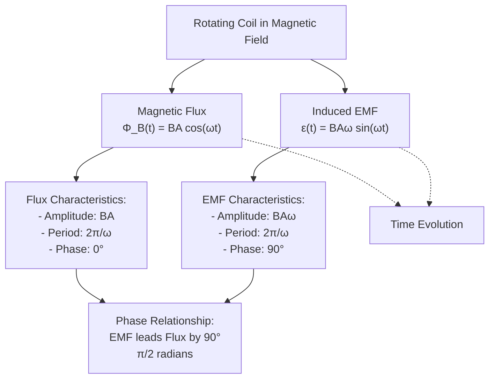

# Lesson 3: Electromagnetic Induction, Faraday's Law, Lenz's Law

## 1. First-Principles Intuition & Invariants

The phenomenon of electromagnetic induction represents one of the most profound unifications in classical physics: the recognition that time-varying magnetic fields generate electric fields, and that this coupling is not merely a curiosity but the foundation of electrical power generation, transformers, inductors, and the propagation of electromagnetic waves themselves. Before Michael Faraday's experimental discoveries in 1831, electricity and magnetism were understood as separate domains. Faraday's insight—that a changing magnetic flux through a conducting loop induces an electromotive force (EMF) in that loop—revealed a dynamic symmetry that would later be encoded in Maxwell's equations as the Faraday-Maxwell law.

At its core, electromagnetic induction arises from the relativistic invariance of electromagnetic phenomena. When an observer moves relative to a magnetic field, that observer experiences an electric field due to the Lorentz transformation of the electromagnetic field tensor. This is not an approximation or a classical limit; it is a direct consequence of special relativity applied to electromagnetism. In the non-relativistic limit, we recover Faraday's law as a statement about the rate of change of magnetic flux linking a circuit. The induced EMF opposes the change in flux that produced it—a principle known as Lenz's law, which is itself a manifestation of energy conservation and the requirement that electromagnetic systems resist changes to their magnetic equilibrium states.

The mathematical statement of Faraday's law in its integral form is

$$\mathcal{E} = -\frac{d\Phi_B}{dt}$$

where $\mathcal{E}$ is the induced electromotive force around a closed loop, and $\Phi_B = \int_S \vec{B} \cdot d\vec{A}$ is the magnetic flux through the surface $S$ bounded by that loop. The negative sign, introduced by Lenz, ensures that the induced current generates a magnetic field opposing the flux change. This is not merely a sign convention; it encodes the irreversibility and dissipative character of real electromagnetic processes. In differential form, Faraday's law becomes one of Maxwell's equations:

$$\nabla \times \vec{E} = -\frac{\partial \vec{B}}{\partial t}$$

This tells us that a time-varying magnetic field generates a curling electric field. Unlike the electrostatic field, which is conservative and derives from a scalar potential, the induced electric field forms closed loops and cannot be expressed as the gradient of a potential alone. The distinction is critical: electrostatic fields arise from charge distributions, while induced electric fields arise from changing magnetic flux.

The flux linkage $\Phi_B$ depends on both the magnetic field strength and the geometric configuration of the conductor. For a coil with $N$ turns, the total flux linkage is $\lambda = N\Phi_B$, and the induced EMF scales linearly with the number of turns. This is why transformers and inductors employ multi-turn coils to amplify inductive effects. The rate of flux change can arise from three distinct mechanisms: temporal variation of the magnetic field itself ($\partial \vec{B}/\partial t \neq 0$), motion of the conductor through a spatially varying magnetic field, or deformation of the loop's geometry. These are not separate laws but different perspectives on the same underlying Lorentz force action on charge carriers.

Motional EMF arises when a conductor moves through a static magnetic field. Consider a conducting rod of length $\ell$ moving with velocity $\vec{v}$ perpendicular to a uniform magnetic field $\vec{B}$. The Lorentz force on charge carriers in the rod is $\vec{F} = q(\vec{v} \times \vec{B})$, which drives a charge separation and establishes an electric field along the rod. The induced EMF is

$$\mathcal{E} = \int_{\text{rod}} (\vec{v} \times \vec{B}) \cdot d\vec{\ell} = B \ell v$$

This motional EMF is not due to a time-varying magnetic field in the laboratory frame; instead, it arises from the transformation of the magnetic field into an electric field in the moving conductor's rest frame. The equivalence of the flux-rule and Lorentz-force perspectives is exact and can be verified by computing the rate of change of flux as the rod sweeps out area.

Self-inductance quantifies the opposition of a circuit to changes in its own current. When current flows through a coil, it generates a magnetic field that threads back through the coil itself. If the current changes, the flux through the coil changes, inducing a back-EMF that opposes the current change. The self-inductance $L$ is defined by

$$\mathcal{E} = -L \frac{dI}{dt}$$

For a solenoid with $N$ turns, length $\ell$, and cross-sectional area $A$, the self-inductance in vacuum is

$$L = \mu_0 \frac{N^2 A}{\ell}$$

Self-inductance has units of henrys (H), where $1 \, \text{H} = 1 \, \text{V} \cdot \text{s} / \text{A}$. The energy stored in the magnetic field of an inductor is

$$U_L = \frac{1}{2} L I^2$$

This energy is distributed throughout the magnetic field volume with energy density

$$u_B = \frac{B^2}{2\mu_0}$$

When the current is interrupted, this stored energy must be dissipated, often producing large voltage spikes that can damage circuit components—a phenomenon exploited in ignition coils and pulse generators.

Mutual inductance describes the coupling between two circuits. When current $I_1$ in circuit 1 generates a magnetic field that links flux $\Phi_{21}$ through circuit 2, the mutual inductance $M_{21}$ is defined by $\Phi_{21} = M_{21} I_1$. By reciprocity, $M_{12} = M_{21} = M$, and the induced EMF in circuit 2 due to changing current in circuit 1 is

$$\mathcal{E}_2 = -M \frac{dI_1}{dt}$$

Transformers operate on this principle. A time-varying current in the primary coil generates a time-varying magnetic flux in a shared ferromagnetic core, which induces an EMF in the secondary coil. The voltage ratio is determined by the turns ratio: $V_2 / V_1 = N_2 / N_1$. Ideal transformers conserve power, so the current ratio is the inverse: $I_2 / I_1 = N_1 / N_2$.

Eddy currents are circulating currents induced in bulk conductors by changing magnetic flux. These currents dissipate energy as Joule heating and can be substantial in magnetic materials subjected to AC fields. Eddy currents are exploited in induction heating, electromagnetic braking, and non-destructive testing, but they represent parasitic losses in transformers and motors. To minimize eddy current losses, magnetic cores are laminated—constructed from thin, insulated sheets oriented parallel to the magnetic field. This increases the effective resistance to eddy current paths without significantly impeding the magnetic flux.

Lenz's law provides a qualitative rule for determining the direction of induced currents: the induced current flows in such a direction that its magnetic field opposes the change in flux that produced it. This is a direct consequence of energy conservation. If the induced field reinforced the flux change, a small perturbation would lead to runaway current growth, violating thermodynamic stability. Lenz's law manifests physically as magnetic damping: a magnet falling through a conducting tube experiences a retarding force due to eddy currents induced in the tube walls, which generate upward magnetic forces opposing the magnet's motion.

## 2. Core Architecture & Mechanics

The experimental realization of Faraday's law requires precise control over magnetic flux and careful measurement of induced voltages. The canonical demonstration employs a solenoid primary coil connected to an AC voltage source and a secondary pickup coil whose terminals connect to a high-impedance voltmeter or oscilloscope. The primary current generates a time-varying magnetic field $\vec{B}(t) = \mu_0 n I(t) \hat{z}$, where $n = N_1 / \ell$ is the turn density. The secondary coil, with $N_2$ turns and cross-sectional area $A$, experiences a flux linkage

$$\lambda(t) = N_2 \Phi_B(t) = N_2 \mu_0 n A I(t)$$

The induced EMF in the secondary is

$$\mathcal{E}(t) = -\frac{d\lambda}{dt} = -\mu_0 n N_2 A \frac{dI}{dt}$$

For sinusoidal excitation $I(t) = I_0 \cos(\omega t)$, the induced EMF is $\mathcal{E}(t) = \mu_0 n N_2 A I_0 \omega \sin(\omega t)$, leading the current by 90 degrees. The amplitude of the induced voltage scales linearly with frequency, a signature of inductive coupling.

To measure self-inductance experimentally, construct an LR circuit consisting of an inductor in series with a resistor and a DC voltage source controlled by a switch. When the switch closes at $t = 0$, Kirchhoff's voltage law gives

$$V_0 = L \frac{dI}{dt} + R I$$

The solution is an exponential rise:

$$I(t) = \frac{V_0}{R} \left(1 - e^{-t/\tau}\right)$$

where the inductive time constant is $\tau = L/R$. Measure the voltage across the resistor as a function of time using an oscilloscope. Fit the exponential transient to extract $\tau$, from which $L = R \tau$. For accurate results, use a resistor with known precision (1% tolerance or better) and ensure the oscilloscope input impedance is much larger than $R$ to avoid loading effects.

The measurement of mutual inductance between two coils requires a mutual inductance bridge or a frequency-domain measurement. Drive the primary coil with a known AC current $I_1(t) = I_0 \sin(\omega t)$ and measure the open-circuit voltage $V_2(t)$ induced in the secondary coil. The mutual inductance is

$$M = \frac{V_{2,\text{peak}}}{\omega I_0}$$

This method assumes the secondary circuit draws negligible current, ensuring the primary field is not perturbed by secondary reaction. For tightly coupled coils, the coupling coefficient $k = M / \sqrt{L_1 L_2}$ approaches unity. In practice, $k$ ranges from 0.9–0.98 for ferromagnetic-core transformers and 0.3–0.6 for air-core coils.

Eddy current visualization employs a thin aluminum disk mounted on a low-friction bearing. Place the disk near the pole face of an electromagnet driven by a function generator. As the AC magnetic field penetrates the disk, circulating eddy currents are induced. These currents interact with the applied field to produce a torque, causing the disk to rotate. The direction of rotation follows Lenz's law: the disk attempts to reduce the rate of flux change by moving with the field oscillations. This is the operating principle of eddy-current tachometers and induction motors.

For quantitative analysis of eddy current losses, consider a conducting slab of thickness $d$, conductivity $\sigma$, and permeability $\mu_0$ subjected to a time-harmonic magnetic field $\vec{B}(t) = B_0 \cos(\omega t) \hat{z}$ perpendicular to the slab surface. The induced electric field is azimuthal, and the eddy current density is

$$\vec{J} = \sigma \vec{E}_{\text{ind}}$$

The skin depth, the characteristic penetration depth of the field into the conductor, is

$$\delta = \sqrt{\frac{2}{\omega \mu_0 \sigma}}$$

For copper ($\sigma \approx 6 \times 10^7 \, \text{S/m}$) at 60 Hz, $\delta \approx 8.5 \, \text{mm}$. At higher frequencies, the field is confined to a thin surface layer, increasing resistive losses per unit volume. The power dissipated per unit area of the slab surface is

$$P_{\text{eddy}} = \frac{B_0^2 \omega^2 d^2}{12 \rho}$$

where $\rho = 1/\sigma$ is the resistivity. This quadratic dependence on frequency explains why transformer cores operating at 50–60 Hz use laminations, while high-frequency transformers require ferrite cores with low conductivity.

Induction heating exploits high-frequency eddy currents to heat conducting workpieces. An induction coil carrying RF current (typically 10 kHz to 10 MHz) generates a rapidly oscillating magnetic field. Eddy currents induced in the workpiece dissipate power as Joule heat. The heating rate is maximum near the surface, within a skin depth, making induction heating ideal for surface hardening and brazing. The efficiency of power transfer depends on the coil-workpiece coupling and the quality factor $Q = \omega L / R$ of the induction coil circuit.

Lenz's law manifests experimentally in magnetic braking. Drop a cylindrical neodymium magnet through a vertical copper tube. The falling magnet induces azimuthal eddy currents in the tube wall. By Lenz's law, these currents generate a magnetic field opposing the magnet's motion, exerting an upward force. The magnet reaches a terminal velocity when the magnetic drag force balances gravity. The terminal velocity depends on the magnet's strength, the tube's conductivity, and wall thickness. Measure the descent time over a fixed distance for tubes of varying wall thickness to quantify the scaling of eddy-current damping.

A rigorous demonstration of Faraday's law using a rotating coil in a uniform magnetic field requires an apparatus consisting of a rectangular coil mounted on a low-friction axle, positioned between the poles of a permanent magnet or electromagnet. The coil rotates at constant angular velocity $\omega$, and the magnetic flux through it is

$$\Phi_B(t) = B A \cos(\omega t)$$

where $A$ is the coil area. The induced EMF is

$$\mathcal{E}(t) = -\frac{d\Phi_B}{dt} = B A \omega \sin(\omega t)$$

Connect the coil terminals to an oscilloscope via slip rings or a wireless inductive coupling. The observed sinusoidal EMF waveform confirms Faraday's law and forms the basis of AC generators. The peak EMF is $\mathcal{E}_{\text{max}} = B A \omega$, demonstrating the linear scaling with rotation frequency.

The diagram below illustrates the magnetic flux and induced EMF in a rotating coil:

This phase relationship is universal in inductive systems and arises because the EMF depends on the time derivative of the flux, not the flux itself.

## 3. High-Performance Optimization & Failure Modes

The optimization of inductive systems for maximum efficiency and minimal parasitic losses demands careful attention to material selection, geometric configuration, and operating frequency. In transformer design, the choice of core material determines the trade-off between magnetic permeability, saturation flux density, and eddy current losses. Silicon steel laminations, with relative permeability $\mu_r \approx 2000$–7000 and lamination thickness 0.3–0.5 mm, are standard for power transformers operating at 50–60 Hz. At higher frequencies (1 kHz to 1 MHz), ferrite cores with low conductivity and moderate permeability ($\mu_r \approx 100$–2000) minimize eddy losses while providing sufficient flux linkage.

The design of high-Q inductors for RF and resonant circuits requires minimizing both resistive losses in the winding and dielectric losses in the coil former. Use heavy-gauge wire (low DC resistance) and Litz wire for frequencies above 100 kHz to mitigate skin effect losses. Litz wire consists of individually insulated strands woven to equalize current distribution across the conductor cross-section, reducing effective AC resistance. The quality factor is

$$Q = \frac{\omega L}{R_{\text{AC}}}$$

where $R_{\text{AC}}$ includes skin effect, proximity effect, and core losses. For air-core inductors, $Q$ can exceed 500 at MHz frequencies. Ferrite-core inductors trade higher inductance for lower $Q$ due to core losses.

Inductive voltage spikes when interrupting current through an inductor pose a significant failure mode in switching circuits. When a switch opens, the inductor attempts to maintain current continuity by generating a large back-EMF, often exceeding the breakdown voltage of semiconductor switches. To suppress these transients, connect a flyback diode in parallel with the inductor, oriented to conduct when the switch opens. The diode provides a current path, clamping the voltage spike to the diode forward drop ($\sim 0.7 \, \text{V}$ for silicon). In high-power applications, use a snubber circuit consisting of a series resistor-capacitor network to dissipate the inductive energy in a controlled manner.

Eddy current shielding exploits the skin effect to confine electromagnetic fields. A conducting enclosure subjected to an external time-varying magnetic field develops surface eddy currents that generate an opposing internal field, exponentially attenuating the field penetration. The shielding effectiveness in decibels is

$$\text{SE} = 20 \log_{10}\left(e^{d/\delta}\right) = 8.69 \frac{d}{\delta}$$

where $d$ is the shield thickness. For effective shielding at 1 MHz, a 1 mm copper sheet provides $\text{SE} \approx 130 \, \text{dB}$. At lower frequencies, thicker shields or high-permeability magnetic materials (mu-metal, permalloy) are required to achieve adequate attenuation.

In AC motor design, minimizing slip losses and maximizing torque density require optimizing the rotor-stator air gap and the conductor bar placement in squirrel-cage rotors. The slip $s = (\omega_s - \omega_r)/\omega_s$, where $\omega_s$ is the synchronous speed and $\omega_r$ is the rotor speed, determines the frequency of induced rotor currents. At rated load, slip is typically 2–5%. Excessive slip indicates poor coupling or high rotor resistance, leading to overheating and reduced efficiency. Use low-resistivity rotor bars (copper or aluminum) and ensure uniform air-gap spacing (tolerance $\pm 0.1 \, \text{mm}$) to maintain balanced magnetic flux distribution.

Induction heating systems require impedance matching between the RF power supply and the induction coil-workpiece system to maximize power transfer. The coil-workpiece combination forms an equivalent $RLC$ circuit with load resistance $R_{\text{load}}$ determined by eddy current dissipation. Match the generator output impedance to $R_{\text{load}}$ using a capacitor bank in series or parallel resonance configuration. The resonance condition $\omega_0 = 1/\sqrt{LC}$ ensures maximum current at the operating frequency, minimizing reactive power circulation. Monitor the reflected power using a directional coupler; reflected power exceeding 5% indicates impedance mismatch and should be corrected by tuning the capacitor bank.

In pulsed inductive systems such as coilguns and magnetic pulsers, the discharge time constant $\tau = L/R$ must be minimized to achieve high peak currents. Use low-inductance coil geometries (pancake coils, single-layer solenoids) and low-resistance bus bars. The peak current in a capacitor-driven inductive discharge is

$$I_{\text{peak}} = V_0 \sqrt{\frac{C}{L}} e^{-R/(2L) t_{\text{peak}}}$$

where $t_{\text{peak}} \approx \pi \sqrt{LC}$ for underdamped oscillations. Maximize $I_{\text{peak}}$ by increasing capacitance or decreasing inductance, but beware of increased stress on insulation and mechanical forces proportional to $I^2$.

Thermal management in high-current inductors and transformers is critical to prevent insulation degradation and core saturation. Operate well below the Curie temperature of ferromagnetic cores ($\sim 770 \, \text{K}$ for iron, $\sim 850 \, \text{K}$ for cobalt) to avoid loss of magnetic permeability. Monitor core temperature using embedded thermocouples or IR thermography. If the core temperature exceeds 100 °C during normal operation, reduce the excitation current, increase ventilation, or switch to a core material with lower hysteresis losses (e.g., amorphous metal alloys).

Precision measurement of small inductances (nH to µH) requires a vector network analyzer (VNA) or an LCR meter operating at the intended application frequency. Parasitic capacitance and lead inductance dominate measurements at high frequencies, so use four-terminal Kelvin connections to eliminate lead resistance and inductance errors. Calibrate the instrument using open, short, and load standards before measurement. The measured impedance $Z(\omega) = R + j\omega L$ yields inductance $L = \text{Im}(Z)/\omega$ and series resistance $R = \text{Re}(Z)$.

Failure modes in mutual inductance systems include coupling coefficient degradation due to misalignment and core saturation limiting power transfer. In wireless power transfer applications, maintain coil alignment within $\pm 5^\circ$ and coil separation within 10% of the coil diameter to preserve $k > 0.5$. Core saturation occurs when the magnetic flux density exceeds $B_{\text{sat}} \approx 1.5 \, \text{T}$ for silicon steel or $B_{\text{sat}} \approx 0.3 \, \text{T}$ for ferrites. Saturation causes a nonlinear drop in permeability, reducing inductance and increasing harmonic distortion. To avoid saturation, operate at flux densities below 80% of $B_{\text{sat}}$ and design for adequate core cross-sectional area: $A_c > \Phi_{\text{max}} / (0.8 B_{\text{sat}})$.

Eddy current losses in rotating machinery scale quadratically with speed and magnetic field strength. In high-speed permanent magnet motors (>10,000 RPM), eddy currents induced in the rotor magnets and retaining sleeve generate substantial heat, potentially demagnetizing the magnets. Mitigate this by segmenting the magnets radially or axially to interrupt eddy current paths, or by using conducting sleeves with radial cuts to increase eddy current resistance without compromising mechanical strength. Monitor rotor temperature during operation; if it exceeds the magnet's maximum operating temperature ($\sim 150 \, \text{°C}$ for NdFeB, $\sim 250 \, \text{°C}$ for SmCo), reduce speed or field strength, or improve cooling.

The verification of Lenz's law and energy conservation in inductive systems can be performed quantitatively by measuring the mechanical work required to move a conductor through a magnetic field against the induced electromagnetic force. Suspend a conducting rod as a pendulum in a transverse magnetic field. Release the pendulum from a measured initial angle $\theta_0$ and track its motion optically or with a rotary encoder. The electromagnetic damping force extracts energy at a rate $P = \mathcal{E}^2 / R$, where $R$ is the rod's electrical resistance. Integrate the power dissipation over the pendulum swing to compute total energy loss, and verify that it equals the initial gravitational potential energy minus the residual kinetic energy at the lowest point. Discrepancies arise from air resistance and bearing friction; perform the measurement in vacuum and with magnetic bearings to minimize non-inductive losses.

In summary, the practical mastery of electromagnetic induction requires rigorous control of experimental variables, precise instrumentation, and a deep understanding of the interplay between geometry, material properties, and time-varying fields. The theoretical framework of Faraday's and Lenz's laws, grounded in Maxwell's equations and relativistic invariance, provides predictive power across length scales from microelectronics to power generation. Every measurement, every optimization, and every failure mode analysis reinforces the central insight: changing magnetic flux generates electric fields, and the universe opposes changes to its electromagnetic equilibrium with a tenacity encoded in the minus sign of Faraday's law.
