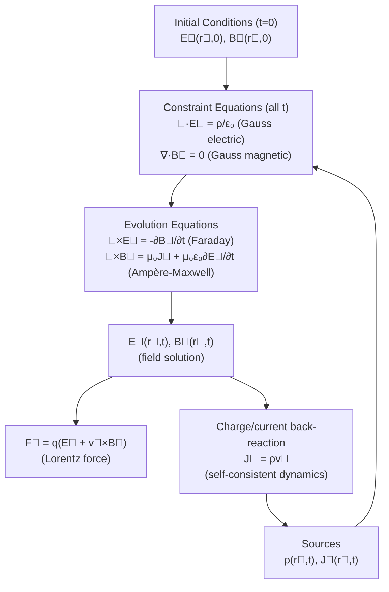

# Lesson 4: Maxwell's Equations, Displacement Current, Continuity

## 1. First-Principles Intuition & Invariants

The history of classical electromagnetism reached its conceptual apex in the early 1860s when James Clerk Maxwell recognized a profound inconsistency lurking within the existing electromagnetic laws. While Faraday's law of induction had elegantly captured the phenomenon of time-varying magnetic fields generating electric fields, Ampère's circuital law—as originally formulated—possessed a fatal mathematical defect that violated charge conservation under dynamic conditions. Maxwell's genius lay not merely in identifying this inconsistency but in proposing a bold correction that would unify electricity, magnetism, and light into a single coherent field theory. This correction, the introduction of the displacement current, transformed electromagnetism from a collection of loosely related phenomena into a complete, self-consistent framework governed by four coupled partial differential equations.

Before Maxwell's intervention, Ampère's law stated that the circulation of the magnetic field around a closed loop equaled the free current piercing the surface bounded by that loop, scaled by the permeability of free space. In differential form, this reads $\nabla \times \vec{B} = \mu_0 \vec{J}$, where $\vec{B}$ denotes the magnetic field, $\mu_0 = 4\pi \times 10^{-7}$ henry per meter represents the permeability constant, and $\vec{J}$ signifies the free current density. This relationship works flawlessly for steady-state currents flowing through conductors. Consider, however, the charging of a parallel-plate capacitor. Current flows into one plate and accumulates as surface charge, yet no conduction current passes through the dielectric gap between the plates. If we choose a surface bounded by an Amperian loop that threads through the gap, we detect zero current, yet the magnetic field circulating around the wire feeding the capacitor is manifestly non-zero. This paradox arises because the choice of surface spanning a given loop is arbitrary in principle—the integral form of Ampère's law should yield identical results for any surface sharing the same boundary curve. The original formulation fails this topological requirement whenever charge density varies with time.

Maxwell resolved this crisis by recognizing that a time-varying electric field could act as an effective current source for magnetic field generation. He postulated that the quantity $\epsilon_0 \partial \vec{E}/\partial t$, where $\epsilon_0 = 8.854 \times 10^{-12}$ farad per meter denotes the permittivity of free space and $\vec{E}$ represents the electric field, should be added to the free current density in Ampère's law. This displacement current density $\vec{J}_d = \epsilon_0 \partial \vec{E}/\partial t$ carries no actual charge transport—no electrons flow—but it produces magnetic fields with the same efficacy as conduction currents. Between the capacitor plates, the electric field increases as charge accumulates, generating a displacement current that exactly compensates for the absent conduction current. The corrected Ampère-Maxwell law reads $\nabla \times \vec{B} = \mu_0 \vec{J} + \mu_0 \epsilon_0 \frac{\partial \vec{E}}{\partial t}$. This modification not only resolves the surface-dependence paradox but also ensures that the full set of Maxwell's equations predicts electromagnetic wave propagation at the speed of light $c = 1/\sqrt{\mu_0 \epsilon_0} \approx 2.998 \times 10^8$ meters per second.

The complete set of Maxwell's equations in vacuum, expressed in their differential form, constitutes the foundational invariants of classical electromagnetism. Gauss's law for electricity, $\nabla \cdot \vec{E} = \rho/\epsilon_0$, relates the divergence of the electric field to the free charge density $\rho$. This equation encodes Coulomb's inverse-square law and establishes that electric field lines originate from positive charges and terminate on negative charges. Gauss's law for magnetism, $\nabla \cdot \vec{B} = 0$, asserts the non-existence of magnetic monopoles—magnetic field lines always form closed loops, never beginning or ending at isolated sources. Faraday's law of induction, $\nabla \times \vec{E} = -\frac{\partial \vec{B}}{\partial t}$, captures the generation of electric fields by time-varying magnetic fields, forming the physical basis for electromagnetic induction, transformers, and generators. Finally, the Ampère-Maxwell law $\nabla \times \vec{B} = \mu_0 \vec{J} + \mu_0 \epsilon_0 \frac{\partial \vec{E}}{\partial t}$ describes how both conduction currents and time-varying electric fields produce magnetic fields. These four equations, supplemented by the Lorentz force law $\vec{F} = q(\vec{E} + \vec{v} \times \vec{B})$ governing charged particle dynamics, form a closed system that determines all classical electromagnetic phenomena.

Charge conservation emerges as a mathematical consequence of Maxwell's equations rather than an independent postulate. Taking the divergence of the Ampère-Maxwell law yields $\nabla \cdot (\nabla \times \vec{B}) = \mu_0 \nabla \cdot \vec{J} + \mu_0 \epsilon_0 \frac{\partial}{\partial t}(\nabla \cdot \vec{E})$. The left side vanishes identically by the vector calculus identity that the divergence of any curl is zero. Substituting Gauss's law $\nabla \cdot \vec{E} = \rho/\epsilon_0$ into the right side produces $0 = \mu_0 \nabla \cdot \vec{J} + \mu_0 \epsilon_0 \frac{\partial}{\partial t}(\rho/\epsilon_0)$, which simplifies to the continuity equation $\frac{\partial \rho}{\partial t} + \nabla \cdot \vec{J} = 0$. This equation expresses local charge conservation: the rate of charge density increase in a volume element equals the negative divergence of the current density, meaning charge can neither be created nor destroyed but only transported from one location to another. The displacement current term in the Ampère-Maxwell law is precisely the modification required to ensure that charge conservation remains consistent with the full electromagnetic field dynamics. Without it, taking the divergence of the original Ampère's law would yield $\nabla \cdot \vec{J} = 0$, which contradicts scenarios where charge density varies with time.

The electromagnetic field possesses an intrinsic gauge freedom that reflects the fact that the physically observable fields $\vec{E}$ and $\vec{B}$ do not uniquely determine the underlying vector and scalar potentials from which they derive. The magnetic field can be expressed as $\vec{B} = \nabla \times \vec{A}$, where $\vec{A}$ denotes the magnetic vector potential. This representation automatically satisfies Gauss's law for magnetism, since the divergence of a curl vanishes identically. Faraday's law then implies that $\nabla \times \vec{E} = -\frac{\partial}{\partial t}(\nabla \times \vec{A})$, which can be rearranged as $\nabla \times (\vec{E} + \frac{\partial \vec{A}}{\partial t}) = 0$. Any vector field with zero curl can be written as the gradient of a scalar potential, so we define $\vec{E} + \frac{\partial \vec{A}}{\partial t} = -\nabla \phi$, yielding $\vec{E} = -\nabla \phi - \frac{\partial \vec{A}}{\partial t}$. Here $\phi$ represents the electric scalar potential. The potentials $\vec{A}$ and $\phi$ are not unique; they contain more degrees of freedom than the physical fields $\vec{E}$ and $\vec{B}$. A gauge transformation $\vec{A} \to \vec{A}' = \vec{A} + \nabla \chi$ and $\phi \to \phi' = \phi - \frac{\partial \chi}{\partial t}$, where $\chi$ is an arbitrary scalar function, leaves the physical fields invariant. Different choices of gauge correspond to different ways of distributing the electromagnetic degrees of freedom between the vector and scalar potentials. The Coulomb gauge imposes $\nabla \cdot \vec{A} = 0$, which simplifies electrostatic problems by decoupling the scalar potential from the vector potential. The Lorenz gauge (note the spelling—Ludvig Lorenz, not Hendrik Lorentz) imposes $\nabla \cdot \vec{A} + \mu_0 \epsilon_0 \frac{\partial \phi}{\partial t} = 0$, which treats space and time symmetrically and is particularly useful in relativistic formulations and wave propagation analysis.

## 2. Core Architecture & Mechanics

Maxwell's equations form a coupled system of partial differential equations linking the electric field, magnetic field, charge density, and current density. To understand the mechanical structure of this system, we must examine how information propagates through the field configuration and how initial conditions and source distributions determine the field evolution. The architecture of electromagnetic field theory rests on two coupled first-order evolution equations (Faraday's law and Ampère-Maxwell law) and two constraint equations (Gauss's laws), with the Lorentz force law providing the back-reaction of fields on charged matter.

Consider first the source-free vacuum case where $\rho = 0$ and $\vec{J} = 0$. The equations reduce to $\nabla \cdot \vec{E} = 0$, $\nabla \cdot \vec{B} = 0$, $\nabla \times \vec{E} = -\frac{\partial \vec{B}}{\partial t}$, and $\nabla \times \vec{B} = \mu_0 \epsilon_0 \frac{\partial \vec{E}}{\partial t}$. Taking the curl of Faraday's law yields $\nabla \times (\nabla \times \vec{E}) = -\frac{\partial}{\partial t}(\nabla \times \vec{B})$. Applying the vector calculus identity $\nabla \times (\nabla \times \vec{E}) = \nabla(\nabla \cdot \vec{E}) - \nabla^2 \vec{E}$ and using $\nabla \cdot \vec{E} = 0$ produces $-\nabla^2 \vec{E} = -\mu_0 \epsilon_0 \frac{\partial^2 \vec{E}}{\partial t^2}$. This simplifies to the three-dimensional wave equation $\nabla^2 \vec{E} = \frac{1}{c^2} \frac{\partial^2 \vec{E}}{\partial t^2}$, where $c = 1/\sqrt{\mu_0 \epsilon_0}$. An identical derivation starting from the Ampère-Maxwell law yields $\nabla^2 \vec{B} = \frac{1}{c^2} \frac{\partial^2 \vec{B}}{\partial t^2}$. Both the electric and magnetic fields satisfy wave equations with propagation speed $c$, the speed of light. This mathematical result represents one of the most profound unifications in physics: light is an electromagnetic wave, an oscillating disturbance in the electric and magnetic fields that propagates through vacuum at a finite, calculable speed determined solely by the electromagnetic constants $\epsilon_0$ and $\mu_0$.

The structure of plane wave solutions illuminates the mechanical interplay between electric and magnetic fields. A monochromatic plane wave propagating in the $+\hat{z}$ direction with angular frequency $\omega = 2\pi f$ and wave vector $k = \omega/c$ takes the form $\vec{E}(\vec{r}, t) = \vec{E}_0 \cos(kz - \omega t + \phi)$ and $\vec{B}(\vec{r}, t) = \vec{B}_0 \cos(kz - \omega t + \phi)$, where $\vec{E}_0$ and $\vec{B}_0$ denote the constant amplitude vectors and $\phi$ represents an arbitrary phase offset. Substituting into Faraday's law $\nabla \times \vec{E} = -\frac{\partial \vec{B}}{\partial t}$ yields $\hat{z} \times (-k \vec{E}_0 \sin(kz - \omega t + \phi)) = -(-\omega \vec{B}_0 \sin(kz - \omega t + \phi))$, which simplifies to $\vec{B}_0 = \frac{k}{\omega} \hat{z} \times \vec{E}_0 = \frac{1}{c} \hat{z} \times \vec{E}_0$. This relationship reveals that the magnetic field amplitude equals the electric field amplitude divided by $c$ and that the magnetic field is perpendicular to both the electric field and the propagation direction. The constraint $\nabla \cdot \vec{E} = 0$ requires $\hat{z} \cdot \vec{E}_0 = 0$, meaning the electric field must be transverse to the propagation direction. Similarly, $\nabla \cdot \vec{B} = 0$ enforces $\hat{z} \cdot \vec{B}_0 = 0$. Electromagnetic waves are therefore transverse waves with electric and magnetic field vectors oscillating perpendicular to the direction of energy transport, forming a right-handed orthogonal triad $(\vec{E}, \vec{B}, \hat{k})$ where $\hat{k}$ denotes the unit vector along the propagation direction.

The energy density and energy flux of the electromagnetic field provide essential mechanical quantities for understanding power transport and radiation pressure. The energy density stored in the electric field is $u_E = \frac{1}{2} \epsilon_0 E^2$, while the magnetic field energy density is $u_B = \frac{1}{2\mu_0} B^2$. For a plane wave, $B = E/c$ and $c^2 = 1/(\mu_0 \epsilon_0)$, so $u_B = \frac{1}{2\mu_0} (E/c)^2 = \frac{1}{2\mu_0 c^2} E^2 = \frac{1}{2} \epsilon_0 E^2 = u_E$. The electric and magnetic energy densities are equal in an electromagnetic wave, and the total energy density is $u = \epsilon_0 E^2$. The rate of energy transport per unit area is given by the Poynting vector $\vec{S} = \frac{1}{\mu_0} \vec{E} \times \vec{B}$, which points in the direction of wave propagation. For a plane wave, $\vec{S} = \frac{1}{\mu_0} E (E/c) \hat{k} = \frac{\epsilon_0 E^2}{\mu_0 \epsilon_0 c} \hat{k} = c \epsilon_0 E^2 \hat{k} = c u \hat{k}$. The magnitude of the Poynting vector equals the energy density multiplied by the wave speed, consistent with the interpretation that electromagnetic energy propagates at speed $c$. For time-harmonic fields varying as $\cos(\omega t)$, the time-averaged Poynting vector is $\langle \vec{S} \rangle = \frac{1}{2\mu_0} \text{Re}(\vec{E}_0 \times \vec{B}_0^*)$, where the asterisk denotes complex conjugation when using complex exponential notation.

Returning to the case with sources, we must examine how charge and current distributions generate electromagnetic fields. Gauss's law $\nabla \cdot \vec{E} = \rho/\epsilon_0$ couples the electric field divergence to the local charge density. In integral form, $\oint_S \vec{E} \cdot d\vec{a} = Q_{\text{enc}}/\epsilon_0$, where $Q_{\text{enc}}$ represents the total charge enclosed by the closed surface $S$. This relationship enables efficient calculation of electric fields for symmetric charge distributions. For a point charge $q$ at the origin, spherical symmetry dictates that $\vec{E}$ points radially and depends only on distance $r$. Applying Gauss's law to a spherical surface of radius $r$ yields $4\pi r^2 E = q/\epsilon_0$, so $E = \frac{q}{4\pi \epsilon_0 r^2}$ and $\vec{E} = \frac{q}{4\pi \epsilon_0 r^2} \hat{r}$, recovering Coulomb's law. For a uniform infinite line charge with linear charge density $\lambda$, cylindrical symmetry gives $\vec{E} = \frac{\lambda}{2\pi \epsilon_0 s} \hat{s}$, where $s$ denotes the perpendicular distance from the line. For an infinite plane with surface charge density $\sigma$, the field is $\vec{E} = \frac{\sigma}{2\epsilon_0} \hat{n}$, uniform and perpendicular to the plane.

The continuity equation $\frac{\partial \rho}{\partial t} + \nabla \cdot \vec{J} = 0$ governs charge transport and provides the consistency condition linking charge and current. In integral form, $\frac{dQ_{\text{enc}}}{dt} = -\oint_S \vec{J} \cdot d\vec{a}$, stating that the rate of charge increase within a volume equals the negative of the current flux out of the bounding surface. Consider a wire connected to a charging capacitor. The conduction current $I = \int \vec{J} \cdot d\vec{a}$ flows into the capacitor plate, accumulating charge at rate $dQ/dt = I$. Between the capacitor plates, the displacement current density $\vec{J}_d = \epsilon_0 \frac{\partial \vec{E}}{\partial t}$ has magnitude $J_d = \epsilon_0 \frac{\partial E}{\partial t}$. The charge on a capacitor plate is $Q = \sigma A$, where $\sigma$ is the surface charge density and $A$ is the plate area. The electric field between the plates is $E = \sigma/\epsilon_0 = Q/(\epsilon_0 A)$, so $\frac{\partial E}{\partial t} = \frac{1}{\epsilon_0 A} \frac{dQ}{dt} = \frac{I}{\epsilon_0 A}$. The displacement current is $I_d = \int \vec{J}_d \cdot d\vec{a} = J_d A = \epsilon_0 \frac{\partial E}{\partial t} A = I$. The displacement current through any surface spanning the gap equals the conduction current in the wire, ensuring continuity of total current (conduction plus displacement) through any surface bounded by an Amperian loop.

The Lorentz force law $\vec{F} = q(\vec{E} + \vec{v} \times \vec{B})$ describes the force exerted by electromagnetic fields on a point charge $q$ moving with velocity $\vec{v}$. The electric field component $q\vec{E}$ acts parallel to the electric field and performs work on the charge, changing its kinetic energy. The magnetic force component $q\vec{v} \times \vec{B}$ acts perpendicular to both the velocity and magnetic field, performing no work (since $\vec{F}_B \cdot \vec{v} = q(\vec{v} \times \vec{B}) \cdot \vec{v} = 0$) but altering the trajectory. For a charge moving perpendicular to a uniform magnetic field, the magnetic force provides centripetal acceleration, causing circular motion with radius $r = mv/(qB)$, where $m$ denotes the particle mass. The cyclotron frequency $\omega_c = qB/m$ determines the angular velocity of this orbital motion and is independent of the particle's speed for non-relativistic velocities. In crossed electric and magnetic fields, the particle experiences a drift velocity $\vec{v}_d = \frac{\vec{E} \times \vec{B}}{B^2}$ perpendicular to both fields, a phenomenon exploited in velocity selectors and mass spectrometers.

## 3. High-Performance Optimization & Failure Modes

The practical application of Maxwell's equations to experimental measurement and computational electromagnetics requires careful attention to gauge choices, boundary conditions, numerical stability, and the physical limitations of measurement apparatus. Real-world electromagnetic problems rarely admit closed-form analytical solutions, necessitating numerical techniques such as finite-difference time-domain (FDTD) methods, finite element analysis (FEM), and method of moments (MoM). Each approach carries distinct computational costs, stability criteria, and accuracy trade-offs that must be matched to the problem geometry, frequency range, and desired precision.

In FDTD simulations, the computational domain is discretized into a spatial grid with cell size $\Delta x$, and time is advanced in increments $\Delta t$. The Courant-Friedrichs-Lewy (CFL) stability condition imposes $c \Delta t \leq \frac{\Delta x}{\sqrt{D}}$, where $D$ denotes the spatial dimensionality (typically $D = 3$). Violating this constraint causes exponential growth of numerical errors, leading to simulation divergence. The grid resolution must satisfy $\Delta x \ll \lambda/10$, where $\lambda$ represents the shortest wavelength present in the electromagnetic spectrum being simulated, to avoid numerical dispersion artifacts. For high-frequency applications such as microwave antenna design or optical waveguide analysis, this resolution requirement demands enormous computational meshes. A $1 \text{ THz}$ electromagnetic wave has wavelength $\lambda = 300 \, \mu\text{m}$, requiring spatial resolution finer than $30 \, \mu\text{m}$. Simulating a cubic millimeter domain then requires at least $(1000/30)^3 \approx 37{,}000$ grid cells, and each cell stores six field components ($E_x, E_y, E_z, B_x, B_y, B_z$). Memory consumption scales as $O(N^3)$ for three-dimensional problems, and computational time per iteration scales identically. Parallel computing architectures utilizing message-passing interface (MPI) decomposition or graphics processing unit (GPU) acceleration become essential for production-scale electromagnetic simulations.

Gauge choice profoundly impacts computational efficiency and conceptual clarity. The Coulomb gauge $\nabla \cdot \vec{A} = 0$ decouples the scalar potential from the vector potential in the absence of time-varying sources, allowing the instantaneous solution $\phi(\vec{r}, t) = \frac{1}{4\pi \epsilon_0} \int \frac{\rho(\vec{r}', t)}{|\vec{r} - \vec{r}'|} d^3 r'$. This gauge is optimal for electrostatic and magnetostatic problems where retardation effects are negligible. However, the Coulomb gauge is non-covariant—it treats space and time asymmetrically—making it awkward for relativistic calculations. The Lorenz gauge $\nabla \cdot \vec{A} + \mu_0 \epsilon_0 \frac{\partial \phi}{\partial t} = 0$ restores spacetime symmetry and leads to decoupled wave equations for the potentials: $\nabla^2 \phi - \frac{1}{c^2} \frac{\partial^2 \phi}{\partial t^2} = -\frac{\rho}{\epsilon_0}$ and $\nabla^2 \vec{A} - \frac{1}{c^2} \frac{\partial^2 \vec{A}}{\partial t^2} = -\mu_0 \vec{J}$. These inhomogeneous wave equations admit retarded potential solutions $\phi(\vec{r}, t) = \frac{1}{4\pi \epsilon_0} \int \frac{\rho(\vec{r}', t_{\text{ret}})}{|\vec{r} - \vec{r}'|} d^3 r'$ and $\vec{A}(\vec{r}, t) = \frac{\mu_0}{4\pi} \int \frac{\vec{J}(\vec{r}', t_{\text{ret}})}{|\vec{r} - \vec{r}'|} d^3 r'$, where the retarded time $t_{\text{ret}} = t - |\vec{r} - \vec{r}'|/c$ accounts for the finite propagation speed of electromagnetic disturbances. The Lorenz gauge is the natural choice for radiation problems, antenna theory, and electromagnetic scattering, where causality and retardation are essential.

Experimental verification of the displacement current poses significant instrumentation challenges due to the extremely small magnitude of $\epsilon_0 \frac{\partial E}{\partial t}$ in most laboratory-scale apparatus. For a parallel-plate capacitor with plate area $A = 0.01 \, \text{m}^2$, gap $d = 1 \, \text{mm}$, driven by a sinusoidal voltage $V(t) = V_0 \sin(\omega t)$ with $V_0 = 100 \, \text{V}$ and frequency $f = 1 \, \text{MHz}$ (so $\omega = 2\pi \times 10^6 \, \text{rad/s}$), the electric field is $E(t) = V(t)/d = 10^5 \sin(\omega t) \, \text{V/m}$. The displacement current density is $J_d = \epsilon_0 \frac{\partial E}{\partial t} = \epsilon_0 \omega 10^5 \cos(\omega t) \approx 8.854 \times 10^{-12} \times 6.28 \times 10^6 \times 10^5 \cos(\omega t) \approx 5.56 \times 10^{-1} \cos(\omega t) \, \text{A/m}^2$. The total displacement current is $I_d = J_d A \approx 5.56 \times 10^{-3} \cos(\omega t) \, \text{A} \approx 5.6 \, \text{mA}$. This is readily measurable with standard ammeters, confirming that displacement current is not merely a theoretical abstraction but a genuine physical current producing observable magnetic fields. To verify the magnetic field generation by displacement current, construct a large-area parallel-plate capacitor (area $\sim 0.1 \, \text{m}^2$) and drive it with a radio-frequency signal generator at $10 \, \text{MHz}$ with amplitude $1 \, \text{kV}$. Place a pickup coil near the edge of the capacitor gap, oriented such that its axis is perpendicular to the plane containing the capacitor plates. The time-varying displacement current generates a magnetic field that induces an electromotive force (EMF) in the pickup coil, which can be detected using a high-impedance oscilloscope. The induced EMF amplitude scales linearly with driving frequency and voltage amplitude, providing quantitative confirmation of the Ampère-Maxwell law.

Boundary conditions at material interfaces are crucial for solving Maxwell's equations in heterogeneous media. At a boundary between two dielectric materials with permittivities $\epsilon_1$ and $\epsilon_2$, the tangential component of the electric field is continuous: $E_{1,\parallel} = E_{2,\parallel}$. The normal component of the electric displacement field $\vec{D} = \epsilon \vec{E}$ satisfies $D_{1,\perp} - D_{2,\perp} = \sigma_f$, where $\sigma_f$ denotes the free surface charge density. In the absence of free surface charge, $\epsilon_1 E_{1,\perp} = \epsilon_2 E_{2,\perp}$. For magnetic fields, the tangential component of $\vec{H} = \vec{B}/\mu$ satisfies $H_{1,\parallel} - H_{2,\parallel} = \vec{K}_f \times \hat{n}$, where $\vec{K}_f$ represents the free surface current density and $\hat{n}$ is the unit normal to the interface. The normal component of $\vec{B}$ is always continuous: $B_{1,\perp} = B_{2,\perp}$. At a perfect conductor boundary, the tangential electric field must vanish ($E_{\parallel} = 0$) and the normal magnetic field must vanish ($B_{\perp} = 0$). These boundary conditions arise from the integral forms of Maxwell's equations applied to infinitesimally thin Gaussian pillboxes and Amperian loops straddling the interface.

Failure modes in electromagnetic measurements frequently arise from parasitic capacitance, ground loops, and electromagnetic interference (EMI). Parasitic capacitance between nearby conductors shunts high-frequency signals, distorting waveforms and reducing measurement fidelity. Coaxial cable geometry minimizes this effect by confining the electric field between the inner conductor and outer shield, with the shield grounded to prevent external field penetration. Ground loops occur when multiple grounding points in a circuit form a conducting loop that intercepts time-varying magnetic flux. Faraday's law then induces an EMF $\mathcal{E} = -\frac{d\Phi_B}{dt}$ around the loop, generating spurious currents that corrupt signal integrity. Proper grounding practice mandates a single-point ground topology, where all instruments share a common ground reference without forming closed loops. Shielding sensitive electronics inside conducting enclosures (Faraday cages) exploits the boundary condition $E_{\parallel} = 0$ at conductor surfaces to exclude external electric fields. For magnetic shielding, high-permeability materials such as mu-metal ($\mu_r \sim 10^5$) channel magnetic flux lines around the shielded region, reducing interior field strength. However, no material exhibits magnetic insulation analogous to electric insulation, since $\nabla \cdot \vec{B} = 0$ requires that field lines always close upon themselves—shielding merely redirects flux rather than blocking it.

Precision measurement of the speed of light $c = 1/\sqrt{\mu_0 \epsilon_0}$ provides a direct experimental verification of Maxwell's theoretical prediction. Modern cavity resonator techniques achieve sub-picosecond timing resolution and parts-per-billion accuracy. A microwave cavity resonator, a conducting enclosure supporting standing electromagnetic wave modes, exhibits resonant frequencies $f_{mnp} = \frac{c}{2} \sqrt{(m/a)^2 + (n/b)^2 + (p/d)^2}$ for a rectangular cavity with dimensions $a \times b \times d$, where $m, n, p$ are integer mode indices. Measure the resonant frequency using a vector network analyzer (VNA) to identify the peak in the reflection coefficient $S_{11}$. Measure the cavity dimensions using a precision micrometer with $\pm 1 \, \mu\text{m}$ accuracy. Calculate $c$ from the resonant frequency formula, and compare with the defined value $c = 299{,}792{,}458 \, \text{m/s}$. Typical undergraduate laboratory setups achieve agreement within $0.1\%$, validating the electromagnetic wave theory and confirming the displacement current's essential role in wave propagation. Advanced implementations using laser interferometry and atomic frequency standards reach uncertainties below $10^{-9}$, making the speed of light one of the most precisely known physical constants.
