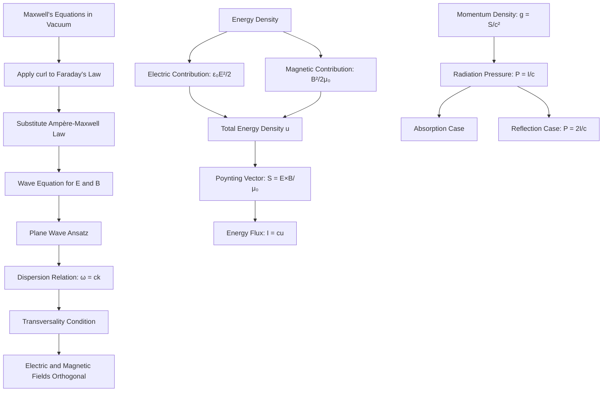

# Lesson 5: Electromagnetic Waves, Wave Equation, Poynting's Theorem

## 1. First-Principles Intuition & Invariants

The unification of electricity and magnetism into a single coherent framework represents one of the most profound intellectual achievements in physics. James Clerk Maxwell's synthesis of Faraday's empirical observations with mathematical field theory revealed a startling prediction embedded within the structure of the equations themselves: oscillating electric and magnetic fields can propagate through space as self-sustaining waves, requiring no material medium for transmission. This prediction, experimentally confirmed by Heinrich Hertz in 1887, established that light itself is an electromagnetic phenomenon and opened the door to our modern understanding of radiation, optics, and wireless communication.

The wave equation emerges naturally from Maxwell's equations when we examine how temporal changes in one field source spatial variations in the other. Consider the fundamental coupling: Faraday's law dictates that a time-varying magnetic field induces a curling electric field, while the Ampère-Maxwell law reveals that a time-varying electric field generates a curling magnetic field. These two mechanisms interlock to form a self-propagating disturbance. When an electric field begins to oscillate at some point in space, it spawns a magnetic field that itself varies in time, which in turn regenerates the electric field at a neighboring location. This reciprocal bootstrapping allows electromagnetic disturbances to travel through vacuum at a characteristic speed determined solely by the permittivity and permeability of free space.

The energy carried by electromagnetic waves presents a subtle conceptual challenge. Unlike mechanical waves in strings or sound waves in air, where energy resides in the kinetic and potential energy of material particles, electromagnetic energy exists purely in the field configuration itself. The energy density splits equally between electric and magnetic contributions in a propagating wave, and the flow of this energy through space is captured by the Poynting vector, a quantity that specifies both the magnitude and direction of electromagnetic power flux. This energy transport mechanism underlies every practical application of electromagnetic radiation, from solar cells converting sunlight into electrical current to radio antennas launching signals into the ionosphere.

Beyond energy, electromagnetic fields also carry momentum, a fact with profound implications for the interaction between light and matter. When an electromagnetic wave strikes a surface, it exerts a radiation pressure proportional to the energy flux. Although this pressure is extraordinarily small for everyday light sources, it becomes significant in astrophysical contexts—radiation pressure from stellar photospheres counterbalances gravitational collapse in massive stars, and light sails have been proposed as propulsion mechanisms for interstellar probes. The momentum density of the electromagnetic field is directly proportional to the Poynting vector, establishing a fundamental connection between energy transport and mechanical action.

The mathematical structure of the wave equation imposes severe constraints on the functional form of electromagnetic disturbances. In source-free regions of space, both the electric and magnetic fields satisfy a second-order partial differential equation coupling spatial curvature to temporal acceleration. The general solution to this equation comprises plane waves, spherical waves, and more exotic configurations, but the plane wave solution serves as the fundamental building block. Any localized electromagnetic pulse can be decomposed into a superposition of monochromatic plane waves through Fourier analysis, making the plane wave the natural basis for understanding propagation, interference, and diffraction phenomena.

Polarization encodes the directional behavior of the electric field vector as the wave propagates. For a plane wave traveling along a fixed direction, the electric field oscillates within a plane perpendicular to the propagation vector, but the specific trajectory traced by the electric field vector—whether linear, circular, or elliptical—depends on the relative amplitudes and phases of orthogonal field components. Polarization plays a critical role in antenna design, optical spectroscopy, and the interaction of light with anisotropic materials such as calcite crystals or liquid crystal displays. Unpolarized natural light can be decomposed into a statistical mixture of polarization states, and selective filtering or reflection can transform this mixture into a well-defined polarization.

The invariants governing electromagnetic wave propagation are rooted in the geometry of spacetime and the gauge symmetry of Maxwell's equations. The wave speed in vacuum, denoted $c = 1/\sqrt{\mu_0 \varepsilon_0}$, is a universal constant independent of the motion of the source or observer, a fact that ultimately necessitated Einstein's special theory of relativity. The transverse nature of electromagnetic waves—the requirement that electric and magnetic field vectors remain perpendicular to the direction of propagation—follows from the divergence-free conditions $\nabla \cdot \vec{E} = 0$ and $\nabla \cdot \vec{B} = 0$ in regions devoid of charges and currents. These structural features are not adjustable parameters but emerge as inevitable consequences of the fundamental field equations.

Experimental verification of electromagnetic wave theory requires instrumentation capable of generating, detecting, and characterizing oscillating fields across an enormous frequency spectrum. At radio frequencies, LC resonator circuits and dipole antennas serve as emitters and receivers, with oscilloscopes capturing time-domain waveforms and spectrum analyzers resolving frequency components. In the optical regime, lasers provide coherent monochromatic sources, and photodiodes or photomultiplier tubes convert incident photon flux into measurable electrical signals. Polarization analysis employs calcite polarizers, quarter-wave plates, and rotating analyzers to reconstruct the full polarization ellipse. Energy flux measurements utilize calibrated bolometers, thermopiles, or pyroelectric detectors that respond to incident power density. Each experimental technique must account for instrumentation response functions, detector noise, and systematic calibrations against traceable radiometric standards.

## 2. Core Architecture & Mechanics

### Derivation of the Wave Equation from Maxwell's Equations

We begin with Maxwell's equations in microscopic form within a source-free vacuum region where charge density $\rho = 0$ and current density $\vec{J} = 0$. The four equations reduce to:

$$
\nabla \cdot \vec{E} = 0
$$

$$
\nabla \cdot \vec{B} = 0
$$

$$
\nabla \times \vec{E} = -\frac{\partial \vec{B}}{\partial t}
$$

$$
\nabla \times \vec{B} = \mu_0 \varepsilon_0 \frac{\partial \vec{E}}{\partial t}
$$

The strategy for deriving the wave equation involves applying the curl operator to Faraday's law and substituting the Ampère-Maxwell law to eliminate one field variable. Taking the curl of Faraday's law yields:

$$
\nabla \times (\nabla \times \vec{E}) = -\frac{\partial}{\partial t}(\nabla \times \vec{B})
$$

The left-hand side can be expanded using the vector identity $\nabla \times (\nabla \times \vec{E}) = \nabla(\nabla \cdot \vec{E}) - \nabla^2 \vec{E}$. Since $\nabla \cdot \vec{E} = 0$ in the source-free region, this simplifies to $-\nabla^2 \vec{E}$. Substituting the Ampère-Maxwell law into the right-hand side gives:

$$
-\nabla^2 \vec{E} = -\frac{\partial}{\partial t}\left(\mu_0 \varepsilon_0 \frac{\partial \vec{E}}{\partial t}\right) = -\mu_0 \varepsilon_0 \frac{\partial^2 \vec{E}}{\partial t^2}
$$

Rearranging produces the three-dimensional wave equation for the electric field:

$$
\nabla^2 \vec{E} - \mu_0 \varepsilon_0 \frac{\partial^2 \vec{E}}{\partial t^2} = 0
$$

By defining the wave speed $c = 1/\sqrt{\mu_0 \varepsilon_0}$, we obtain the canonical form:

$$
\nabla^2 \vec{E} = \frac{1}{c^2} \frac{\partial^2 \vec{E}}{\partial t^2}
$$

An entirely parallel derivation starting from the curl of the Ampère-Maxwell law yields the wave equation for the magnetic field:

$$
\nabla^2 \vec{B} = \frac{1}{c^2} \frac{\partial^2 \vec{B}}{\partial t^2}
$$

This demonstrates that both electric and magnetic fields propagate as waves at the same characteristic speed $c \approx 2.998 \times 10^8 \, \text{m/s}$ in vacuum, numerically equal to the measured speed of light. This numerical coincidence provided Maxwell with the key insight that light is an electromagnetic wave.

### Plane Wave Solutions and Dispersion Relation

The simplest non-trivial solution to the wave equation is the monochromatic plane wave. For a wave propagating in the $+z$ direction, we postulate a solution of the form:

$$
\vec{E}(z, t) = \vec{E}_0 \cos(kz - \omega t + \phi)
$$

where $\vec{E}_0$ is the constant amplitude vector, $k$ is the wave number, $\omega$ is the angular frequency, and $\phi$ is an initial phase offset. Substituting this ansatz into the wave equation yields the dispersion relation:

$$
k^2 = \frac{\omega^2}{c^2} \quad \Rightarrow \quad \omega = c k
$$

This linear dispersion relation implies that electromagnetic waves in vacuum are non-dispersive: wave packets maintain their shape during propagation because all frequency components travel at the same phase velocity $v_{\text{phase}} = \omega/k = c$ and group velocity $v_{\text{group}} = d\omega/dk = c$.

For a plane wave propagating in an arbitrary direction specified by the wave vector $\vec{k}$, the spatial and temporal dependence generalizes to:

$$
\vec{E}(\vec{r}, t) = \vec{E}_0 \cos(\vec{k} \cdot \vec{r} - \omega t + \phi)
$$

The magnetic field must satisfy Faraday's law. Computing the curl:

$$
\nabla \times \vec{E} = -\vec{k} \times \vec{E}_0 \sin(\vec{k} \cdot \vec{r} - \omega t + \phi)
$$

Equating this to $-\partial \vec{B}/\partial t$ and integrating with respect to time determines the magnetic field:

$$
\vec{B}(\vec{r}, t) = \frac{\vec{k} \times \vec{E}_0}{\omega} \cos(\vec{k} \cdot \vec{r} - \omega t + \phi) = \frac{\hat{k} \times \vec{E}_0}{c} \cos(\vec{k} \cdot \vec{r} - \omega t + \phi)
$$

where $\hat{k} = \vec{k}/|\vec{k}|$ is the unit vector in the propagation direction. This result encodes two fundamental properties: the magnetic field is perpendicular to both the electric field and the propagation direction, and the magnitude relationship $|\vec{B}| = |\vec{E}|/c$ holds at every point in space and time. The triad $(\vec{E}, \vec{B}, \hat{k})$ forms a right-handed orthogonal coordinate system, with energy flow occurring along $\hat{k}$.

### Polarization States and Decomposition

The polarization of an electromagnetic wave specifies the time-dependent orientation of the electric field vector in the plane perpendicular to propagation. For a wave traveling in the $+z$ direction, the electric field resides in the $xy$-plane and can be decomposed into orthogonal components:

$$
\vec{E}(z, t) = E_{0x} \cos(kz - \omega t + \phi_x) \, \hat{x} + E_{0y} \cos(kz - \omega t + \phi_y) \, \hat{y}
$$

Linear polarization occurs when the phase difference $\Delta \phi = \phi_y - \phi_x$ equals $0$ or $\pi$. The electric field vector oscillates along a fixed direction in the $xy$-plane, with orientation angle $\theta = \arctan(E_{0y}/E_{0x})$ for in-phase components or $\theta = \arctan(-E_{0y}/E_{0x})$ for out-of-phase components.

Circular polarization results when the amplitudes are equal ($E_{0x} = E_{0y} = E_0$) and the phase difference is $\Delta \phi = \pm \pi/2$. For $\Delta \phi = +\pi/2$ (right-handed circular polarization), the electric field vector rotates counter-clockwise when viewed by an observer looking into the oncoming wave:

$$
\vec{E}(z, t) = E_0 \left[ \cos(kz - \omega t) \, \hat{x} - \sin(kz - \omega t) \, \hat{y} \right]
$$

The magnitude $|\vec{E}| = E_0$ remains constant, but the direction rotates with angular frequency $\omega$. Left-handed circular polarization corresponds to $\Delta \phi = -\pi/2$ and counter-clockwise rotation.

Elliptical polarization is the general case when amplitudes differ and phase differences lie between the circular and linear extremes. The tip of the electric field vector traces an ellipse in the $xy$-plane, with semi-major and semi-minor axes determined by $E_{0x}$, $E_{0y}$, and $\Delta \phi$. The ellipse orientation angle and ellipticity parameter fully characterize the polarization state.

Any polarization state can be synthesized from two orthogonal basis states. Linear horizontal and vertical polarizations form one natural basis, while right- and left-handed circular polarizations constitute another. The Jones vector formalism represents polarization as a two-component complex vector, and the Stokes parameters provide an alternative description in terms of measurable intensity combinations that remain valid even for partially polarized or unpolarized light.

### Energy Density and the Poynting Vector

Electromagnetic fields store energy distributed throughout space. The energy density (energy per unit volume) splits into electric and magnetic contributions:

$$
u_E = \frac{1}{2} \varepsilon_0 |\vec{E}|^2, \quad u_B = \frac{1}{2\mu_0} |\vec{B}|^2
$$

For a plane wave where $|\vec{B}| = |\vec{E}|/c$ and $c = 1/\sqrt{\mu_0 \varepsilon_0}$, we verify that $u_B = u_E$, confirming equal energy partitioning between electric and magnetic fields. The total energy density becomes:

$$
u = u_E + u_B = \varepsilon_0 |\vec{E}|^2 = \frac{1}{\mu_0 c^2} |\vec{E}|^2
$$

Energy does not remain localized but flows through space. The Poynting vector $\vec{S}$ quantifies the directional energy flux (power per unit area):

$$
\vec{S} = \frac{1}{\mu_0} \vec{E} \times \vec{B}
$$

For a plane wave propagating along $\hat{k}$ with $\vec{B} = (\hat{k} \times \vec{E})/c$, the Poynting vector reduces to:

$$
\vec{S} = \frac{1}{\mu_0 c} |\vec{E}|^2 \hat{k} = c \varepsilon_0 |\vec{E}|^2 \hat{k} = c u \hat{k}
$$

This result reveals that electromagnetic energy propagates at speed $c$ in the direction of the wave vector, with intensity magnitude equal to $c$ times the energy density. The instantaneous Poynting vector oscillates at twice the wave frequency due to the product of sinusoidal electric and magnetic fields. The time-averaged Poynting vector, relevant for power measurements over many oscillation cycles, becomes:

$$
\langle \vec{S} \rangle = \frac{1}{2} \frac{1}{\mu_0 c} |\vec{E}_0|^2 \hat{k} = \frac{1}{2} c \varepsilon_0 |\vec{E}_0|^2 \hat{k}
$$

where $\vec{E}_0$ denotes the amplitude of the oscillating electric field. The factor of $1/2$ arises from averaging $\cos^2(kz - \omega t)$ over a complete cycle. The intensity $I$ of an electromagnetic wave, defined as the time-averaged power per unit area, equals the magnitude of the time-averaged Poynting vector:

$$
I = |\langle \vec{S} \rangle| = \frac{1}{2} c \varepsilon_0 |\vec{E}_0|^2 = \frac{1}{2\mu_0 c} |\vec{B}_0|^2
$$

### Poynting's Theorem and Energy Conservation

Poynting's theorem provides a local statement of energy conservation for electromagnetic fields, analogous to the continuity equation in fluid mechanics. Starting from Maxwell's equations, we compute the work done by fields on charges. The power per unit volume delivered to matter by the electromagnetic field equals $\vec{J} \cdot \vec{E}$, where $\vec{J}$ is the current density. Combining Faraday's law and the Ampère-Maxwell law through vector manipulations yields:

$$
\nabla \cdot \vec{S} + \frac{\partial u}{\partial t} = -\vec{J} \cdot \vec{E}
$$

This expresses energy conservation in differential form: the divergence of the Poynting vector (net energy flow out of a volume) plus the time rate of change of field energy density equals the negative of the power delivered to charges. Integrating over a volume $V$ enclosed by surface $S$ and applying the divergence theorem converts this to integral form:

$$
\frac{d}{dt} \int_V u \, dV + \oint_S \vec{S} \cdot d\vec{A} = -\int_V \vec{J} \cdot \vec{E} \, dV
$$

The left-hand side represents the rate of change of electromagnetic energy within the volume plus the energy flux through the boundary. The right-hand side accounts for mechanical work done on charged matter. In source-free vacuum regions where $\vec{J} = 0$, energy conservation simplifies to:

$$
\frac{d}{dt} \int_V u \, dV + \oint_S \vec{S} \cdot d\vec{A} = 0
$$

This confirms that electromagnetic energy is neither created nor destroyed in vacuum but merely redistributed through space via the Poynting vector flow.

### Momentum Density and Radiation Pressure

Electromagnetic fields carry not only energy but also momentum. The momentum density $\vec{g}$ (momentum per unit volume) relates directly to the Poynting vector:

$$
\vec{g} = \frac{\vec{S}}{c^2} = \varepsilon_0 \vec{E} \times \vec{B} = \frac{1}{\mu_0 c^2} \vec{E} \times \vec{B}
$$

For a plane wave, substituting $\vec{B} = (\hat{k} \times \vec{E})/c$ yields:

$$
\vec{g} = \frac{u}{c} \hat{k}
$$

The momentum density is thus proportional to the energy density divided by $c$ and points in the propagation direction. When electromagnetic radiation is absorbed by a surface, the momentum transfer induces a mechanical force, producing radiation pressure. Consider a perfectly absorbing surface with area $A$ perpendicular to an incident plane wave with intensity $I$. The energy absorbed per unit time equals $IA$, corresponding to momentum absorption rate $IA/c$. The force exerted on the surface is:

$$
F = \frac{IA}{c}
$$

The radiation pressure (force per unit area) becomes:

$$
P_{\text{rad}} = \frac{I}{c}
$$

For a perfectly reflecting surface, the momentum transfer doubles because the incident momentum is not merely absorbed but reversed, yielding $P_{\text{rad}} = 2I/c$. Although radiation pressure is minuscule for typical terrestrial light sources—sunlight at Earth's surface exerts a pressure of approximately $3.3 \times 10^{-6} \, \text{Pa}$—it becomes significant in astrophysical contexts. Radiation pressure from fusion reactions in stellar cores counterbalances gravitational collapse, and photon momentum transfer drives stellar winds and comet tail formation.

### Experimental Apparatus for Electromagnetic Wave Characterization

Radio-frequency electromagnetic wave experiments employ function generators to drive resonant LC circuits or dipole antennas, producing oscillating currents that radiate electromagnetic energy. A receiving antenna positioned at variable distances detects the incident wave, converting electromagnetic oscillations back into measurable voltages. An oscilloscope captures the time-domain waveform, revealing amplitude, frequency, and phase information. By measuring received signal strength as a function of distance from the transmitter, experimenters verify the inverse-square law for radiated power in the far-field regime.

Polarization measurements require antennas with defined orientations. A linearly polarized transmitting antenna produces electric fields oscillating along the antenna axis. Rotating a linearly polarized receiving antenna through $360°$ and recording received signal strength yields a sinusoidal intensity pattern $I(\theta) = I_0 \cos^2(\theta - \theta_0)$, where $\theta_0$ specifies the transmitter polarization angle. Circularly polarized waves can be generated by feeding two perpendicular dipole antennas with signals phase-shifted by $90°$. A rotating linear receiver antenna then detects constant intensity independent of orientation angle, confirming circular polarization.

Optical polarization analysis employs calcite polarizers and wave plates. A calcite crystal exhibits birefringence, splitting incident unpolarized light into orthogonal linearly polarized beams (ordinary and extraordinary rays) due to anisotropic refractive indices. A Glan-Thompson polarizer transmits only one polarization component, producing linearly polarized output. Quarter-wave plates introduce a $90°$ phase shift between orthogonal polarization components, converting linear polarization to circular or elliptical depending on the incident polarization orientation relative to the plate's fast and slow axes. Full Stokes polarimetry requires at least four independent intensity measurements, obtained by rotating a wave plate in addition to the analyzer (or using multiple fixed wave-plate orientations) and recording intensity as a function of analyzer angle at each setting, then fitting the data to extract all four Stokes parameters.

Energy flux measurements utilize calibrated photodetectors. In the visible and near-infrared spectrum, silicon photodiodes generate photocurrents proportional to incident power. The responsivity $R(\lambda)$ (amperes per watt) must be calibrated against traceable radiometric standards. For laser beams with known spatial profiles, integrating power density over the beam cross-section yields total power. Thermopile detectors provide broadband wavelength-insensitive response by measuring temperature rise from absorbed radiation, enabling absolute power measurements when coupled to precision thermal modeling.

Radiation pressure experiments require extremely sensitive force detection. The Nichols radiometer (1903) used a torsion balance to measure light pressure on metallized vanes suspended in vacuum. Modern implementations employ optical trapping of dielectric microspheres with laser tweezers. Radiation pressure from a focused laser beam balances viscous drag in a fluid, allowing precise determination of force in the piconewton range. Calibration involves measuring the sphere's Brownian motion power spectrum to extract the trap stiffness via the equipartition theorem, then inferring force from displacement measurements.

## 3. High-Performance Optimization & Failure Modes

### Maximizing Signal-to-Noise Ratio in Wave Detection

Electromagnetic wave detection is fundamentally limited by thermal noise in receiver electronics and background radiation. For radio-frequency receivers, thermal noise power is given by the Nyquist-Johnson formula $P_n = k_B T \Delta f$, where $k_B$ is Boltzmann's constant, $T$ is the system temperature, and $\Delta f$ is the receiver bandwidth. Reducing bandwidth through narrowband filtering centered on the signal frequency suppresses noise proportionally, but excessively narrow bandwidths distort modulated signals. Cryogenic cooling of receiver components lowers $T$, significantly improving sensitivity for radio astronomy and microwave communication links. Low-noise amplifiers (LNAs) positioned immediately after the antenna minimize additional noise contributions from subsequent amplifier stages.

In optical detection, shot noise arising from the discrete photon nature of light imposes a fundamental quantum limit. The signal-to-noise ratio for direct photodetection scales as $\sqrt{N_{\text{photons}}}$, where $N_{\text{photons}}$ is the number of detected photons. Increasing integration time or collecting light over larger areas improves SNR but cannot eliminate quantum fluctuations. Heterodyne and homodyne detection schemes mix the signal with a strong local oscillator, shifting detection to lower frequencies where amplifier noise is minimized and enabling phase-sensitive measurements that approach the quantum shot-noise limit.

### Polarization Extinction Ratio Optimization

Polarizers and wave plates suffer from imperfections that limit extinction ratios (the intensity ratio between desired and unwanted polarization components). High-quality Glan-Thompson polarizers achieve extinction ratios exceeding $10^5:1$ through careful optical alignment and anti-reflection coatings on crystal surfaces. Stress-induced birefringence in optical mounts degrades performance; polarizers must be mounted with minimal mechanical strain. Temporal stability requires temperature control, as thermal expansion alters crystal dimensions and refractive indices.

Wire-grid polarizers for microwave and infrared radiation consist of parallel conducting wires spaced much smaller than the wavelength. Electric fields parallel to the wires induce currents and are reflected, while perpendicular fields pass through. Fabrication precision determines extinction ratio: wire spacing irregularities and diameter variations scatter light and reduce polarization purity. Electron-beam lithography enables submicron wire patterns for short-wavelength polarizers, but feature size tolerances must be held to a small fraction of the wire period.

### Beam Propagation and Diffraction Mitigation

Plane wave solutions represent idealized infinite transverse extent, but real electromagnetic beams have finite cross-sections and exhibit diffraction spreading. A collimated laser beam with initial radius $w_0$ diverges with half-angle $\theta \approx \lambda/(πw_0)$. Larger initial beam diameters reduce divergence but require larger optics. Gaussian beam propagation analysis provides exact solutions to the paraxial wave equation, revealing that the beam waist (minimum radius) and Rayleigh range (distance over which the beam area doubles) are related by $z_R = πw_0^2/\lambda$.

Adaptive optics systems correct wavefront distortions in real time by measuring phase errors with Shack-Hartmann sensors and applying compensating deformations via deformable mirrors. Atmospheric turbulence correction in astronomy and aberration compensation in high-power laser systems rely on closed-loop adaptive optics with kilohertz bandwidths. The Fried parameter $r_0$ quantifies atmospheric coherence length; effective correction requires deformable mirrors with actuator spacing finer than $r_0$, typically $5-20$ cm for visible wavelengths.

### Radiation Pressure Force Balance and Optical Trapping

Stable optical trapping of particles requires balancing radiation pressure (scattering force) with gradient forces arising from intensity gradients. A tightly focused Gaussian beam exerts a scattering force along the propagation direction proportional to the integrated intensity, while the transverse intensity gradient produces a restoring force pulling particles toward the beam focus. The axial trap stiffness depends on the numerical aperture of the focusing objective and the refractive index contrast between particle and medium. High-NA oil-immersion objectives ($\text{NA} > 1.3$) are necessary for stable trapping of dielectric microspheres in water.

Calibration of optical trap stiffness involves power spectrum analysis of Brownian motion. A trapped particle undergoes thermally-driven fluctuations described by a Langevin equation with position-dependent restoring force. The power spectral density of position fluctuations exhibits a Lorentzian lineshape with corner frequency $f_c = \kappa/(2π\gamma)$, where $\kappa$ is the trap stiffness and $\gamma$ is the Stokes drag coefficient. Fitting experimental power spectra to the theoretical Lorentzian form extracts $\kappa$, enabling absolute force measurements from observed displacements.

### Failure Mode: Nonlinear Effects at High Intensities

The plane wave solutions and linear superposition principles discussed throughout this lesson assume field strengths remain weak enough that material response is linear. At extremely high intensities achievable with pulsed lasers, nonlinear optical effects become significant. Second-harmonic generation converts input photons at frequency $\omega$ into photons at $2\omega$ through nonlinear polarization in crystals lacking inversion symmetry. Self-focusing occurs when the intensity-dependent refractive index creates a lensing effect that concentrates the beam, potentially leading to optical damage or filamentation.

Electromagnetic pulses with peak powers exceeding the critical power for self-focusing ($P_{\text{crit}} \sim 3 \, \text{GW}$ in air for $800$ nm wavelength) undergo catastrophic collapse unless dispersive spreading or plasma defocusing arrests the instability. Chirped pulse amplification mitigates this by temporally stretching pulses before amplification and recompressing them afterward, maintaining manageable peak intensities during amplification while achieving extreme powers at the target. Damage thresholds for optical coatings and bulk materials impose hard limits on intensity; fluences exceeding $1-10 \, \text{J/cm}^2$ for nanosecond pulses ablate most materials.

### Failure Mode: Dispersion and Pulse Broadening

In dispersive media where the refractive index $n(\omega)$ depends on frequency, different frequency components of a pulse travel at different group velocities, causing temporal broadening. Group velocity dispersion (GVD) is quantified by $d^2k/d\omega^2$, where $k = n\omega/c$ is the wave number. Normal dispersion ($d^2k/d\omega^2 > 0$) causes longer wavelengths to travel faster, while anomalous dispersion ($d^2k/d\omega^2 < 0$) exhibits the opposite behavior. Optical fibers for telecommunications operate near $1550$ nm because silica fiber has minimum attenuation (~0.2 dB/km) at that wavelength; dispersion at 1550 nm is anomalous and must be managed to maintain signal quality.

Ultrashort laser pulses require careful dispersion management. A transform-limited Gaussian pulse with temporal width $\Delta t$ (FWHM) has spectral bandwidth $\Delta \omega \approx 2.77/\Delta t$ (FWHM in angular frequency), corresponding to a time-bandwidth product of Δt·Δω ≈ 2.77. Propagation through $L$ meters of dispersive material broadens the pulse to $\Delta t' = \Delta t \sqrt{1 + (L/L_D)^2}$, where $L_D = \Delta t^2/(d^2k/d\omega^2)$ is the dispersion length. For $100$ fs pulses in fused silica at $800$ nm, $L_D \approx 28$ cm, indicating significant broadening over meter-scale propagation. Chirped mirrors and prism compressors introduce negative GVD to precompensate propagation through positive-GVD materials, maintaining pulse duration.

### Failure Mode: Impedance Mismatch and Reflection Losses

When electromagnetic waves encounter interfaces between materials with different impedances $Z = \sqrt{\mu/\varepsilon}$, partial reflection occurs. The power reflection coefficient for normal incidence is $R = |(Z_2 - Z_1)/(Z_2 + Z_1)|^2$. Air-to-glass interfaces typically reflect $4\%$ of incident intensity due to impedance mismatch, accumulating to substantial losses in multi-element optical systems. Quarter-wave anti-reflection coatings with thickness $d = \lambda/(4n_{\text{coating}})$ and refractive index $n_{\text{coating}} = \sqrt{n_{\text{air}} n_{\text{glass}}}$ create destructive interference between reflections from the coating's front and back surfaces, reducing reflectance below $0.1\%$ for a specific design wavelength.

Broadband anti-reflection coatings employ multiple dielectric layers with graded refractive indices, approximating an adiabatic impedance transformation between air and substrate. Multilayer coatings can achieve $R < 0.5\%$ across the entire visible spectrum. Fabrication requires precise thickness control via ion-beam sputtering or e-beam evaporation with quartz crystal microbalance monitoring. Thickness errors of $\pm 5$ nm significantly degrade performance for visible wavelengths, demanding environmental control during deposition.

### Radiation Safety and Exposure Limits

Intense electromagnetic fields pose health hazards through tissue heating and photochemical damage. Radiofrequency radiation at $10$ MHz to $300$ GHz is absorbed by biological tissue with depth-dependent specific absorption rate (SAR, watts per kilogram). IEEE and ICNIRP exposure guidelines limit whole-body SAR to $0.4$ W/kg for occupational exposure. Near-field coupling from high-power RF sources requires conductive shielding and personnel exclusion zones. Power density measurements with calibrated field probes verify compliance with exposure limits.

Laser radiation safety is wavelength-dependent due to differential absorption and focusing by the eye. Visible and near-infrared lasers ($400-1400$ nm) are particularly hazardous because the eye's lens focuses collimated beams onto a small retinal spot, achieving intensities sufficient for thermal damage at modest power levels. The maximum permissible exposure (MPE) for continuous-wave $532$ nm lasers is approximately $2.5$ mW/cm$^2$ for extended viewing. Class 3B and Class 4 lasers require interlocked enclosures, beam dumps to terminate unused light, and eye protection with optical density matched to laser wavelength and power. Ultraviolet lasers pose additional photochemical hazards, inducing cataract formation and corneal damage through ionization and free radical generation.
