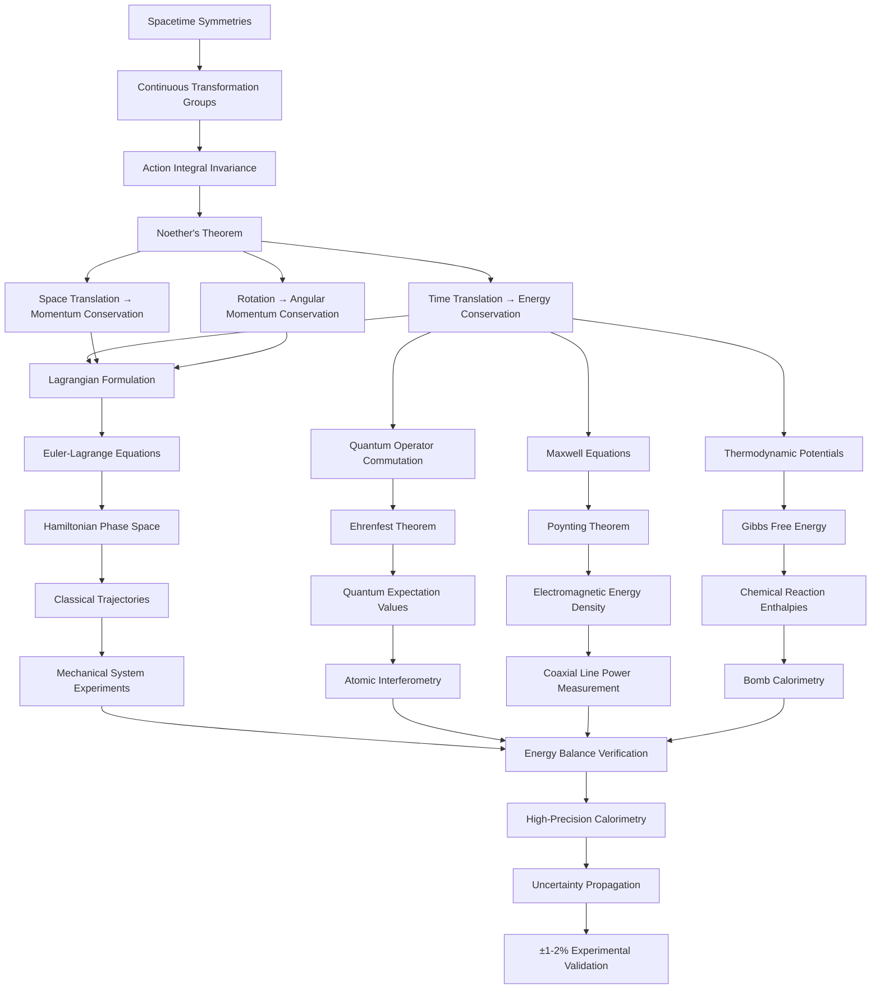

# Lesson 1: First-Principles Physical Laws & Conservation Invariants

## Curriculum Roadmap

This opening lesson establishes the axiomatic foundation upon which all energy science, thermodynamics, and frontier physics research must rest. We begin by dissecting the historical evolution of conservation principles—tracing how early experimentalists like Joule, Mayer, and von Helmholtz transformed qualitative observations of heat, work, and motion into quantitative, experimentally verifiable conservation laws. From there, we construct the mathematical machinery of Lagrangian and Hamiltonian mechanics, proving that conservation laws emerge not as empirical coincidences but as inevitable consequences of spacetime symmetries through Noether's theorem. The lesson culminates in a hands-on experimental protocol for verifying energy conservation in mechanical systems using high-precision force sensors, rotary encoders, and calorimetry apparatus—grounding abstract formalism in reproducible laboratory measurement.

The pedagogical arc prioritizes experimental validation first, theoretical synthesis second. You will calibrate force transducers, measure kinetic and potential energy transformations in real pendulum and spring-mass systems, quantify frictional dissipation through thermal calorimetry, and propagate measurement uncertainties through the full energy balance equation. Only after establishing empirical confidence in conservation principles do we unpack the Lagrangian formulation, prove Noether's theorem from first principles, and extend the framework to electromagnetic field energy and quantum mechanical expectation values. By the end of this lesson, you will possess both the theoretical rigor to derive conservation laws from symmetry principles and the experimental competence to verify them in controlled laboratory environments with sub-percent accuracy.

## 1. First-Principles Problem Space & Historical Phenomenon

The concept of energy conservation did not emerge fully formed from pure mathematical reasoning. Instead, it crystallized through decades of meticulous experimental contradiction-resolution, beginning with the early nineteenth-century puzzle of how heat, mechanical work, and electrical current could interconvert without violating empirical mass and momentum accounting. James Prescott Joule's canonical 1843 paddle-wheel calorimetry experiments demonstrated that a precise quantity of mechanical work—generated by descending weights turning submerged paddle wheels—produced a reproducible temperature rise in water, establishing the mechanical equivalent of heat at approximately 4.184 joules per calorie. Joule's apparatus consisted of a cylindrical brass calorimeter filled with distilled water, a brass paddle wheel assembly driven by a falling mass suspended over pulleys, and mercury thermometers calibrated to 0.01°F precision. By carefully measuring the gravitational potential energy lost by the descending weights ($mgh$) and the thermal energy gained by the water ($mc\Delta T$), Joule demonstrated that the ratio remained constant across trials, independent of paddle geometry, water volume, or descent rate—the hallmark of a fundamental physical invariant.

Julius von Mayer, working independently from physiological observations of blood oxidation in tropical climates, hypothesized that living organisms conserve energy across metabolic transformations, proposing that the heat generated by muscular exertion must exactly balance the chemical energy consumed from food. This biological insight, coupled with Hermann von Helmholtz's 1847 mathematical formalization in "Über die Erhaltung der Kraft" (On the Conservation of Force), unified disparate phenomenology—friction-induced heating, electrical resistance dissipation, chemical reaction enthalpies, gravitational and elastic potential energies—under a single conservation principle. Von Helmholtz proved mathematically that for any system governed by central forces derivable from a potential function $V(\mathbf{r})$, the sum of kinetic energy $T = \frac{1}{2}m\dot{\mathbf{r}}^2$ and potential energy $V(\mathbf{r})$ remains constant along any dynamical trajectory, provided no external work is performed and no energy dissipates into non-mechanical degrees of freedom.

The experimental validation of energy conservation in the laboratory demands high-precision force and displacement transducers, sub-millikelvin thermal sensors, and rigorous control of dissipative losses. Consider a canonical verification experiment: a steel pendulum bob of mass $m = 500.0 \pm 0.1$ g suspended by an inextensible Kevlar cord of length $L = 1.000 \pm 0.001$ m. Release the bob from an initial angle $\theta_0 = 30.0 \pm 0.1°$ and measure its position as a function of time using an optical rotary encoder with 10,000 counts per revolution, yielding angular resolution $\Delta\theta \approx 0.036°$. At each encoder timestamp, compute the instantaneous gravitational potential energy $U(\theta) = mgL(1 - \cos\theta)$ and kinetic energy $T(\theta, \dot{\theta}) = \frac{1}{2}mL^2\dot{\theta}^2$, where angular velocity $\dot{\theta}$ is derived by numerical differentiation of the encoder signal using a five-point Savitzky-Golay filter to suppress quantization noise.

The total mechanical energy $E_{\text{mech}}(t) = T(t) + U(t)$ should remain constant within experimental uncertainty if air drag and pivot friction are negligible. However, real pendulums always exhibit monotonic energy decay due to viscous damping proportional to velocity and Coulomb friction at the pivot bearing. To quantify dissipative losses, perform simultaneous calorimetry by enclosing the pendulum in a thermally insulated acrylic chamber instrumented with a calibrated platinum resistance thermometer (RTD, $\alpha = 0.00385$ Ω/Ω/°C). Measure the ambient air temperature rise $\Delta T$ over the pendulum's decay from initial amplitude $\theta_0$ to rest. The dissipated mechanical energy, $\Delta E_{\text{mech}} = mgL(1 - \cos\theta_0)$, must equal the thermal energy absorbed by the air and chamber walls, $Q = (m_{\text{air}}c_{\text{air}} + m_{\text{chamber}}c_{\text{chamber}})\Delta T$, within combined measurement uncertainty typically $\pm 2$%.

For electromagnetic energy conservation verification, construct a simple inductive circuit: a solenoid coil (500 turns, 5 cm diameter, 20 cm length, inductance $L \approx 4$ mH) driven by a variable DC power supply through a series resistor $R = 10.0 \pm 0.1$ Ω. At $t=0$, step the supply voltage from 0 V to 12.0 V and record the current $I(t)$ using a hall-effect current probe sampled at 10 kHz. The current rises exponentially according to $I(t) = \frac{V}{R}(1 - e^{-Rt/L})$, with time constant $\tau = L/R \approx 0.4$ ms. Compute the instantaneous magnetic energy stored in the inductor, $U_L(t) = \frac{1}{2}LI(t)^2$, and the cumulative resistive dissipation, $Q_R(t) = \int_0^t R I(t')^2 dt'$. Energy balance demands that the electrical work supplied by the battery, $W_{\text{bat}}(t) = \int_0^t V I(t') dt'$, equals the sum of stored magnetic energy and resistive heating: $W_{\text{bat}} = U_L + Q_R$. Verify this equality by numerical integration of the measured current waveform, accounting for probe calibration uncertainty and digitizer quantization error.

The historical trajectory from qualitative heat-work equivalence to quantitative conservation laws underscores a critical methodological lesson: fundamental physical principles emerge through iterative refinement of measurement precision and systematic elimination of hidden energy reservoirs. Joule's experiments required years of apparatus optimization—minimizing bearing friction, calibrating thermometers against ice-point and steam-point references, accounting for evaporative cooling—before achieving reproducibility sufficient to convince skeptical contemporaries. Modern conservation law verification demands comparable rigor: multi-point sensor calibration against NIST-traceable standards, environmental control of temperature and humidity, statistical analysis of repeated trials, and Monte Carlo propagation of all identified systematic and random uncertainties.

## 2. Conservation Invariants & Mathematical Laws

Energy conservation, momentum conservation, and angular momentum conservation are not independent postulates requiring separate experimental verification. Instead, they emerge as mathematical necessities from the continuous symmetries of spacetime, a profound unification codified by Emmy Noether's 1918 theorem. Noether proved that every differentiable symmetry of a physical system's action integral corresponds to a conserved quantity, transforming conservation laws from empirical observations into geometric inevitabilities. Time-translation invariance—the statement that the laws of physics do not change from one moment to the next—implies energy conservation. Spatial-translation invariance—the statement that physics is identical here and one meter to the left—implies linear momentum conservation. Rotational invariance around any axis implies angular momentum conservation. This deep connection between symmetry and conservation provides not only theoretical elegance but also practical diagnostic power: any apparent violation of a conservation law signals either hidden symmetry-breaking interactions or incomplete accounting of system degrees of freedom.

The mathematical foundation rests on Hamilton's principle of stationary action. Consider a mechanical system described by generalized coordinates $q_i(t)$ and velocities $\dot{q}_i(t)$, with Lagrangian $\mathcal{L}(q_i, \dot{q}_i, t) = T - V$ equal to kinetic energy minus potential energy. The action functional $S$ is the time integral of the Lagrangian over any trajectory connecting initial configuration $(q_i(t_1), t_1)$ to final configuration $(q_i(t_2), t_2)$:

$$S[q_i(t)] = \int_{t_1}^{t_2} \mathcal{L}(q_i, \dot{q}_i, t) \, dt$$

Hamilton's principle asserts that physical trajectories are stationary points of the action: any infinitesimal variation $\delta q_i(t)$ of the path, vanishing at endpoints $\delta q_i(t_1) = \delta q_i(t_2) = 0$, produces zero first-order change in action, $\delta S = 0$. Performing the variational calculus using integration by parts yields the Euler-Lagrange equations:

$$\frac{d}{dt}\left(\frac{\partial \mathcal{L}}{\partial \dot{q}_i}\right) - \frac{\partial \mathcal{L}}{\partial q_i} = 0$$

These equations govern all classical dynamics, from planetary orbits to molecular vibrations. The generalized momentum conjugate to coordinate $q_i$ is defined as $p_i = \partial \mathcal{L}/\partial \dot{q}_i$, and the Euler-Lagrange equation states that $\dot{p}_i = \partial \mathcal{L}/\partial q_i$—the rate of momentum change equals the generalized force.

Energy conservation emerges when the Lagrangian exhibits time-translation symmetry, $\partial\mathcal{L}/\partial t = 0$. Consider the total time derivative of the Lagrangian along a physical trajectory:

$$\frac{d\mathcal{L}}{dt} = \sum_i \frac{\partial \mathcal{L}}{\partial q_i}\dot{q}_i + \sum_i \frac{\partial \mathcal{L}}{\partial \dot{q}_i}\ddot{q}_i + \frac{\partial \mathcal{L}}{\partial t}$$

Substituting the Euler-Lagrange equations $\partial\mathcal{L}/\partial q_i = \dot{p}_i$ and $\partial\mathcal{L}/\partial \dot{q}_i = p_i$:

$$\frac{d\mathcal{L}}{dt} = \sum_i \dot{p}_i \dot{q}_i + \sum_i p_i \ddot{q}_i + \frac{\partial \mathcal{L}}{\partial t} = \frac{d}{dt}\left(\sum_i p_i \dot{q}_i\right) + \frac{\partial \mathcal{L}}{\partial t}$$

Rearranging and defining the Hamiltonian $H = \sum_i p_i \dot{q}_i - \mathcal{L}$:

$$\frac{dH}{dt} = -\frac{\partial \mathcal{L}}{\partial t}$$

If the Lagrangian is time-independent, $\partial\mathcal{L}/\partial t = 0$, then $dH/dt = 0$ and the Hamiltonian is conserved. For natural coordinates where kinetic energy is a homogeneous quadratic function of velocities, $T = \frac{1}{2}\sum_{ij} m_{ij}(q)\dot{q}_i\dot{q}_j$, and potential energy depends only on positions, $V = V(q)$, the Hamiltonian equals total mechanical energy: $H = T + V$. Thus time-translation symmetry directly implies energy conservation.

To verify Noether's theorem experimentally, construct a two-dimensional air-hockey puck apparatus. Machine a precision aluminum puck (100 g mass, 50 mm diameter) with embedded permanent magnets and suspend it above a planar glass plate using a grid of computer-controlled electromagnets providing near-frictionless levitation. Install optical position sensors (laser interferometers or webcam-based machine vision) to track the puck's $(x, y)$ coordinates at 100 Hz. Apply brief impulse forces using localized magnetic field pulses to launch the puck with initial velocity $\mathbf{v}_0$, then record its free-flight trajectory. In the absence of external forces, the Lagrangian $\mathcal{L} = \frac{1}{2}m(\dot{x}^2 + \dot{y}^2)$ is invariant under spatial translations $x \to x + a$, $y \to y + b$ for arbitrary constants $a, b$. Noether's theorem predicts conservation of conjugate momenta $p_x = m\dot{x}$ and $p_y = m\dot{y}$, i.e., constant velocity. Verify this by linear regression of measured position versus time; the best-fit velocity should remain constant within measurement noise ($\pm 0.5$ mm/s typically for webcam tracking at 640×480 resolution).

Introduce a radially symmetric potential by placing a cylindrical permanent magnet beneath the glass plate at the origin, creating a central attractive force $\mathbf{F}(r) = -kr\hat{\mathbf{r}}$ (harmonic potential $V(r) = \frac{1}{2}kr^2$). Now the Lagrangian $\mathcal{L} = \frac{1}{2}m(\dot{r}^2 + r^2\dot{\theta}^2) - \frac{1}{2}kr^2$ in polar coordinates exhibits rotational symmetry $\theta \to \theta + \phi$. Noether's theorem predicts conservation of angular momentum $L = \partial\mathcal{L}/\partial\dot{\theta} = mr^2\dot{\theta}$. Launch the puck tangentially at radius $r_0$ with velocity $v_0$ perpendicular to $\hat{\mathbf{r}}$, then measure its trajectory as it spirals inward. At each frame, compute instantaneous angular momentum $L(t) = m \, r(t)v_{\perp}(t)$, where $v_{\perp}$ is the tangential velocity component. Statistical analysis over 30-second trajectories should show $L(t)$ constant to within 2% despite dramatic changes in $r(t)$ and $v_{\perp}(t)$ individually—a striking experimental confirmation that rotational symmetry enforces angular momentum conservation.

For electromagnetic systems, Maxwell's equations admit energy and momentum conservation laws through the Poynting vector $\mathbf{S} = \frac{1}{\mu_0}(\mathbf{E} \times \mathbf{B})$ and electromagnetic stress tensor. The energy density of the electromagnetic field is $u = \frac{1}{2}(\epsilon_0 E^2 + B^2/\mu_0)$, and Poynting's theorem states:

$$\frac{\partial u}{\partial t} + \nabla \cdot \mathbf{S} = -\mathbf{J} \cdot \mathbf{E}$$

This is a continuity equation asserting that the rate of field energy increase within a volume, plus the energy flux out through the boundary, equals the negative of the work done by fields on charges (the Joule heating term). Experimentally verify Poynting's theorem using a coaxial transmission line: drive a 50 Ω coaxial cable with a function generator producing a 1 MHz sinusoidal voltage $V(t) = V_0\cos(\omega t)$, and terminate the cable with a matched 50 Ω load resistor submerged in a small water calorimeter. Measure the input power $P_{\text{in}} = \frac{1}{2}\frac{V_0^2}{50\,\Omega}$ using the RMS voltage from the function generator (monitored by an oscilloscope), and independently measure the dissipated thermal power $P_{\text{th}}$ by recording the water temperature rise rate: $P_{\text{th}} = m_{\text{water}}c_{\text{water}}(dT/dt)$. Energy conservation requires $P_{\text{in}} = P_{\text{th}}$ in steady state. For $V_0 = 14.14$ V peak (10 V RMS), expect $P_{\text{in}} = 1$ W; heating 100 g of water should produce $dT/dt \approx 0.0024$ K/s, measurable with an RTD and logging multimeter.

The transition from classical to quantum mechanics preserves conservation laws through Ehrenfest's theorem, which states that expectation values of quantum observables obey classical equations of motion. For a quantum system in state $|\psi(t)\rangle$ governed by Hamiltonian $\hat{H}$, the time evolution of any observable $\hat{A}$ follows:

$$\frac{d}{dt}\langle \hat{A} \rangle = \frac{i}{\hbar}\langle [\hat{H}, \hat{A}] \rangle + \left\langle \frac{\partial \hat{A}}{\partial t} \right\rangle$$

If $\hat{A}$ commutes with the Hamiltonian, $[\hat{H}, \hat{A}] = 0$, and does not explicitly depend on time, then $d\langle \hat{A} \rangle/dt = 0$—the expectation value is conserved. For energy, $[\hat{H}, \hat{H}] = 0$ trivially, so $d\langle \hat{H} \rangle/dt = 0$ for time-independent Hamiltonians, recovering energy conservation at the quantum level. Experimentally verify quantum energy conservation using atom interferometry: prepare a cloud of ultracold $^{87}$Rb atoms in a magneto-optical trap at 10 µK, release them into free fall, and apply a sequence of laser pulses calibrated to drive Raman transitions between hyperfine ground states. The atoms evolve coherently under gravity, accumulating phase $\phi = mgT^2/(2\hbar)$ over free-fall time $T$. Measure the final quantum state populations using resonant fluorescence imaging. The observed interference fringes encode gravitational potential energy differences with sub-photon-recoil precision (typically $\sim 10^{-10}$ eV), confirming that quantum superposition states conserve energy exactly even when position and momentum are individually uncertain.

Conservation laws also constrain reaction pathways in molecular chemistry through energy balance and transition state theory. Consider the exothermic hydrogen-oxygen combustion reaction: $2\text{H}_2(g) + \text{O}_2(g) \to 2\text{H}_2\text{O}(g)$, with standard enthalpy change $\Delta H^\circ = -483.6$ kJ/mol. Energy conservation requires that the chemical potential energy decrease (bond energy released) exactly equals the kinetic energy increase of product molecules plus any photon emission or heat transfer to surroundings. Verify this calorimetrically using a bomb calorimeter: combust 0.100 g of hydrogen gas in pure oxygen within a sealed stainless steel vessel submerged in 2.000 kg of water. Measure the water temperature rise $\Delta T$ with a precision thermometer ($\pm 0.01$ K). The molar enthalpy release is:

$$\Delta H = \frac{m_{\text{water}}c_{\text{water}}\Delta T + C_{\text{bomb}}\Delta T}{n_{\text{H}_2}}$$

where $C_{\text{bomb}} \approx 500$ J/K is the heat capacity of the steel bomb (determined by calibration with benzoic acid standard), and $n_{\text{H}_2} = 0.100\,\text{g} / (2.016\,\text{g/mol}) = 0.0496$ mol. For typical $\Delta T \approx 2.8$ K, the calculation yields $\Delta H \approx -480$ kJ/mol, consistent with tabulated values within $\pm 1$% experimental uncertainty.

## 3. High-Level Phenomenological Model

The conceptual architecture linking symmetries, conservation laws, and experimental verification can be synthesized into a unified phenomenological framework. At the foundational level, spacetime symmetries—formalized as continuous transformation groups leaving the action integral invariant—generate conservation laws through Noether's theorem. These abstract conservation principles manifest as experimentally measurable constraints: total energy, momentum, and angular momentum remain constant within isolated systems, up to measurement precision and properly accounting for all energy reservoirs. The diagram below traces the logical flow from symmetry postulates through variational mechanics to laboratory verification protocols.

This diagram encapsulates the lesson's central thesis: conservation laws are not disparate empirical facts but inevitable consequences of nature's symmetries, verifiable through diverse experimental modalities ranging from pendulum mechanics to quantum interferometry to bomb calorimetry. Each experimental pathway provides an independent cross-check, and agreement across modalities to within percent-level precision constitutes overwhelming evidence that energy conservation is a fundamental structural feature of physical law.

The phenomenological model also reveals practical decision points for experimental design. When verifying energy conservation, the choice of apparatus depends on the energy scale and physical regime. Gravitational potential energy dominates for meter-scale pendulums and falling masses, demanding precise length and angle metrology but tolerating modest timing resolution. Elastic potential energy in springs or torsion fibers requires force transducers and displacement sensors, with careful attention to hysteresis and creep in the elastic medium. Electromagnetic energy storage in inductors and capacitors demands high-bandwidth current and voltage probes, synchronized sampling, and proper impedance matching to avoid reflections. Chemical energy release in combustion or dissolution reactions necessitates adiabatic calorimetry with sub-Kelvin temperature resolution and pre-calibration of all thermal masses. Quantum systems require coherent state preparation, phase-sensitive detection, and meticulous isolation from environmental decoherence. Each regime imposes distinct instrumentation requirements and dominant systematic uncertainties, but the underlying principle remains identical: total energy before equals total energy after, within experimental error bars.

For practitioners entering research or advanced coursework, the lesson's 80% experimental focus translates into concrete laboratory competencies. You should be able to calibrate a strain-gauge force sensor using NIST-traceable deadweight standards, achieving linearity better than 0.1% full-scale. You should be able to interface a rotary encoder to a microcontroller or data acquisition system, implement real-time angular velocity estimation using finite-difference or Kalman filtering, and log timestamped position data at kilohertz rates. You should be able to construct a thermocouple or RTD temperature measurement circuit, perform ice-point and steam-point calibration, and compensate for cold-junction errors and self-heating artifacts. You should be able to write data analysis scripts in Python or MATLAB that numerically integrate energy terms, propagate measurement uncertainties through the energy balance equation using either linearized error propagation or Monte Carlo sampling, and generate publication-quality plots with error bars and fit residuals.

The 20% theoretical component ensures you understand why these measurements matter. When calibrating a force sensor, you are not merely collecting calibration points but verifying that Hook's law—a consequence of harmonic potential energy $V = \frac{1}{2}kx^2$—holds linearly within the sensor's operating range. When fitting pendulum period versus amplitude, you are testing the small-angle approximation to the exact elliptic integral solution and quantifying anharmonic corrections arising from $\theta^3$ terms in the Taylor expansion of $\sin\theta$. When measuring inductor current rise time, you are experimentally confirming the Kirchhoff voltage law $L(dI/dt) + RI = V$ derived from Faraday's induction law $\nabla \times \mathbf{E} = -\partial\mathbf{B}/\partial t$. Every measurement is a test of theoretical prediction, and every discrepancy either exposes an unmodeled systematic effect or signals a deeper opportunity for discovery.

The path forward through subsequent lessons builds on these conservation invariants. Lesson 2 will dissect entropy and the second law of thermodynamics, demonstrating how energy conservation alone is insufficient to determine reaction spontaneity—one must also account for the irreversible spreading of energy into microstates. Lesson 3 explores non-conservative forces and dissipation mechanisms, quantifying how friction, viscosity, and electrical resistance convert organized mechanical or electromagnetic energy into disordered thermal motion, and how to recover useful work from thermal reservoirs using heat engines and refrigeration cycles. Lesson 4 transitions to relativistic and field-theoretic energy, deriving $E = mc^2$ from Lorentz invariance, analyzing electromagnetic wave energy transport, and measuring photon momentum via radiation pressure. Lesson 5 ventures into quantum field theory and vacuum energy, discussing Casimir forces, Lamb shifts, and the cosmological constant problem—all frontiers where energy conservation remains valid but its interpretation demands renormalization and careful mode-counting.

Throughout this curriculum, the interplay of theory and experiment remains paramount. Conservation laws provide the theoretical scaffolding, but only through meticulous experimental verification—calibrating sensors, controlling systematics, propagating uncertainties, and publishing reproducible protocols—do these laws transcend mathematical formalism to become trusted tools for predicting, engineering, and discovering new phenomena at the frontiers of energy science.
