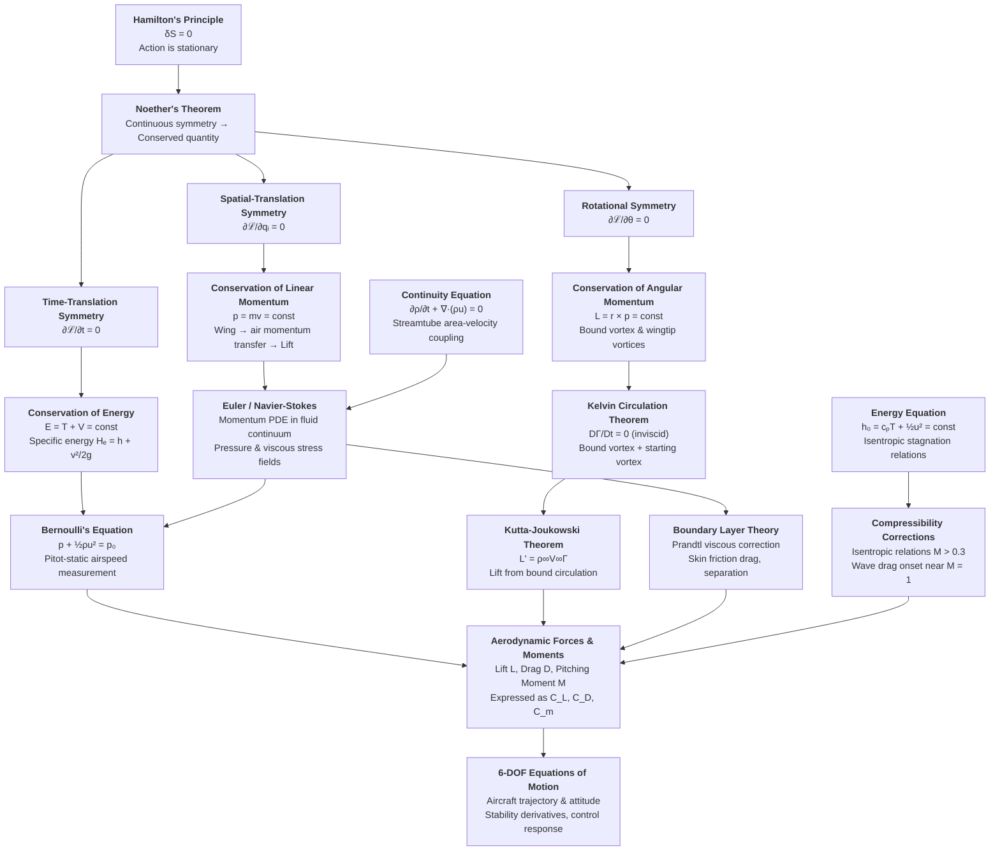

# Lesson 1: First-Principles Physical Laws & Conservation Invariants

## Curriculum Roadmap

This lesson is the axiomatic foundation of the entire flight dynamics curriculum. Every subsequent lesson — from lift generation and boundary layer separation to stability derivatives and control surface deflection — rests on the physical invariants established here. The goal is not to survey aerodynamics at a surface level, but to anchor you in the exact laws that make flight possible, traceable from first principles to wind tunnel measurement to flight test data.

The curriculum proceeds in three tightly coupled arcs. The first arc, covered in this lesson, establishes the conserved quantities of classical mechanics and fluid continua: energy, momentum, angular momentum, and mass. These are not approximations. They are the irreducible physical laws from which every aerodynamic force equation, every stability criterion, and every control law is derived. The second arc, covered in Lessons 2 through 4, translates these invariants into the language of fluid mechanics — Navier-Stokes dynamics, potential flow, boundary layer theory, and vortex dynamics — with direct laboratory protocols for each phenomenon. The third arc, covered in Lessons 5 onward, applies those fluid mechanics tools to real airfoils, wings, fuselages, and complete vehicle configurations, culminating in six-degree-of-freedom equations of motion, eigenvalue stability analysis, and practical flight testing methodology.

By the end of this lesson, you will have derived the principal conservation equations from the Euler-Lagrange formalism, applied Noether's theorem to identify the symmetries that underwrite each conserved quantity, and executed a hands-on pressure measurement exercise that makes those conservation laws physically tangible. The theory-to-practice ratio is deliberate: every abstract invariant introduced here will be measured, plotted, and stress-tested against real data before the lesson closes.

---

## 1. First-Principles Problem Space & Historical Phenomenon

### The Problem That Motivated a Century of Physics

Flight is, at its core, a problem of sustained force balance against gravity inside a moving fluid. That sentence contains three distinct physical problems compressed into one: the mechanics of rigid bodies under applied loads, the dynamics of a continuous viscous medium, and the coupling between solid geometry and fluid response that produces aerodynamic forces. What makes the problem scientifically extraordinary is that none of these sub-problems can be treated in isolation. The lift generated by a wing cannot be computed without knowing the velocity field of the surrounding air. The velocity field cannot be known without specifying the boundary conditions imposed by the wing geometry. The wing geometry moves in response to the forces the fluid exerts on it. The system is fundamentally closed and mutually coupled.

The historical path to resolving this coupling is a direct record of physics discovering its own limits. Daniel Bernoulli published *Hydrodynamica* in 1738, establishing the relationship between fluid velocity and static pressure in an inviscid streamline. Leonhard Euler, working in the same era, formulated the equations of motion for an ideal (inviscid, incompressible) fluid in 1757, giving the field its first rigorous conservation framework. What Euler's equations could not explain was the d'Alembert paradox: a body moving through an ideal fluid experiences zero drag. Any aeronautical engineer knows this is catastrophically wrong, and the paradox remained unresolved until Ludwig Prandtl introduced the boundary layer concept in 1904, at the same Heidelberg congress where the Wright brothers were preparing for their first powered flight. The timing is not coincidental. The resolution of the d'Alembert paradox — through the recognition that viscosity, however small, creates a thin region near the body surface where velocity gradients are enormous and cannot be neglected — was the theoretical event that made modern aerodynamics possible.

This historical arc matters for a practitioner because it defines the hierarchy of approximations you will use throughout this curriculum. Euler's equations are exact for inviscid flow and are the correct starting point for understanding lift at the level of circulation and pressure distribution. Prandtl's boundary layer equations are a systematic perturbation correction that introduces drag, flow separation, and viscous losses. Navier-Stokes is the complete statement that subsumes both. Each level of the hierarchy has a domain of validity, a computational cost, and a corresponding set of measurable quantities. Knowing when to invoke which level — and knowing the physical mechanism that breaks each approximation — is the central practical skill of an aerodynamicist.

### Why Conservation Laws Are the Right Starting Point

Before writing a single force equation, every working aerodynamicist internalizes conservation laws as intuition pumps. When you watch a wing generate lift, you are watching momentum being continuously transferred downward from the wing to the air mass; the reaction to that transfer is the upward lift force. When you see a jet exhaust, you are watching the aircraft exchange internal chemical energy for kinetic energy of the exhaust stream; the reaction is thrust. When a wing stalls and a leading-edge vortex detaches and convects downstream, you are watching a conserved circulation — created when the boundary layer separated — advect away from the wing with the free stream. Every visible aerodynamic phenomenon is a conservation law made manifest.

The reason to begin here rather than immediately with the Navier-Stokes equations or airfoil geometry is that conservation laws are coordinate-independent and approximation-independent. They hold exactly regardless of whether the flow is laminar or turbulent, subsonic or supersonic, steady or unsteady. When you derive a result from a conservation law applied to a control volume, that result is exact within the assumptions you stated for the control volume boundary — not approximate within the numerical scheme you used to solve the governing equations. This gives conservation-based analysis a robustness that differential equation solutions rarely possess, and it is why experimental aerodynamicists routinely cross-check high-fidelity computational results against control volume momentum budgets.

---

## 2. Conservation Invariants & Mathematical Laws

### 2.1 The Principle of Least Action and Its Flight Mechanics Consequence

The deepest statement of classical mechanics is not Newton's second law. It is Hamilton's principle, also called the principle of stationary action, which asserts that the actual trajectory of any mechanical system between two states extremizes the action functional:

$$\delta S = \delta \int_{t_1}^{t_2} \mathcal{L}(\mathbf{q}, \dot{\mathbf{q}}, t) \, dt = 0$$

where $\mathcal{L} = T - V$ is the Lagrangian, $T$ is the kinetic energy of the system, $V$ is the potential energy, $\mathbf{q}$ is the vector of generalized coordinates, and $\dot{\mathbf{q}}$ is the vector of generalized velocities. Demanding that $\delta S = 0$ under arbitrary variations $\delta \mathbf{q}$ that vanish at the endpoints produces the Euler-Lagrange equations of motion:

$$\frac{d}{dt}\frac{\partial \mathcal{L}}{\partial \dot{q}_i} - \frac{\partial \mathcal{L}}{\partial q_i} = 0, \quad i = 1, \ldots, n$$

For a rigid aircraft modeled as a six-degree-of-freedom body, the generalized coordinates are the three translational positions $(x, y, z)$ of the center of mass and the three Euler angles $(\phi, \theta, \psi)$ describing orientation. The Lagrangian formulation is particularly powerful here because it systematically handles the kinematic constraints between degrees of freedom — such as the coupling between rolling and yawing through gyroscopic propeller moments — without requiring the explicit construction of constraint forces.

The practical relevance of the action principle to flight dynamics is not primarily computational. Its relevance is structural: it tells you that the equations of motion of an aircraft are not arbitrary differential equations but are constrained to be derivable from a scalar function. That structural constraint is what allows Noether's theorem to operate, which is where the conservation laws emerge.

### 2.2 Noether's Theorem and the Origin of Conservation Laws

Emmy Noether proved in 1915 that every continuous symmetry of the action functional corresponds to exactly one conserved quantity. This theorem is not a physical hypothesis — it is a mathematical theorem about variational calculus. Its physical content depends entirely on what symmetries the action possesses, and those symmetries are determined by the physical laws governing the system.

**Time-translation invariance and conservation of energy.** If the Lagrangian of the aircraft system does not depend explicitly on time — $\partial \mathcal{L} / \partial t = 0$ — then the action is invariant under the transformation $t \to t + \epsilon$ for any constant $\epsilon$. Noether's theorem then guarantees that the Hamiltonian $\mathcal{H}$, which equals the total mechanical energy when the kinetic energy is a homogeneous quadratic function of velocities, is conserved:

$$\mathcal{H} = \sum_i \dot{q}_i \frac{\partial \mathcal{L}}{\partial \dot{q}_i} - \mathcal{L} = E = \text{const}$$

For a gliding aircraft in still air with no thrust and no aerodynamic dissipation — an idealization, but a useful one — total mechanical energy $E = \frac{1}{2}mv^2 + mgh$ is conserved. Any altitude lost must appear as kinetic energy gained, and conversely. This is the physical foundation of the energy height concept in energy-maneuverability analysis, where the specific mechanical energy $H_e = h + v^2/(2g)$ is treated as a conserved currency that the pilot trades between altitude and airspeed.

**Spatial-translation invariance and conservation of linear momentum.** If $\partial \mathcal{L} / \partial q_i = 0$ for some generalized coordinate $q_i$ — meaning the Lagrangian is invariant under translation in the direction associated with $q_i$ — then the conjugate generalized momentum $p_i = \partial \mathcal{L} / \partial \dot{q}_i$ is conserved. For an aircraft in free flight with no external forces (again an idealization), this gives conservation of linear momentum $\mathbf{p} = m\mathbf{v}$. The physical consequence is that every aerodynamic force on the aircraft must have an equal and opposite reaction on the air mass, manifested as changes in the fluid momentum field. When an aircraft generates lift $L$, the air mass is accelerated downward at a rate $\dot{p}_{\text{air},z} = -L$. This momentum transfer is exactly what a momentum-theory analysis measures when it integrates the vertical momentum flux through a control volume surrounding the wing.

**Rotational invariance and conservation of angular momentum.** If the Lagrangian is invariant under rotation about some axis — which requires that neither the external potential nor the kinetic energy has any preferred direction associated with that axis — then the corresponding component of angular momentum $\mathbf{L} = \mathbf{r} \times \mathbf{p}$ is conserved. In flight mechanics, this invariant governs propeller gyroscopic moments, the precession of spinning rotors, and the vortex dynamics of wingtip vortices. A wingtip vortex is a concentrrated region of angular momentum that the wing imparts to the fluid; its persistence and evolution downstream are governed by the impossibility of that angular momentum disappearing without a corresponding torque acting on the vortex tube.

### 2.3 Conservation of Mass: The Continuity Equation

For fluid mechanics, the conservation laws must be recast in Eulerian form — applied to a fixed control volume rather than a moving body. The conservation of mass for a fluid continuum states that the rate of change of mass within any fixed control volume $\mathcal{V}$ plus the net mass flux through its bounding surface $\partial \mathcal{V}$ equals zero:

$$\frac{\partial \rho}{\partial t} + \nabla \cdot (\rho \mathbf{u}) = 0$$

where $\rho$ is the fluid density in $\text{kg/m}^3$ and $\mathbf{u}$ is the velocity field vector in $\text{m/s}$. This is the continuity equation, and it is exact. For incompressible flow — a valid approximation below Mach 0.3, where density changes are less than roughly 5% — this simplifies to $\nabla \cdot \mathbf{u} = 0$, meaning the velocity field is divergence-free. The physical meaning is immediately practical: in a converging streamtube, the fluid must accelerate because the same mass flux must pass through a smaller cross-sectional area. This is the mechanism behind the accelerated flow over the upper surface of a cambered airfoil.

The practical manifestation of continuity in experimental work is the measurement of velocity profiles across a streamtube using a Pitot-static rake or a hot-wire anemometer array. When you integrate the velocity profile across a known duct cross-section and compare the result at two axial stations, the product $\rho_1 A_1 \bar{u}_1 = \rho_2 A_2 \bar{u}_2$ must be conserved to within the measurement uncertainty. Deviations from this balance indicate either mass injection or extraction (intentional or through a leaky test section) or significant compressibility effects that invalidate the incompressible assumption.

### 2.4 Conservation of Momentum: The Euler and Navier-Stokes Equations

Newton's second law applied to a fluid element in Eulerian form yields the momentum equation. For a Newtonian fluid with dynamic viscosity $\mu$ and bulk viscosity $\lambda$, this is the Navier-Stokes equation:

$$\rho \left( \frac{\partial \mathbf{u}}{\partial t} + (\mathbf{u} \cdot \nabla)\mathbf{u} \right) = -\nabla p + \mu \nabla^2 \mathbf{u} + \left(\lambda + \frac{\mu}{3}\right)\nabla(\nabla \cdot \mathbf{u}) + \rho \mathbf{g}$$

where $p$ is the static pressure in $\text{Pa}$, $\mu$ is the dynamic viscosity in $\text{Pa} \cdot \text{s}$, and $\mathbf{g}$ is the gravitational acceleration vector in $\text{m/s}^2$. The left-hand side is the material acceleration of a fluid parcel — the convective operator $(\mathbf{u} \cdot \nabla)\mathbf{u}$ is the nonlinear term responsible for turbulence and the mathematical difficulty of the equation. The right-hand side contains the pressure gradient force, viscous diffusion, volumetric viscosity effects (negligible for most aerodynamic applications), and body forces.

Setting the viscous terms to zero recovers Euler's equations for inviscid flow:

$$\rho \left( \frac{\partial \mathbf{u}}{\partial t} + (\mathbf{u} \cdot \nabla)\mathbf{u} \right) = -\nabla p + \rho \mathbf{g}$$

For steady, incompressible, inviscid flow along a streamline — a highly idealized but enormously useful case — integrating Euler's equation along the streamline direction yields Bernoulli's equation:

$$p + \frac{1}{2}\rho u^2 + \rho g z = p_0 = \text{const along a streamline}$$

where $p_0$ is the stagnation pressure, also called total pressure. This is not an independent physical law — it is a first integral of the momentum equation under the stated assumptions. Its practical importance cannot be overstated: it is the operating principle of every Pitot-static airspeed measurement system ever built. The Pitot tube measures stagnation pressure $p_0$ at the tube tip and static pressure $p_s$ at a port flush with the tube wall or the aircraft skin. The dynamic pressure $q = p_0 - p_s = \frac{1}{2}\rho u^2$ is then read by the differential pressure transducer and converted to airspeed by:

$$V = \sqrt{\frac{2(p_0 - p_s)}{\rho}} \quad \text{[m/s]}$$

The density $\rho$ used in this conversion is determined from the standard atmosphere model using the simultaneously measured static pressure and temperature, unless a local density probe is available.

### 2.5 Conservation of Energy: The Energy Equation and Bernoulli's Hierarchy

The first law of thermodynamics applied to a fluid element gives the energy equation. For a calorically perfect gas with specific heat ratio $\gamma = c_p/c_v$, the total enthalpy $h_0 = c_p T_0$ is conserved along streamlines in adiabatic inviscid flow:

$$h_0 = c_p T + \frac{1}{2}u^2 = c_p T_0 = \text{const along a streamline}$$

where $T$ is the static temperature in Kelvin, $T_0$ is the stagnation temperature, $c_p$ is the specific heat at constant pressure in $\text{J/(kg \cdot K)}$, and $u$ is the flow speed in $\text{m/s}$. This form of energy conservation is essential for compressible aerodynamics. At Mach numbers above 0.3, the temperature rise at the stagnation point becomes non-negligible and affects both the local speed of sound and the structural heating of the vehicle.

The relationship between static and stagnation conditions for a calorically perfect gas is given by the isentropic relations:

$$\frac{T_0}{T} = 1 + \frac{\gamma - 1}{2} M^2, \quad \frac{p_0}{p} = \left(1 + \frac{\gamma - 1}{2} M^2\right)^{\gamma/(\gamma-1)}, \quad \frac{\rho_0}{\rho} = \left(1 + \frac{\gamma - 1}{2} M^2\right)^{1/(\gamma-1)}$$

where $M = u/a$ is the local Mach number and $a = \sqrt{\gamma R T}$ is the local speed of sound. At $M = 0$ these all reduce to unity. At $M = 0.3$, the stagnation-to-static pressure ratio is approximately 1.064, meaning a 6.4% error in airspeed if compressibility is ignored. At $M = 0.8$ the error exceeds 25%, and incompressible Bernoulli fails badly. The practical threshold for applying compressibility corrections to Pitot-static systems is $M > 0.3$, corresponding to roughly $V > 103 \, \text{m/s}$ at sea level in the International Standard Atmosphere.

### 2.6 Kelvin's Circulation Theorem and the Origin of Lift

The final conservation invariant essential to flight is the conservation of circulation, which is Kelvin's theorem: in an inviscid, barotropic fluid subject only to conservative body forces, the circulation $\Gamma$ around any material closed curve co-moving with the fluid is constant in time:

$$\frac{D\Gamma}{Dt} = \frac{D}{Dt} \oint_C \mathbf{u} \cdot d\mathbf{l} = 0$$

where $C$ is a material curve that moves with the fluid. Circulation is defined as:

$$\Gamma = \oint_C \mathbf{u} \cdot d\mathbf{l} \quad [\text{m}^2/\text{s}]$$

Kelvin's theorem has a direct and experimentally verifiable consequence for lifting aerodynamics. When an airfoil starts from rest and accelerates to a steady flight speed, the circulation around it must start from zero because the entire fluid is initially at rest and $\Gamma = 0$ for every material curve. As the airfoil accelerates, it sheds a starting vortex from its trailing edge — this vortex contains negative circulation that exactly cancels the positive bound circulation that builds up around the airfoil. The total circulation in the fluid domain remains zero, as Kelvin's theorem requires. The lift per unit span generated by the bound circulation is then given by the Kutta-Joukowski theorem:

$$L' = \rho_\infty V_\infty \Gamma \quad [\text{N/m}]$$

where $\rho_\infty$ is the freestream density in $\text{kg/m}^3$, $V_\infty$ is the freestream velocity in $\text{m/s}$, and $\Gamma$ is the magnitude of the bound circulation in $\text{m}^2/\text{s}$. This equation is exact for two-dimensional inviscid flow. Its precision in predicting lift at low angles of attack before boundary layer separation is remarkable, and every modern potential-flow panel code is ultimately computing $\Gamma$ on each panel to evaluate this expression.

The experimental protocol for verifying the Kutta-Joukowski theorem in a wind tunnel involves measuring the surface pressure distribution $C_p(\theta)$ around an airfoil at known angle of attack and freestream conditions, integrating the pressure distribution to obtain lift and drag coefficients, and comparing the lift coefficient $C_L$ against the theoretical prediction from thin airfoil theory, which gives $C_{L,\text{theory}} = 2\pi(\alpha + \alpha_0)$ where $\alpha$ is the geometric angle of attack in radians and $\alpha_0$ is the zero-lift angle determined by camber. For a NACA 0012 airfoil at $\alpha = 5°$ and $Re = 10^6$, the measured $C_L$ is typically within 3% of this linear prediction, with the discrepancy attributable to viscous displacement thickness effects on the effective camber.

---

## 3. High-Level Phenomenological Model

The following diagram maps the causal chain from the first-principles physical invariants established in this lesson through to the observable aerodynamic forces and moments that govern flight. Each node is an exact physical quantity or law; each arrow is a mechanistic causal link, not an analogy.

Reading the diagram from top to bottom, the logical structure of flight physics is a strict hierarchy. Hamilton's principle and Noether's theorem sit at the apex as the pure mathematical substrate — they generate the three primary conservation laws without any physical input beyond the symmetries of the action. Those conservation laws, combined with the continuum description of the fluid (continuity, momentum, and energy PDEs), produce the working equations of aerodynamics: Bernoulli, the circulation theorem, the boundary layer equations, and the isentropic compressibility relations. These in turn are the direct inputs to the computation of aerodynamic forces and moments, which enter the six-degree-of-freedom equations of motion as external loads.

The diagram also reveals where the approximation hierarchy lives. The Kutta-Joukowski path from circulation to lift assumes inviscid flow. The boundary layer path introduces viscosity as a correction to that inviscid core. The compressibility path extends the analysis to Mach numbers where density changes are significant. These three paths are not competing theories — they are nested approximations of the single underlying Navier-Stokes system, each valid in its domain and each validated by a distinct class of measurement.

### Practical Verification: Pitot-Static Pressure Measurement Protocol

The most direct experimental verification of the conservation laws in this lesson is a Pitot-static measurement of a velocity profile in a wind tunnel test section. The following protocol is designed for a low-speed open-circuit tunnel with a contraction ratio of at least 6:1 and a test section velocity range of 5–50 m/s, though the method scales to any facility.

Before running the tunnel, calibrate the differential pressure transducer by applying known gauge pressures using a deadweight tester or a calibrated electronic pressure source. The transducer full-scale range should match the maximum expected dynamic pressure $q_{\max} = \frac{1}{2}\rho V_{\max}^2$. At $V_{\max} = 50 \, \text{m/s}$ and sea-level density $\rho = 1.225 \, \text{kg/m}^3$, this gives $q_{\max} = 1531 \, \text{Pa}$, so a 0–2000 Pa transducer with 0.1% full-scale accuracy ($\pm 2 \, \text{Pa}$) is appropriate.

Mount the Pitot-static probe on a traversing mechanism aligned with the tunnel centerline. Set the probe yaw angle to zero degrees relative to the nominal flow direction using a clinometer; misalignment beyond $\pm 3°$ introduces a cosine error in the stagnation pressure reading of roughly 0.1%, which is small but non-negligible at high precision. With the tunnel running at a stable set point, record differential pressure $\Delta p = p_0 - p_s$ at traverse increments of 2 mm across the full test section height. Simultaneously record the ambient static pressure $p_\infty$ from a Betz manometer or a precision barometer and the ambient temperature $T_\infty$ from a thermistor probe upstream of the contraction. Compute the local flow velocity at each traverse position as:

$$V_i = \sqrt{\frac{2 \Delta p_i}{\rho_\infty}}, \quad \rho_\infty = \frac{p_\infty}{R_{\text{air}} T_\infty}, \quad R_{\text{air}} = 287.058 \, \text{J/(kg \cdot K)}$$

Integrate the velocity profile across the test section to obtain the volumetric flow rate $\dot{V} = \int\!\int V \, dA$, and verify that it matches the volumetric flow rate computed from the contraction inlet velocity (measured with a separate manometer on the settling chamber total pressure port) multiplied by the contraction area ratio. Agreement within 1–2% confirms that the continuity equation and Bernoulli's equation are operating consistently across the facility, and that the measurement system is free from significant systematic errors.

This verification step — checking conservation of mass flux across the tunnel by integrating independently measured velocity profiles — is a standard quality-assurance procedure in aerodynamics laboratories. It is the experimental counterpart of the theoretical derivation: the same conservation law that was derived from Hamilton's principle on paper is enforced, to measurement precision, in the physical fluid. That correspondence between the mathematical invariant and the laboratory measurement is the foundation on which all subsequent experimental work in this curriculum rests.
