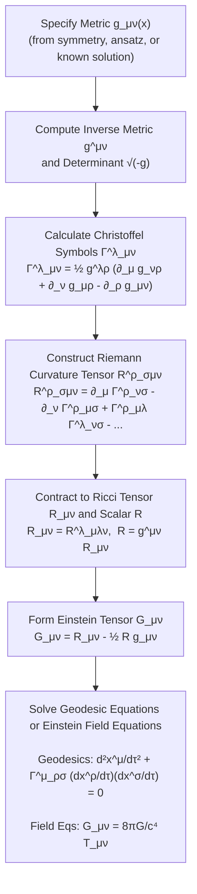

# Lesson 1: Mathematical Foundations of Curved Spacetime

## 1. First-Principles Intuition & Invariants

The transition from Newtonian gravity to Einstein's general relativity represents one of the most profound conceptual revolutions in the history of physics. Where Newton conceived of gravity as an instantaneous force acting at a distance through absolute Euclidean space, Einstein reimagined gravitational phenomena as geometric consequences of spacetime curvature. This geometric paradigm demands a mathematical language far more sophisticated than the vector calculus sufficient for classical mechanics. The arena of general relativity is the differentiable manifold, and its natural language is tensor calculus on curved spaces.

The fundamental insight underlying general relativity is the **principle of equivalence**: locally, in a freely falling reference frame, the laws of physics take the same form as in special relativity. This principle forces us to abandon the global inertial frames of special relativity and accept that spacetime itself possesses intrinsic curvature determined by the distribution of energy and momentum. The mathematical framework required to express this idea rigorously is differential geometry, which provides the tools to describe curved spaces without reference to any ambient embedding space.

At the heart of this framework lies the concept of a **manifold**—a topological space that locally resembles Euclidean space but may possess global structure that is far from flat. A smooth manifold of dimension $n$ is a space $\mathcal{M}$ where each point has a neighborhood that can be mapped smoothly (infinitely differentiable) to an open subset of $\mathbb{R}^n$. These local maps are called **charts**, and a collection of charts covering the entire manifold is an **atlas**. The critical feature enabling calculus on manifolds is that where charts overlap, the transition functions relating them are smooth diffeomorphisms. This structure allows us to define smooth functions, curves, and vector fields on the manifold without requiring it to sit inside any higher-dimensional space.

Spacetime in general relativity is modeled as a four-dimensional smooth manifold $\mathcal{M}$ equipped with a **metric tensor** $g_{\mu\nu}$, a symmetric rank-2 tensor field that assigns to each point an inner product structure on the tangent space at that point. The metric signature in general relativity is conventionally taken as $(-,+,+,+)$ in the **West Coast convention** or $(+,-,-,-)$ in the **East Coast convention**—we adopt the former throughout this curriculum. The metric tensor serves multiple essential functions: it measures spacetime intervals between infinitesimally separated events via the line element

$$ds^2 = g_{\mu\nu} dx^\mu dx^\nu,$$

it defines the causal structure distinguishing timelike, spacelike, and null separations, and it determines the geometry through its curvature properties. The signature with one negative eigenvalue and three positive eigenvalues characterizes the manifold as **pseudo-Riemannian** rather than Riemannian, reflecting the fundamental distinction between time and space in relativity.

The notion of a **tangent space** $T_p\mathcal{M}$ at a point $p \in \mathcal{M}$ provides the arena for vectors. Geometrically, tangent vectors can be visualized as equivalence classes of curves passing through $p$ with the same first derivative, but the modern coordinate-free definition treats them as directional derivative operators acting on smooth functions. Given a smooth function $f: \mathcal{M} \to \mathbb{R}$ and a tangent vector $V \in T_p\mathcal{M}$, the action $V(f)$ yields the directional derivative of $f$ along $V$. In a coordinate chart $\{x^\mu\}$, tangent vectors are expressed in terms of coordinate basis vectors $\partial_\mu \equiv \partial/\partial x^\mu$, so that

$$V = V^\mu \partial_\mu,$$

where $V^\mu$ are the components of $V$ in this basis. This component notation, employing Einstein's summation convention over repeated upper-lower index pairs, pervades the formalism of general relativity.

Dual to the tangent space is the **cotangent space** $T_p^*\mathcal{M}$, consisting of linear functionals mapping tangent vectors to real numbers. Elements of the cotangent space are called **one-forms** or **covectors**, and in coordinates they are expressed using the dual basis $dx^\mu$, defined by the pairing

$$dx^\mu(\partial_\nu) = \delta^\mu_\nu,$$

where $\delta^\mu_\nu$ is the Kronecker delta. A one-form $\omega$ thus takes the form

$$\omega = \omega_\mu dx^\mu.$$

The distinction between vectors (contravariant, with upper indices) and covectors (covariant, with lower indices) is fundamental to tensor calculus. The metric tensor $g_{\mu\nu}$ provides a natural isomorphism between tangent and cotangent spaces, allowing index lowering and raising:

$$V_\mu = g_{\mu\nu} V^\nu, \quad V^\mu = g^{\mu\nu} V_\nu,$$

where $g^{\mu\nu}$ denotes the inverse metric satisfying $g^{\mu\rho}g_{\rho\nu} = \delta^\mu_\nu$.

**Tensors** generalize vectors and covectors, forming multilinear objects with multiple indices. A tensor of type $(k,\ell)$ is a multilinear map taking $\ell$ vectors and $k$ covectors to a real number. In component form, such a tensor is written

$$T^{\mu_1\cdots\mu_k}_{\phantom{\mu_1\cdots\mu_k}\nu_1\cdots\nu_\ell},$$

with $k$ contravariant indices and $\ell$ covariant indices. Under coordinate transformations $x^\mu \to x'^{\mu'}$, tensor components transform according to the chain rule:

$$T'^{\mu'_1\cdots\mu'_k}_{\phantom{\mu'_1\cdots\mu'_k}\nu'_1\cdots\nu'_\ell} = \frac{\partial x'^{\mu'_1}}{\partial x^{\mu_1}} \cdots \frac{\partial x'^{\mu'_k}}{\partial x^{\mu_k}} \frac{\partial x^{\nu_1}}{\partial x'^{\nu'_1}} \cdots \frac{\partial x^{\nu_\ell}}{\partial x'^{\nu'_\ell}} T^{\mu_1\cdots\mu_k}_{\phantom{\mu_1\cdots\mu_k}\nu_1\cdots\nu_\ell}.$$

This transformation law defines tensor character and ensures that tensor equations are coordinate-independent geometric statements—a requirement for physical laws in general relativity.

The metric tensor itself is a symmetric rank-2 covariant tensor. Its determinant $g \equiv \det(g_{\mu\nu})$ is negative in pseudo-Riemannian signature, and the quantity $\sqrt{-g}$ appears ubiquitously in integration measures. The invariant spacetime volume element is $d^4x \sqrt{-g}$, ensuring coordinate independence of integrals.

Differentiation on curved manifolds requires care because vector fields at different points live in different tangent spaces, preventing naive subtraction. The **covariant derivative** $\nabla_\mu$ generalizes the partial derivative $\partial_\mu$ to curved spaces, introducing **Christoffel symbols** $\Gamma^\lambda_{\mu\nu}$ that encode how basis vectors change from point to point. For a vector field $V^\mu$ and a covector field $\omega_\mu$, the covariant derivatives are

$$\nabla_\mu V^\nu = \partial_\mu V^\nu + \Gamma^\nu_{\mu\lambda} V^\lambda,$$

$$\nabla_\mu \omega_\nu = \partial_\mu \omega_\nu - \Gamma^\lambda_{\mu\nu} \omega_\lambda.$$

The Christoffel symbols are not tensor components—they transform inhomogeneously—but they can be expressed purely in terms of the metric tensor and its first derivatives:

$$\Gamma^\lambda_{\mu\nu} = \frac{1}{2} g^{\lambda\rho} \left( \partial_\mu g_{\nu\rho} + \partial_\nu g_{\mu\rho} - \partial_\rho g_{\mu\nu} \right).$$

This formula reveals that the connection is **metric-compatible**: the covariant derivative of the metric vanishes,

$$\nabla_\lambda g_{\mu\nu} = 0,$$

a condition called **metricity**. The connection is also **torsion-free**:

$$\Gamma^\lambda_{\mu\nu} = \Gamma^\lambda_{\nu\mu},$$

which ensures that the covariant derivatives commute on scalar functions: $\nabla_\mu \nabla_\nu f = \nabla_\nu \nabla_\mu f$.

Curvature arises when covariant derivatives fail to commute on vector fields. The **Riemann curvature tensor** $R^\rho_{\phantom{\rho}\sigma\mu\nu}$ measures this non-commutativity:

$$(\nabla_\mu \nabla_\nu - \nabla_\nu \nabla_\mu) V^\rho = R^\rho_{\phantom{\rho}\sigma\mu\nu} V^\sigma.$$

In terms of Christoffel symbols, the Riemann tensor is

$$R^\rho_{\phantom{\rho}\sigma\mu\nu} = \partial_\mu \Gamma^\rho_{\nu\sigma} - \partial_\nu \Gamma^\rho_{\mu\sigma} + \Gamma^\rho_{\mu\lambda} \Gamma^\lambda_{\nu\sigma} - \Gamma^\rho_{\nu\lambda} \Gamma^\lambda_{\mu\sigma}.$$

The Riemann tensor possesses numerous symmetries. It is antisymmetric in its last two indices,

$$R^\rho_{\phantom{\rho}\sigma\mu\nu} = -R^\rho_{\phantom{\rho}\sigma\nu\mu},$$

and with all indices lowered ($R_{\rho\sigma\mu\nu} = g_{\rho\lambda} R^\lambda_{\phantom{\lambda}\sigma\mu\nu}$), it exhibits the additional symmetries

$$R_{\rho\sigma\mu\nu} = -R_{\sigma\rho\mu\nu} = -R_{\rho\sigma\nu\mu} = R_{\mu\nu\rho\sigma},$$

along with the first Bianchi identity:

$$R_{\rho\sigma\mu\nu} + R_{\rho\mu\nu\sigma} + R_{\rho\nu\sigma\mu} = 0.$$

These symmetries reduce the number of independent components in four dimensions from 256 to 20.

Contracting the Riemann tensor yields the **Ricci tensor**

$$R_{\mu\nu} = R^\lambda_{\phantom{\lambda}\mu\lambda\nu} = g^{\rho\sigma} R_{\rho\mu\sigma\nu},$$

which is symmetric: $R_{\mu\nu} = R_{\nu\mu}$. The trace of the Ricci tensor is the **Ricci scalar** or **scalar curvature**:

$$R = g^{\mu\nu} R_{\mu\nu}.$$

These contracted curvature quantities appear directly in Einstein's field equations. The **Einstein tensor**

$$G_{\mu\nu} = R_{\mu\nu} - \frac{1}{2} R g_{\mu\nu}$$

satisfies the contracted Bianchi identity $\nabla^\mu G_{\mu\nu} = 0$ automatically, ensuring consistency with local energy-momentum conservation when equated to the stress-energy tensor.

Particle trajectories in curved spacetime are **geodesics**—curves that parallel-transport their own tangent vector. A geodesic $x^\mu(\tau)$ parametrized by proper time $\tau$ satisfies the geodesic equation

$$\frac{d^2 x^\mu}{d\tau^2} + \Gamma^\mu_{\rho\sigma} \frac{dx^\rho}{d\tau} \frac{dx^\sigma}{d\tau} = 0.$$

This equation generalizes Newton's first law to curved spacetime: free particles follow geodesics. Timelike geodesics represent massive particle worldlines, null geodesics represent light rays, and spacelike geodesics have no direct physical interpretation but are mathematically well-defined. The geodesic equation can also be derived variationally from extremizing the proper time functional

$$\tau = \int \sqrt{-g_{\mu\nu} \frac{dx^\mu}{d\lambda} \frac{dx^\nu}{d\lambda}} \, d\lambda,$$

establishing geodesics as the curved-space generalization of straight lines.

The **affine parameter** $\lambda$ along a geodesic is defined such that the tangent vector $u^\mu = dx^\mu/d\lambda$ satisfies $u^\mu \nabla_\mu u^\nu = 0$. For timelike geodesics of massive particles, the proper time $\tau$ serves as a natural affine parameter related to the four-velocity by $u^\mu = dx^\mu/d\tau$, normalized such that $g_{\mu\nu} u^\mu u^\nu = -1$ in our signature convention. For null geodesics, proper time is identically zero, and any affine parameter works, with different choices related by linear transformations $\lambda \to a\lambda + b$.

The geometric framework of differential geometry thus transforms the intuitive picture of gravity as a force into a statement about spacetime geometry: mass-energy curves spacetime, and curved spacetime dictates geodesic motion. The Einstein field equations, which we shall derive and explore in subsequent lessons, close the loop by specifying precisely how matter-energy distributions determine the metric tensor components. But before tackling those dynamical equations, we must master the computational machinery of tensor calculus, covariant differentiation, and curvature calculation.

## 2. Core Architecture & Mechanics

The practical application of differential geometry to general relativity requires systematic procedures for calculating geometric quantities in specific coordinate systems. While the geometric concepts are coordinate-independent, explicit computation demands choosing coordinates and performing index gymnastics with discipline and care. We now dissect the computational architecture underlying tensor calculus on curved spacetime.

### Coordinate Charts and Basis Fields

A coordinate chart $\{x^\mu\}$ on a spacetime manifold $\mathcal{M}$ assigns four real numbers $(x^0, x^1, x^2, x^3)$ to each point in some open region $U \subset \mathcal{M}$. Temporal coordinate $x^0$ is conventionally taken as $ct$ where $c$ is the speed of light and $t$ is coordinate time, though in natural units with $c=1$ we write simply $x^0 = t$. The spatial coordinates $(x^1, x^2, x^3)$ may be Cartesian, spherical, cylindrical, or any other system adapted to the problem's symmetry.

The coordinate basis for the tangent space at each point consists of the partial derivative operators $\{\partial_\mu\} = \{\partial/\partial x^\mu\}$, and the dual basis for the cotangent space is $\{dx^\mu\}$. These bases are **holonomic** or **coordinate-induced**. In many applications, particularly when dealing with rotating reference frames or gauge theories, it proves advantageous to employ **non-holonomic bases**—also called **tetrads** or **vierbeins**—which are not derivable from any coordinate system. A tetrad consists of four vector fields $\{e_a\}$, $a = 0,1,2,3$, that at each point form a basis for the tangent space, along with the dual basis of one-forms $\{\theta^a\}$ satisfying $\theta^a(e_b) = \delta^a_b$.

The relationship between coordinate and tetrad bases is mediated by the tetrad components:

$$e_a = e_a{}^\mu \partial_\mu, \quad \theta^a = \theta^a{}_\mu dx^\mu,$$

with the orthogonality conditions

$$e_a{}^\mu \theta^b{}_\mu = \delta_a^b, \quad e_a{}^\mu \theta^a{}_\nu = \delta^\mu_\nu.$$

The metric tensor in the tetrad basis takes the canonical Minkowski form when the tetrad is orthonormal:

$$g(e_a, e_b) = \eta_{ab} = \text{diag}(-1,+1,+1,+1),$$

which defines the **orthonormal tetrad condition**. This condition does not uniquely specify the tetrad—Lorentz transformations preserve $\eta_{ab}$—and this Lorentz gauge freedom underlies the vierbein formulation of gravity used in supergravity and loop quantum gravity.

### Metric Tensor Computation and Index Manipulation

Given a line element in coordinate form, the metric components $g_{\mu\nu}$ are read directly. For example, the Schwarzschild metric describing the spacetime outside a spherically symmetric mass $M$ is

$$ds^2 = -\left(1 - \frac{2GM}{c^2 r}\right) c^2 dt^2 + \left(1 - \frac{2GM}{c^2 r}\right)^{-1} dr^2 + r^2 d\theta^2 + r^2 \sin^2\theta \, d\phi^2.$$

In natural units ($c=G=1$) and defining the Schwarzschild radius $r_s = 2M$, the metric becomes

$$ds^2 = -\left(1 - \frac{r_s}{r}\right) dt^2 + \left(1 - \frac{r_s}{r}\right)^{-1} dr^2 + r^2(d\theta^2 + \sin^2\theta \, d\phi^2).$$

The metric matrix in coordinates $(t,r,\theta,\phi)$ is diagonal:

$$g_{\mu\nu} = \text{diag}\left(-\left(1-\frac{r_s}{r}\right), \left(1-\frac{r_s}{r}\right)^{-1}, r^2, r^2\sin^2\theta\right).$$

The inverse metric components $g^{\mu\nu}$, needed for raising indices, are obtained by matrix inversion. For diagonal metrics, inversion is trivial:

$$g^{\mu\nu} = \text{diag}\left(-\left(1-\frac{r_s}{r}\right)^{-1}, 1-\frac{r_s}{r}, r^{-2}, (r\sin\theta)^{-2}\right).$$

The determinant is

$$g = \det(g_{\mu\nu}) = -r^4 \sin^2\theta,$$

hence $\sqrt{-g} = r^2 \sin\theta$, which is the familiar volume element in spherical coordinates.

Index raising and lowering via the metric is straightforward once $g_{\mu\nu}$ and $g^{\mu\nu}$ are known. Given a vector $V^\mu$, its covariant components are

$$V_\mu = g_{\mu\nu} V^\nu.$$

For the Schwarzschild metric, if $V^\mu = (V^t, V^r, V^\theta, V^\phi)$, then

$$V_t = -\left(1-\frac{r_s}{r}\right) V^t, \quad V_r = \left(1-\frac{r_s}{r}\right)^{-1} V^r, \quad V_\theta = r^2 V^\theta, \quad V_\phi = r^2 \sin^2\theta \, V^\phi.$$

### Christoffel Symbol Calculation

Computing Christoffel symbols from the metric is a multi-step algorithmic procedure. The defining formula

$$\Gamma^\lambda_{\mu\nu} = \frac{1}{2} g^{\lambda\rho} \left( \partial_\mu g_{\nu\rho} + \partial_\nu g_{\mu\rho} - \partial_\rho g_{\mu\nu} \right)$$

requires calculating all first derivatives $\partial_\mu g_{\nu\rho}$ of the metric components. Symmetry in the lower indices $\Gamma^\lambda_{\mu\nu} = \Gamma^\lambda_{\nu\mu}$ reduces the independent components: in four dimensions, each upper index $\lambda$ corresponds to $4 \times 5 / 2 = 10$ independent lower index pairs, yielding $4 \times 10 = 40$ components total, though many vanish due to metric structure.

For the Schwarzschild metric, the non-zero derivatives of $g_{\mu\nu}$ are

$$\partial_r g_{tt} = -\frac{r_s}{r^2}, \quad \partial_r g_{rr} = -\frac{r_s}{r^2}\left(1-\frac{r_s}{r}\right)^{-2}, \quad \partial_r g_{\theta\theta} = 2r, \quad \partial_r g_{\phi\phi} = 2r\sin^2\theta,$$

$$\partial_\theta g_{\phi\phi} = 2r^2 \sin\theta \cos\theta.$$

Applying the Christoffel formula systematically yields the non-zero components:

$$\Gamma^t_{tr} = \Gamma^t_{rt} = \frac{r_s}{2r(r-r_s)}, \quad \Gamma^r_{tt} = \frac{r_s(r-r_s)}{2r^3},$$

$$\Gamma^r_{rr} = -\frac{r_s}{2r(r-r_s)}, \quad \Gamma^r_{\theta\theta} = -(r-r_s), \quad \Gamma^r_{\phi\phi} = -(r-r_s)\sin^2\theta,$$

$$\Gamma^\theta_{r\theta} = \Gamma^\theta_{\theta r} = \frac{1}{r}, \quad \Gamma^\theta_{\phi\phi} = -\sin\theta\cos\theta,$$

$$\Gamma^\phi_{r\phi} = \Gamma^\phi_{\phi r} = \frac{1}{r}, \quad \Gamma^\phi_{\theta\phi} = \Gamma^\phi_{\phi\theta} = \cot\theta.$$

These Christoffel symbols encode how coordinate basis vectors change along coordinate curves. For instance, $\Gamma^r_{\theta\theta} = -(r-r_s)$ indicates that moving in the $\theta$-direction at fixed $r$ introduces an inward radial component to the basis vector derivative.

### Geodesic Equation Execution

With Christoffel symbols in hand, the geodesic equation

$$\frac{d^2 x^\mu}{d\tau^2} + \Gamma^\mu_{\rho\sigma} \frac{dx^\rho}{d\tau} \frac{dx^\sigma}{d\tau} = 0$$

becomes a system of four coupled second-order ordinary differential equations. For a massive particle with four-velocity $u^\mu = dx^\mu/d\tau$ normalized to $g_{\mu\nu} u^\mu u^\nu = -1$, substituting the Schwarzschild Christoffel symbols yields

$$\frac{d^2 t}{d\tau^2} + \frac{r_s}{r(r-r_s)} \frac{dt}{d\tau} \frac{dr}{d\tau} = 0,$$

$$\frac{d^2 r}{d\tau^2} + \frac{r_s(r-r_s)}{2r^3} \left(\frac{dt}{d\tau}\right)^2 - \frac{r_s}{2r(r-r_s)} \left(\frac{dr}{d\tau}\right)^2 - (r-r_s)\left[\left(\frac{d\theta}{d\tau}\right)^2 + \sin^2\theta \left(\frac{d\phi}{d\tau}\right)^2\right] = 0,$$

$$\frac{d^2 \theta}{d\tau^2} + \frac{2}{r} \frac{dr}{d\tau} \frac{d\theta}{d\tau} - \sin\theta\cos\theta \left(\frac{d\phi}{d\tau}\right)^2 = 0,$$

$$\frac{d^2 \phi}{d\tau^2} + \frac{2}{r} \frac{dr}{d\tau} \frac{d\phi}{d\tau} + 2\cot\theta \frac{d\theta}{d\tau} \frac{d\phi}{d\tau} = 0.$$

Solving these equations numerically requires initial conditions: position $x^\mu(\tau_0)$ and four-velocity $u^\mu(\tau_0)$ at some initial proper time $\tau_0$. Standard numerical integrators—fourth-order Runge-Kutta, Dormand-Prince adaptive step-size methods, or symplectic integrators preserving the normalization constraint—evolve the trajectory forward in proper time.

Analytic solutions exist for highly symmetric spacetimes. In Schwarzschild geometry, conservation of energy and angular momentum follows from time-translation and azimuthal symmetries via Noether's theorem. The constants of motion

$$E = \left(1 - \frac{r_s}{r}\right) \frac{dt}{d\tau}, \quad L = r^2 \sin^2\theta \frac{d\phi}{d\tau}$$

reduce the geodesic equations to quadratures for orbits confined to the equatorial plane $\theta = \pi/2$. The effective radial potential

$$V_{\text{eff}}(r) = -\frac{r_s}{r} + \frac{L^2}{r^2} - \frac{r_s L^2}{r^3}$$

governs radial motion via

$$\frac{1}{2}\left(\frac{dr}{d\tau}\right)^2 + V_{\text{eff}}(r) = \frac{E^2 - 1}{2}.$$

The last term $-r_s L^2/r^3$, absent in Newtonian gravity, causes perihelion precession and the existence of unstable circular orbits at $r = 3r_s/2$ for photons.

### Riemann Tensor Component Calculation

Computing the Riemann tensor from Christoffel symbols via

$$R^\rho_{\phantom{\rho}\sigma\mu\nu} = \partial_\mu \Gamma^\rho_{\nu\sigma} - \partial_\nu \Gamma^\rho_{\mu\sigma} + \Gamma^\rho_{\mu\lambda} \Gamma^\lambda_{\nu\sigma} - \Gamma^\rho_{\nu\lambda} \Gamma^\lambda_{\mu\sigma}$$

is computationally intensive but algorithmically straightforward. Each component requires taking derivatives of Christoffel symbols and summing products of pairs of Christoffel symbols. For a metric depending on $n$ coordinates, the Riemann tensor generically has $n^4$ components, reduced to $n^2(n^2-1)/12$ independent components by symmetries.

For Schwarzschild spacetime, the non-zero independent components of $R_{\rho\sigma\mu\nu}$ (with all indices lowered) are

$$R_{trtr} = \frac{r_s(r-r_s)}{r^4}, \quad R_{t\theta t\theta} = \frac{r_s(r-r_s)}{2r^2}, \quad R_{t\phi t\phi} = \frac{r_s(r-r_s)\sin^2\theta}{2r^2},$$

$$R_{r\theta r\theta} = -\frac{r_s}{2r}, \quad R_{r\phi r\phi} = -\frac{r_s \sin^2\theta}{2r}, \quad R_{\theta\phi\theta\phi} = r^4 \sin^2\theta \left(\frac{r_s}{r^3}\right),$$

along with components related by symmetries. Contracting to form the Ricci tensor $R_{\mu\nu}$ yields zero for all components, consistent with the fact that Schwarzschild spacetime is a vacuum solution satisfying $R_{\mu\nu} = 0$. The Ricci scalar $R = g^{\mu\nu}R_{\mu\nu}$ also vanishes. However, the Riemann tensor is non-zero, indicating genuine spacetime curvature. The Schwarzschild geometry is a **Ricci-flat** but not flat spacetime.

The **Kretschmann scalar** $K = R^{\rho\sigma\mu\nu} R_{\rho\sigma\mu\nu}$, formed by contracting the Riemann tensor with itself, provides a coordinate-invariant measure of curvature. For Schwarzschild spacetime,

$$K = \frac{12 r_s^2}{r^6},$$

which diverges as $r \to 0$, signaling a curvature singularity at the origin. At the event horizon $r = r_s$, the Kretschmann scalar remains finite:

$$K(r_s) = \frac{12}{r_s^4} = \frac{3}{4M^4}.$$

This finiteness confirms that the coordinate singularity at $r = r_s$ in Schwarzschild coordinates is an artifact of the coordinate choice, not a physical singularity. Observers crossing the horizon experience finite tidal forces.

### Parallel Transport and Covariant Derivatives Along Curves

Parallel transporting a vector $V^\mu$ along a curve $x^\mu(\lambda)$ means keeping the vector's components constant in a parallelly transported basis. Mathematically, parallel transport satisfies

$$\frac{D V^\mu}{D\lambda} \equiv \frac{dx^\nu}{d\lambda} \nabla_\nu V^\mu = \frac{dV^\mu}{d\lambda} + \Gamma^\mu_{\nu\rho} \frac{dx^\nu}{d\lambda} V^\rho = 0.$$

This defines a system of first-order linear ODEs governing how $V^\mu(\lambda)$ evolves along the curve. Initial conditions $V^\mu(\lambda_0)$ at one point determine $V^\mu$ everywhere along the curve.

For a geodesic with tangent vector $u^\mu = dx^\mu/d\lambda$, parallel transport of $u^\mu$ itself reproduces the geodesic equation:

$$\frac{D u^\mu}{D\lambda} = 0 \quad \Leftrightarrow \quad \frac{d^2 x^\mu}{d\lambda^2} + \Gamma^\mu_{\rho\sigma} \frac{dx^\rho}{d\lambda} \frac{dx^\sigma}{d\lambda} = 0.$$

A geodesic is thus a curve whose tangent vector is parallel-transported along itself—the curved-space analogue of a straight line.

The **geodesic deviation equation** quantifies how neighboring geodesics separate or converge due to spacetime curvature. Consider a one-parameter family of geodesics $x^\mu(s,\tau)$ where $\tau$ is the affine parameter along each geodesic and $s$ labels different geodesics. The deviation vector $\xi^\mu = \partial x^\mu / \partial s$ measures the infinitesimal separation between neighboring geodesics. Its evolution satisfies

$$\frac{D^2 \xi^\mu}{D\tau^2} = -R^\mu_{\phantom{\mu}\nu\rho\sigma} u^\rho u^\sigma \xi^\nu,$$

where $u^\mu = \partial x^\mu/\partial\tau$ is the common tangent vector. This equation reveals that the Riemann tensor acts as a linear operator causing relative acceleration of nearby geodesics—interpreted physically as tidal forces. In Newtonian gravity, tidal acceleration is proportional to the gradient of the gravitational field; here, the Riemann tensor encodes those tidal effects geometrically.

### Computational Workflow Diagram

The computational pipeline for solving problems in curved spacetime follows a systematic sequence:

This workflow applies to both forward problems—given a metric, compute curvature and geodesics—and inverse problems—given a matter distribution via $T_{\mu\nu}$, solve the Einstein equations for $g_{\mu\nu}$. Symbolic algebra systems like Mathematica, Maxima with the `ctensor` package, or Python with the `sympy` library automate much of this calculation, but understanding the manual procedure is essential for physical intuition and debugging.

## 3. High-Performance Optimization & Failure Modes

Practical calculations in general relativity, whether analytic or numerical, demand careful attention to coordinate choices, gauge conditions, computational stability, and the interpretation of singularities. This section addresses optimization strategies, common pitfalls, and failure mode diagnostics.

### Coordinate Singularities vs Physical Singularities

A **coordinate singularity** is an apparent pathology in metric components that arises from a poor choice of coordinates, not from physical curvature. The Schwarzschild metric in standard coordinates exhibits a coordinate singularity at $r = r_s$ where $g_{tt} \to 0$ and $g_{rr} \to \infty$. However, curvature invariants like the Kretschmann scalar remain finite there. To resolve this, alternative coordinates such as **Eddington-Finkelstein** coordinates or **Kruskal-Szekeres** coordinates extend smoothly through the horizon.

Eddington-Finkelstein coordinates introduce advanced or retarded time:

$$v = t + r + r_s \ln\left|\frac{r}{r_s} - 1\right|,$$

yielding the metric

$$ds^2 = -\left(1-\frac{r_s}{r}\right) dv^2 + 2 \, dv \, dr + r^2 d\Omega^2,$$

which is non-singular at $r = r_s$. The mixed $dv \, dr$ term reflects the causal structure: infalling observers cross the horizon smoothly, but outgoing light cones tilt inward.

Kruskal-Szekeres coordinates $(U,V)$ defined by

$$U = \left(\frac{r}{r_s} - 1\right)^{1/2} e^{r/2r_s} \cosh\left(\frac{t}{2r_s}\right), \quad V = \left(\frac{r}{r_s} - 1\right)^{1/2} e^{r/2r_s} \sinh\left(\frac{t}{2r_s}\right)$$

for $r > r_s$, with analogous expressions for $r < r_s$, produce a manifestly regular metric at the horizon and reveal the full causal structure including the black hole interior, white hole region, and parallel exterior universe.

In contrast, a **physical singularity** like the $r=0$ curvature singularity in Schwarzschild spacetime is genuine: curvature invariants diverge, and geodesics terminate in finite proper time. Observers reaching $r=0$ experience infinite tidal forces, and classical general relativity breaks down, signaling the need for quantum gravity.

**Diagnostic protocol for singularities**: When encountering metric coefficient divergences, compute curvature scalars such as the Kretschmann scalar $K = R^{\rho\sigma\mu\nu}R_{\rho\sigma\mu\nu}$ and the Ricci scalar $R$. If these remain finite, the singularity is coordinate-based; transform to more suitable coordinates. If curvature invariants diverge, the singularity is physical. Additionally, integrate geodesics numerically: if geodesics reach the problematic region in finite affine parameter, the singularity is genuine.

### Numerical Integration of Geodesics: Stability and Constraints

Numerical integration of the geodesic equation faces two primary challenges: maintaining the normalization constraint and handling stiff equations near strong-field regions. The four-velocity normalization $g_{\mu\nu} u^\mu u^\nu = -1$ (for timelike geodesics) or $0$ (for null geodesics) is preserved by the geodesic equation analytically but can drift numerically due to truncation error.

**Constraint preservation strategy**: Use a **velocity Verlet** or other symplectic integrator that conserves phase-space volume, reducing constraint drift. Alternatively, apply **constraint stabilization**: at each time step, project the velocity onto the constraint manifold by rescaling:

$$u^\mu \to \frac{u^\mu}{\sqrt{-g_{\rho\sigma} u^\rho u^\sigma}}.$$

This projection keeps $g_{\mu\nu} u^\mu u^\nu = -1$ exactly at each step. For null geodesics, use an affine parameter $\lambda$ such that $u^\mu = dx^\mu/d\lambda$ satisfies $u^\mu \nabla_\mu u^\nu = 0$ without normalization.

**Adaptive step-size control** is critical near horizons or strong-field regions. As a geodesic approaches $r = r_s$ in Schwarzschild coordinates, Christoffel symbols diverge, causing rapid variation in $d^2x^\mu/d\tau^2$. Adaptive Runge-Kutta methods (e.g., Dormand-Prince 5(4) or Runge-Kutta-Fehlberg) adjust the step size dynamically based on local truncation error estimates, preventing blow-up.

**Coordinate-dependent stiffness**: The geodesic equation stiffness depends on the coordinate system. Schwarzschild coordinates become stiff near $r = r_s$; switching to Eddington-Finkelstein or Kruskal-Szekeres coordinates alleviates this. In rotating spacetimes like Kerr, Boyer-Lindquist coordinates are standard but suffer stiffness near the ergosphere and event horizon; Kerr-Schild coordinates offer better numerical behavior.

### Symbolic Algebra Systems and Tensor Calculus Automation

Manual calculation of Christoffel symbols and Riemann tensors is error-prone for complex metrics. Symbolic algebra systems automate this:

- **Mathematica**: Packages like `xAct` (specifically `xCoba` and `xTensor`) provide comprehensive tensor manipulation, automatic index contraction, and symmetry exploitation.
  
- **Maxima**: The `ctensor` package computes Christoffel symbols, Riemann, Ricci, and Einstein tensors from a given metric. Commands such as `christof(true)`, `riemann(true)`, `einstein(true)` produce the desired quantities.

- **Python with SymPy**: The `sympy.diffgeom` module supports differential geometry computations. The `einsteinpy` package provides symbolic and numerical tools for geodesics and tensor calculus in general relativity.

- **SageMath**: The `SageManifolds` project extends Sage for differential geometry and general relativity, offering a balance between symbolic power and computational efficiency.

**Workflow optimization**: Define the metric symbolically, compute geometric quantities once, then export expressions to numerical routines (C++, Fortran, Julia) for large-scale simulations. Symbolic preprocessing eliminates redundant computations and enables automatic code generation with optimized evaluation order.

### Gauge Choices and Coordinate Conditions in Numerical Relativity

In numerical relativity simulations of dynamical spacetimes—binary black hole mergers, gravitational collapse, cosmological evolution—the choice of coordinates (gauge) profoundly affects stability and accuracy. The Einstein equations allow diffeomorphism freedom: spacetime coordinates can be chosen arbitrarily, subject to gauge conditions that fix this freedom.

The **3+1 decomposition** splits spacetime into spacelike hypersurfaces $\Sigma_t$ labeled by coordinate time $t$, with the metric taking the ADM form

$$ds^2 = -\alpha^2 dt^2 + \gamma_{ij} (dx^i + \beta^i dt)(dx^j + \beta^j dt),$$

where $\alpha$ is the **lapse function** controlling proper time flow normal to $\Sigma_t$, $\beta^i$ is the **shift vector** controlling the evolution of spatial coordinates, and $\gamma_{ij}$ is the spatial metric on $\Sigma_t$. The lapse and shift are freely specifiable gauge functions.

**Popular gauge choices**:

- **Geodesic slicing** ($\alpha = 1$, $\beta^i = 0$): Observers follow geodesics orthogonal to slices. Simple but prone to singularity formation (slice-stretching).
  
- **Maximal slicing**: Enforces vanishing extrinsic curvature trace $K = 0$, avoiding slice collision with singularities. The lapse satisfies an elliptic PDE:

$$\nabla^2 \alpha - \alpha K_{ij} K^{ij} + \alpha K^2 = 0.$$

Computationally expensive but stable.

- **Harmonic coordinates**: Generalize Minkowski coordinates to curved spacetime by requiring $\nabla_\mu \nabla^\mu x^\alpha = 0$. The gauge condition becomes

$$\partial_\mu \left(\sqrt{-g} \, g^{\mu\nu}\right) = 0,$$

simplifying the Einstein equations to a wave equation form, facilitating numerical integration.

- **Moving puncture gauges** ("$1+\log$" slicing): The lapse evolves via

$$\partial_t \alpha = -\alpha^2 K,$$

and the shift satisfies a hyperbolic equation. This gauge allows black hole punctures (coordinate singularities representing horizons) to move through the computational grid, enabling long-term stable binary black hole simulations.

**Failure mode**: Coordinate pathologies (grid stretching, coordinate collapse, CFL violation) manifest as runaway metric components or Christoffel symbol divergences. Monitoring geometric invariants like the Hamiltonian and momentum constraints—residuals of the Einstein equations not automatically satisfied in the numerical scheme—provides diagnostics. Large constraint violations signal gauge breakdown or insufficient resolution.

### Boundary Conditions and Asymptotic Flatness

Astrophysical spacetimes are typically asymptotically flat: at large distances, the metric approaches Minkowski form. In spherical coordinates,

$$g_{\mu\nu} \to \eta_{\mu\nu} + O(r^{-1}) \quad \text{as } r \to \infty.$$

Numerical simulations on finite grids require boundary conditions that approximate infinity. **Sommerfeld boundary conditions** impose outgoing wave behavior:

$$\left(\frac{\partial}{\partial t} + \frac{\partial}{\partial r}\right) \psi \bigg|_{r=R} = 0,$$

where $\psi$ represents metric perturbations and $R$ is the outer boundary radius. This allows gravitational waves to exit the domain with minimal reflection.

**Compactified coordinates** map spatial infinity to a finite coordinate value, enabling true boundary conditions at $r = \infty$. For example, the coordinate $\rho = r/(1+r)$ maps $r \in [0,\infty)$ to $\rho \in [0,1)$, with infinity at $\rho = 1$. The metric and field equations are transformed to these coordinates, and boundary conditions imposed at $\rho = 1$ enforce asymptotic flatness.

**Failure mode**: Reflections from improperly implemented boundaries corrupt the solution in the wave zone. Symptoms include spurious high-frequency oscillations in metric components or extracted gravitational waveforms with unphysical late-time behavior. Diagnosis involves comparing results at different boundary radii and verifying that wave amplitudes decay as $1/r$ at large $r$.

### Perturbation Theory and Weak-Field Approximations

When the metric deviates slightly from a background metric $\bar{g}_{\mu\nu}$ (typically Minkowski or another exact solution), perturbation theory linearizes the Einstein equations. Writing

$$g_{\mu\nu} = \bar{g}_{\mu\nu} + h_{\mu\nu}, \quad |h_{\mu\nu}| \ll 1,$$

and retaining terms linear in $h_{\mu\nu}$, the Einstein tensor becomes

$$G_{\mu\nu}[g] = G_{\mu\nu}[\bar{g}] + \delta G_{\mu\nu}[h] + O(h^2).$$

For a Minkowski background with $G_{\mu\nu}[\eta] = 0$, the linearized Einstein equations reduce to a wave equation:

$$\Box \bar{h}_{\mu\nu} - \partial_\mu \partial^\rho \bar{h}_{\rho\nu} - \partial_\nu \partial^\rho \bar{h}_{\rho\mu} + \partial_\mu \partial_\nu \bar{h} + \eta_{\mu\nu} (\partial_\rho \partial_\sigma \bar{h}^{\rho\sigma} - \Box \bar{h}) = -16\pi G T_{\mu\nu},$$

where $\bar{h}_{\mu\nu} = h_{\mu\nu} - \frac{1}{2}\eta_{\mu\nu} h$ is the trace-reversed perturbation and $h = \eta^{\mu\nu}h_{\mu\nu}$. Imposing the **Lorenz gauge** $\partial^\mu \bar{h}_{\mu\nu} = 0$ simplifies this to

$$\Box \bar{h}_{\mu\nu} = -16\pi G T_{\mu\nu}.$$

Solutions describe gravitational waves in the weak-field regime. For a binary system, post-Newtonian expansions systematically compute higher-order corrections in $v/c$ and $GM/(rc^2)$, matching numerical relativity at late inspiral stages.

**Optimization strategy**: Use perturbation theory for initial data and far-field boundary conditions in numerical simulations. The innermost strong-field region requires full non-linear evolution, but outer buffer zones can employ linearized equations, reducing computational cost.

### Error Propagation and Convergence Testing

Numerical simulations accumulate truncation error from finite differencing and roundoff error from floating-point arithmetic. **Convergence testing** verifies that solutions approach the continuum limit as resolution increases. For a method with convergence order $n$, doubling the grid resolution should reduce error by a factor $2^n$. Comparing solutions at resolutions $\Delta x$, $\Delta x / 2$, and $\Delta x / 4$ and computing Richardson extrapolation estimates the continuum result:

$$u_{\text{extrap}} = \frac{2^n u(\Delta x / 2) - u(\Delta x)}{2^n - 1}.$$

**Failure mode**: Loss of convergence indicates code bugs, under-resolution of sharp features, or algorithmic instability. Symptoms include oscillations at the grid scale or convergence order far below expected. Diagnosis involves verifying each module independently (metric evolution, curvature calculation, geodesic integration) and ensuring boundary conditions and gauge conditions are correctly discretized.

**Floating-point precision**: General relativity calculations often span many orders of magnitude (from Planck scale to cosmological scales). Double precision (64-bit floats) suffices for most astrophysical problems, but near coordinate singularities or for long-time integrations, **quadruple precision** (128-bit floats) may be necessary. Libraries like `GMP` or `MPFR` provide arbitrary-precision arithmetic, albeit at computational cost.

### Physical Interpretation and Observable Extraction

The ultimate goal of general relativistic calculations is predicting observables: gravitational wave strains, photon trajectories, redshifts, time delays. **Gravitational wave extraction** from numerical simulations employs the **Weyl scalars** $\Psi_0, \ldots, \Psi_4$ in the Newman-Penrose formalism. At large radius in an asymptotically flat spacetime, the outgoing radiation is encoded in $\Psi_4$, related to the strain by

$$h_+ - i h_\times = \int \int \Psi_4 \, dt \, dt.$$

Alternatively, the **Regge-Wheeler-Zerilli** formalism decomposes gravitational perturbations into tensor spherical harmonics, separating radial and angular dependencies. Each multipole mode $(\ell, m)$ satisfies a one-dimensional wave equation, simplifying waveform computation.

**Photon trajectories** (null geodesics) determine lensing and shadow imaging. For the Event Horizon Telescope observations of supermassive black holes, ray-tracing through Kerr spacetime computes the apparent shape of the photon ring and shadow boundary. The critical impact parameter $b_{\text{crit}}$ for photon capture depends on black hole spin, allowing spin measurement from shadow morphology.

**Redshift and time delay**: Gravitational redshift of spectral lines and Shapiro time delay of radar signals provide tests of general relativity in the solar system and pulsar timing arrays. The frequency shift $\Delta \nu / \nu$ and coordinate time delay $\Delta t$ are computed by integrating along null geodesics:

$$\frac{\Delta \nu}{\nu} = \frac{u^\mu k_\mu |_{\text{emission}}}{u^\mu k_\mu |_{\text{reception}}} - 1, \quad \Delta t = \int \frac{d\lambda}{u^t},$$

where $k^\mu$ is the photon four-momentum and $u^\mu$ the observer four-velocity.

The mathematical machinery of differential geometry thus translates into concrete predictions confronting observation, closing the loop from abstract tensor calculus to empirical science. Mastery of the computational techniques outlined here—coordinate transformations, geodesic integration, curvature calculation, and gauge choices—equips the practitioner to navigate the landscape of curved spacetime and extract physical meaning from Einstein's equations. Subsequent lessons will apply this foundation to exact solutions, gravitational wave physics, cosmology, and experimental tests, but the geometric bedrock established here remains the invariant core of general relativity.
