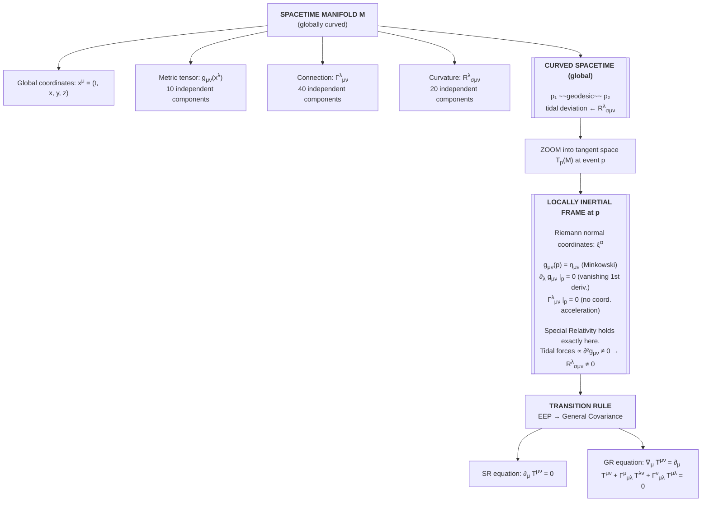
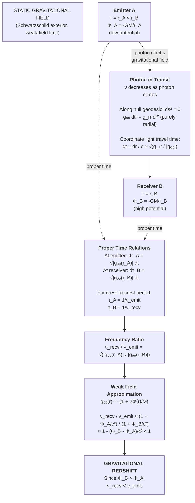

# Lesson 2: Equivalence Principle and Spacetime Structure

## 1. First-Principles Intuition & Invariants

### The Elevator and the Apple: A Thought Experiment Becomes a Foundation

There is a moment in the history of physics when a single thought experiment reorganized everything that came before it. Einstein, reflecting on what he would later call "the happiest thought of my life," imagined a person falling freely from the roof of a house. During that fall, the person feels nothing — no floor pressing against their feet, no weight pulling their body downward. Gravity, the dominant force of everyday experience, vanishes entirely from the perspective of the falling observer. This was not merely a curiosity. It was a physical invariant, and Einstein recognized it as the key that would unlock the geometry of spacetime.

The principle he extracted from this intuition is the **Equivalence Principle**, and it comes in three distinct formulations of increasing scope and power. Understanding the differences between these formulations is not an academic exercise. It determines how you design experiments, interpret measurements, and test the theoretical framework of General Relativity against observation.

---

### The Weak Equivalence Principle: Inertial Mass Equals Gravitational Mass

The most ancient form of the equivalence principle is the **Weak Equivalence Principle (WEP)**, which asserts that the trajectory of a freely falling test body in a gravitational field is independent of the body's internal composition and structure. This is equivalent to the statement that inertial mass and gravitational mass are identical.

Newton's second law defines inertial mass $m_i$ through resistance to acceleration:

$$\vec{F} = m_i \vec{a}$$

Newton's law of gravitation defines gravitational mass $m_g$ through the coupling to a gravitational field $\vec{g}$:

$$\vec{F}_{\text{grav}} = m_g \vec{g}$$

For a freely falling body, equating these gives:

$$\vec{a} = \frac{m_g}{m_i} \vec{g}$$

If $m_g / m_i$ were composition-dependent — if it varied between, say, a lead sphere and a wooden one — then different objects would fall at different rates, and that ratio would be measurable. Galileo's experiments at Pisa (apocryphal or not) showed no such variation. The modern benchmark is the **Eötvös parameter** $\eta$, which quantifies the fractional difference between gravitational and inertial mass for two materials $A$ and $B$:

$$\eta(A, B) = 2 \frac{\left| \frac{m_g}{m_i} \bigg|_A - \frac{m_g}{m_i} \bigg|_B \right|}{\frac{m_g}{m_i} \bigg|_A + \frac{m_g}{m_i} \bigg|_B}$$

Loránd Eötvös, working with torsion balance experiments in the early twentieth century, constrained $\eta$ to below $10^{-9}$. Modern experiments using lunar laser ranging, rotating torsion pendulums (the Eöt-Wash experiments at the University of Washington), and atom interferometry have pushed this bound to $|\eta| < 10^{-13}$. Any detection of a nonzero $\eta$ would immediately falsify the WEP and, by extension, any metric theory of gravity.

---

### The Einstein Equivalence Principle: Gravity Is Locally Erased

The **Einstein Equivalence Principle (EEP)** extends the WEP by incorporating all nongravitational physics, not merely mechanics. It states three things simultaneously: the WEP holds, the outcome of any local nongravitational experiment is independent of the velocity of the freely falling laboratory (Local Lorentz Invariance, LLI), and the outcome of any such experiment is independent of where and when in spacetime that laboratory is located (Local Position Invariance, LPI).

The EEP is what allows physics to be done at all in a curved spacetime. It guarantees that in a sufficiently small region around any spacetime event, the laws of special relativity hold exactly. No local experiment — no measurement of electric fields, no spectroscopic line ratio, no clock comparison — can distinguish between a laboratory at rest in a uniform gravitational field and a laboratory uniformly accelerating through flat spacetime in the absence of gravity.

This local erasure of gravity is not approximate in the EEP's statement; it is exact in the limit of a vanishingly small region. The corrections that enter at finite size are the **tidal forces**, which arise because a real gravitational field is not uniform over extended regions, and they are what allows, in principle, an observer inside the elevator to eventually detect that they are in a gravitational field rather than uniformly accelerating. The curvature of spacetime is precisely encoded in these tidal deviations, and they are the physical content of the Riemann tensor — which we address fully in Lesson 3.

---

### The Strong Equivalence Principle: Self-Gravity Included

The **Strong Equivalence Principle (SEP)** extends the EEP to cover bodies with significant self-gravitational energy — compact objects like neutron stars and black holes — and to gravitational experiments themselves. The SEP asserts that the WEP holds even for massive, gravitationally bound bodies, and that the outcomes of local experiments (including gravitational ones) are independent of velocity and position in spacetime.

The distinction matters enormously. General Relativity satisfies the SEP, but many alternative theories of gravity — scalar-tensor theories like Brans-Dicke gravity, for instance — violate it. In these theories, the effective gravitational constant $G$ depends on the local distribution of matter via a scalar field, so a body's gravitational binding energy contributes differently to its inertial and gravitational masses. This produces a phenomenon called the **Nordtvedt effect**: in an external gravitational field, the Moon and Earth (which have different fractional gravitational self-energies) would fall at slightly different rates toward the Sun. Lunar laser ranging measurements constrain the Nordtvedt parameter $\eta_N$ to $|\eta_N| < 4 \times 10^{-4}$, placing strong limits on scalar-tensor theories and confirming that GR's SEP is an excellent description of nature at solar-system scales.

---

### Locally Inertial Frames and the Geometric Language of Spacetime

The EEP provides the construction principle for locally inertial frames. At any event $p$ in spacetime, one can always find a coordinate system $\{\xi^\alpha\}$ such that the metric takes the Minkowski form at that point and all first derivatives of the metric vanish there:

$$g_{\mu\nu}(p) = \eta_{\mu\nu} = \text{diag}(-1, +1, +1, +1)$$

$$\left. \frac{\partial g_{\mu\nu}}{\partial x^\lambda} \right|_p = 0$$

This is a theorem of Riemannian (and pseudo-Riemannian) geometry. The construction is explicit: given any coordinate system around $p$, one performs a coordinate transformation to **Riemann normal coordinates**, which are defined by shooting out geodesics from $p$ in every direction and using the affine parameter along each geodesic as the coordinate. In these coordinates, the Christoffel symbols $\Gamma^\lambda_{\mu\nu}$ vanish at $p$ — meaning freely falling particles experience no coordinate acceleration at that point — but the second derivatives of the metric generally do not vanish. Those second derivatives are the components of the Riemann curvature tensor, and they represent the tidal forces that no coordinate transformation can eliminate.

The practical implication for laboratory physics is profound. Any equation of special relativity, written in tensor form, automatically generalizes to curved spacetime by replacing ordinary derivatives with covariant derivatives and $\eta_{\mu\nu}$ with $g_{\mu\nu}$. This is the **minimal coupling prescription**, sometimes called the **comma-goes-to-semicolon rule**. It is not a theorem but a heuristic that follows naturally from the EEP, and it is the working rule that generates the generally covariant form of Maxwell's equations, the energy-momentum conservation law, and the geodesic equation.

---

### The Metric Tensor as Gravitational Potential

The transition from Newtonian gravity to General Relativity involves replacing a single scalar gravitational potential $\Phi(\vec{x}, t)$ with a symmetric rank-2 tensor field: the **metric tensor** $g_{\mu\nu}(x^\lambda)$. This is not a superficial enlargement of notation. The metric tensor does everything the Newtonian potential does and far more: it encodes the geometry of spacetime, determines the behavior of clocks and rulers, dictates the paths of freely falling particles, and governs the propagation of electromagnetic and gravitational waves.

The spacetime interval between two infinitesimally separated events is:

$$ds^2 = g_{\mu\nu} \, dx^\mu \, dx^\nu$$

where $g_{\mu\nu}$ is symmetric ($g_{\mu\nu} = g_{\nu\mu}$), giving it ten independent components in four spacetime dimensions. The signature is $(-,+,+,+)$ in the convention used throughout this curriculum. When the metric reduces to $\eta_{\mu\nu}$, this interval reproduces the Minkowski geometry of special relativity. The ten components of $g_{\mu\nu}$ replace the single Newtonian potential $\Phi$, and the Einstein field equations — ten coupled nonlinear partial differential equations — determine how those components are sourced by matter and energy.

The connection to Newtonian gravity is recovered in the weak-field, slow-motion limit. Consider a metric that is a small perturbation away from flat spacetime: $g_{\mu\nu} = \eta_{\mu\nu} + h_{\mu\nu}$ with $|h_{\mu\nu}| \ll 1$. For a slowly moving test particle, the geodesic equation reduces to Newtonian form, and one finds the identification:

$$g_{00} \approx -\left(1 + \frac{2\Phi}{c^2}\right)$$

The $tt$-component of the metric plays the role of the Newtonian gravitational potential. In this sense, the entire tensor $g_{\mu\nu}$ is the relativistic gravitational potential, and gravity is not a force in curved spacetime — it is the geometry itself.

---

### Gravitational Time Dilation: Clocks in a Potential Well

One of the most direct and experimentally accessible consequences of the EEP is **gravitational time dilation**. Consider two observers at rest in a static gravitational field: observer $A$ at a lower gravitational potential $\Phi_A$ and observer $B$ at a higher potential $\Phi_B > \Phi_A$. The proper time $d\tau$ measured by a clock relates to the coordinate time $dt$ through the metric:

$$d\tau = \sqrt{-g_{00}} \, dt$$

Using the weak-field expression $g_{00} \approx -(1 + 2\Phi/c^2)$:

$$d\tau \approx \left(1 + \frac{\Phi}{c^2}\right) dt$$

The ratio of proper time rates at the two locations is therefore:

$$\frac{d\tau_B}{d\tau_A} = \frac{1 + \Phi_B / c^2}{1 + \Phi_A / c^2} \approx 1 + \frac{\Phi_B - \Phi_A}{c^2}$$

Since $\Phi_B > \Phi_A$ (clocks higher in a gravitational field sit at higher, less negative potential), we have $d\tau_B > d\tau_A$: clocks higher in a gravitational field run faster than clocks deeper in the potential well. This is not an artifact of the coordinate system. It is a physical, measurable, and technologically consequential effect. The GPS satellite network, whose clocks orbit at an altitude of approximately $20{,}200$ km, requires a gravitational time dilation correction of approximately $+45.9$ microseconds per day relative to ground-based clocks (partially offset by the $-7.2$ $\mu$s/day special-relativistic time dilation from orbital velocity), yielding a net relativistic correction of $+38.4$ $\mu$s/day. Without this correction, GPS position errors would accumulate at roughly 10 kilometers per day.

---

### Gravitational Redshift: The Pound-Rebka Experiment

The same metric-based time dilation that affects clocks also affects the frequency of photons propagating through a gravitational field. If a photon is emitted with frequency $\nu_{\text{emit}}$ at gravitational potential $\Phi_{\text{emit}}$ and received at potential $\Phi_{\text{recv}}$, the received frequency is:

$$\nu_{\text{recv}} = \nu_{\text{emit}} \sqrt{\frac{g_{00}(\text{emit})}{g_{00}(\text{recv})}} \approx \nu_{\text{emit}} \left(1 + \frac{\Phi_{\text{emit}} - \Phi_{\text{recv}}}{c^2}\right)$$

A photon climbing out of a gravitational potential well ($\Phi_{\text{recv}} > \Phi_{\text{emit}}$) loses energy and its frequency shifts toward the red. The fractional frequency shift is:

$$\frac{\Delta \nu}{\nu} = \frac{\nu_{\text{recv}} - \nu_{\text{emit}}}{\nu_{\text{emit}}} \approx \frac{\Phi_{\text{emit}} - \Phi_{\text{recv}}}{c^2} = -\frac{g \Delta h}{c^2}$$

for a uniform field with gravitational acceleration $g$ over a height difference $\Delta h$.

The direct laboratory confirmation of this prediction came with the **Pound-Rebka experiment** at Harvard University in 1959. Robert Pound and Glen Rebka used the Mössbauer effect — the recoil-free nuclear resonance absorption of gamma rays by ${}^{57}$Fe nuclei — to measure the gravitational redshift over a vertical path of only 22.5 meters in Jefferson Laboratory's tower. The predicted fractional frequency shift for this height is:

$$\frac{\Delta \nu}{\nu} = \frac{g \Delta h}{c^2} = \frac{(9.8 \, \text{m/s}^2)(22.5 \, \text{m})}{(3 \times 10^8 \, \text{m/s})^2} \approx 2.46 \times 10^{-15}$$

This number is extraordinarily small — a part in $10^{15}$ — yet Pound and Rebka measured it to within 10% using the Doppler compensation technique of moving the source at a known velocity to null the shift. The 1965 refinement by Pound and Snider achieved 1% accuracy. This experiment remains one of the clearest direct confirmations that the EEP is physically realized by nature, not merely a theoretical convenience.

---

## 2. Core Architecture & Mechanics

### The Geometry of Locally Inertial Coordinates

To build real facility with the equivalence principle, one must move from conceptual description to geometric construction. The following diagram represents the layered structure of spacetime geometry as seen from both a global perspective and from within a locally inertial frame.

This diagram captures the two-level architecture of GR. At the local level, the EEP guarantees flat Minkowski geometry and the full machinery of special relativity. At the global level, the metric varies from point to point, and that variation — encoded in the Christoffel connection $\Gamma^\lambda_{\mu\nu}$ and ultimately in the Riemann tensor — is the physical content of gravitation.

---

### The Geodesic Equation: Freely Falling Paths

A freely falling particle in curved spacetime follows a **geodesic**, the generalization of a straight line to curved geometry. The geodesic equation is derived by extremizing the proper time along the worldline:

$$\delta \int d\tau = 0 \implies \frac{d^2 x^\mu}{d\tau^2} + \Gamma^\mu_{\alpha\beta} \frac{dx^\alpha}{d\tau} \frac{dx^\beta}{d\tau} = 0$$

The Christoffel symbols $\Gamma^\mu_{\alpha\beta}$ are not tensor components — they transform inhomogeneously under coordinate changes — but they encode the gravitational field in any given coordinate system. They are computed directly from the metric and its first derivatives:

$$\Gamma^\mu_{\alpha\beta} = \frac{1}{2} g^{\mu\lambda} \left( \partial_\alpha g_{\beta\lambda} + \partial_\beta g_{\alpha\lambda} - \partial_\lambda g_{\alpha\beta} \right)$$

This expression makes the identification of $g_{\mu\nu}$ as the gravitational potential precise. Just as the Newtonian gravitational force is minus the gradient of the potential $\vec{F} = -\nabla\Phi$, the geodesic deviation from straight-line motion is determined by the derivatives of $g_{\mu\nu}$ through the Christoffel symbols. In the Newtonian limit, the $\Gamma^i_{00}$ component reduces exactly to $\partial^i \Phi / c^2$.

---

### Gravitational Redshift: Signal Path Through Curved Geometry

The following diagram traces how a photon emitted at a lower gravitational potential propagates to a receiver at higher potential, illustrating the redshift mechanism through the metric structure.

This signal-path analysis reveals that gravitational redshift is not an energy loss in the classical sense. The photon does not "slow down" or lose energy to some potential in a Newtonian way. Rather, the metric structure causes proper time intervals at different locations in a gravitational field to be related differently to coordinate time, and this differential time flow directly modulates the received frequency.

---

### Measuring Gravitational Redshift: The Pound-Rebka Protocol

Understanding the Pound-Rebka experiment at the procedural level illuminates both the ingenuity required to measure effects at the $10^{-15}$ level and the direct connection between metric theory and laboratory measurement.

The core challenge is that nuclear gamma-ray transitions are extraordinarily narrow — the natural linewidth of the $14.4$ keV transition in ${}^{57}$Fe is $\Gamma \approx 4.7 \times 10^{-9}$ eV, giving a quality factor $Q = E / \Gamma \approx 3 \times 10^{12}$ — which is what makes Mössbauer spectroscopy sensitive enough for this measurement, but also means that any recoil momentum transferred to the nucleus during emission or absorption would Doppler-shift the photon by far more than the gravitational shift. The Mössbauer effect eliminates nuclear recoil by embedding the nucleus in a crystal lattice, so the recoil momentum is taken up by the entire crystal rather than the single nucleus. The resulting zero-recoil fraction allows resonance absorption with linewidths set by the natural decay width, achieving the resolution necessary to see the gravitational shift.

The experimental protocol proceeds as follows. The ${}^{57}$Co source (which decays to an excited state of ${}^{57}$Fe, which then emits the 14.4 keV gamma ray) is mounted at the base of the 22.5 m tower, and an ${}^{57}$Fe absorber is mounted at the top. The source is driven sinusoidally by a loudspeaker to scan its Doppler velocity and thereby scan the emitted photon frequency. The resonance absorption dip in the gamma-ray transmission through the absorber is monitored as a function of Doppler velocity. The gravitational redshift manifests as a displacement of the absorption resonance center relative to the emission center. This offset velocity $v_{\text{offset}}$ is related to the gravitational shift by:

$$\frac{v_{\text{offset}}}{c} = \frac{\Delta \nu}{\nu} = \frac{g \Delta h}{c^2}$$

For the Jefferson Laboratory tower with $g = 9.80 \, \text{m s}^{-2}$ and $\Delta h = 22.5 \, \text{m}$, the predicted offset velocity is approximately $7.4 \times 10^{-7} \, \text{m s}^{-1}$ — less than a micrometer per second. Measuring this with a loudspeaker-driven mechanical oscillation system, with careful calibration of the velocity drive amplitude and phase, represents a remarkable experimental achievement and a direct clock-and-ruler confirmation of the spacetime metric.

---

### Tidal Forces and the Limits of Local Inertial Frames

The EEP guarantees that gravity can be locally erased, but it also makes precise what "locally" means. The departures from flat spacetime are second-order in the size $L$ of the region and the time interval $T$ over which the inertial frame is used. Specifically, the fractional deviation of the metric from $\eta_{\mu\nu}$ within a locally inertial frame grows as:

$$\delta g_{\mu\nu} \sim \frac{R \cdot L^2}{c^2}$$

where $R$ represents a characteristic component of the Riemann curvature tensor (with dimensions of inverse length squared). For Earth's gravitational field, the relevant curvature scale is set by:

$$R \sim \frac{GM_\oplus}{c^2 r_\oplus^3} \approx \frac{(6.67 \times 10^{-11})(5.97 \times 10^{24})}{(9 \times 10^{16})(6.37 \times 10^6)^3} \approx 1.7 \times 10^{-23} \, \text{m}^{-2}$$

A laboratory of size $L = 10 \, \text{m}$ over a time interval corresponding to a spatial extent $cT = 10 \, \text{m}$ experiences a tidal deviation $\delta g \sim 1.7 \times 10^{-21}$, which is far below any currently accessible measurement threshold. Near a stellar-mass black hole of $10 \, M_\odot$ at a distance of $100 \, \text{km}$, the same calculation gives $\delta g \sim 10^{-4}$ over a 10 m laboratory, a physically significant tidal force that an infalling observer could in principle detect. This is the precise quantitative meaning of the qualifier "local" in the EEP.

---

## 3. High-Performance Optimization & Failure Modes

### Precision Measurement of Equivalence Principle Violations

For researchers working in experimental gravity, the EEP is not a theorem to accept but a proposition to test at increasing precision. The state of the art has advanced through several generations of technology, and understanding the architecture of these experiments is essential for interpreting their results and designing the next generation.

**Torsion balance experiments** (the Eöt-Wash group) place two test masses of different compositions at the ends of a fiber-suspended pendulum and look for a torque that would signal composition-dependent gravitational coupling. The key experimental challenge is distinguishing a genuine WEP-violating signal from systematic effects: thermal gradients across the apparatus cause differential expansion; magnetic contamination of the test masses produces spurious torques from ambient fields; seismic noise couples to the pendulum through the support structure. Modern torsion balance experiments address these by operating in a thermal enclosure with active temperature stabilization to millikelvin precision, using non-magnetic test mass materials (beryllium and titanium are common), and conducting the experiment in a rotating platform configuration so that any WEP-violating signal appears at a known frequency (the rotation frequency), which can be separated from low-frequency seismic noise by narrow-band lock-in detection.

**Atom interferometry** provides a complementary approach. In a matter-wave gravimeter, cold atoms (typically ${}^{87}$Rb or ${}^{85}$Rb, though dual-species experiments comparing ${}^{87}$Rb to ${}^{39}$K are most sensitive for WEP tests) are launched vertically and their trajectories are split, redirected, and recombined by laser pulses in a $\pi/2$-$\pi$-$\pi/2$ Mach-Zehnder sequence. The phase accumulated between the two arms of the interferometer is proportional to $g \cdot T^2$, where $T$ is the time between laser pulses. By simultaneously operating two interferometers with different atomic species in the same launch tube, differential accelerations at the level of $\Delta g / g \sim 10^{-7}$ have been demonstrated, with proposals for reaching $10^{-13}$ in space-based configurations such as the STE-QUEST mission concept. The dominant systematic errors in dual-species atom interferometry are differential light shifts from the Raman laser beams, Coriolis effects from Earth's rotation (which cause a velocity-dependent phase for atoms launched with slightly different velocities), and gravity gradients that couple to the initial spatial separation of the two atomic clouds.

**Space missions** represent the third pillar. The MICROSCOPE mission (CNES, launched 2016) tested the WEP in Earth orbit by comparing the accelerations of concentric cylindrical test masses made of titanium and platinum-rhodium alloy. The drag-free spacecraft, whose attitude was controlled by micro-Newton cold-gas thrusters to null non-gravitational forces on the outer test mass, measured differential accelerations along the orbit with a sensitivity of $\sim 10^{-15} \, \text{m s}^{-2}$ per orbit, achieving a final WEP constraint of $|\eta| < 1.3 \times 10^{-14}$ — two orders of magnitude better than the best ground-based torsion balance results at the time of publication (2022, final results). The primary systematics were electrostatic patch effects between the test mass surfaces and the electrode housing, thermal gradients induced by orbital solar flux variation, and magnetic force from the interaction of test mass magnetic susceptibility with the geomagnetic field.

---

### Failure Modes of the Locally Inertial Frame Approximation

The locally inertial frame construction is exact as a mathematical statement about tangent spaces, but its application to real laboratories and experiments involves approximations that can fail in physically important regimes.

The first failure mode is **extended-body effects**. A real laboratory has finite size, and tidal forces across its extent produce differential accelerations that cannot be transformed away. For precision free-fall experiments, this manifests as a **gravity gradient noise floor**: seismic motion of nearby dense objects (buildings, geological structures, ocean waves) produces time-varying gravity gradients that couple directly to the test mass, indistinguishable from a true differential acceleration signal. For ground-based atom interferometers targeting $\Delta g / g \sim 10^{-13}$, the gravity gradient noise from local mass fluctuations becomes a fundamental limitation below roughly $1 \, \text{Hz}$. Active gravity gradient compensation, using an array of seismometers and dense actuator masses whose positions are servo-controlled to minimize the measured gradient, is an active area of experimental development.

The second failure mode involves the **limits of the EEP near quantum systems**. The EEP, as conventionally stated, applies to classical test bodies and to quantum systems in the semiclassical regime. For quantum systems in superpositions of distinct gravitational potential eigenstates — the scenario relevant to quantum gravity phenomenology — the applicability of the EEP is an open question. The COW experiment (Colella, Overhauser, Werner, 1975) demonstrated gravitational phase shifts in neutron interferometry, confirming that the Schrödinger equation in a gravitational field takes the form:

$$i\hbar \frac{\partial \psi}{\partial t} = \left( -\frac{\hbar^2}{2m}\nabla^2 + m\Phi(\vec{x}) \right) \psi$$

This equation satisfies the WEP in the sense that the same mass $m$ appears in both the kinetic term (inertial) and the potential term (gravitational). However, the quantum-mechanical phase accumulated along different paths depends on the mass $m$, which means that for systems in gravitational superposition, the notion of "following a geodesic" requires careful reinterpretation. This is not a falsification of GR but a regime where the standard formulation must be generalized.

The third failure mode is conceptually the most important: **the EEP does not hold for the gravitational field itself**. One cannot construct a locally inertial frame in which the gravitational radiation field or the Christoffel symbols vanish globally — only locally at a point. For problems involving gravitational wave detection (LIGO, Virgo, LISA), the signal is precisely the tidal deviation from flatness — the nonzero $R^{\lambda}{}_{\sigma\mu\nu}$ — and the locally inertial frame is not a useful computational tool. The correct framework is the geodesic deviation equation:

$$\frac{D^2 \xi^\mu}{d\tau^2} = -R^\mu{}_{\nu\alpha\beta} u^\nu \xi^\alpha u^\beta$$

where $\xi^\mu$ is the separation vector between two neighboring geodesics and $u^\nu = dx^\nu / d\tau$ is the four-velocity of a reference geodesic. This equation describes how gravitational waves stretch and squeeze the separation between free test masses — the physical observable that LIGO measures — and it requires the full Riemann tensor, which cannot be eliminated by any choice of local frame.

---

### Practical Computation: Metric Perturbations and Gravitational Redshift in Schwarzschild Geometry

For researchers computing observational predictions, the bridge between the abstract metric and measurable quantities runs through explicit metric components. Consider the Schwarzschild metric, which describes the spacetime exterior to any spherically symmetric mass $M$:

$$ds^2 = -\left(1 - \frac{r_s}{r}\right)c^2 \, dt^2 + \left(1 - \frac{r_s}{r}\right)^{-1} dr^2 + r^2 \, d\Omega^2$$

where $r_s = 2GM/c^2$ is the Schwarzschild radius and $d\Omega^2 = d\theta^2 + \sin^2\theta \, d\phi^2$. The gravitational redshift for a photon emitted at radius $r_A$ and received at radius $r_B > r_A$ follows directly from the $g_{00}$ components:

$$\frac{\nu_{\text{recv}}}{\nu_{\text{emit}}} = \sqrt{\frac{g_{00}(r_A)}{g_{00}(r_B)}} = \sqrt{\frac{1 - r_s / r_A}{1 - r_s / r_B}}$$

As $r_A \to r_s$, the emitted frequency is redshifted to zero from the perspective of a distant observer — this is the photon sphere and the approach to the Schwarzschild horizon, where the gravitational time dilation becomes infinite. For a solar observation ($r_s = 2.95 \, \text{km}$, $r_\odot = 6.96 \times 10^5 \, \text{km}$, $r_B \to \infty$):

$$\frac{\nu_{\text{recv}}}{\nu_{\text{emit}}} = \sqrt{1 - \frac{r_s}{r_\odot}} \approx 1 - \frac{r_s}{2 r_\odot} = 1 - 2.12 \times 10^{-6}$$

This gives a solar gravitational redshift of $z = \Delta\lambda / \lambda \approx 2.12 \times 10^{-6}$, or about $0.636 \, \text{km s}^{-1}$ in velocity units. The measured solar redshift in the photospheric spectral lines (accounting for convective Doppler shifts and pressure broadening) is consistent with this prediction and was confirmed at the 2% level by the 1962 Harvard solar spectrum measurements, and more recently at the 0.02% level using solar oscillation modes.

For white dwarf stars, with masses comparable to the Sun but radii of order $10^{-2} \, R_\odot$, the gravitational redshift is $\sim 10^{-4}$ to $\sim 10^{-3}$, corresponding to 30–300 km/s in velocity equivalent — large enough to measure directly in stellar spectra and to compare with independent mass-radius constraints from asteroseismology and gravitational microlensing. The Sirius B measurement, which yielded a gravitational redshift consistent with its mass-radius ratio, was an important early confirmation of GR in the strong-field regime.

---

### Connecting to the Einstein Field Equations

The metric tensor's role as gravitational potential reaches its full expression in the **Einstein field equations**, which will be derived in detail in Lesson 4. Here it is sufficient to state them and understand how they close the system:

$$G_{\mu\nu} \equiv R_{\mu\nu} - \frac{1}{2} g_{\mu\nu} R = \frac{8\pi G}{c^4} T_{\mu\nu}$$

The left-hand side is the Einstein tensor, constructed from the Ricci tensor $R_{\mu\nu}$ (a contraction of the Riemann curvature tensor) and the Ricci scalar $R = g^{\mu\nu} R_{\mu\nu}$. The right-hand side is the stress-energy-momentum tensor $T_{\mu\nu}$, which encodes the density and flux of energy, momentum, and stress in matter and radiation. These ten equations — for the ten independent components of $g_{\mu\nu}$ — are the relativistic generalization of Poisson's equation $\nabla^2 \Phi = 4\pi G \rho$. Where Poisson's equation has the scalar Laplacian of the scalar potential sourced by the scalar mass density, Einstein's equations have the covariant divergence-free curvature of the metric tensor sourced by the full energy-momentum content of spacetime.

The structure of the EEP, the locally inertial frame, gravitational time dilation, the metric as gravitational potential — all of these are ingredients that make the Einstein field equations physically interpretable. Without the EEP, we could not say what the metric measures. Without gravitational time dilation, we could not connect the $g_{00}$ component to observable clock rates. Without the geodesic equation, we could not predict the motion of test particles. The lesson of this chapter is precisely that these are not separate topics bolted together but a single coherent framework, in which the equivalence principle is the founding operational definition and the metric tensor is its mathematical realization. The curvature encoded in $g_{\mu\nu}$ and its derivatives is gravity, and in the next lesson we will develop the full tensorial language needed to characterize that curvature precisely.
