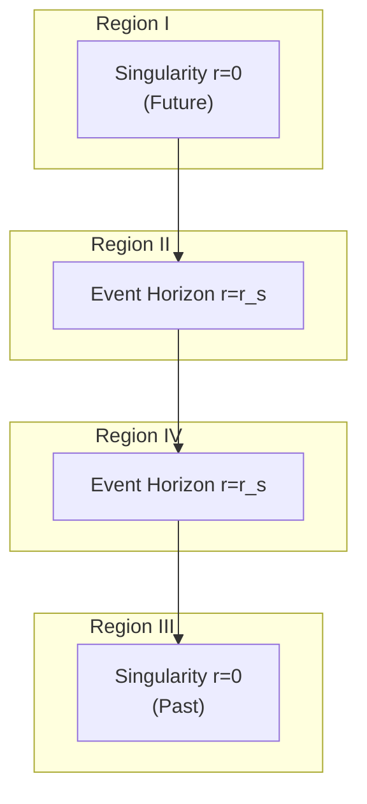
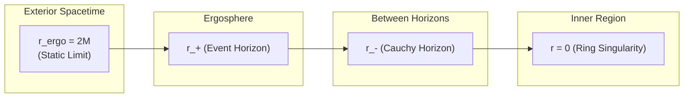

# Lesson 4: Schwarzschild and Kerr Solutions

## 1. First-Principles Intuition & Invariants

The Einstein field equations, $G_{\mu\nu} = \frac{8\pi G}{c^4}T_{\mu\nu}$, relate the geometry of spacetime to the distribution of matter and energy within it. When we seek solutions in vacuum — regions devoid of matter and non-gravitational fields — the stress-energy tensor $T_{\mu\nu}$ vanishes, and we are left with $G_{\mu\nu} = 0$, or equivalently $R_{\mu\nu} = 0$ (the Ricci tensor vanishes). This deceptively simple statement comprises ten nonlinear coupled partial differential equations for the metric components $g_{\mu\nu}$, and exact solutions exist only under strong symmetry assumptions. The two most physically consequential of these exact solutions — Schwarzschild's for non-rotating masses and Kerr's for rotating masses — describe every astrophysical black hole in the observable universe and every exterior vacuum spacetime around a compact body that is either static or stationary-axisymmetric.

The physical intuition is this: a spherically symmetric mass distribution curves the spacetime around it, and that curvature persists into the vacuum exterior because spacetime curvature is self-referential — the metric tells the metric how to curve. Karl Schwarzschild found this solution in 1916, mere weeks after Einstein published the field equations, by imposing spherical symmetry on the vacuum equations and integrating. He assumed the mass was a point at the origin, sought a static, spherically symmetric metric of the form $ds^2 = -A(r)\,c^2\,dt^2 + B(r)\,dr^2 + r^2\,d\Omega^2$, where $d\Omega^2 = d\theta^2 + \sin^2\theta\,d\phi^2$ is the unit sphere metric, and demanded that the solution reduce to the Newtonian weak-field limit $g_{tt} \approx -(1 - 2GM/c^2r)$ at large $r$. The result is the Schwarzschild metric:

$$ds^2 = -\left(1 - \frac{r_s}{r}\right)c^2\,dt^2 + \left(1 - \frac{r_s}{r}\right)^{-1}dr^2 + r^2\left(d\theta^2 + \sin^2\theta\,d\phi^2\right)$$

where $r_s = 2GM/c^2$ is the Schwarzschild radius, $M$ is the total mass-energy of the source (measured asymptotically via Keplerian orbits), and the coordinates $(t, r, \theta, \phi)$ are Schwarzschild coordinates. This metric is static ($\partial/\partial t$ is a timelike Killing vector outside $r = r_s$) and spherically symmetric (the metric components depend only on $r$), encoding the gravitational field of a point mass — or, more precisely, of any spherically symmetric mass distribution whose exterior vacuum is being described.

The most remarkable property of the Schwarzschild solution is encoded in Birkhoff's theorem: *any* spherically symmetric solution of the vacuum Einstein equations is static and asymptotically flat, and is the Schwarzschild metric up to a mass parameter. The physical consequence is profound. If a spherically symmetric star pulsates, collapses, or explodes — as long as it maintains exact spherical symmetry — the exterior spacetime does not change at all. No gravitational waves are emitted. The exterior "knows" only the total mass. This is the relativistic generalization of Newton's shell theorem, and it explains why we can use the Schwarzschild metric to describe the vacuum outside any non-rotating star, not just point masses.

At $r = r_s$, the metric components $g_{tt} = 0$ and $g_{rr} \to \infty$, suggesting a pathology. The question of whether this is a true singularity or merely a coordinate artifact was resolved by computing curvature invariants — quantities built from the Riemann tensor that are independent of coordinate choice. The Kretschner scalar is the most commonly used:

$$\mathcal{K} = R_{\alpha\beta\gamma\delta}\,R^{\alpha\beta\gamma\delta} = \frac{48\,G^2 M^2}{c^4\,r^6} = \frac{12\,r_s^2}{r^6}$$

This quantity is finite at $r = r_s$ (it evaluates to $12/r_s^4$) and diverges only as $r \to 0$. The event horizon at $r = r_s$ is thus a coordinate singularity — an artifact of the Schwarzschild coordinate system, not a physical pathology. An infalling observer crosses $r = r_s$ smoothly in finite proper time, though from the perspective of a distant stationary observer, the infall appears to slow asymptotically due to infinite gravitational redshift. The true physical singularity lies at $r = 0$, where curvature diverges and geodesics terminate: no extension of the manifold beyond this point is possible within classical general relativity.

Roy Kerr's 1963 discovery of the exact solution for a rotating mass was, in the words of Subrahmanyan Chandrasekhar, "the most remarkable discovery in the history of physics." Real astrophysical bodies rotate, and rotation breaks spherical symmetry in favor of axisymmetry — the spacetime is invariant under rotations about a single axis rather than all axes through the origin. The Kerr metric, written in Boyer-Lindquist coordinates $(t, r, \theta, \phi)$, depends on two parameters: the mass $M$ and the specific angular momentum $a = J/(Mc)$, where $J$ is the total angular momentum. The dimensionless spin parameter $\chi = a/M = cJ/(GM^2)$ ranges from $0$ (Schwarzschild, no rotation) to $1$ (maximally rotating). The metric is:

$$ds^2 = -\left(1 - \frac{2GMr}{c^2\Sigma}\right)c^2\,dt^2 - \frac{4GMar\sin^2\theta}{c\,\Sigma}\,c\,dt\,d\phi + \frac{\Sigma}{\Delta}\,dr^2 + \Sigma\,d\theta^2 + \frac{(r^2 + a^2)^2 - \Delta\,a^2\sin^2\theta}{\Sigma}\sin^2\theta\,d\phi^2$$

where $\Sigma = r^2 + a^2\cos^2\theta$ and $\Delta = r^2 - \frac{2GM}{c^2}r + a^2 = r^2 - r_s\,r + a^2$. The cross-term $g_{t\phi}\,dt\,d\phi$ is the mathematical signature of rotation: it couples time and azimuthal angle, meaning that the spacetime itself is "dragged" around the rotating mass. No coordinate system can eliminate this term globally, and it gives rise to the phenomenon of frame dragging — the most distinctive physical effect of the Kerr solution. The Kretschner scalar for Kerr,

$$\mathcal{K} = \frac{48\,G^2 M^2}{c^4} \cdot \frac{r^2\cos^2\theta - a^2\cos^4\theta \cdot (3r^2 - a^2\cos^2\theta)}{(r^2 + a^2\cos^2\theta)^6} \cdot \left[\text{(higher-order terms)}\right]$$

diverges not at a point but along a ring: $r = 0$, $\theta = \pi/2$. The Kerr singularity is a ring singularity, and passing through the center of the ring leads to regions of spacetime that are causally disconnected from our own — the maximal analytic extension of the Kerr solution contains an infinite ladder of universes connected through the ring. Whether these regions are physically relevant is doubtful, since the inner structure of the Kerr solution is unstable to perturbations (the Cauchy horizon instability), but the ring singularity itself is a genuine curvature divergence, confirmed by the invariant.

The fundamental invariants of both solutions can be summarized compactly. For Schwarzschild, the only independent curvature invariant is the one above; all contractions of the Ricci tensor vanish identically in vacuum. For Kerr, the same holds — $R_{\mu\nu} = 0$ everywhere in the vacuum region — but the richer topology introduces additional structure: two horizons (where $\Delta = 0$), an ergosphere (where $g_{tt} = 0$), and a ring singularity. These structures define the causal and energetic architecture of rotating black holes, and each has direct observational consequences that we now have the instruments to measure.

## 2. Core Architecture & Mechanics

### The Schwarzschild Geodesic Structure

The motion of test particles and light rays in the Schwarzschild geometry is governed by the geodesic equation, $\frac{d^2x^\mu}{d\tau^2} + \Gamma^\mu_{\alpha\beta}\frac{dx^\alpha}{d\tau}\frac{dx^\beta}{d\tau} = 0$, where $\tau$ is an affine parameter (proper time for massive particles). Because the Schwarzschild metric possesses four Killing vectors — $\partial/\partial t$ (time translation), $\partial/\partial\phi$ (azimuthal rotation), and two related to the $\theta$-direction — every geodesic conserves a specific energy $E$ and angular momentum $L$. Restricting to the equatorial plane ($\theta = \pi/2$, which is always possible by spherical symmetry), the radial equation of motion reduces to a one-dimensional problem with an effective potential:

$$\left(\frac{dr}{d\tau}\right)^2 = E^2 - V_{\text{eff}}(r), \quad V_{\text{eff}}(r) = \left(1 - \frac{r_s}{r}\right)\left(c^2 + \frac{L^2}{r^2}\right)$$

Here $E$ is the conserved energy per unit rest mass (related to the Killing vector $\partial_t$ by $E = -g_{t\mu}u^\mu$) and $L$ is the conserved angular momentum per unit rest mass (from $\partial_\phi$). The effective potential encodes the competition between gravitational attraction ($-r_s/r$ term) and the centrifugal barrier ($L^2/r^2$). For sufficiently high angular momentum, a local minimum of $V_{\text{eff}}$ exists, permitting stable circular orbits. As $L$ decreases, the minimum and maximum merge at an inflection point — the innermost stable circular orbit (ISCO), located at:

$$r_{\text{ISCO}} = 3\,r_s = \frac{6GM}{c^2}$$

Below this radius, no stable circular orbits exist. A particle orbiting at the ISCO is marginally bound: the binding energy per unit mass is $E_{\text{ISCO}} = \sqrt{8/9} \approx 0.943c^2$, meaning roughly $5.7\%$ of the rest mass energy is liberated as the particle spirals inward from infinity to the ISCO through an accretion disk. This is the fundamental energy source for X-ray binaries and active galactic nuclei: matter accreting onto a Schwarzschild black hole converts approximately $5.7\%$ of its rest mass into radiation. For a maximally spinning Kerr black hole, the ISCO moves inward to $r = GM/c^2$ (the horizon itself), and the binding energy increases to approximately $42.3\%$ — a sevenfold improvement that explains why spinning black holes power the most luminous quasars.

The photon sphere, where light can orbit in unstable circular trajectories, sits at $r = \frac{3}{2}r_s = \frac{3GM}{c^2}$. This is the radius at which the effective potential for null geodesics ($L \neq 0$, $E$ arbitrary, and the $c^2$ term in the massive potential is absent) has an inflection point. Light rays passing close to this radius are strongly deflected, and the apparent "shadow" of the black hole — the region from which no photons reach a distant observer — has an angular diameter determined by the photon ring. The shadow radius as seen by a distant observer is not $3M$ but rather $3\sqrt{3}\,GM/c^2 \approx 5.196\,GM/c^2$, because photons arriving at the observer from slightly larger radii are gravitationally lensed into a bright ring surrounding the dark central shadow.

The perihelion precession of bound orbits provides one of the classic tests of general relativity. For an orbit with semi-major axis $a$ and eccentricity $e$, the relativistic correction to Newtonian Keplerian motion causes the perihelion to advance by:

$$\Delta\phi = \frac{6\pi GM}{c^2\,a(1-e^2)}$$

per orbit. For Mercury ($a = 5.79 \times 10^{10}$ m, $e = 0.206$), this gives $5.02 \times 10^{-7}$ radians per orbit, which accumulates to $43$ arcseconds per century — exactly the anomalous precession that Urbain Le Verrier had identified in 1859 and that Einstein's theory explained in 1915. Modern measurements of Mercury's orbit from the MESSENGER spacecraft confirm this prediction to a precision better than $10^{-4}$. The Shapiro time delay, $\Delta t = \frac{2GM}{c^3}\ln\left(\frac{4r_1 r_2}{b^2}\right)$ for a signal passing a mass $M$ with impact parameter $b$ between emitter at $r_1$ and receiver at $r_2$, has been measured via spacecraft ranging to agree with general relativity at the $10^{-5}$ level (Cassini experiment, 2003).

### Kruskal-Szekeres Coordinates and Causal Structure

The coordinate singularity at $r = r_s$ in Schwarzschild coordinates obscures the true causal structure. Martin Kruskal and George Szekeres independently discovered a coordinate transformation that removes the singularity entirely, revealing the maximal analytic extension of the Schwarzschild geometry. The Kruskal-Szekeres coordinates $(u, v)$ are defined by:

$$u = \sqrt{\frac{r}{r_s} - 1}\;e^{r/(2r_s)}\cosh\left(\frac{c\,t}{2r_s}\right), \quad v = \sqrt{\frac{r}{r_s} - 1}\;e^{r/(2r_s)}\sinh\left(\frac{c\,t}{2r_s}\right)$$

for $r > r_s$ (with trigonometric functions replacing hyperbolic ones for $r < r_s$). In these coordinates, radial light cones are the same as in flat space — $v = \pm u + \text{const}$ — and the metric is regular everywhere except $r = 0$. The resulting Penrose diagram reveals four regions:



Region I is our exterior universe. Region II is the black hole interior — once entered, all future-directed timelike and null paths lead to the singularity at $r = 0$. Region III is a white hole, the time-reverse of a black hole, from which particles can only emerge. Region IV is a second, causally disconnected asymptotically flat universe. The Kruskal extension is mathematically complete but astrophysically irrelevant: real black holes form from gravitational collapse, which truncates the diagram at the surface of the collapsing star, removing Regions III and IV entirely. The maximally extended Schwarzschild solution is a mathematical object; the physical black hole formed by stellar collapse is described by only a portion of it.

### The Kerr Metric: Horizons, Ergosphere, and Frame Dragging

The Kerr solution's complexity emerges from its richer causal structure. The horizons occur where $\Delta = 0$, giving two roots:

$$r_\pm = \frac{GM}{c^2} \pm \sqrt{\left(\frac{GM}{c^2}\right)^2 - a^2}$$

The outer horizon $r_+$ is the event horizon — the boundary of the region from which nothing can escape. The inner horizon $r_-$ is the Cauchy horizon, a surface of infinite blueshift that is generally unstable to perturbations (the mass inflation instability discovered by Israel and Poisson). For $a \to 0$, $r_+ \to r_s$ and $r_- \to 0$, recovering the Schwarzschild result. For $a = GM/c^2$ (maximal spin), $r_+ = r_- = GM/c^2$ — the horizons coincide.

The ergosphere is the region between the outer horizon $r_+$ and the static limit, the surface where $g_{tt} = 0$:

$$r_{\text{ergo}}(\theta) = \frac{GM}{c^2} + \sqrt{\left(\frac{GM}{c^2}\right)^2 - a^2\cos^2\theta}$$

At the poles ($\theta = 0, \pi$), the ergosphere coincides with the horizon: $r_{\text{ergo}} = r_+$. At the equator ($\theta = \pi/2$), it extends furthest: $r_{\text{ergo}} = 2GM/c^2 = r_s$. The ergosphere's defining property is that the Killing vector $\partial/\partial t$ becomes spacelike inside it — there is no stationary observer. Every observer within the ergosphere is forced to corotate with the black hole, dragged by frame dragging at an angular velocity:

$$\omega(r, \theta) = -\frac{g_{t\phi}}{g_{\phi\phi}} = \frac{2GMar}{c\,\Sigma\,(r^2 + a^2)^2 - \Delta\,a^2\sin^2\theta}$$

This is the Lense-Thirring precession rate, and it has been directly measured. The Gravity Probe B satellite, launched in 2004, carried four cryogenic gyroscopes in polar orbit around Earth. After 17 months of data collection and years of analysis, the frame-dragging effect was confirmed to a precision of approximately $19\%$ (the reported measurement was $0.0372 \pm 0.0072$ arcseconds per year, compared to the GR prediction of $0.0392$ arcseconds per year). The LAGEOS and LAGEOS II satellite laser ranging experiments, using the measured nodal precession of two laser-reflector satellites, achieved a $10\%$ confirmation of the Lense-Thirring effect in 2004, later improved to $5\%$.

The cross-sectional structure of the Kerr black hole in the equatorial plane illustrates the layered architecture:



Inside the ergosphere, particles can still escape to infinity (unlike inside the event horizon), but they cannot remain stationary. This is the key enabler of the Penrose process.

### The Penrose Process and Energy Extraction

Roger Penrose's 1969 insight was that the ergosphere permits energy extraction from a rotating black hole's rotational energy. The mechanism exploits a crucial property of the Kerr spacetime: inside the ergosphere, the conserved energy $E = -p_t$ (associated with the time-translation Killing vector) can be *negative* for certain particle trajectories, because $\partial_t$ is spacelike in that region. The Penrose process works as follows. A particle enters the ergosphere with positive energy $E_0$ and decays into two fragments. One fragment is directed on a trajectory with negative energy $E_2 < 0$, causing it to fall into the black hole. The other fragment escapes with energy $E_1 = E_0 - E_2 > E_0$ — more energy than the original particle carried in. The excess energy comes from the black hole's rotational energy: the negative-energy fragment reduces the black hole's mass and angular momentum, and the second law of black hole thermodynamics (the area theorem) constrains the process.

The maximum energy extractable from a Kerr black hole is governed by the Christodoulou mass formula, which relates the total mass to the irreducible mass $M_{\text{irr}}$ (proportional to the square root of the horizon area) and the angular momentum:

$$M^2 = M_{\text{irr}}^2 + \frac{J^2}{4\,M_{\text{irr}}^2\,c^2}$$

For a maximally spinning black hole ($J = GM^2/c$), the irreducible mass is $M_{\text{irr}} = M/\sqrt{2}$, meaning up to $1 - 1/\sqrt{2} \approx 29.3\%$ of the total mass-energy is extractable rotational energy. This is an enormous reservoir: a $10^9\,M_\odot$ maximally spinning black hole stores extractable energy equivalent to roughly $6 \times 10^{55}$ joules in its spin. The simple Penrose process, involving a single fragmentation event, achieves an efficiency of approximately $20.7\%$ in the optimal case. The Blandford-Znajek process, which extracts rotational energy electromagnetically through a magnetosphere threaded by magnetic field lines, can sustain continuous extraction at efficiencies of several percent — sufficient to power relativistic jets in active galactic nuclei.

### Observational Anchors: EHT, LIGO, and Black Hole Shadows

The Event Horizon Telescope (EHT), a very-long-baseline interferometric array operating at 1.3 mm wavelength, produced the first image of a black hole shadow in 2019. The target was M87* — the supermassive black hole at the center of the galaxy M87 — with mass $M \approx 6.5 \times 10^9\,M_\odot$ and distance $D \approx 16.8$ Mpc. The predicted angular diameter of the shadow is:

$$\theta_{\text{shadow}} = \frac{2 \times 3\sqrt{3}\,GM}{c^2\,D} \approx 39.6\;\mu\text{as}$$

The EHT measured a ring diameter of $42 \pm 3\;\mu$as, consistent with the Kerr prediction. The shadow size depends weakly on spin (the coefficient $3\sqrt{3}$ varies by only a few percent between Schwarzschild and maximal Kerr for face-on viewing), but the *shape* of the shadow is spin-dependent: a rapidly rotating black hole viewed at an inclination produces an asymmetric shadow, displaced and distorted by frame dragging. The 2022 image of Sgr A* (the $4.3 \times 10^6\,M_\odot$ black hole at the Galactic Center, $D \approx 8.3$ kpc) has a predicted shadow diameter of approximately $52\;\mu$as, and the measured value of $48 \pm 7\;\mu$as again agrees with the Kerr metric.

The LIGO and Virgo gravitational wave detectors provide a fundamentally different test: they measure the quasi-normal mode (QNM) ringdown frequencies of the final black hole formed in a binary merger. The fundamental QNM frequency for a Schwarzschild black hole is:

$$\omega_{\text{QNM}} \approx 0.37\,\frac{c^3}{GM}$$

For the final black hole in GW150914 ($M_f \approx 62\,M_\odot$, $\chi_f \approx 0.67$), the Kerr QNM frequency increases due to spin, yielding $f_{\text{QNM}} \approx 251$ Hz — matching the observed ringdown frequency of $250 \pm 5$ Hz. The orbital frequency at the ISCO sets the merger frequency:

$$f_{\text{ISCO}} = \frac{1}{2\pi}\,\Omega_{\text{ISCO}} = \frac{c^3}{6^{3/2} \cdot 2\pi\,GM}$$

For a total binary mass of $65\,M_\odot$, this gives $f_{\text{ISCO}} \approx 204$ Hz (orbital), or approximately $408$ Hz for the dominant gravitational wave harmonic — consistent with the observed merger frequency. The ISCO frequency for a maximally spinning Kerr black hole is higher by a factor of $6^{3/2} \approx 14.7$ compared to Schwarzschild for the same mass, which is why spinning black hole mergers produce higher-frequency gravitational wave signals.

### Practical ISCO Computation for Kerr

The ISCO radius for a Kerr black hole depends on both the spin magnitude and the orbital orientation (prograde or retrograde). The general formula, derived by Bardeen, Press, and Teukolsky (1972), is:

$$r_{\text{ISCO}} = \frac{GM}{c^2}\left[3 + Z_2 \mp \sqrt{(3-Z_1)(3+Z_1+2Z_2)}\right]$$

where the upper sign ($-$) gives the prograde orbit and the lower sign ($+$) the retrograde orbit, and:

$$Z_1 = 1 + \left(1 - \chi^2\right)^{1/3}\left[\left(1+\chi\right)^{1/3} + \left(1-\chi\right)^{1/3}\right]$$
$$Z_2 = \sqrt{3\chi^2 + Z_1^2}$$

with $\chi = ac/(GM)$ the dimensionless spin. The following Python function implements this calculation and can be used directly in data analysis pipelines for X-ray spectroscopy (where the ISCO radius sets the inner edge of the accretion disk and thus the temperature profile of the thermal continuum):

```python
import numpy as np

def kerr_isco(chi, M_solar=1.0, prograde=True):
    """
    Compute the ISCO radius for a Kerr black hole.

    Parameters
    ----------
    chi : float
        Dimensionless spin parameter, 0 <= chi <= 1.
    M_solar : float
        Black hole mass in solar masses.
    prograde : bool
        True for prograde orbits, False for retrograde.

    Returns
    -------
    r_isco_meters : float
        ISCO radius in meters.
    r_isco_rg : float
        ISCO radius in units of GM/c^2 (gravitational radii).
    """
    G = 6.674e-11       # m^3 kg^-1 s^-2
    c = 2.998e8         # m/s
    M_sun = 1.989e30    # kg
    M = M_solar * M_sun

    Z1 = 1 + (1 - chi**2)**(1/3) * ((1 + chi)**(1/3) + (1 - chi)**(1/3))
    Z2 = np.sqrt(3 * chi**2 + Z1**2)

    sign = -1.0 if prograde else 1.0
    r_isco_rg = 3 + Z2 + sign * np.sqrt((3 - Z1) * (3 + Z1 + 2 * Z2))

    rg = G * M / c**2   # gravitational radius in meters
    return r_isco_rg * rg, r_isco_rg
```

For $\chi = 0$ (Schwarzschild), this returns $r_{\text{ISCO}} = 6\,GM/c^2$. For $\chi = 1$ prograde, it returns $r_{\text{ISCO}} = GM/c^2$ (at the horizon). For $\chi = 1$ retrograde, it returns $r_{\text{ISCO}} = 9\,GM/c^2$. The factor of $9$ between prograde and retrograde ISCO for maximal spin is directly observable: the thermal continuum spectrum of an accretion disk around a maximally spinning black hole in a retrograde system extends to much lower temperatures than in a prograde system, because the inner disk edge is farther from the central engine.

### Geodesic Integration: The Hamiltonian Approach

For ray tracing through the Kerr geometry — essential for modeling black hole shadows, accretion disk spectra, and gravitational lensing — the most robust numerical approach is the Hamiltonian formulation. The geodesic Hamiltonian is:

$$H(x^\mu, p_\mu) = \frac{1}{2}\,g^{\mu\nu}(x)\,p_\mu\,p_\nu$$

with Hamilton's equations:

$$\frac{dx^\mu}{d\lambda} = \frac{\partial H}{\partial p_\mu} = g^{\mu\nu}\,p_\nu, \quad \frac{dp_\mu}{d\lambda} = -\frac{\partial H}{\partial x^\mu} = -\frac{1}{2}\frac{\partial g^{\alpha\beta}}{\partial x^\mu}\,p_\alpha\,p_\beta$$

This system of eight first-order ODEs can be integrated with standard numerical methods. A fourth-order Runge-Kutta integrator with adaptive step size provides sufficient accuracy for most applications. The key practical concern is the conservation of the Hamiltonian constraint $H = 0$ (for null geodesics) or $H = -c^2/2$ (for timelike geodesics). A symplectic integrator (such as a leapfrog or Yoshida scheme) preserves this constraint exactly, but at the cost of higher computational overhead. For production ray-tracing codes used by the EHT collaboration (e.g., `ipole`, `grtrans`, `RAPTOR`), adaptive Runge-Kutta with a tolerance of $10^{-10}$ on the Hamiltonian constraint is standard.

For the Kerr metric specifically, the existence of a fourth constant of motion — the Carter constant $Q$, associated with a Killing tensor — means the equations of motion are fully integrable. The Carter constant permits separation of the Hamilton-Jacobi equation, reducing the problem to four independent quadratures. This is why analytic expressions for photon trajectories (the "critical geodesics" that define the shadow boundary) exist for Kerr but would not for a generic non-Kerr spacetime. Ray-tracing codes exploit this separability for speed: rather than integrating eight coupled ODEs, they integrate four decoupled ones, each in a single coordinate.

## 3. High-Performance Optimization & Failure Modes

### Coordinate Choices and Their Pathologies

The choice of coordinate system is the single most consequential decision in computational general relativity, and it determines which failure modes a practitioner will encounter. Schwarzschild coordinates $(t, r, \theta, \phi)$ are intuitive and reduce to spherical coordinates in the weak-field limit, but they are pathological at the horizon: $g_{rr} \to \infty$ and $g_{tt} \to 0$ at $r = r_s$, which causes numerical geodesic integrators to fail. An infalling particle appears to "freeze" at the horizon, with $dt/dr \to \infty$. For any computation involving horizon crossing — such as modeling the final plunge of accretion matter or simulating gravitational wave emission during merger — Schwarzschild coordinates are unsuitable.

Kerr-Schild coordinates avoid this problem. The transformation $d\tau = dt + \frac{2GM}{c^2(r - r_s)}dr$ (for Schwarzschild; the Kerr generalization is analogous) yields a coordinate system in which the metric is regular at the horizon and the coordinate time $\tau$ matches proper time for radially infalling observers. Kerr-Schild coordinates also decompose the metric as $g_{\mu\nu} = \eta_{\mu\nu} + H\,l_\mu\,l_\nu$, where $\eta_{\mu\nu}$ is the Minkowski metric, $H$ is a scalar function, and $l_\mu$ is a null vector. This form is computationally convenient because it separates the "background" flat spacetime from the "perturbation" $H\,l_\mu\,l_\nu$, and it is the standard choice for numerical relativity codes that model black hole formation and merger.

For ray-tracing applications, the regularity of the coordinate system at the horizon is less critical than the behavior of the metric at large $r$, where most photons travel. Boyer-Lindquist coordinates are adequate for distant observers but introduce a coordinate singularity at $\Delta = 0$ (the horizons) that must be handled by switching to Kerr-Schild or Doran coordinates in that region. Production codes typically implement a hybrid scheme: Boyer-Lindquist coordinates in the far field, smoothly interpolated to Kerr-Schild coordinates near the horizons.

### Numerical Geodesic Integration: Practical Recipes

The following Python implementation integrates geodesics in the Schwarzschild geometry using the Hamiltonian formulation with a fourth-order Runge-Kutta integrator. It is suitable for modeling photon trajectories near non-rotating black holes and can be extended to Kerr by replacing the metric functions.

```python
import numpy as np

def schwarzschild_geodesic(x0, p0, M=1.0, G=6.674e-11, c=3e8,
                            lam_max=100.0, dlam=0.01):
    """
    Integrate a geodesic in Schwarzschild geometry using the
    Hamiltonian formulation with 4th-order Runge-Kutta.

    Parameters
    ----------
    x0 : array, shape (4,)
        Initial position [t, r, theta, phi] in SI units.
    p0 : array, shape (4,)
        Initial covariant 4-momentum [p_t, p_r, p_theta, p_phi].
    M : float
        Black hole mass in kg.
    lam_max : float
        Maximum affine parameter value.
    dlam : float
        Initial step size.

    Returns
    -------
    trajectory : array, shape (N, 8)
        Array of [t, r, theta, phi, p_t, p_r, p_theta, p_phi]
        at each integration step.
    """
    rs = 2 * G * M / c**2  # Schwarzschild radius

    # Metric functions (Schwarzschild)
    def gtt(r): return -(1 - rs / r)
    def grr(r): return 1 / (1 - rs / r)
    def gthth(r): return r**2
    def gphph(r, th): return r**2 * np.sin(th)**2

    # Inverse metric components
    def gtt_inv(r): return 1 / gtt(r)
    def grr_inv(r): return 1 / grr(r)
    def gthth_inv(r): return 1 / gthth(r)
    def gphph_inv(r, th): return 1 / gphph(r, th)

    def dHamiltonian_dx(x, p):
        """Compute -dH/dx^mu for the geodesic Hamiltonian."""
        t, r, th, ph = x
        pt, pr, pth, pph = p

        # Derivatives of inverse metric w.r.t. coordinates
        dgtt_inv_dr = -rs / (r**2 * gtt(r)**2)
        dgrr_inv_dr = -rs / (r**2 * (1 - rs/r)**2)
        dgthth_inv_dr = 2 * r
        dgphph_inv_dr = 2 * r * np.sin(th)**2
        dgphph_inv_dth = r**2 * 2 * np.sin(th) * np.cos(th)

        dH_dt = 0.0  # static metric
        dH_dr = 0.5 * (dgtt_inv_dr * pt**2 +
                       dgrr_inv_dr * pr**2 +
                       dgthth_inv_dr * pth**2 +
                       dgphph_inv_dr * pph**2)
        dH_dth = 0.5 * dgphph_inv_dth * pph**2
        dH_dph = 0.0  # axisymmetric metric

        return -np.array([dH_dt, dH_dr, dH_dth, dH_dph])

    def dHamiltonian_dp(x, p):
        """Compute dH/dp_mu = g^{mu nu} p_nu."""
        t, r, th, ph = x
        pt, pr, pth, pph = p
        return np.array([
            gtt_inv(r) * pt,
            grr_inv(r) * pr,
            gthth_inv(r) * pth,
            gphph_inv(r, th) * pph
        ])

    def rhs(x, p):
        """Right-hand side of Hamilton's equations."""
        dxdlam = dHamiltonian_dp(x, p)
        dpdlam = dHamiltonian_dx(x, p)
        return dxdlam, dpdlam

    def hamiltonian(x, p):
        """Compute H = 0.5 * g^{mu nu} p_mu p_nu."""
        t, r, th, ph = x
        pt, pr, pth, pph = p
        return 0.5 * (gtt_inv(r) * pt**2 +
                      grr_inv(r) * pr**2 +
                      gthth_inv(r) * pth**2 +
                      gphph_inv(r, th) * pph**2)

    # 4th-order Runge-Kutta integration
    x, p = np.array(x0, dtype=float), np.array(p0, dtype=float)
    trajectory = [np.concatenate([x, p])]
    lam = 0.0
    H0 = hamiltonian(x, p)  # should be ~0 for null, -0.5*c^2 for timelike

    while lam < lam_max:
        h = dlam
        k1_x, k1_p = rhs(x, p)
        k2_x, k2_p = rhs(x + 0.5*h*k1_x, p + 0.5*h*k1_p)
        k3_x, k3_p = rhs(x + 0.5*h*k2_x, p + 0.5*h*k2_p)
        k4_x, k4_p = rhs(x + h*k3_x, p + h*k3_p)

        x_new = x + (h/6) * (k1_x + 2*k2_x + 2*k3_x + k4_x)
        p_new = p + (h/6) * (k1_p + 2*k2_p + 2*k3_p + k4_p)

        # Check Hamiltonian constraint conservation
        H_new = hamiltonian(x_new, p_new)
        if abs(H_new - H0) > 1e-8 * max(abs(H0), 1e-15):
            h *= 0.5
            continue

        x, p = x_new, p_new
        lam += h
        trajectory.append(np.concatenate([x, p]))

        # Stop if particle falls into singularity
        if x[1] < 1e-3 * rs:
            break

    return np.array(trajectory)
```

The adaptive step-size control on the Hamiltonian constraint is critical: without it, numerical errors accumulate and the integrated trajectory drifts off the true geodesic. For Kerr geodesics, the Carter constant provides an additional conserved quantity that should be monitored. Any code that does not check both $H$ and $Q$ to at least $10^{-8}$ relative precision is producing unreliable trajectories near the horizon.

### Weak-Field and Slow-Rotation Approximation Breakdown

The weak-field expansion of general relativity, where the metric is written as $g_{\mu\nu} = \eta_{\mu\nu} + h_{\mu\nu}$ with $|h_{\mu\nu}| \ll 1$, is the basis for most solar system tests and gravitational wave templates in the early inspiral phase. It breaks down when $GM/(c^2 r) \sim 1$, which is precisely the regime where black hole physics becomes interesting. The slow-rotation expansion of the Kerr metric, keeping only terms linear in $a$, gives the Lense-Thirring metric and is valid for $a \ll GM/c^2$. For astrophysical black holes, this approximation is poor: stellar-mass black holes in X-ray binaries typically have $\chi \gtrsim 0.5$, and supermassive black holes in active galactic nuclei may have $\chi \gtrsim 0.9$. At $\chi = 0.9$, the prograde ISCO is at $r \approx 2.32\,GM/c^2$, compared to $6\,GM/c^2$ for Schwarzschild — a factor of $2.6$ that the linear-in-$a$ approximation badly misestimates. Any calculation involving the ISCO, the photon ring, or the ergosphere for rapidly spinning black holes must use the full Kerr metric, not the slow-rotation expansion.

A related failure mode is the post-Newtonian (PN) expansion used in gravitational wave template generation. The PN expansion is a systematic expansion in the orbital velocity $v/c$, and it converges poorly as $v \to c$ near merger. At $v/c \sim 0.3$ (roughly the ISCO velocity for Schwarzschild), the 3.5PN inspiral waveform begins to deviate from the true waveform at the percent level, and higher-order PN terms oscillate rather than converging. For gravitational wave data analysis, the inspiral-merger-ringdown waveform family (IMR) replaces the PN expansion with numerical relativity simulations in the strong-field region, stitching together PN waveforms (valid for $v/c \lesssim 0.3$) with numerical results (valid near merger) via matching procedures. The LIGO/Virgo collaboration uses this approach: the `IMRPhenom` and `SEOBNR` waveform families combine PN theory, self-force calculations, effective-one-body resummation, and numerical relativity to produce waveform templates accurate to within the statistical uncertainty of current detectors across the entire coalescence.

### Cauchy Horizon Instability and Cosmic Censorship

The inner horizon of the Kerr black hole — the Cauchy horizon at $r = r_-$ — is a surface where infalling radiation from the exterior universe is infinitely blueshifted. Any perturbation that enters the black hole exterior, reflects off the potential barrier between $r_+$ and $r_-$, and arrives at $r_-$ undergoes divergent blueshift. This "mass inflation" instability, analyzed rigorously by Eric Poisson and Werner Israel in 1990, means the Cauchy horizon is not a stable feature of the spacetime: generic perturbations convert it into a curvature singularity. The implication is that the rich internal structure of the maximally extended Kerr solution — the infinite tower of asymptotically flat universes, the closed timelike curves beyond the ring singularity — is physically inaccessible. The real Kerr black hole has an interior that is generically singular at (or near) the Cauchy horizon, and the region beyond it is not well-defined.

This connects to Penrose's cosmic censorship conjecture, which posits that naked singularities cannot form from generic initial data. The conjecture remains unproven, but no known physically realistic collapse scenario produces a naked singularity. For the Kerr family, the condition $a \leq GM/c^2$ (the horizon condition) is satisfied by all known astrophysical processes: there is no known mechanism to spin a black hole beyond the maximal limit, because angular momentum extraction via accretion becomes increasingly inefficient as $\chi \to 1$ (the accretion efficiency diverges, but the torque required to add the last bit of angular momentum also diverges). The Thorne limit, derived by modeling accretion disk spin-up with radiation pressure backreaction, gives a maximum achievable spin of $\chi \approx 0.998$ — tantalizingly close but strictly below unity.

### Observational Degeneracies and Parameter Estimation

A practical challenge in testing the Kerr metric observationally is that multiple physical effects produce degenerate signatures. The black hole shadow size depends on mass, distance, spin, and viewing inclination. The EHT measurement of M87*'s shadow diameter constrains $M/D$ (the mass-to-distance ratio) but not $M$ and $D$ independently — these come from gas dynamics and stellar kinematics, each with their own systematics. The shadow shape is sensitive to spin and inclination, but also to the emission profile of the accretion flow, which is not independently known. Breaking these degeneracies requires multi-frequency observations (the shadow size is achromatic, but the emission morphology is frequency-dependent) and independent mass measurements from stellar dynamics.

For gravitational waves, the ringdown spectrum provides a cleaner test. The Kerr QNM frequencies depend only on $M$ and $\chi$, and measuring two independent mode frequencies overconstrains the system: if both frequencies match the Kerr prediction for a single $(M, \chi)$ pair, the no-hair theorem is confirmed. Current LIGO/Virgo sensitivity is insufficient for robust multi-mode detection, but third-generation detectors (Einstein Telescope, Cosmic Explorer) and space-based missions (LISA) will measure multiple QNMs for supermassive black hole mergers, enabling tests of the Kerr hypothesis at the percent level. Any deviation from the Kerr QNM spectrum would signal a breakdown of general relativity in the strong-field regime — the most direct test of Einstein's theory in the regime where it has never been experimentally probed.

The practical workflow for such a test is: (1) detect the ringdown signal following a black hole merger, (2) extract the dominant ($l=2, n=0$) and subdominant ($l=2, n=1$ or $l=3, n=0$) QNM frequencies and damping times via matched filtering or Bayesian parameter estimation, (3) fit the frequencies to the Kerr QNM spectrum to determine $M$ and $\chi$, and (4) check whether the damping times are consistent with the same $(M, \chi)$. A discrepancy between the frequencies' and damping times' inferred parameters constitutes a violation of the Kerr metric. The Kerr QNM frequencies for arbitrary spin are tabulated (via numerical solutions of the Teukolsky equation) and available in the `qnm` Python package, which provides interpolated frequencies and damping times for any $(l, m, n, \chi)$ combination. This package is the standard tool for ringdown analysis in the LIGO Scientific Collaboration and can be incorporated into any strong-field gravity testing pipeline.
