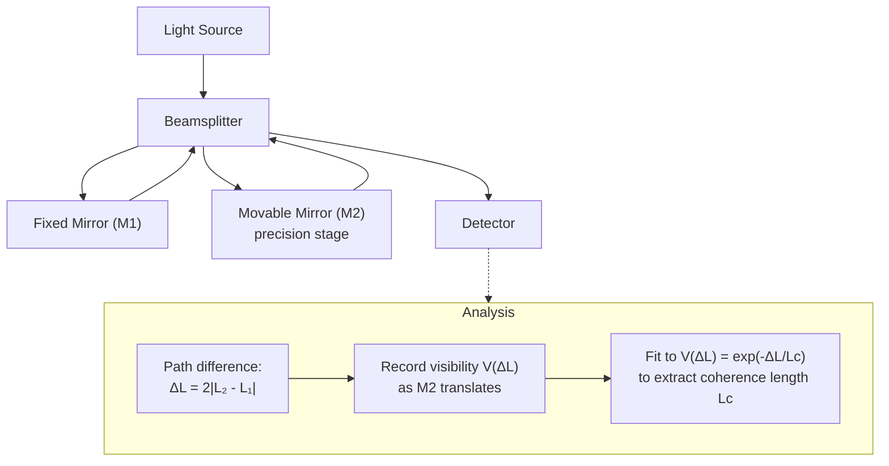

# Lesson 2: Wave Optics: Interference, Diffraction, Coherence

## 1. First-Principles Intuition & Invariants

The transition from geometric optics to wave optics represents a paradigm shift in our understanding of light propagation. Where ray-tracing methods suffice for lenses and mirrors operating at scales far exceeding the wavelength of light, phenomena like interference fringes, diffraction patterns, and the finite resolution of optical instruments demand that we embrace the electromagnetic wave nature of light. This lesson establishes the theoretical foundations of wave optics through Maxwell's equations, derives the conditions for constructive and destructive interference, and connects these principles to laboratory-verifiable observations using coherent light sources.

Light propagates as an electromagnetic disturbance satisfying Maxwell's equations in vacuum. The electric field $\vec{E}(\vec{r}, t)$ and magnetic field $\vec{B}(\vec{r}, t)$ obey the wave equation derived from the curl equations. For a monochromatic plane wave propagating in the $+z$ direction with angular frequency $\omega = 2\pi f$ and wave vector magnitude $k = 2\pi/\lambda = \omega/c$, the electric field takes the form $\vec{E}(\vec{r}, t) = \vec{E}_0 \cos(kz - \omega t + \phi_0)$, where $\phi_0$ represents an initial phase offset. This oscillatory solution encodes both spatial periodicity (wavelength $\lambda$) and temporal periodicity (period $T = 1/f$). The principle of superposition, a direct consequence of the linearity of Maxwell's equations in source-free regions, allows us to add the complex amplitudes of multiple waves at a single point in space to determine the resultant field.

The intensity of light measured by photodetectors corresponds to the time-averaged square of the electric field magnitude, $I \propto \langle |\vec{E}|^2 \rangle_T$, where the angle brackets denote temporal averaging over many optical cycles. When two coherent waves with electric field amplitudes $E_1 = E_{01} \cos(kz - \omega t + \phi_1)$ and $E_2 = E_{02} \cos(kz - \omega t + \phi_2)$ superpose, the resultant field is $E = E_1 + E_2$. Expanding the square of this sum and time-averaging yields the fundamental interference equation:

$$I = I_1 + I_2 + 2\sqrt{I_1 I_2} \cos(\phi_2 - \phi_1)$$

This cross-term, $2\sqrt{I_1 I_2} \cos(\Delta\phi)$, constitutes the interference contribution. When the phase difference $\Delta\phi = \phi_2 - \phi_1$ equals an integer multiple of $2\pi$ (constructive interference), the intensity reaches a maximum of $I_{\text{max}} = (\sqrt{I_1} + \sqrt{I_2})^2$. Conversely, when $\Delta\phi = (2m+1)\pi$ for integer $m$ (destructive interference), the intensity drops to $I_{\text{min}} = (\sqrt{I_1} - \sqrt{I_2})^2$. For equal-amplitude waves ($I_1 = I_2 = I_0$), perfect constructive interference yields $I_{\text{max}} = 4I_0$, while perfect destructive interference produces complete darkness, $I_{\text{min}} = 0$. This dramatic redistribution of light energy—not creation or destruction—embodies the wave nature of light.

The visibility or contrast of interference fringes quantifies the quality of interference patterns through the Michelson visibility function:

$$V = \frac{I_{\text{max}} - I_{\text{min}}}{I_{\text{max}} + I_{\text{min}}}$$

For perfectly coherent equal-intensity sources, $V = 1$ (maximum contrast). For incoherent sources or unequal intensities, visibility degrades. Experimentally measuring visibility provides a direct probe of coherence properties. The path difference $\Delta L$ between two interfering waves translates to a phase difference via $\Delta\phi = k \Delta L = (2\pi/\lambda) \Delta L$. Constructive interference occurs when $\Delta L = m\lambda$ (integer $m$), and destructive interference occurs when $\Delta L = (m + 1/2)\lambda$. This relationship underpins the spatial distribution of interference fringes in Young's double-slit experiment, thin-film interference, and interferometric measurements.

Diffraction emerges when light encounters obstacles or apertures with dimensions comparable to or smaller than the wavelength. Huygens' principle, formalized by Fresnel and Kirchhoff, treats each point on a wavefront as a source of secondary spherical wavelets. The observed field at any later point arises from the coherent superposition of these wavelets, accounting for amplitude decay and phase shifts. The Fresnel-Kirchhoff diffraction integral expresses the field $U(P)$ at observation point $P$ due to an aperture $\Sigma$ illuminated by a source field $U_0$:

$$U(P) = \frac{1}{i\lambda} \iint_{\Sigma} U_0(Q) \frac{e^{ikr}}{r} \cos(\vec{n}, \vec{r}) \, dS$$

Here, $r$ is the distance from aperture element $dS$ at point $Q$ to observation point $P$, and $\cos(\vec{n}, \vec{r})$ is the obliquity factor accounting for the angle between the surface normal $\vec{n}$ and the direction vector $\vec{r}$. This integral formulation reduces to simpler forms under specific geometric approximations.

The Fraunhofer (far-field) diffraction regime applies when the observation distance $z$ satisfies $z \gg a^2/\lambda$, where $a$ is the characteristic aperture dimension. Under this condition, the spherical wavelets approximate plane waves at the observation screen, and the diffraction integral simplifies to a Fourier transform of the aperture transmission function. For a single slit of width $b$ illuminated by a normally incident plane wave, the intensity distribution along a distant screen is:

$$I(\theta) = I_0 \left( \frac{\sin(\beta)}{\beta} \right)^2, \quad \beta = \frac{\pi b \sin\theta}{\lambda}$$

The central maximum spans from $\theta = -\lambda/b$ to $\theta = +\lambda/b$, and the first minimum occurs at $\sin\theta = \lambda/b$. Secondary maxima appear at approximate positions $\beta \approx (m + 1/2)\pi$ for integer $m \geq 1$, with rapidly diminishing intensity. Measuring the angular width of the central maximum allows experimental determination of the slit width when the wavelength is known, or vice versa. For a circular aperture of diameter $D$, the Airy diffraction pattern emerges with the first dark ring at angular radius $\theta_1 = 1.22\lambda/D$. This diffraction-limited spot size fundamentally constrains the resolving power of telescopes and microscopes through the Rayleigh criterion: two point sources are just resolved when the central maximum of one Airy pattern coincides with the first minimum of the other, corresponding to an angular separation $\Delta\theta_{\text{min}} = 1.22\lambda/D$.

Coherence theory formalizes the conditions under which interference fringes remain visible despite non-idealities in real light sources. Temporal coherence quantifies the phase correlation of a light wave with itself at different times, characterized by the coherence time $\tau_c$ and coherence length $L_c = c\tau_c$. A source with spectral linewidth $\Delta\lambda$ (or equivalently, frequency bandwidth $\Delta\nu$) exhibits a coherence length $L_c \approx \lambda^2/\Delta\lambda = c/\Delta\nu$. For a monochromatic laser with $\Delta\lambda = 10^{-12}$ m at $\lambda = 633$ nm, the coherence length exceeds 0.4 meters. In contrast, a filtered white-light source with $\Delta\lambda = 10$ nm yields $L_c \approx 40$ μm. Interference fringes remain visible only when the path difference between interfering beams is less than $L_c$; beyond this limit, phase fluctuations wash out the fringes.

Spatial coherence describes the phase correlation between different points across the wavefront at a given instant. An extended incoherent source (such as a thermal lamp or the Sun) produces spatially incoherent illumination, degrading interference visibility in double-slit experiments. The Van Cittert-Zernike theorem quantifies spatial coherence for quasi-monochromatic incoherent sources: the complex degree of coherence between two points separated by distance $d$ on a screen at distance $z$ from a source of angular size $\theta_s$ is approximately:

$$|\gamma_{12}| \approx \left| \frac{\sin(\pi d \theta_s / \lambda)}{\pi d \theta_s / \lambda} \right|$$

Spatial coherence degrades as the product $d\theta_s$ increases relative to the wavelength. For stellar interferometry measuring the angular diameter of stars, this relationship allows determination of $\theta_s$ by varying baseline $d$ until fringe visibility vanishes.

Fourier optics provides a powerful framework unifying diffraction, imaging, and spatial filtering. The Fraunhofer diffraction pattern is the spatial Fourier transform of the aperture function, making the focal plane of a lens the natural domain for spatial frequency analysis. A lens performs a physical Fourier transform: the field distribution in the back focal plane corresponds to the angular spectrum (spatial frequency content) of the field incident on the lens. This principle enables optical signal processing, where spatial filters placed in the Fourier plane selectively transmit or block specific spatial frequencies, implementing edge enhancement, low-pass filtering, or phase contrast microscopy.

The connection between coherence and Fourier analysis emerges through the Wiener-Khinchin theorem: the power spectral density of a light field is the Fourier transform of its temporal autocorrelation function (or equivalently, the mutual coherence function). This relationship bridges time-domain coherence measurements and frequency-domain spectral characterization, forming the theoretical basis for Fourier-transform spectroscopy.

## 2. Core Architecture & Mechanics

Experimental wave optics demands precise control of optical path lengths, alignment of coherent sources, and quantitative measurement of intensity distributions. The canonical demonstration of interference is Young's double-slit experiment, first performed in 1801. Modern implementations use a helium-neon laser (wavelength $\lambda = 632.8$ nm, coherence length $\sim 20$ cm) spatially filtered through a pinhole or single-mode optical fiber to produce a spatially coherent diverging wavefront. This wavefront illuminates a double-slit mask consisting of two narrow parallel slits separated by distance $d$ (typically 0.1 to 1 mm), each of width $a$ (typically 50 to 100 μm). The transmitted waves from each slit propagate and interfere on a distant observation screen placed at distance $L$ (typically 1 to 3 meters).

At a point $P$ on the screen displaced by transverse distance $y$ from the centerline, the path difference between light arriving from the two slits is $\Delta L = d \sin\theta \approx d y / L$ for small angles. Constructive interference (bright fringes) occurs when:

$$d \sin\theta = m\lambda \quad \Rightarrow \quad y_{\text{bright}} = \frac{m\lambda L}{d}$$

for integer $m = 0, \pm 1, \pm 2, \ldots$. Destructive interference (dark fringes) occurs at:

$$y_{\text{dark}} = \frac{(m + 1/2)\lambda L}{d}$$

The fringe spacing, defined as the distance between adjacent bright fringes, is:

$$\Delta y = \frac{\lambda L}{d}$$

This relationship provides an experimental protocol for wavelength measurement: measure the slit separation $d$ using a calibrated microscope, measure the screen distance $L$ with a meter stick, and measure the fringe spacing $\Delta y$ using a linear photodiode array or traveling microscope. Solve for wavelength: $\lambda = \Delta y \cdot d / L$. Typical parameters ($d = 0.3$ mm, $L = 2$ m, $\lambda = 633$ nm) yield fringe spacing $\Delta y \approx 4.2$ mm, easily measured with millimeter-scale precision.

The intensity envelope modulating these interference fringes arises from single-slit diffraction. Each individual slit produces a diffraction pattern with intensity:

$$I_{\text{single}}(\theta) = I_0 \left( \frac{\sin\alpha}{\alpha} \right)^2, \quad \alpha = \frac{\pi a \sin\theta}{\lambda}$$

The combined pattern from the double slit is the product of the interference term (due to two coherent point sources) and the single-slit diffraction envelope:

$$I(\theta) = I_0 \left( \frac{\sin\alpha}{\alpha} \right)^2 \cos^2\left( \frac{\pi d \sin\theta}{\lambda} \right)$$

The visibility of interference fringes diminishes at angles where the single-slit diffraction minima coincide with interference maxima. The first single-slit minimum occurs at $\sin\theta_1 = \lambda/a$. If the slit separation is an integer multiple of the slit width, $d = na$, then every $n$-th interference order vanishes, creating a missing order phenomenon directly observed in the intensity distribution.

Measuring the coherence length of a source requires a Michelson interferometer configured to vary the path difference between two interfering beams. The interferometer splits an incident beam using a 50/50 beamsplitter, directing one portion to a fixed mirror at distance $L_1$ and the other to a movable mirror at adjustable distance $L_2$. The reflected beams recombine at the beamsplitter and interfere. When the path difference $2|L_2 - L_1|$ is smaller than the coherence length $L_c$, high-contrast interference fringes appear. As the movable mirror translates to increase the path difference beyond $L_c$, fringe visibility degrades. Quantitatively, the visibility $V(\Delta L)$ as a function of path difference equals the magnitude of the complex degree of temporal coherence $|\gamma(\tau)|$, where $\tau = \Delta L / c$. For a Lorentzian spectral profile with full-width-at-half-maximum linewidth $\Delta\nu$, the coherence function is $|\gamma(\tau)| = \exp(-\pi \Delta\nu |\tau|)$, yielding an exponential decay of fringe visibility.

The experimental protocol involves:

1. Align the interferometer for equal arm lengths ($L_1 = L_2$) to observe maximum fringe contrast at zero path difference.
2. Translate the movable mirror in increments of $\Delta L = 10$ μm to 100 μm, recording the intensity variation at a fixed detector position.
3. Compute visibility $V(\Delta L)$ from the measured maximum and minimum intensities at each path difference.
4. Fit the measured $V(\Delta L)$ to the expected functional form (exponential decay, Gaussian, etc.) to extract coherence length $L_c$ and spectral linewidth $\Delta\nu = c / L_c$.

For a He-Ne laser stabilized to the $^{20}$Ne isotope with $\Delta\nu \sim 1.5$ GHz, the coherence length is $L_c \sim 20$ cm. For a low-pressure sodium lamp filtered to the D-lines ($\lambda = 589$ nm, $\Delta\lambda \approx 0.0006$ nm), the coherence length reaches $L_c \sim 0.5$ m. White-light interference from a tungsten filament lamp exhibits fringes only within a few micrometers of zero path difference, corresponding to coherence lengths of order $L_c \sim 1$ μm.

Single-slit diffraction experiments require precise control of slit width and wavelength. A variable-width slit (adjustable from 10 μm to 1 mm) is illuminated by a collimated laser beam, and the diffracted light is observed on a distant screen or projected onto a linear CCD array. The measured intensity profile $I(y)$ on the screen relates to angle $\theta$ via $y = L \tan\theta \approx L \sin\theta$ for small angles. Normalize the measured intensity by the peak value and fit to the theoretical function:

$$I_{\text{norm}}(\theta) = \left( \frac{\sin\beta}{\beta} \right)^2, \quad \beta = \frac{\pi b \sin\theta}{\lambda}$$

The fit parameter $b$ is the effective slit width. Compare this value to the mechanical micrometer reading to validate the model. Measure the angular position of the first minimum, $\theta_1 = \lambda / b$, and solve for wavelength: $\lambda = b \sin\theta_1$. For $b = 100$ μm and $\lambda = 633$ nm, the first minimum occurs at $\theta_1 \approx 6.3$ milliradians (0.36 degrees). At screen distance $L = 2$ m, this corresponds to $y_1 \approx 12.6$ mm.

Diffraction grating experiments extend single-slit diffraction to arrays of $N$ equally spaced slits with separation $d$ (the grating constant). Each slit diffracts light according to the single-slit envelope, and the $N$ slits interfere to produce sharp principal maxima at angles satisfying the grating equation:

$$d \sin\theta_m = m\lambda$$

for integer order $m$. The angular dispersion $d\theta/d\lambda = m/(d\cos\theta_m)$ quantifies the separation of different wavelengths, enabling spectrometry. The resolving power $R = \lambda / \delta\lambda = mN$ (where $N$ is the total number of illuminated grooves) determines the minimum resolvable wavelength difference. A grating with $d = 1.67$ μm (600 lines/mm), $N = 10,000$ grooves, and $m = 1$ achieves $R = 10,000$, sufficient to resolve the sodium D-doublet ($\lambda_1 = 589.0$ nm, $\lambda_2 = 589.6$ nm, $\delta\lambda = 0.6$ nm) in first order.

The experimental protocol for grating spectrometry involves:

1. Mount the diffraction grating on a precision rotation stage with angular readout accurate to 1 arcminute.
2. Illuminate the grating with a collimated beam from the spectral source (e.g., mercury vapor lamp, sodium lamp, or white light).
3. Rotate the detector arm (or rotate the grating) to locate the angles $\theta_m$ corresponding to diffraction maxima for each order $m$.
4. For each spectral line of interest, measure $\theta_m$ for multiple orders ($m = 1, 2, 3$).
5. Solve the grating equation for wavelength: $\lambda = d \sin\theta_m / m$.
6. Average the wavelength determinations across multiple orders to reduce systematic errors from grating imperfections.

For the mercury green line ($\lambda = 546.1$ nm) diffracted by a 600 lines/mm grating in first order, the diffraction angle is $\theta_1 = \arcsin(546.1 \times 10^{-9} / 1.67 \times 10^{-6}) \approx 19.1$ degrees. The second-order maximum appears at $\theta_2 \approx 40.5$ degrees, and the third order at $\theta_3 \approx 78.8$ degrees. Higher orders eventually exceed $\sin\theta = 1$, imposing an upper limit on observable orders.

Circular aperture diffraction produces the Airy pattern, consisting of a bright central disk surrounded by concentric dark and bright rings. The intensity distribution is:

$$I(\theta) = I_0 \left( \frac{2 J_1(x)}{x} \right)^2, \quad x = \frac{\pi D \sin\theta}{\lambda}$$

where $J_1$ is the first-order Bessel function of the first kind. The first zero of $J_1(x)$ occurs at $x_1 \approx 3.83$, corresponding to the angular radius of the first dark ring:

$$\theta_1 = 1.22 \frac{\lambda}{D}$$

This Airy disk radius defines the diffraction-limited resolution of imaging systems. For a telescope of diameter $D = 10$ cm observing at $\lambda = 550$ nm, the angular resolution is $\theta_1 \approx 6.7 \times 10^{-6}$ radians (1.4 arcseconds). The Rayleigh criterion states that two point sources separated by angle $\Delta\theta = 1.22\lambda/D$ are just resolved, meaning the central maximum of one Airy pattern falls on the first minimum of the other, yielding a combined intensity dip of approximately 26% between the two peaks.

Experimentally verifying the Airy pattern requires a high-quality circular aperture (pinhole diameter 50 to 200 μm, free of edge defects) illuminated by a spatially coherent laser beam. Image the diffracted light onto a CCD camera or scan a small-aperture photodetector across the pattern. Measure the radial intensity profile $I(r)$, where $r$ is the distance from the central maximum. Fit the measured profile to the theoretical Airy function to extract the effective aperture diameter $D$. Compare to the mechanical measurement from a calibrated microscope.

Fourier optics experiments demonstrate spatial frequency filtering by placing amplitude or phase masks in the focal plane of a lens. A $4f$ correlator system consists of two lenses (focal length $f$) separated by distance $4f$. An input transparency at the front focal plane of the first lens is Fourier transformed into the intermediate focal plane between the lenses, where a spatial filter is inserted. The second lens performs an inverse Fourier transform, reconstructing a filtered image at the back focal plane. Common filters include:

- **Low-pass filter:** Circular aperture blocking high spatial frequencies, producing a smoothed (blurred) output image.
- **High-pass filter:** Opaque central disk blocking low spatial frequencies, enhancing edges and fine details.
- **Directional filter:** Slit oriented perpendicular to a desired spatial frequency component, selectively passing or blocking periodic structures at specific orientations.

The experimental protocol involves preparing a photographic slide or spatial light modulator pattern as the input object, illuminating with a collimated laser beam, and placing the object at the front focal plane of lens $L_1$ (focal length $f_1 = 150$ mm). The Fourier plane appears at distance $f_1$ behind $L_1$. Insert the spatial filter mask (fabricated via photolithography or laser-cut from opaque film) in this plane. Place the second lens $L_2$ (focal length $f_2 = 150$ mm) at distance $f_1 + f_2$ from the input object, positioning the output image plane at distance $f_2$ beyond $L_2$. Record the output image with a camera and compare to the input image to quantify the filtering effect.

Practical coherence measurements using a Michelson interferometer require vibration isolation and thermal stability. Mount the interferometer on a pneumatic optical table to suppress mechanical vibrations. Enclose the setup in a temperature-controlled box or perform measurements during periods of minimal air turbulence to avoid fringe washout from refractive index fluctuations. Use kinematic mirror mounts with differential micrometers (resolution 1 μm) for path length adjustment. Record fringe patterns using a photodiode or CCD camera, digitizing intensity traces with at least 8-bit depth.

Phase-shifting interferometry improves measurement precision by introducing a controlled phase shift (typically $\pi/2$ increments) between the reference and measurement arms, recording intensity images at each phase step, and algorithmically reconstructing the phase map. The four-bucket algorithm uses four phase-shifted images $I_1, I_2, I_3, I_4$ corresponding to phases $0, \pi/2, \pi, 3\pi/2$ to compute:

$$\phi(x, y) = \arctan\left( \frac{I_4 - I_2}{I_1 - I_3} \right)$$

This technique achieves phase measurement accuracy of $\lambda/100$ or better, enabling nanometer-scale surface profilometry and wavefront characterization.

```mermaid
flowchart LR
    subgraph params ["Optical Parameters"]
        direction TB
        P1["λ = 632.8 nm"]
        P2["d = 0.3 mm (slit separation)"]
        P3["a = 0.05 mm (slit width)"]
        P4["L = 2 m (screen distance)"]
    end

    subgraph results ["Expected Results"]
        direction TB
        R1["Fringe spacing: Δy = λL/d = 4.2 mm"]
        R2["First single-slit minimum: y_min = λL/a = 25.3 mm"]
    end

    subgraph optical_path ["Optical Configuration for Double-Slit Interference Measurement"]
        direction LR
        A["Laser\n(HeNe)"]
        B["Spatial Filter\n(pinhole)"]
        C["Collimating Lens\n(f = 100 mm)"]
        D["Double Slit\n(d, a)"]
        E["Screen / Detector\n(L = 2 m)"]

        A --> B --> C --> D --> E
    end

    params -. governs .-> optical_path
    optical_path -. produces .-> results
```

## 3. High-Performance Optimization & Failure Modes

Achieving high-visibility interference fringes and clean diffraction patterns requires systematic mitigation of coherence degradation, alignment errors, and environmental perturbations. Laser sources must exhibit single transverse mode operation (typically TEM₀₀ Gaussian mode) to ensure spatial coherence across the beam cross-section. Multimode lasers produce speckle patterns and degrade fringe contrast. Single-mode fiber coupling or spatial filtering through a pinhole aperture (diameter 10 to 50 μm, placed at the focal point of a lens) strips higher-order modes, generating a clean diverging spherical wavefront. The pinhole diameter must match the Airy disk size for the focusing lens to pass only the fundamental mode while blocking higher-order modes and scattered light.

Optical alignment requires iterative adjustment of mirror angles to within 10 arcseconds (50 μrad) to maintain beam overlap and collinearity over propagation distances of several meters. Kinematic mounts with fine-pitch adjustment screws (80 threads per inch, yielding 10 μrad per division) enable precision alignment. Autocollimation using a reference flat or retroreflector verifies perpendicularity. For double-slit experiments, the slits must be parallel to within 1 mrad to avoid fringe tilt, and the screen must be perpendicular to the bisector of the two slit beams to within 0.1 degrees to avoid asymmetric fringe distortion.

Vibration isolation is critical for interferometry. Mechanical vibrations with amplitudes exceeding $\lambda/10$ (60 nm for visible light) wash out fringes by introducing time-varying path differences. Pneumatic optical tables (resonant frequency $\sim 1$ Hz) isolate the setup from floor vibrations. Active vibration cancellation systems (bandwidth up to 1 kHz) further suppress residual motion. Acoustic isolation using enclosures lined with sound-absorbing foam prevents airborne vibrations from coupling into optical mounts.

Temperature stability must be maintained to within $\pm 0.1$ °C to avoid refractive index fluctuations in air ($dn/dT \approx 10^{-6}$ K$^{-1}$ at STP). A $0.1$ °C temperature change over a $1$ m air path introduces a $0.1$ μm optical path difference, equivalent to $\lambda/6$ for visible light, sufficient to degrade fringe visibility. Thermal enclosures with PID-controlled heaters or air conditioning maintain temperature stability. Evacuating the interferometer arms eliminates air turbulence entirely but requires vacuum-compatible optics and windows.

Stray light suppression involves baffling the optical path with black anodized tubes and apertures to prevent scattered light from reaching the detector. Anti-reflection coatings on all transmissive optics (residual reflectance $< 0.5\%$ per surface) minimize ghost reflections. Detector dynamic range must span the full contrast ratio of the interference pattern. For equal-intensity beams producing fringes with $I_{\text{max}}/I_{\text{min}} = \infty$ (perfect extinction), a detector with at least 10-bit depth (dynamic range $\sim 1000:1$) is required. CCD cameras with 12-bit or 16-bit analog-to-digital conversion capture fringes without saturation or noise floor clipping.

Polarization mismatch between interfering beams reduces visibility by the factor $\cos^2(\Delta\psi)$, where $\Delta\psi$ is the angle between the two electric field polarization vectors. For unpolarized light, the ensemble-averaged visibility is 50% of the maximum. Inserting a polarizer before the interferometer or double slit ensures that both beams have parallel polarization, restoring full visibility. Polarization-maintaining optical fibers preserve polarization state during beam delivery, avoiding depolarization from fiber bending or stress-induced birefringence.

Slit edge quality critically affects diffraction patterns. Rough or rounded slit edges scatter light, broadening diffraction features and reducing contrast. Photolithographically fabricated slits on chrome-on-glass substrates provide sharp edges (edge roughness $< 50$ nm) with well-defined widths. Mechanical slits cut by razor blades or wire substrates exhibit edge roughness of several micrometers, degrading pattern quality. For precision measurements, electron-beam lithography or focused-ion-beam milling fabricates slits with nanometer-scale edge definition.

Detector spatial resolution must resolve the fringe spacing and diffraction features. For a fringe spacing of $\Delta y = 4$ mm, a CCD camera pixel pitch of 5 to 10 μm (400 to 800 pixels per fringe) provides adequate sampling to measure fringe positions with sub-pixel accuracy via centroid fitting. Linear photodiode arrays with 512 to 2048 pixels and programmable integration times enable automated scanning of intensity profiles. Lock-in amplifiers synchronized to a mechanical chopper modulating the light beam enhance signal-to-noise ratio by rejecting ambient light and 1/f noise.

Nonlinearity in photodetector response causes systematic errors in intensity measurements. Silicon photodiodes exhibit linearity within 0.1% up to $10$ mW incident power but saturate at higher levels. Neutral density filters attenuate the beam to maintain operation within the linear range. Detector calibration using a reference photodiode traceable to NIST standards ensures absolute intensity measurements accurate to 1%.

Wavelength calibration of diffraction gratings and interferometers relies on atomic emission lines with precisely known wavelengths. The mercury green line ($\lambda = 546.074$ nm, air wavelength corrected for standard atmospheric conditions) serves as a primary reference. The sodium D-doublet ($\lambda_1 = 589.0$ nm, $\lambda_2 = 589.6$ nm) and helium-neon laser line ($\lambda = 632.991$ nm in air at 15 °C, 1 atm) provide additional calibration points. Wavelength meters with accuracy $< 0.01$ nm verify laser wavelengths when absolute precision is required.

Grating spectrometers exhibit spectral order overlap when the second-order diffraction of a wavelength $\lambda$ coincides with the first-order diffraction of $2\lambda$. For example, second-order red light ($2 \times 633$ nm $= 1266$ nm) overlaps first-order near-infrared light. Bandpass filters blocking unwanted orders prevent spectral confusion. Blazed gratings optimize diffraction efficiency in a specific order and wavelength range by angling the groove facets to concentrate light into the desired order via constructive interference at the groove level.

Fringe localization in interferometers determines the region where fringes are visible with high contrast. For thin films and wedge interferometers, fringes localize near the surface of the film or wedge, requiring focused observation. For Michelson interferometers with extended sources, fringes localize at infinity (parallel beam interference) when the two mirrors are perpendicular and equidistant from the beamsplitter. Tilting one mirror produces localized fringes at finite distance, allowing observation on a screen. The tilt angle $\alpha$ and fringe spacing $\Delta y$ are related by $\Delta y = \lambda / (2\alpha)$ for small tilt angles.

Speckle patterns arise when coherent light scatters from a rough surface with height variations exceeding $\lambda/4$. The speckle grain size is set by the numerical aperture of the imaging system and the wavelength. Speckle contrast $C = \sigma_I / \langle I \rangle$ (where $\sigma_I$ is the intensity standard deviation) equals unity for fully developed speckle from a rough surface. Averaging multiple speckle patterns (by moving the illumination angle, the observation angle, or the wavelength) reduces speckle contrast by $1/\sqrt{N}$ for $N$ independent patterns. Rotating diffusers or multimode fibers partially suppress speckle but degrade spatial coherence.

Temporal coherence measurements exhibit systematic errors from detector response time and sampling rate. The detector bandwidth must exceed the inverse coherence time, $\Delta f_{\text{det}} > 1/\tau_c$. For a laser with coherence time $\tau_c = 1$ ns ($L_c = 30$ cm), a detector bandwidth of 1 GHz is required to resolve the coherence function. Slower detectors time-average the intensity fluctuations, artificially prolonging the measured coherence time. High-speed photodiodes (bandwidth 1 to 10 GHz) and oscilloscopes (sampling rate 10 GS/s) capture nanosecond-scale intensity variations.

Chromatic aberration in lenses degrades Fourier transform quality by focusing different wavelengths at different distances, smearing the spatial frequency spectrum. Achromatic doublets (two lens elements with opposing dispersion) correct chromatic aberration over a 100 nm bandwidth. For broadband applications, apochromatic triplets or reflective optics (parabolic mirrors) eliminate chromatic aberration entirely at the cost of increased alignment complexity.

Digital image processing enhances raw diffraction and interference data. Background subtraction removes ambient light and detector dark current. Flat-field correction compensates for non-uniform illumination and pixel-to-pixel sensitivity variation by dividing the measured image by a reference image of uniform illumination. Fourier filtering in the spatial frequency domain removes periodic noise from power-line interference or electronic pickup. Subpixel peak localization via Gaussian or sinc function fitting improves fringe position accuracy by a factor of 10 beyond the pixel pitch.

Edge effects in finite-sized optical components truncate the wavefront, introducing diffraction artifacts. A Gaussian beam with waist $w_0 = 1$ mm diffracted by a circular aperture of diameter $D = 10$ mm introduces negligible truncation loss ($< 1\%$). Apertures smaller than $2w_0$ severely truncate the beam, distorting the diffraction pattern. Adjustable irises control beam diameter while maintaining clean Gaussian profiles by placing the iris in a collimated region where the wavefront curvature is minimal.

Nonlinear optical effects (saturable absorption, self-focusing, thermal lensing) emerge at high laser intensities, modifying the beam profile and coherence. For continuous-wave lasers below $1$ W average power in millimeter-scale beams, nonlinear effects are negligible. Pulsed lasers with peak intensities exceeding $10^{12}$ W/m² induce Kerr-effect self-focusing and supercontinuum generation, broadening the spectrum and degrading temporal coherence. Attenuating the beam power with neutral density filters or expanding the beam diameter reduces intensity below nonlinear thresholds.

Quantum noise limits interferometric sensitivity via shot noise, which scales as the square root of the photon flux. A detector receiving $N$ photons per integration time exhibits a signal-to-noise ratio $\text{SNR} = \sqrt{N}$. Increasing laser power proportionally increases both signal and shot noise, improving SNR by $\sqrt{P}$. For sub-shot-noise sensitivity, squeezed light sources (reducing quantum fluctuations in one quadrature below the vacuum level) or photon-number-resolving detectors enable quantum-enhanced interferometry beyond the standard quantum limit.

Automation of alignment and data acquisition improves repeatability and throughput. Motorized translation stages (resolution 10 nm, travel range 25 mm) scan path differences or slit positions under computer control. LabVIEW or Python scripts interface with cameras, photodiodes, and motion controllers, executing measurement sequences and logging data with timestamps. Machine learning algorithms (convolutional neural networks) trained on simulated diffraction patterns automatically classify aperture shapes and dimensions from measured intensity distributions, accelerating quality control in optical fabrication.

Failure mode analysis identifies systematic errors and their mitigation strategies. Misaligned optics produce asymmetric or distorted fringe patterns; realignment using autocollimation and iterative adjustment restores symmetry. Dirty optics scatter light, reducing fringe visibility; cleaning with lens tissue and spectroscopic-grade methanol removes contaminants. Laser mode hops (abrupt wavelength shifts in external-cavity lasers) cause fringe jumps; temperature-stabilized diode lasers with thermoelectric coolers maintain wavelength stability within 0.001 nm. Photobleaching of spatial light modulators or photographic slides reduces contrast over time; replacing the input transparency restores pattern quality.
