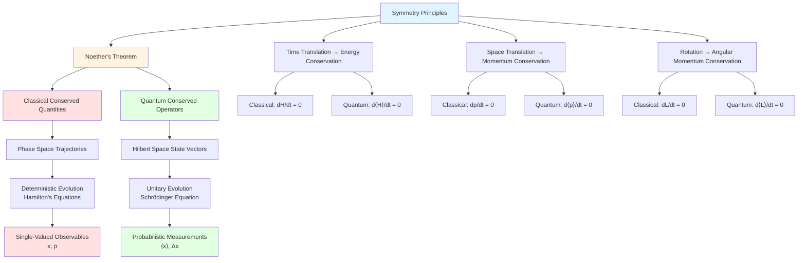

# Lesson 1: First-Principles Physical Laws & Conservation Invariants

## Curriculum Roadmap

The quantum revolution did not arrive as a sudden theoretical rupture but emerged from decades of experimental anomalies that classical physics could not resolve. This curriculum begins where all rigorous physics must: with the conservation laws and symmetry principles that constrain physical reality, then proceeds through the historical experiments that shattered classical determinism. By Lesson 3, you will construct the Hilbert space formalism that unifies wave mechanics and matrix mechanics. Lessons 4 through 6 confront the measurement problem, entanglement, and Bell's theorem with laboratory precision. The final lessons examine modern interpretations and experimental tests that continue to probe the boundary between quantum and classical worlds.

This opening lesson establishes the bedrock: the conservation laws that survive the transition from classical to quantum mechanics, the action principle that generates equations of motion in both regimes, and the symmetry theorems that dictate which quantities must remain invariant under temporal evolution. You cannot grasp why quantum mechanics is paradoxical without first internalizing what classical mechanics promised: a universe of continuous trajectories, deterministic evolution, and separable properties that exist independent of observation. The paradoxes arise precisely where quantum formalism preserves the abstract structure of conservation laws while demolishing the classical ontology that seemed to ground them.

## 1. First-Principles Problem Space & Historical Phenomenon

Classical mechanics, as synthesized by Newton and refined through the analytical frameworks of Lagrange and Hamilton, rested on a seductive premise: given complete knowledge of positions and momenta at time $t_0$, the entire future and past of a mechanical system could be computed with arbitrary precision. This Laplacian determinism extended naturally into Maxwell's electromagnetic theory, where field configurations obeyed linear partial differential equations with well-posed initial value problems. By the 1890s, physics appeared nearly complete, requiring only incremental refinements to accommodate minor empirical discrepancies in blackbody radiation spectra and atomic emission lines.

The experimental failures that precipitated quantum mechanics were not philosophical speculations but hard, reproducible laboratory measurements that refused to conform to theoretical prediction. When Lummer and Pringsheim measured the spectral radiance of cavity radiation in 1899, they found that Wien's distribution law matched short-wavelength data but diverged catastrophically in the infrared, while Rayleigh-Jeans theory predicted an ultraviolet catastrophe where total radiated power diverged to infinity. Planck's interpolation formula, introduced in December 1900, fit the data precisely but required the ontologically shocking assumption that electromagnetic energy in a cavity mode of frequency $\nu$ could only assume discrete values $E_n = n h \nu$, where $h = 6.62607015 \times 10^{-34}$ J·s is the quantum of action.

Einstein's 1905 analysis of the photoelectric effect drove the wedge deeper. When ultraviolet light strikes a metal surface, electrons are ejected with kinetic energies that depend on the light's frequency, not its intensity. Classical wave theory predicted that sufficiently intense light of any frequency should eventually liberate electrons by accumulating energy, yet experiments showed an instantaneous threshold effect: below a material-specific cutoff frequency $\nu_0$, no electrons emerge regardless of intensity, while above threshold the maximum kinetic energy scales linearly as $K_{\text{max}} = h\nu - \phi$, where $\phi = h\nu_0$ is the work function. This behavior demands that light energy arrives in localized packets—photons—with energy $E = h\nu$ and momentum $p = h\nu/c = h/\lambda$.

The Compton effect (1923) provided definitive confirmation of photon particle character. When X-rays scatter from electrons, the scattered radiation exhibits a wavelength shift $\Delta\lambda = \lambda' - \lambda = (h/m_e c)(1 - \cos\theta)$ that depends only on scattering angle $\theta$, precisely matching predictions from relativistic billiard-ball collisions between photons and electrons. No wave theory could explain why scattered wavelength depends on angle rather than incident intensity.

Atomic spectra presented an equally acute crisis. The Balmer formula (1885) empirically characterized visible hydrogen emission lines as $\lambda = B \frac{n^2}{n^2 - 4}$ for integer $n \geq 3$, later generalized by Rydberg to $\frac{1}{\lambda} = R_\infty \left(\frac{1}{n_f^2} - \frac{1}{n_i^2}\right)$ with $R_\infty = 1.097373 \times 10^7$ m$^{-1}$. Classical electromagnetism offered no mechanism for discrete spectral lines: an orbiting electron should radiate continuously across all frequencies as it spirals into the nucleus, producing a continuous spectrum and atomic collapse within picoseconds. Bohr's 1913 model imposed quantization by fiat, restricting angular momentum to integer multiples of $\hbar = h/2\pi$ and thereby stabilizing circular orbits, but the model provided no dynamical explanation for why nature should respect such constraints.

De Broglie's 1924 hypothesis inverted the logic: if light waves exhibit particle properties, perhaps particles exhibit wave properties. Assigning a wavelength $\lambda = h/p$ to electrons with momentum $p$ immediately explained Bohr's quantization as a resonance condition—stationary orbits correspond to standing waves where the circumference contains an integer number of wavelengths, $2\pi r = n\lambda = nh/p = nh/(m_e v)$, yielding $m_e v r = n\hbar$. Davisson and Germer's 1927 electron diffraction experiments confirmed that electrons scattered from nickel crystals produce interference patterns identical in structure to X-ray diffraction, with maxima satisfying Bragg's law $n\lambda = 2d\sin\theta$.

These experimental facts forced a conclusion that remains conceptually jarring a century later: the fundamental entities of nature are neither classical particles nor classical waves, but quantum objects that exhibit contextual behavior depending on the experimental apparatus. An electron passing through a double-slit apparatus produces an interference pattern characteristic of waves when both slits are open, yet always registers as a localized detection event on a screen, never as a smeared continuous distribution. The wave function $\psi(\mathbf{r}, t)$, introduced by Schrödinger in 1926, encodes this duality: its modulus squared $|\psi(\mathbf{r}, t)|^2$ gives the probability density for detecting the particle at position $\mathbf{r}$ at time $t$, yet $\psi$ itself evolves according to a deterministic wave equation.

## 2. Conservation Invariants & Mathematical Laws

The transition from classical to quantum mechanics preserves the deep structure of conservation laws while radically altering their physical interpretation. In classical mechanics, conserved quantities arise from continuous symmetries through Noether's theorem: time translation invariance yields energy conservation, spatial translation invariance yields momentum conservation, and rotational invariance yields angular momentum conservation. Quantum mechanics retains this symmetry-conservation correspondence but replaces deterministic trajectories with probabilistic amplitudes and commuting observables with non-commuting operators.

The principle of least action provides the foundation. For a system with generalized coordinates $q_i(t)$ and velocities $\dot{q}_i(t)$, the action functional is defined as the temporal integral of the Lagrangian,

$$S[q] = \int_{t_1}^{t_2} \mathcal{L}(q_i, \dot{q}_i, t) \, dt,$$

where the Lagrangian for a particle in a potential $V(\mathbf{r})$ takes the canonical form $\mathcal{L} = T - V = \frac{1}{2}m\dot{\mathbf{r}}^2 - V(\mathbf{r})$. Hamilton's principle asserts that the physically realized trajectory renders the action stationary under small variations $\delta q_i(t)$ that vanish at the endpoints, $\delta S = 0$. Applying the calculus of variations yields the Euler-Lagrange equations,

$$\frac{d}{dt}\left(\frac{\partial \mathcal{L}}{\partial \dot{q}_i}\right) - \frac{\partial \mathcal{L}}{\partial q_i} = 0.$$

For a free particle where $\mathcal{L} = \frac{1}{2}m\dot{\mathbf{r}}^2$, this reproduces Newton's second law $m\ddot{\mathbf{r}} = \mathbf{0}$. For a particle in a conservative force field $\mathbf{F} = -\nabla V$, the Euler-Lagrange equations yield $m\ddot{\mathbf{r}} = -\nabla V = \mathbf{F}$.

Noether's theorem formalizes the symmetry-conservation link. If the Lagrangian remains invariant under a continuous transformation $q_i \to q_i + \epsilon \, \delta q_i$, there exists a conserved quantity $Q$ satisfying $dQ/dt = 0$ along any trajectory. For time translation symmetry, where $\mathcal{L}$ does not depend explicitly on $t$, the conserved quantity is the Hamiltonian energy,

$$H = \sum_i \dot{q}_i \frac{\partial \mathcal{L}}{\partial \dot{q}_i} - \mathcal{L} = \sum_i p_i \dot{q}_i - \mathcal{L},$$

where $p_i = \partial \mathcal{L}/\partial \dot{q}_i$ defines the canonical momentum conjugate to $q_i$. For the standard Lagrangian $\mathcal{L} = \frac{1}{2}m\dot{\mathbf{r}}^2 - V(\mathbf{r})$, the momentum is $\mathbf{p} = m\dot{\mathbf{r}}$ and the Hamiltonian becomes $H = \mathbf{p}^2/(2m) + V(\mathbf{r}) = T + V$, the total mechanical energy.

For spatial translation symmetry, where $\mathcal{L}$ is invariant under $\mathbf{r} \to \mathbf{r} + \epsilon \, \hat{\mathbf{n}}$ for constant displacement along unit vector $\hat{\mathbf{n}}$, Noether's theorem yields conservation of the momentum component $p_n = \mathbf{p} \cdot \hat{\mathbf{n}}$. In the absence of external forces, $\mathbf{p} = m\dot{\mathbf{r}}$ remains constant. For rotational symmetry about an axis $\hat{\mathbf{n}}$, the conserved quantity is the angular momentum component $L_n = (\mathbf{r} \times \mathbf{p}) \cdot \hat{\mathbf{n}}$. Central force potentials $V(|\mathbf{r}|)$ preserve full rotational symmetry, yielding conservation of the total angular momentum vector $\mathbf{L} = \mathbf{r} \times \mathbf{p}$.

The Hamiltonian formulation recasts mechanics in phase space, the $2N$-dimensional manifold parametrized by coordinates $(q_i, p_i)$. Hamilton's equations,

$$\dot{q}_i = \frac{\partial H}{\partial p_i}, \quad \dot{p}_i = -\frac{\partial H}{\partial q_i},$$

govern the flow of the system's phase point through this space. For a particle in one dimension with $H = p^2/(2m) + V(x)$, these yield $\dot{x} = p/m$ and $\dot{p} = -dV/dx$, reproducing Newton's second law. The Hamiltonian framework reveals a deep symmetry: canonical transformations that preserve the form of Hamilton's equations, generated by functions $F(q, P, t)$, define a symplectic geometry on phase space where the Poisson bracket structure,

$$\{A, B\} = \sum_i \left(\frac{\partial A}{\partial q_i}\frac{\partial B}{\partial p_i} - \frac{\partial A}{\partial p_i}\frac{\partial B}{\partial q_i}\right),$$

remains invariant. Observables $A(q, p, t)$ evolve according to $dA/dt = \{A, H\} + \partial A/\partial t$, yielding $dH/dt = \partial H/\partial t$—if $H$ has no explicit time dependence, energy is conserved.

Quantum mechanics emerges from classical mechanics through canonical quantization, a replacement of phase space coordinates with non-commuting operators acting on a Hilbert space of state vectors. Position and momentum become Hermitian operators $\hat{x}$ and $\hat{p}$ satisfying the canonical commutation relation,

$$[\hat{x}, \hat{p}] = \hat{x}\hat{p} - \hat{p}\hat{x} = i\hbar,$$

where $\hbar = 1.054571817 \times 10^{-34}$ J·s. This commutator encodes the uncertainty principle: observables that do not commute cannot simultaneously possess definite values, with uncertainties constrained by $\Delta x \, \Delta p \geq \hbar/2$. The classical Hamiltonian $H(x, p)$ becomes the quantum Hamiltonian operator $\hat{H}(\hat{x}, \hat{p})$, and Hamilton's equations are replaced by the Heisenberg equation of motion,

$$\frac{d\hat{A}}{dt} = \frac{1}{i\hbar}[\hat{A}, \hat{H}] + \frac{\partial \hat{A}}{\partial t}.$$

In the Schrödinger picture, operators remain time-independent while state vectors evolve according to the time-dependent Schrödinger equation,

$$i\hbar \frac{\partial}{\partial t}|\psi(t)\rangle = \hat{H}|\psi(t)\rangle.$$

For a particle in one dimension with Hamiltonian $\hat{H} = \hat{p}^2/(2m) + V(\hat{x})$, the position-space representation $\psi(x, t) = \langle x|\psi(t)\rangle$ satisfies

$$i\hbar \frac{\partial \psi}{\partial t} = -\frac{\hbar^2}{2m}\frac{\partial^2\psi}{\partial x^2} + V(x)\psi,$$

where the momentum operator acts as $\hat{p} = -i\hbar\,\partial/\partial x$. This is a deterministic equation for the wave function, yet $|\psi(x, t)|^2$ yields only the probability density for measuring the particle at position $x$. The expectation value of position, $\langle x \rangle = \langle\psi|\hat{x}|\psi\rangle = \int_{-\infty}^\infty x|\psi(x, t)|^2 \, dx$, evolves according to

$$\frac{d}{dt}\langle x \rangle = \frac{1}{i\hbar}\langle[\hat{x}, \hat{H}]\rangle = \left\langle\frac{\hat{p}}{m}\right\rangle,$$

and similarly,

$$\frac{d}{dt}\langle p \rangle = \frac{1}{i\hbar}\langle[\hat{p}, \hat{H}]\rangle = \left\langle -\frac{dV}{dx}\right\rangle.$$

These are Ehrenfest's theorems: expectation values of position and momentum evolve according to classical equations, yet individual measurements yield probabilistic outcomes.

Energy conservation in quantum mechanics follows from time translation symmetry just as in classical mechanics. If the Hamiltonian has no explicit time dependence, $\partial\hat{H}/\partial t = 0$, then $d\hat{H}/dt = 0$ in the Heisenberg picture, and the expectation value $\langle H \rangle = \langle\psi|\hat{H}|\psi\rangle$ remains constant in time. Stationary states $|\psi(t)\rangle = e^{-iEt/\hbar}|E\rangle$, where $\hat{H}|E\rangle = E|E\rangle$, possess definite energy $E$ and time-independent probability densities $|\psi(x, t)|^2 = |\langle x|E\rangle|^2$. The time-independent Schrödinger equation,

$$-\frac{\hbar^2}{2m}\frac{d^2\psi}{dx^2} + V(x)\psi = E\psi,$$

determines the allowed energy eigenvalues and corresponding eigenfunctions for bound states.

Momentum conservation follows from spatial translation symmetry. For a free particle where $V(x) = 0$, the Hamiltonian $\hat{H} = \hat{p}^2/(2m)$ commutes with $\hat{p}$, so momentum eigenstates $|p\rangle$ with $\hat{p}|p\rangle = p|p\rangle$ are also energy eigenstates with $E = p^2/(2m)$. The position-space wave functions are plane waves $\psi_p(x) = (2\pi\hbar)^{-1/2}e^{ipx/\hbar}$, exhibiting the de Broglie relation $\lambda = h/p = 2\pi\hbar/p$. For a particle in a periodic potential $V(x + a) = V(x)$, Bloch's theorem asserts that eigenstates can be chosen with the form $\psi_k(x) = e^{ikx}u_k(x)$ where $u_k(x + a) = u_k(x)$, reflecting discrete translation symmetry.

Angular momentum conservation arises from rotational symmetry. The orbital angular momentum operator $\hat{\mathbf{L}} = \hat{\mathbf{r}} \times \hat{\mathbf{p}}$ satisfies commutation relations $[\hat{L}_i, \hat{L}_j] = i\hbar\epsilon_{ijk}\hat{L}_k$, where $\epsilon_{ijk}$ is the Levi-Civita tensor. For spherically symmetric potentials $V(|\mathbf{r}|)$, the Hamiltonian commutes with $\hat{\mathbf{L}}^2$ and $\hat{L}_z$, so energy eigenstates can be labeled by quantum numbers $(n, \ell, m)$ where $\hat{\mathbf{L}}^2|n\ell m\rangle = \hbar^2\ell(\ell+1)|n\ell m\rangle$ and $\hat{L}_z|n\ell m\rangle = \hbar m|n\ell m\rangle$. The hydrogen atom wave functions $\psi_{n\ell m}(r, \theta, \phi) = R_{n\ell}(r)Y_\ell^m(\theta, \phi)$ factorize into radial functions $R_{n\ell}$ and spherical harmonics $Y_\ell^m$, with energy levels $E_n = -13.6 \, \text{eV}/n^2$ determined solely by principal quantum number $n$.

The correspondence between classical and quantum conservation laws runs deeper than formal analogy. When a classical observable $A(q, p)$ is conserved, satisfying $\{A, H\} = 0$, the corresponding quantum operator $\hat{A}$ commutes with the Hamiltonian, $[\hat{A}, \hat{H}] = 0$, ensuring that expectation values $\langle A \rangle$ remain constant and that eigenstates of $\hat{A}$ can be chosen as energy eigenstates. This structure survives even when classical determinism fails: quantum systems still conserve energy, momentum, and angular momentum in expectation, even though individual measurement outcomes are fundamentally probabilistic.

## 3. High-Level Phenomenological Model

The architecture of quantum mechanics rests on a three-layer structure that separates kinematic formalism, dynamical evolution, and measurement postulates. The kinematic layer specifies that pure states correspond to rays in a complex Hilbert space $\mathcal{H}$, with observables represented by Hermitian operators whose eigenvalues give possible measurement outcomes and whose eigenvectors span the state space. The dynamical layer dictates that isolated systems evolve unitarily according to the Schrödinger equation, preserving inner products and probability normalization. The measurement layer—historically the most contentious—posits that measurement outcomes are probabilistic, with probabilities given by the Born rule $P(a_n) = |\langle a_n|\psi\rangle|^2$ for measuring eigenvalue $a_n$ in state $|\psi\rangle$, and that measurement instantaneously collapses the state to the corresponding eigenstate $|a_n\rangle$.

Classical mechanics admits a phase space description where the system's state is a point $(q, p)$ evolving along deterministic trajectories. Complete knowledge of this point determines all future and past behavior. Quantum mechanics replaces the phase space point with a state vector $|\psi\rangle \in \mathcal{H}$, evolving unitarily under $\hat{H}$. Position and momentum no longer represent simultaneous properties but non-commuting observables whose uncertainties are constrained by $\Delta x \, \Delta p \geq \hbar/2$. This inequality is not a statement about experimental imprecision but a fundamental feature of the quantum state: a state with definite position is necessarily a superposition of momentum eigenstates, and vice versa.

The following diagram illustrates the flow from symmetry principles through conservation laws to experimental observables, highlighting the parallel structure in classical and quantum frameworks:

The diagram exposes a critical asymmetry: while classical mechanics permits simultaneous knowledge of all conjugate variables, quantum mechanics enforces complementarity through non-commuting observables. A particle prepared in a momentum eigenstate $|p_0\rangle$ has perfectly definite momentum $p_0$ but is completely delocalized in position—its position-space wave function is a plane wave $\psi(x) = (2\pi\hbar)^{-1/2}e^{ip_0 x/\hbar}$ with $|\psi(x)|^2 = (2\pi\hbar)^{-1}$, a uniform probability density over all space. Conversely, a position eigenstate $|x_0\rangle$ corresponds to a delta function $\psi(x) = \delta(x - x_0)$ in position space but has a momentum-space representation $\tilde{\psi}(p) = (2\pi\hbar)^{-1/2}e^{-ipx_0/\hbar}$, a uniform superposition of all momentum values.

This complementarity manifests experimentally in the double-slit apparatus. When electrons pass through two slits separated by distance $d$ and strike a screen at distance $L \gg d$, the detection probability exhibits interference fringes with spacing $\Delta y \approx \lambda L/d = hL/(pd)$, characteristic of wave behavior. If we insert detectors at the slits to determine which path each electron takes, the interference pattern vanishes and we recover the classical sum of single-slit patterns. The act of path measurement does not physically disturb the electron in a classical sense—modern which-path detectors can operate with arbitrarily weak coupling—yet the quantum state fundamentally changes. With both paths coherent, the state is a superposition $|\psi\rangle = (|1\rangle + |2\rangle)/\sqrt{2}$, where $|1\rangle$ and $|2\rangle$ represent passage through slit 1 and slit 2. The detection probability $P(y) \propto |\langle y|\psi\rangle|^2 = |\psi_1(y) + \psi_2(y)|^2$ includes the cross term $2\text{Re}(\psi_1^*\psi_2)$ that generates interference. With path information, the state becomes a mixture $\rho = \frac{1}{2}(|1\rangle\langle 1| + |2\rangle\langle 2|)$, and $P(y) = \frac{1}{2}(|\psi_1(y)|^2 + |\psi_2(y)|^2)$—no interference.

Quantum superposition is not ignorance about which classical state obtains but a genuine feature of the quantum state that produces interference. An electron in the state $(|1\rangle + |2\rangle)/\sqrt{2}$ is not "really" in slit 1 or "really" in slit 2 with 50% probability; it occupies a superposition that manifests interference effects incompatible with any classical mixture. The linearity of the Schrödinger equation ensures that if $\psi_1(x, t)$ and $\psi_2(x, t)$ are solutions, so is $c_1\psi_1 + c_2\psi_2$ for any complex coefficients $c_1, c_2$. This linearity, combined with the Born rule's quadratic dependence on amplitudes, generates interference.

Measurement fundamentally distinguishes quantum from classical mechanics. In classical mechanics, measurement is idealized as revealing a pre-existing property without altering the system's state. In quantum mechanics, measurement of an observable $\hat{A}$ with eigenstates $|a_n\rangle$ and eigenvalues $a_n$ produces one of the eigenvalues as outcome, with probability $P(a_n) = |\langle a_n|\psi\rangle|^2$, and leaves the system in the corresponding eigenstate $|a_n\rangle$. This collapse postulate is non-unitary: the continuous, deterministic evolution under $\hat{H}$ is interrupted by discontinuous, probabilistic projection onto an eigenstate. If we measure position, obtaining outcome $x_0$, the state collapses to $|x_0\rangle$; an immediate subsequent position measurement with arbitrarily fine resolution will yield $x_0$ again with certainty. Yet if we then measure momentum, obtaining $p_0$, the state collapses to $|p_0\rangle$, and a subsequent position measurement yields a probabilistic outcome distributed uniformly.

The quantum-to-classical transition, though not fully resolved, can be partially understood through decoherence. A quantum system interacting with a large environment rapidly loses coherence between macroscopically distinguishable states. The combined system-environment state evolves from an initial product $(c_1|1\rangle + c_2|2\rangle)|\text{env}_0\rangle$ to an entangled state $c_1|1\rangle|\text{env}_1\rangle + c_2|2\rangle|\text{env}_2\rangle$, where $|\text{env}_1\rangle$ and $|\text{env}_2\rangle$ are nearly orthogonal environment states correlated with the system states. Tracing over the environment yields a reduced density matrix $\rho_{\text{sys}} = |c_1|^2|1\rangle\langle 1| + |c_2|^2|2\rangle\langle 2|$ that describes a classical mixture rather than a coherent superposition. Decoherence timescales for macroscopic objects in ordinary environments are extraordinarily short—femtoseconds for dust grains, attoseconds for centimeter-scale objects—suppressing interference and enforcing classical behavior. Yet decoherence does not solve the measurement problem: it explains why we do not observe macroscopic superpositions but does not explain why a particular outcome obtains in any single trial.

Conservation laws impose global constraints on quantum evolution yet permit radical departures from classical intuition. A photon passing through a beam splitter enters a superposition of transmitted and reflected paths, $|\psi\rangle = (|T\rangle + |R\rangle)/\sqrt{2}$. Energy, momentum, and angular momentum are conserved in expectation—$\langle E \rangle$, $\langle \mathbf{p} \rangle$, and $\langle \mathbf{L} \rangle$ remain constant—yet individual measurements yield discrete outcomes incompatible with continuous classical trajectories. A single photon detection event at one output port instantaneously eliminates the possibility of detection at the other, even though no physical signal propagates between them. This is not superluminal causation but a manifestation of the photon's delocalized quantum state: until measurement, the photon is not localized to either path but exists as a superposition that collapses globally upon detection.

The conservation laws you have internalized from classical mechanics—energy, momentum, angular momentum—survive the quantum revolution as operator equations and expectation value evolution, yet their ontological meaning transforms. Classical conservation asserts that particles follow trajectories with constant energy and momentum. Quantum conservation asserts that expectation values evolve according to classical equations, individual measurements yield probabilistic outcomes, and the universe preserves symmetry under temporal, spatial, and rotational transformations. The laws remain; the ontology shatters. This lesson has established the invariants that constrain quantum theory. The next lessons confront the paradoxes that emerge when we push this formalism to its limits.
