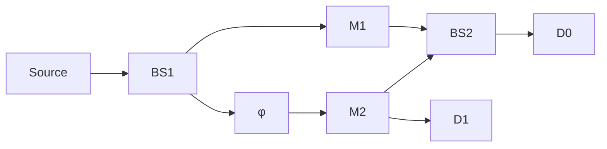

# Lesson 1: Wave-Particle Duality Foundations

## 1. First-Principles Intuition & Invariants

The quantum revolution of the early twentieth century arose not from philosophical speculation but from experimental paradoxes that classical physics could not resolve. By the 1920s, physicists faced mounting evidence that light—long established as an electromagnetic wave phenomenon obeying Maxwell's equations—also exhibited particle-like behavior in photoelectric absorption and Compton scattering. Conversely, electrons and other matter particles, previously understood as discrete corpuscles following Newtonian trajectories, produced interference patterns characteristic of waves when passed through crystalline lattices or narrow apertures. This empirical crisis forced a radical reconceptualization of physical reality at atomic scales.

Wave-particle duality stands as the foundational principle of quantum mechanics, asserting that all quantum entities possess both wave-like and particle-like properties, with the observed character determined by the measurement apparatus and experimental context. This duality is not merely a philosophical curiosity but a quantitative framework encoded in the de Broglie relations, verified through precision interferometry, and constrained by fundamental uncertainty principles that govern what can be simultaneously known about complementary observables.

The de Broglie hypothesis, proposed by Louis de Broglie in his 1924 doctoral thesis, postulates that every particle of matter with momentum $p$ possesses an associated wavelength $\lambda$ given by the relation:

$$\lambda = \frac{h}{p} = \frac{h}{mv}$$

where $h = 6.62607015 \times 10^{-34}$ J·s is Planck's constant, $m$ represents the particle mass, and $v$ its velocity. This relation extends Einstein's earlier photon energy-frequency correspondence $E = h\nu$ into the momentum-wavelength domain, establishing a universal bridge between the wave description (wavelength, frequency) and particle description (momentum, energy) of quantum entities. For a photon, where $E = pc$ for massless particles and $c = \nu\lambda$ for electromagnetic waves, these relations collapse into the unified framework $E = h\nu = \hbar\omega$ and $p = h/\lambda = \hbar k$, where $\hbar = h/(2\pi)$ is the reduced Planck constant and $k = 2\pi/\lambda$ the wave vector magnitude.

The physical significance of the de Broglie wavelength becomes apparent when examining characteristic scales. For a macroscopic object such as a baseball with mass $m = 0.145$ kg moving at velocity $v = 40$ m/s, the de Broglie wavelength computes to $\lambda \approx 1.14 \times 10^{-34}$ m, some twenty orders of magnitude smaller than atomic nuclei. Such infinitesimal wavelengths render quantum wave effects utterly negligible, explaining why classical mechanics successfully describes everyday phenomena. Conversely, for an electron with mass $m_e = 9.109 \times 10^{-31}$ kg accelerated through a potential difference of $V = 100$ V, acquiring kinetic energy $K = eV = 1.602 \times 10^{-17}$ J and momentum $p = \sqrt{2m_e K} \approx 5.4 \times 10^{-24}$ kg·m/s, the de Broglie wavelength becomes $\lambda \approx 1.23$ nm—comparable to atomic spacings in crystalline solids. At such scales, wave phenomena dominate observable behavior.

The wave function $\Psi(\vec{r}, t)$ emerges as the mathematical object encoding quantum state information, satisfying the time-dependent Schrödinger equation:

$$i\hbar \frac{\partial \Psi}{\partial t} = \hat{H}\Psi = \left(-\frac{\hbar^2}{2m}\nabla^2 + V(\vec{r}, t)\right)\Psi$$

where $\hat{H}$ denotes the Hamiltonian operator, $\nabla^2$ the Laplacian spatial derivative operator, and $V(\vec{r}, t)$ the potential energy function. The wave function itself possesses no direct physical interpretation—it is a complex-valued probability amplitude residing in an abstract Hilbert space. The Born interpretation, established by Max Born in 1926, provides the connection to measurable quantities: the probability density for finding the particle at position $\vec{r}$ at time $t$ equals $\rho(\vec{r}, t) = |\Psi(\vec{r}, t)|^2 = \Psi^*\Psi$, where $\Psi^*$ denotes the complex conjugate. Normalization requires that the total probability integrates to unity over all space:

$$\int_{-\infty}^{\infty} |\Psi(\vec{r}, t)|^2 \, d^3r = 1$$

For a free particle moving with definite momentum $\vec{p} = \hbar\vec{k}$ and energy $E = \hbar\omega = p^2/(2m)$, the wave function takes the plane wave form:

$$\Psi(\vec{r}, t) = A \exp\left(i(\vec{k} \cdot \vec{r} - \omega t)\right) = A \exp\left(\frac{i}{\hbar}(\vec{p} \cdot \vec{r} - Et)\right)$$

where $A$ represents a normalization constant. This plane wave solution exhibits infinite spatial extent with uniform probability density $|\Psi|^2 = |A|^2$, representing a particle with perfectly defined momentum but completely undefined position—a state violating strict normalization but serving as a useful idealized eigenstate of the momentum operator $\hat{p} = -i\hbar\nabla$.

Physical particles occupy wave packet states formed by superposing plane waves across a momentum distribution:

$$\Psi(\vec{r}, t) = \int \phi(\vec{k}) \exp\left(i(\vec{k} \cdot \vec{r} - \omega(\vec{k}) t)\right) \, d^3k$$

where $\phi(\vec{k})$ specifies the momentum-space amplitude distribution. A localized wave packet with spatial extent $\Delta x$ necessarily contains a spread of wave vectors $\Delta k \sim 1/\Delta x$ through Fourier transform reciprocity. Since $p = \hbar k$, this translates into a momentum uncertainty $\Delta p \sim \hbar/\Delta x$, yielding the Heisenberg uncertainty principle:

$$\Delta x \, \Delta p \geq \frac{\hbar}{2}$$

This fundamental inequality constrains simultaneous knowledge of position and momentum, not due to measurement imperfection but as an intrinsic property of quantum wave functions. A similar relation governs energy and time: $\Delta E \, \Delta t \geq \hbar/2$, where $\Delta t$ represents the characteristic timescale over which the wave packet spreads or the system evolves through energy states.

The complementarity principle, articulated by Niels Bohr in 1927, formalizes the conceptual framework: wave and particle descriptions represent complementary facets of quantum reality, mutually exclusive in any single measurement yet both necessary for complete physical understanding. An experimental apparatus designed to measure wave properties (interference patterns, diffraction angles) necessarily destroys information about particle properties (definite trajectories, localized detection events), and vice versa. This complementarity is not an epistemological limitation but an ontological feature of quantum systems—the choice of measurement apparatus fundamentally determines which observables possess definite values.

## 2. Core Architecture & Mechanics

The double-slit experiment stands as the canonical empirical demonstration of wave-particle duality, stripping quantum behavior to its essential paradox. The experimental architecture consists of a coherent source emitting particles (photons, electrons, neutrons, or even molecules), a barrier containing two narrow parallel slits separated by distance $d$, and a detection screen positioned at distance $L$ behind the barrier. When both slits remain open, the detection screen records an interference pattern—alternating bright and dark fringes—characteristic of wave phenomena. When either slit is closed, or when apparatus monitors which slit each particle traverses, the interference pattern vanishes, replaced by the classical distribution expected for particle trajectories.

The mathematical analysis begins with the superposition principle governing wave functions. When both slits A and B are open, the total wave function at the detection screen equals the coherent sum of amplitudes from each slit:

$$\Psi_{\text{total}} = \Psi_A + \Psi_B$$

Treating each slit as a cylindrical wave source (valid in the Fraunhofer far-field limit where $L \gg d$ and $L \gg d^2/\lambda$), the wave function at screen position $x$ (measured from the central axis) becomes:

$$\Psi(x) = \frac{A}{\sqrt{r_A}} e^{ikr_A} + \frac{A}{\sqrt{r_B}} e^{ikr_B}$$

where $r_A$ and $r_B$ denote path lengths from slits A and B to the screen position, and $k = 2\pi/\lambda$ is the wave number. For small angles $\theta = x/L$ and equal path length magnitudes $r_A \approx r_B \approx L$ in amplitude factors, the path difference simplifies to $\delta = r_B - r_A \approx d\sin\theta \approx dx/L$. The intensity distribution follows from the squared modulus:

$$I(x) = |\Psi(x)|^2 \propto \left|\frac{A}{L}\right|^2 \left|e^{ikr_A} + e^{ikr_B}\right|^2 = \frac{2|A|^2}{L^2}\left(1 + \cos(k\delta)\right) = \frac{2|A|^2}{L^2}\left(1 + \cos\left(\frac{2\pi d x}{\lambda L}\right)\right)$$

This yields constructive interference (intensity maxima) at positions satisfying $d\sin\theta = m\lambda$ for integer $m$, and destructive interference (intensity minima) at $d\sin\theta = (m + 1/2)\lambda$. The fringe spacing on the screen equals $\Delta x = \lambda L / d$. For electrons accelerated through $V = 50$ kV (yielding $\lambda \approx 5.5$ pm), with slits separated by $d = 50$ nm and screen distance $L = 1$ m, the fringe spacing computes to $\Delta x \approx 0.11$ mm—readily measurable with photographic film or microchannel plate detectors.

The quantum paradox emerges starkly when reducing source intensity until only one particle traverses the apparatus at a time. Individual detection events appear as localized spots—particle-like impacts at definite screen positions. Yet as detection events accumulate, the interference pattern gradually materializes from the statistical distribution of these discrete arrivals. Each particle interferes only with itself, not with other particles. The wave function describes probability amplitudes for single-particle behavior, not a classical ensemble distribution.

When experimenters introduce which-path information—apparatus capable of determining whether each particle passed through slit A or slit B—the interference pattern vanishes regardless of whether the information is actually read out. A common realization employs polarization tags: photons traversing slit A acquire vertical polarization, while slit B imparts horizontal polarization. The wave functions from each slit now occupy orthogonal polarization states $|V\rangle$ and $|H\rangle$, rendering them distinguishable:

$$\Psi_{\text{tagged}} = \Psi_A|V\rangle + \Psi_B|H\rangle$$

The probability density for screen detection, after tracing over (ignoring) polarization states, becomes:

$$P(x) = |\langle V|\Psi_{\text{tagged}}\rangle|^2 + |\langle H|\Psi_{\text{tagged}}\rangle|^2 = |\Psi_A|^2 + |\Psi_B|^2$$

This incoherent sum—lacking the cross term $2\text{Re}(\Psi_A^*\Psi_B)$ responsible for interference—produces the classical double-peaked distribution. Coherence requires indistinguishability: only when the particle's path through the apparatus leaves no trace in any observable degree of freedom can interference manifest. This principle extends beyond discrete paths to encompass all complementary observables—position versus momentum, energy versus time, angular momentum components about different axes.

Experimentally measuring wave-particle duality quantitatively employs the visibility parameter $V$ and distinguishability parameter $D$, constrained by the duality relation:

$$V^2 + D^2 \leq 1$$

Visibility quantifies interference contrast: $V = (I_{\max} - I_{\min})/(I_{\max} + I_{\min})$, ranging from $V = 1$ for perfect interference to $V = 0$ for no fringes. Distinguishability measures which-path information: $D = 1$ for perfect path knowledge, $D = 0$ for complete ignorance. The inequality formalizes complementarity: gaining path information (increasing $D$) necessarily reduces interference visibility (decreasing $V$), with equality holding for pure quantum states.

Modern realizations extend double-slit physics to macroscopic quantum systems. Fullerene molecules ($\text{C}_{60}$ and $\text{C}_{70}$, containing 60 and 70 carbon atoms respectively, with masses around 720 and 840 atomic mass units) exhibit interference patterns when passed through nanofabricated gratings with periods near 100 nm. At velocities of 200 m/s, the de Broglie wavelength computes to approximately 2.8 pm, yet interference fringes appear with fringe spacing matching theoretical predictions. These experiments probe the boundary between quantum and classical regimes, testing decoherence mechanisms that suppress interference for increasingly complex systems through environmental entanglement.

The Mach-Zehnder interferometer architecture provides an alternative configuration isolating wave-particle duality. A beam splitter divides an incident photon or atom beam into two coherent paths; phase shifters and mirrors route the paths to recombine at a second beam splitter feeding two detectors D0 and D1:

In this configuration, BS1 and BS2 denote beam splitters, M1 and M2 mirrors, and φ a controllable phase shifter. For photons, beam splitters are semi-transparent dielectric interfaces; for atoms, they are pulsed laser fields inducing stimulated Raman transitions between internal states. With no which-path information and phase shift $\phi$, the detection probabilities exhibit sinusoidal interference:

$$P_{D0} = \cos^2(\phi/2), \quad P_{D1} = \sin^2(\phi/2)$$

Inserting which-path detectors after BS1 collapses the wave function into a definite path eigenstate, destroying interference: $P_{D0} = P_{D1} = 1/2$ independent of $\phi$. Quantum erasure experiments restore interference by performing measurements that erase which-path information after the photon passes the detection point but before wavefunction collapse—demonstrating that complementarity is enforced not by irreversible disturbance but by the logical structure of quantum information.

## 3. High-Performance Optimization & Failure Modes

Designing high-precision double-slit experiments demands rigorous control of systematic errors and decoherence channels that degrade interference visibility. The de Broglie wavelength $\lambda = h/p$ scales inversely with particle momentum, imposing severe constraints on source monochromaticity and collimation for matter-wave interferometry. For thermal atomic beams at temperature $T$, the momentum spread follows the Maxwell-Boltzmann distribution with characteristic width $\Delta p \sim \sqrt{m k_B T}$, yielding fractional momentum uncertainty $\Delta p/p \sim 1$. This broad distribution washes out interference fringes unless the source is velocity-selected or laser-cooled to sub-Kelvin temperatures.

Laser cooling techniques—Doppler cooling, polarization gradient cooling, and evaporative cooling—reduce atomic thermal velocities to the microkelvin regime, where recoil from a single photon absorption constitutes a substantial momentum kick. For rubidium-87 atoms cooled to $T = 1 \,\mu\text{K}$, the thermal de Broglie wavelength reaches $\lambda_{\text{th}} = h/\sqrt{2\pi m k_B T} \approx 0.6 \,\mu\text{m}$, comparable to optical wavelengths and enabling atom interferometry with micrometer-scale gratings. The Ramsey-Bordé interferometer configuration, utilizing standing-wave light pulses as coherent beam splitters for atomic wave packets, achieves enclosed areas on the order of square millimeters, rendering the setup sensitive to inertial forces (accelerations, rotations) and serving as the basis for precision gyroscopes and gravimeters.

Decoherence—the irreversible loss of quantum coherence through entanglement with environmental degrees of freedom—represents the fundamental obstacle to maintaining interference in complex systems. Each collision with a background gas molecule, emission or absorption of thermal radiation, or scattering of ambient photons entangles the particle's internal state with the environment, effectively performing a which-path measurement. The decoherence rate scales with the system's coupling strength to the environment and the number of environmental modes within the system's interaction volume.

For massive particles, collisional decoherence in residual gas imposes strict vacuum requirements. The mean free path $\ell = (n\sigma)^{-1}$, where $n$ denotes gas density and $\sigma$ the collision cross-section (typically $\sigma \sim 10^{-19}$ m² for noble gases), must exceed the interferometer dimensions. At pressure $p = 10^{-7}$ torr and temperature $T = 300$ K, the gas density is $n \approx 3.5 \times 10^{15}$ m⁻³, yielding $\ell \approx 3$ m—barely sufficient for table-top interferometers. High-precision experiments operate in ultra-high vacuum at $p < 10^{-10}$ torr, where mean free paths extend to kilometers.

Photon scattering from thermal radiation fields provides another decoherence channel, particularly severe for molecules with large polarizabilities. The scattering rate $\Gamma = n_{\gamma} \sigma_{\text{scat}} v$, where $n_{\gamma}$ is the blackbody photon density at temperature $T$ and $\sigma_{\text{scat}}$ the photon scattering cross-section, increases with molecular size. For fullerene molecules at room temperature, thermal photon scattering from a 300 K environment yields decoherence times on the order of milliseconds, requiring sub-millisecond transit times through the interferometer to preserve visibility.

Slit width and separation impose diffractive constraints through the uncertainty principle. For slits of finite width $a$, each slit introduces a transverse momentum spread $\Delta p_x \sim \hbar/a$ through single-slit diffraction. When this uncertainty exceeds the momentum difference $\hbar d/(L\lambda)$ required to resolve adjacent interference fringes, the pattern blurs. Optimal visibility requires $a \ll d$ and $d \ll L\lambda/a$, constraining feasible geometries. Nanofabricated gratings with periods $d \sim 100$ nm and slit widths $a \sim 50$ nm, produced via electron-beam lithography on silicon nitride membranes, achieve these criteria for molecular beams.

Temporal coherence requirements stem from the wave packet longitudinal extent. A finite-duration pulse with temporal width $\Delta t$ possesses energy spread $\Delta E \sim \hbar/\Delta t$ and hence wavelength spread $\Delta\lambda/\lambda \sim \Delta E/E$. For interference fringes to remain stable across the detection screen, the coherence length $\ell_{\text{coh}} = \lambda^2/\Delta\lambda$ must exceed the path difference $\delta \sim d^2/L$. Electron sources driven by field emission from sharp tungsten tips typically exhibit energy spreads of $\Delta E \sim 0.3$ eV; for 50 keV electrons ($\lambda \approx 5$ pm), this yields $\ell_{\text{coh}} \approx 0.5 \,\mu\text{m}$, adequate for double slits separated by $d = 50$ nm at $L = 1$ m.

Measuring the uncertainty principle directly requires simultaneous position and momentum determinations on identically prepared quantum states. A canonical protocol employs weak measurements: position is inferred from weakly coupled pointer states (e.g., photon transverse momentum after scattering from the particle) that minimally disturb the wave function, followed by a strong projective momentum measurement. Statistical analysis over many runs reconstructs the joint quasi-probability distribution (the Wigner function), which exhibits negativity—impossible for classical probabilities—in regions where $\Delta x \, \Delta p < \hbar/2$ would be violated.

Advanced implementations probe entangled two-particle systems to demonstrate violations of local hidden-variable theories. When two particles share an entangled state $|\Psi\rangle = (|A_1\rangle|B_2\rangle + |B_1\rangle|A_2\rangle)/\sqrt{2}$, where subscripts label particles and letters denote slits, measuring which slit particle 1 traversed instantaneously collapses particle 2's state, destroying interference for particle 2 even though no local interaction occurred at particle 2's location. These nonlocal correlations, verified through violations of Bell inequalities, confirm that quantum complementarity reflects the structure of reality rather than observer ignorance.

Calibration protocols for electron and neutron interferometers rely on crystallographic standards and precision phasometry. For electron biprisms—where a charged wire applies a transverse electric field deflecting electrons into overlapping paths—the phase shift $\phi = (e/\hbar) \int A_z \, dz$, where $A_z$ denotes the magnetic vector potential component, enables measurement of magnetic flux with sensitivity below a single flux quantum $\Phi_0 = h/e = 4.136 \times 10^{-15}$ Wb. Neutron interferometers fabricated from perfect silicon crystals exploit Bragg diffraction from lattice planes separated by $d_{hkl} = a/\sqrt{h^2 + k^2 + l^2}$ (where $a = 0.543$ nm is the silicon lattice constant) to create coherent beam-splitting and recombination, achieving phase stabilities below milliradians over hour-long integration periods.

Error budgets for precision interferometry must account for vibration-induced phase noise, thermal drifts in optical path lengths, and residual electromagnetic field gradients. Passive vibration isolation platforms, employing pneumatic dampers and stacked elastomeric layers, attenuate ground vibrations below 1 Hz with suppression factors exceeding $10^6$. Active stabilization, using seismometers and piezoelectric actuators in feedback loops with bandwidths up to 100 Hz, further reduces residual motion to sub-nanometer amplitudes. Temperature stabilization to millikelvin levels via proportional-integral-derivative (PID) controllers minimizes thermal expansion of optical mounts and drift of beam splitter positions, maintaining fringe stability over hours.

The transition from quantum to classical behavior—where interference fringes vanish for macroscopic objects—remains an active research frontier. Decoherence theory predicts that systems coupled to environments with many degrees of freedom undergo exponential suppression of off-diagonal density matrix elements (coherences) on timescales $\tau_D \sim \hbar/(k_B T) \cdot (m_{\text{sys}}/m_{\text{env}})^{-2}$, where $m_{\text{sys}}$ and $m_{\text{env}}$ characterize system and environment masses. For a dust grain of mass $10^{-15}$ kg in room-temperature air, $\tau_D \sim 10^{-40}$ s—vanishingly short, rendering quantum superposition unobservable. Experiments probing mesoscopic scales, using superconducting qubits in flux states, levitated nanoparticles in optical traps, or Bose-Einstein condensates containing thousands of atoms, push this boundary, testing whether new physics beyond standard quantum mechanics emerges at larger scales.

Optimal experimental design for pedagogical demonstrations prioritizes visual clarity and reproducibility. Electron double-slit setups using transmission electron microscopes (TEMs) operated at 80 kV, with carbon-film substrates containing FIB-milled slits of width 30 nm separated by 300 nm, produce interference patterns on phosphor screens recorded by CCD cameras with exposure times of seconds. Single-electron detection mode, achieved by reducing beam current below $10^{-18}$ A (corresponding to electron arrival rates below 10 Hz), allows students to observe the gradual buildup of interference from individual localized events, directly witnessing the wave-particle synthesis at quantum foundations.
