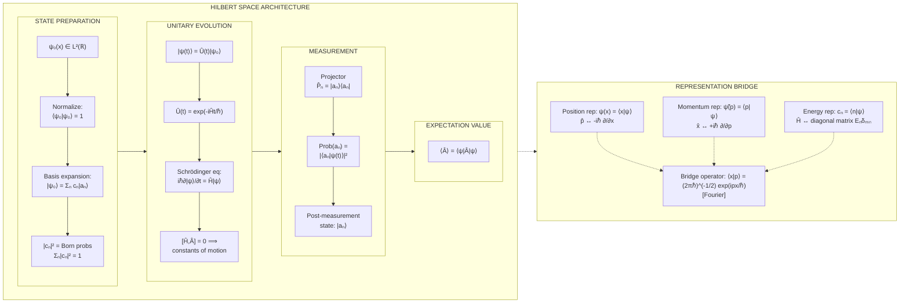

# Lesson 2: Hilbert Space Operator Formalism

## 1. First-Principles Intuition & Invariants

Quantum mechanics is, at its deepest level, a theory about information: what can be known about a physical system, how that knowledge transforms under measurement, and what constraints nature imposes on simultaneous knowledge of incompatible quantities. The mathematical structure that makes this precise is the Hilbert space, and understanding it not as an abstract convenience but as a physical necessity is the first task of any serious practitioner.

The transition from classical to quantum mechanics is not merely a substitution of waves for particles. It is a fundamental restructuring of what the word "state" means. In classical mechanics, the state of a system is a point in phase space — a definite position $\vec{q}$ and momentum $\vec{p}$ at every instant. Measurement reveals this state without disturbing it. Quantum mechanics abandons this picture entirely. The state of a quantum system is instead a ray in a complex vector space, and the act of measurement is an irreducible physical intervention that collapses this structure onto one of a discrete set of outcomes. The Hilbert space formalism is the language that makes this operationally precise.

### The Hilbert Space as Physical Arena

A Hilbert space $\mathcal{H}$ is a complete inner product space over the field of complex numbers $\mathbb{C}$. For a particle in one dimension, the relevant Hilbert space is $L^2(\mathbb{R})$, the space of square-integrable complex-valued functions $\psi(x)$ satisfying:

$$\int_{-\infty}^{\infty} |\psi(x)|^2 \, dx < \infty$$

The completeness requirement — that every Cauchy sequence of vectors converges to a limit inside the space — is not a mathematical formality. It guarantees that physically sensible limiting procedures, such as taking a superposition of infinitely many momentum eigenstates to build a normalizable wave packet, remain well-defined within the theory. Without completeness, the formalism would be unable to describe physically realizable states.

For finite-dimensional systems like spin-$\frac{1}{2}$ particles, $\mathcal{H} = \mathbb{C}^2$, and all linear algebra is exact. The infinite-dimensional case introduces subtleties — domains of operators, distributional eigenstates, the distinction between normalizable and non-normalizable states — that the working physicist must navigate carefully and that we address throughout this lesson.

### Bra-Ket Notation: Dirac's Operational Language

Paul Dirac introduced bra-ket notation not as aesthetic convenience but as an operational calculus that cleanly separates the abstract algebraic structure of quantum states from any particular representation. A **ket** $|\psi\rangle$ is an element of $\mathcal{H}$. Its dual, the **bra** $\langle\psi|$, is a linear functional in the dual space $\mathcal{H}^*$ that maps any ket $|\phi\rangle$ to the complex number $\langle\psi|\phi\rangle$. The inner product is therefore the contraction of a bra with a ket, and by the Riesz representation theorem, there is a canonical antilinear isomorphism between $\mathcal{H}$ and $\mathcal{H}^*$ so that every bra corresponds to exactly one ket and vice versa.

The inner product on $\mathcal{H}$ satisfies three axioms that carry direct physical weight. For any $|\psi\rangle, |\phi\rangle, |\chi\rangle \in \mathcal{H}$ and $\alpha \in \mathbb{C}$:

$$\langle\psi|\phi\rangle = \langle\phi|\psi\rangle^*$$
$$\langle\psi|\alpha\phi + \chi\rangle = \alpha\langle\psi|\phi\rangle + \langle\psi|\chi\rangle$$
$$\langle\psi|\psi\rangle \geq 0, \quad \text{with equality iff } |\psi\rangle = 0$$

The first axiom enforces that $\langle\psi|\psi\rangle$ is always real and non-negative, which is essential because $|\langle\psi|\psi\rangle|$ is interpreted as a probability. A normalized state satisfies $\langle\psi|\psi\rangle = 1$, and the probability of finding the system in state $|\phi\rangle$ upon measuring a system prepared in $|\psi\rangle$ is $|\langle\phi|\psi\rangle|^2$ — the Born rule, which is the empirical bridge between the mathematical formalism and experimental outcomes.

In position representation, the inner product takes its familiar integral form:

$$\langle\phi|\psi\rangle = \int_{-\infty}^{\infty} \phi^*(x)\,\psi(x)\,dx$$

The position eigenstate $|x'\rangle$ satisfies $\langle x|x'\rangle = \delta(x - x')$, which is not a function in the classical sense but a distribution. This signals that position eigenstates are not normalizable and do not belong to $L^2(\mathbb{R})$ in the strict sense — they belong to a larger space called the rigged Hilbert space or Gel'fand triple, $\Phi \subset \mathcal{H} \subset \Phi'$, where $\Phi$ is a dense subspace of smooth, rapidly decreasing test functions and $\Phi'$ is its topological dual containing distributions. For the working physicist, this means position and momentum eigenstates are idealizations: physically realizable states are always square-integrable wave packets constructed from them.

### Operators as Observables: The Hermitian Condition

Classical observables are real-valued functions on phase space. Quantum observables are linear operators on $\mathcal{H}$. The critical requirement is that physical observables — quantities whose measurement yields real numbers — must be represented by **Hermitian** (self-adjoint) operators.

For an operator $\hat{A}$, the adjoint $\hat{A}^\dagger$ is defined by the condition:

$$\langle\phi|\hat{A}|\psi\rangle = \langle\hat{A}^\dagger\phi|\psi\rangle \quad \forall\, |\psi\rangle, |\phi\rangle \in \mathcal{H}$$

A Hermitian operator satisfies $\hat{A}^\dagger = \hat{A}$, which immediately guarantees that all eigenvalues are real. The proof is direct: if $\hat{A}|a\rangle = a|a\rangle$, then $\langle a|\hat{A}|a\rangle = a\langle a|a\rangle$. Taking the complex conjugate using the Hermitian condition gives $\langle a|\hat{A}^\dagger|a\rangle = a^*\langle a|a\rangle$. Since $\hat{A} = \hat{A}^\dagger$, we conclude $a = a^*$, so $a \in \mathbb{R}$.

In practice, the distinction between Hermitian and self-adjoint operators becomes important for operators defined on half-lines or with boundary conditions, but for the canonical observables on $\mathbb{R}$, the distinction is immaterial and we follow standard physics convention in treating them as equivalent.

The position and momentum operators in one dimension are defined by their action on wave functions as:

$$\hat{x}\,\psi(x) = x\,\psi(x)$$
$$\hat{p}\,\psi(x) = -i\hbar\,\frac{\partial}{\partial x}\psi(x)$$

One verifies Hermiticity of $\hat{p}$ by integration by parts, using the fact that normalizable wave functions vanish at infinity:

$$\langle\phi|\hat{p}|\psi\rangle = \int \phi^*\!\left(-i\hbar\frac{\partial\psi}{\partial x}\right)dx = -\left[i\hbar\phi^*\psi\right]_{-\infty}^{\infty} + \int\!\left(-i\hbar\frac{\partial\phi^*}{\partial x}\right)\psi\,dx = \langle\hat{p}\phi|\psi\rangle$$

This confirms $\hat{p}^\dagger = \hat{p}$, grounding the momentum operator as a legitimate quantum observable.

### The Eigenvalue Problem and Spectral Decomposition

The spectral theorem for Hermitian operators is the mathematical backbone of quantum measurement theory. It states that the eigenvectors of a Hermitian operator form a complete orthonormal basis for $\mathcal{H}$, so any state can be decomposed as a superposition of eigenstates. For a discrete spectrum:

$$\hat{A}|a_n\rangle = a_n|a_n\rangle, \quad \langle a_m|a_n\rangle = \delta_{mn}$$
$$|\psi\rangle = \sum_n c_n|a_n\rangle, \quad c_n = \langle a_n|\psi\rangle$$

The completeness relation, $\sum_n |a_n\rangle\langle a_n| = \hat{I}$, is the resolution of the identity and perhaps the most useful single equation in applied quantum mechanics. It allows the insertion of a complete set of states at any point in an inner product calculation — a technique that connects representations, transforms between bases, and builds propagators.

For a continuous spectrum, the sums become integrals:

$$\hat{A}|a\rangle = a|a\rangle, \quad \langle a|a'\rangle = \delta(a - a')$$
$$|\psi\rangle = \int da\, c(a)|a\rangle, \quad c(a) = \langle a|\psi\rangle$$

The resolution of the identity becomes $\int da\, |a\rangle\langle a| = \hat{I}$. Inserting this identity between $\langle x|$ and $|\psi\rangle$ with $a = x'$ recovers the trivial statement $\psi(x) = \psi(x)$, while inserting it with the momentum eigenstates $|p\rangle$ yields the Fourier transform as a change of basis between position and momentum representations.

Momentum eigenstates in position representation are $\langle x|p\rangle = \frac{1}{\sqrt{2\pi\hbar}}e^{ipx/\hbar}$, and the wave function in momentum space is:

$$\tilde{\psi}(p) = \langle p|\psi\rangle = \frac{1}{\sqrt{2\pi\hbar}}\int_{-\infty}^{\infty} e^{-ipx/\hbar}\psi(x)\,dx$$

The uncertainty principle already lives here: a wave packet sharply localized in $x$ requires a broad superposition of momenta, and vice versa. This is not a statement about measurement disturbance in the naive sense — it is a statement about the Fourier width product, which we formalize in the next section.

### Commutators and the Canonical Quantization Program

The commutator of two operators is defined as:

$$[\hat{A}, \hat{B}] = \hat{A}\hat{B} - \hat{B}\hat{A}$$

This algebraic object encodes the degree to which the two observables are incompatible. If $[\hat{A}, \hat{B}] = 0$, the operators share a common eigenbasis and can be simultaneously measured with arbitrary precision. If the commutator is nonzero, no common eigenbasis exists, and the Robertson uncertainty relation applies:

$$\Delta A \cdot \Delta B \geq \frac{1}{2}\left|\langle[\hat{A},\hat{B}]\rangle\right|$$

where $\Delta A = \sqrt{\langle\hat{A}^2\rangle - \langle\hat{A}\rangle^2}$ is the standard deviation of $\hat{A}$ in state $|\psi\rangle$.

The canonical commutation relation (CCR) between position and momentum is:

$$[\hat{x}, \hat{p}] = i\hbar\hat{I}$$

This single equation is the axiomatic heart of quantum mechanics. It is not derived from more fundamental principles in the standard formulation — it is imposed as the quantization condition, promoted from the classical Poisson bracket $\{x, p\}_{PB} = 1$ via the correspondence $\{\ ,\ \}_{PB} \to \frac{1}{i\hbar}[\ ,\ ]$. The verification in position representation is straightforward:

$$[\hat{x},\hat{p}]\psi(x) = x\left(-i\hbar\frac{\partial\psi}{\partial x}\right) - \left(-i\hbar\frac{\partial}{\partial x}\right)(x\psi(x)) = -i\hbar x\psi' + i\hbar(\psi + x\psi') = i\hbar\psi(x)$$

From $[\hat{x}, \hat{p}] = i\hbar$, the Heisenberg uncertainty principle follows as a theorem rather than a postulate:

$$\Delta x \cdot \Delta p \geq \frac{\hbar}{2}$$

The minimum uncertainty state — the coherent state or Gaussian wave packet — saturates this bound and plays a central role in quantum optics, condensed matter, and the semiclassical limit of quantum mechanics.

---

## 2. Core Architecture & Mechanics

The Hilbert space formalism is not merely a theoretical description; it is an operational architecture with specific signal paths governing how state preparation, unitary evolution, and projective measurement interact. Understanding these paths — both analytically and numerically — is what separates the practitioner who can deploy quantum mechanics from the student who can merely recite its postulates.

### Structural Overview of the Formalism

The following diagram captures the operational flow from state preparation through measurement, with the mathematical objects governing each transition:

Each arrow in this architecture is a physical event with mathematical content. State preparation fixes initial conditions; unitary evolution is generated by the Hamiltonian and conserves the inner product, hence probabilities; measurement is a stochastic projection that irreversibly collapses the superposition. The practitioner's work consists of moving fluently through these three stages and switching between representations as computational efficiency demands.

### Matrix Mechanics: Finite-Dimensional Realization

For a finite-dimensional Hilbert space — the spin-$\frac{1}{2}$ system being the canonical example — every operator is a matrix, every state is a column vector, and the full formalism reduces to complex linear algebra that can be executed analytically or numerically without approximation.

The two-dimensional Hilbert space $\mathcal{H} = \mathbb{C}^2$ for a spin-$\frac{1}{2}$ particle has the standard basis of spin-up and spin-down along the $z$-axis:

$$|+\rangle = \begin{pmatrix}1\\0\end{pmatrix}, \quad |-\rangle = \begin{pmatrix}0\\1\end{pmatrix}$$

The spin operators are $\hat{S}_i = \frac{\hbar}{2}\sigma_i$ where $\sigma_i$ are the Pauli matrices:

$$\sigma_x = \begin{pmatrix}0&1\\1&0\end{pmatrix}, \quad \sigma_y = \begin{pmatrix}0&-i\\i&0\end{pmatrix}, \quad \sigma_z = \begin{pmatrix}1&0\\0&-1\end{pmatrix}$$

One verifies directly that each Pauli matrix is Hermitian ($\sigma_i^\dagger = \sigma_i$), traceless, and squares to the identity ($\sigma_i^2 = I$). Their commutation relations are:

$$[\sigma_i, \sigma_j] = 2i\epsilon_{ijk}\sigma_k$$

where $\epsilon_{ijk}$ is the Levi-Civita symbol. This algebra $\mathfrak{su}(2)$ is the Lie algebra of the rotation group $SU(2)$, so the spin operators are generators of rotations in $\mathbb{C}^2$.

A general pure state is $|\psi\rangle = \cos(\theta/2)|+\rangle + e^{i\phi}\sin(\theta/2)|-\rangle$, parameterized by angles on the Bloch sphere. The expectation value of $\hat{S}_z$ is:

$$\langle\hat{S}_z\rangle = \langle\psi|\hat{S}_z|\psi\rangle = \frac{\hbar}{2}\left(\cos^2\frac{\theta}{2} - \sin^2\frac{\theta}{2}\right) = \frac{\hbar}{2}\cos\theta$$

This is not just a formal result — it is directly measurable with a Stern-Gerlach apparatus, and the derivation above is exactly the calculation one performs to predict experimental outcomes in spin-state tomography.

### Computing Matrix Elements and Transition Rates

In practice, most quantum mechanical computations reduce to evaluating matrix elements of operators between states. The general matrix element is:

$$A_{mn} = \langle m|\hat{A}|n\rangle$$

For the harmonic oscillator, the ladder operators $\hat{a}$ and $\hat{a}^\dagger$ have the simplest possible matrix elements. Their definitions and actions are:

$$\hat{a}|n\rangle = \sqrt{n}\,|n-1\rangle, \quad \hat{a}^\dagger|n\rangle = \sqrt{n+1}\,|n+1\rangle$$

so $\langle m|\hat{a}|n\rangle = \sqrt{n}\,\delta_{m,n-1}$ and $\langle m|\hat{a}^\dagger|n\rangle = \sqrt{n+1}\,\delta_{m,n+1}$. Since $\hat{x} = \sqrt{\frac{\hbar}{2m\omega}}(\hat{a} + \hat{a}^\dagger)$, the position matrix elements follow immediately:

$$\langle m|\hat{x}|n\rangle = \sqrt{\frac{\hbar}{2m\omega}}\left(\sqrt{n}\,\delta_{m,n-1} + \sqrt{n+1}\,\delta_{m,n+1}\right)$$

This selection rule — that $\hat{x}$ connects only states differing by one quantum of excitation — is what makes the harmonic oscillator the engine of perturbation theory in quantum field theory and spectroscopy. Electric dipole transitions between molecular vibrational modes, photon emission in a cavity, and phonon scattering in crystals all trace their selection rules back to this structure.

### The Heisenberg Picture and Operator Dynamics

The Schrödinger picture assigns time dependence to states and keeps operators static. The Heisenberg picture inverts this: states are fixed at their initial values and operators evolve according to:

$$\frac{d\hat{A}_H}{dt} = \frac{i}{\hbar}[\hat{H}, \hat{A}_H] + \left(\frac{\partial\hat{A}}{\partial t}\right)_H$$

The Heisenberg equation of motion is the quantum analog of Hamilton's equations. For position and momentum in a potential $V(\hat{x})$:

$$\frac{d\hat{x}}{dt} = \frac{i}{\hbar}[\hat{H},\hat{x}] = \frac{\hat{p}}{m}$$
$$\frac{d\hat{p}}{dt} = \frac{i}{\hbar}[\hat{H},\hat{p}] = -\frac{\partial V}{\partial \hat{x}}$$

These are operator-valued equations, but their expectation values recover Newton's second law exactly (Ehrenfest's theorem). The Heisenberg picture is indispensable in quantum optics, quantum field theory, and many-body physics, where one tracks the time evolution of field operators rather than individual state vectors.

### Change of Basis: The Rotation of Representations

The connection between different representations is a unitary transformation. If $\{|a_n\rangle\}$ and $\{|b_n\rangle\}$ are two orthonormal bases of $\mathcal{H}$, the transformation matrix $U_{mn} = \langle b_m|a_n\rangle$ is unitary: $U^\dagger U = I$. Under this transformation, operators transform as:

$$\hat{A}' = U\hat{A}U^\dagger$$

and state vectors as $|\psi'\rangle = U|\psi\rangle$. Inner products and eigenvalues are preserved because $\langle\psi'|\hat{A}'|\phi'\rangle = \langle\psi|\hat{A}|\phi\rangle$. This is the Hilbert space version of a change of coordinate frame in classical mechanics, and it is the machinery behind basis diagonalization, the interaction picture, and the normal mode decomposition of coupled oscillator systems.

The computational routine for solving the time-independent Schrödinger equation in a finite basis is precisely this: choose a convenient basis $\{|n\rangle\}$, construct the Hamiltonian matrix $H_{mn} = \langle m|\hat{H}|n\rangle$, diagonalize it numerically to find eigenvalues $E_k$ and eigenvectors $|k\rangle$, and express any initial state in the energy eigenbasis to propagate it in time via $e^{-iE_k t/\hbar}$. This is the foundation of configuration interaction methods in quantum chemistry, tight-binding models in condensed matter, and coupled-channel scattering calculations in nuclear physics.

---

## 3. High-Performance Optimization & Failure Modes

Knowing the formalism is necessary but not sufficient. Working quantum mechanics problems at research level requires fluency in the techniques that make calculations tractable, and equally, the judgment to recognize when standard techniques break down.

### Experimental Protocol: Measuring Quantum States via Optical Pumping and Stern-Gerlach Analysis

The abstract machinery of Hermitian operators and projective measurement connects directly to laboratory apparatus. Consider a spin-$\frac{1}{2}$ ensemble of rubidium-87 atoms in a magneto-optical trap (MOT). The ground electronic state $5^2S_{1/2}$ has a nuclear spin that, under a static bias field $B_0$ along $\hat{z}$, splits into Zeeman sublevels $|m_F\rangle$ with energies $E_{m_F} = m_F g_F \mu_B B_0$.

**State Preparation.** Drive the atoms with a circularly polarized optical pumping beam resonant with the $5^2S_{1/2} \to 5^2P_{1/2}$ transition. Because circularly polarized light carries $\Delta m_F = +1$ angular momentum, repeated absorption-emission cycles pump the population toward the maximally spin-polarized state $|F=2, m_F=+2\rangle$. After $\sim 100\, \mu\text{s}$ of pumping at $1\,\text{mW/cm}^2$ intensity, greater than 95% population transfer to the stretched state is typical. This corresponds operationally to preparing the initial ket $|\psi_0\rangle = |F=2, m_F=+2\rangle$ with high fidelity.

**Coherent Rotation.** Apply a resonant radio-frequency pulse at the Larmor frequency $\omega_L = g_F \mu_B B_0 / \hbar$ for a duration $\tau$. The interaction Hamiltonian is $\hat{H}_{RF} = -\hat{\mu} \cdot \vec{B}_{RF}$, which generates a rotation about the $\hat{x}$-axis by angle $\Omega_R \tau$ where $\Omega_R$ is the Rabi frequency. A $\pi/2$ pulse at calibrated power and duration rotates the state from $|m_F=+2\rangle$ to an equal superposition — the operational realization of applying the unitary $\hat{U} = e^{-i\pi\hat{S}_x/2\hbar}$.

**Measurement by Stern-Gerlach Analysis.** Release the atoms from the trap and apply a strong magnetic field gradient $\partial B/\partial z \approx 50\,\text{G/cm}$ along the vertical axis. The force $F_z = m_F g_F \mu_B \partial B/\partial z$ spatially separates the $m_F$ components during $\sim 20\,\text{ms}$ of free fall. Absorption imaging with a resonant probe beam then gives the population $N_{m_F}$ in each Zeeman sublevel. The measured probability $P_{m_F} = N_{m_F}/N_{total}$ is the experimental realization of the Born rule prediction $|\langle m_F|\psi\rangle|^2$. Repeating this sequence over many experimental shots builds the full probability distribution and allows reconstruction of the density matrix via quantum state tomography.

Error sources in this protocol are systematic and quantifiable. Magnetic field inhomogeneity across the atomic cloud broadens each Zeeman resonance by $\delta\omega \sim \mu_B \delta B/\hbar$, introducing dephasing that reduces coherence. Spontaneous emission during RF manipulation (on order $\Gamma_{\text{scatt}} \sim 10^{-4}$ photons per RF cycle for far-detuned fields) introduces decoherence. The experimenter must balance optical pumping efficiency — which requires near-resonant light — against heating and state decoherence, which are minimized by brief, intense pulses followed by rapid extinction.

### Numerical Diagonalization: Finite-Basis Approximations

For bound state problems with no analytic solution, the standard approach is basis set diagonalization. Choose a truncated basis of $N$ states $\{|n\rangle\}_{n=0}^{N-1}$, compute the $N\times N$ Hamiltonian matrix, and diagonalize numerically. The key practical criterion for the basis is that it must span the physically relevant region of configuration space. For a 1D anharmonic oscillator $\hat{H} = \frac{\hat{p}^2}{2m} + \frac{1}{2}m\omega^2\hat{x}^2 + \lambda\hat{x}^4$, the harmonic oscillator eigenstates $|n\rangle$ form an efficient basis because the anharmonic term $\lambda\hat{x}^4$ has matrix elements that fall off with $|m-n|$.

The position operator in the harmonic oscillator basis connects states separated by $\pm 1$ quantum. Therefore $\hat{x}^4 = (\hat{a}+\hat{a}^\dagger)^4 \cdot (\hbar/2m\omega)^2$ generates matrix elements spanning $|m-n| \leq 4$. For a truncated basis of size $N$, convergence of the lowest $k$ eigenvalues requires $N \gg k$ and grows slowly with the coupling strength $\lambda/\hbar\omega$. A practical convergence check is to increase $N$ until the lowest eigenvalues change by less than the desired precision — typically $N = 50$ suffices for the lowest ten levels at moderate anharmonicity $\lambda\langle x^4\rangle \sim 0.1\hbar\omega$.

The critical failure mode in basis diagonalization is basis incompleteness: if the true ground state has amplitude extending beyond the basis's effective range, the computed eigenvalue will be systematically above the exact value (by the variational principle, since the Hamiltonian matrix eigenvalue is an upper bound on the true ground state energy). This failure is silent — the numerical diagonalization converges to a stable but incorrect answer. The diagnostic is systematic enlargement of the basis: if eigenvalues shift significantly upon doubling $N$, the basis is insufficient.

### Commutator Algebra: Computational Techniques and Failure Modes

Commutator calculations underpin perturbation theory, symmetry analysis, and the derivation of conservation laws. Three algebraic identities reduce most calculations to sequences of elementary steps:

$$[\hat{A}\hat{B}, \hat{C}] = \hat{A}[\hat{B},\hat{C}] + [\hat{A},\hat{C}]\hat{B} \quad\text{(product rule)}$$
$$[\hat{A}, [\hat{B},\hat{C}]] + [\hat{B},[\hat{C},\hat{A}]] + [\hat{C},[\hat{A},\hat{B}]] = 0 \quad\text{(Jacobi identity)}$$
$$e^{\hat{A}}\hat{B}e^{-\hat{A}} = \hat{B} + [\hat{A},\hat{B}] + \frac{1}{2!}[\hat{A},[\hat{A},\hat{B}]] + \cdots \quad\text{(Baker-Campbell-Hausdorff)}$$

The product rule is the workhorse. To compute $[\hat{x}^2, \hat{p}]$, one applies it immediately: $[\hat{x}^2,\hat{p}] = \hat{x}[\hat{x},\hat{p}] + [\hat{x},\hat{p}]\hat{x} = i\hbar\hat{x} + i\hbar\hat{x} = 2i\hbar\hat{x}$. By induction, $[\hat{x}^n, \hat{p}] = i\hbar n\hat{x}^{n-1}$, which is the quantum analog of $\{x^n, p\}_{PB} = nx^{n-1}$.

The Baker-Campbell-Hausdorff (BCH) lemma is essential for time evolution calculations. When $[\hat{A},[\hat{A},\hat{B}]] = c\hat{B}$ for some constant $c$, the BCH series terminates exactly, giving $e^{\hat{A}}\hat{B}e^{-\hat{A}} = \hat{B}\cosh(\sqrt{c}) + [\hat{A},\hat{B}]\sinh(\sqrt{c})/\sqrt{c}$. This is precisely the structure encountered in squeezing operators in quantum optics and Bogoliubov transformations in superconductivity.

A common failure mode is the erroneous commutation of operators that act on the same degree of freedom. The position operator $\hat{x}$ and any function $f(\hat{p})$ do not commute, while $\hat{x}_1$ and $\hat{p}_2$ acting on different particles commute exactly: $[\hat{x}_1, \hat{p}_2] = 0$. Confusing these leads to incorrect selection rules and spurious conservation laws. The diagnostic is always to return to the CCR as the ground truth and derive all higher commutators systematically.

### Degenerate Spectra and the Failure of Non-Degenerate Perturbation Theory

When a Hermitian operator has a degenerate eigenvalue — multiple linearly independent eigenvectors with the same eigenvalue — the eigenvectors within the degenerate subspace are not uniquely determined by the eigenvalue equation alone. Any linear combination within the degenerate subspace is an equally valid eigenvector. This freedom is physically significant: a perturbation $\hat{H}'$ will lift the degeneracy, but only along specific linear combinations determined by diagonalizing $\hat{H}'$ within the degenerate subspace.

If one applies standard non-degenerate perturbation theory to a degenerate system, the energy denominators $E_n^{(0)} - E_m^{(0)}$ diverge for the degenerate states ($E_n = E_m$), producing formally infinite corrections. This is the signal that the basis within the degenerate subspace must be chosen to diagonalize the perturbation before any expansion is attempted. The correct procedure — degenerate perturbation theory — is to construct the matrix of $\hat{H}'$ restricted to the degenerate subspace and diagonalize it exactly. The resulting "good" basis states have well-defined first-order energy corrections $E_n^{(1)}$ that are the eigenvalues of this restricted matrix.

This failure mode has direct experimental consequences. The Stark splitting of hydrogen's $n=2$ levels in an external electric field is exactly zero by symmetry selection rules in the $\{|200\rangle, |211\rangle, |210\rangle, |21-1\rangle\}$ basis, but nonzero and experimentally observable when the correct linear combinations adapted to the perturbation's symmetry are used. Getting this wrong leads to a prediction that disagrees with spectroscopic measurements by an order of magnitude.

### Uncertainty Relations Beyond Position-Momentum

The Robertson relation generalizes the uncertainty principle to any pair of non-commuting observables. For the spin operators:

$$\Delta S_x \cdot \Delta S_y \geq \frac{1}{2}|\langle[\hat{S}_x, \hat{S}_y]\rangle| = \frac{1}{2}|\langle i\hbar\hat{S}_z\rangle| = \frac{\hbar}{2}|\langle\hat{S}_z\rangle|$$

This is state-dependent: when the spin is polarized along $\hat{z}$, the right-hand side is $\hbar^2/4$, and the uncertainty product is at its maximum. When the spin points along $\hat{x}$, $\langle\hat{S}_z\rangle = 0$, the bound becomes trivially zero, and the spin components can in principle both have zero variance — but only in the specific state $|\hat{x}+\rangle$, where the expectation value of $\hat{S}_z$ vanishes. This state-dependence is often overlooked by students who interpret uncertainty relations as universal floor constraints rather than state-specific bounds.

The energy-time uncertainty relation $\Delta E \cdot \Delta t \geq \hbar/2$ requires separate treatment because time is not a Hermitian operator in quantum mechanics (there is no self-adjoint time operator conjugate to the Hamiltonian in a consistent sense for systems with bounded-below energy spectra, by Pauli's theorem). The correct interpretation is that $\Delta t$ is the characteristic timescale over which the state changes appreciably — specifically, $\Delta t = \Delta A / |d\langle\hat{A}\rangle/dt|$ for any observable $\hat{A}$, giving the Mandelstam-Tamm relation. This distinction matters for interpreting the natural linewidths of spectral lines: the lifetime $\tau$ of an excited atomic state is the timescale of exponential decay, and the spectral linewidth $\Gamma = 1/\tau$ is the energy uncertainty in the excited state's energy, not a measurement disturbance.

### Tensor Products and Multi-Particle Hilbert Spaces

The Hilbert space of a composite system of two particles is the tensor product $\mathcal{H} = \mathcal{H}_1 \otimes \mathcal{H}_2$. A general state in $\mathcal{H}$ is:

$$|\Psi\rangle = \sum_{m,n} c_{mn}|m\rangle_1 \otimes |n\rangle_2$$

A state is **separable** if the coefficient matrix $c_{mn}$ has rank one, i.e., $c_{mn} = \alpha_m\beta_n$ so $|\Psi\rangle = |\phi\rangle_1\otimes|\chi\rangle_2$. Otherwise it is **entangled**. The Bell states for two spin-$\frac{1}{2}$ particles are maximally entangled:

$$|\Phi^+\rangle = \frac{1}{\sqrt{2}}\left(|+\rangle_1|+\rangle_2 + |-\rangle_1|-\rangle_2\right)$$

For this state, the reduced density matrix of particle 1, obtained by tracing over particle 2, is $\rho_1 = \text{Tr}_2(|\Phi^+\rangle\langle\Phi^+|) = \frac{1}{2}\hat{I}$, which is a maximally mixed state. No single-particle observable on particle 1 carries any information about the global quantum state; all correlations are encoded in the joint two-particle structure. This is the operational content of entanglement, and it is the resource that quantum information protocols exploit.

The tensor product structure also governs operator algebras: a local operator $\hat{A}_1$ acting on particle 1 is properly written $\hat{A}_1 \otimes \hat{I}_2$ in the full Hilbert space. Operators on different particles commute automatically: $[\hat{A}_1 \otimes \hat{I}_2, \hat{I}_1 \otimes \hat{B}_2] = 0$. Failure to maintain this bookkeeping when constructing many-body Hamiltonians is a frequent source of error in numerical simulations of multi-qubit systems.

The machinery developed in this lesson — Hilbert spaces, bra-ket notation, Hermitian operators, eigenvalue decomposition, commutators, and canonical quantization — forms the complete operational language of quantum mechanics. Every subsequent topic in the curriculum, from perturbation theory and angular momentum coupling to quantum field theory and open quantum systems, is an extension of this architecture rather than a departure from it. Mastery here is not optional; it is the prerequisite for everything that follows.
