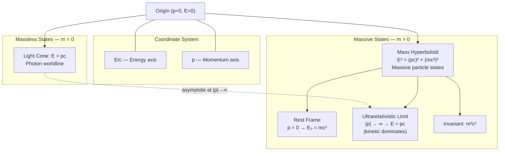

# Lesson 4: Relativistic Dynamics, Energy-Momentum Four-Vector, Mass-Energy Equivalence

## 1. First-Principles Intuition & Invariants

The transition from Newtonian mechanics to relativistic dynamics is not merely a correction applied at high velocities. It is a fundamental reconceptualization of what momentum and energy *are*, rooted in the geometric structure of spacetime itself. In Newtonian mechanics, mass plays the role of an inert scalar coefficient, momentum is $\vec{p} = m\vec{v}$, and kinetic energy is a separate, additive quantity $T = \frac{1}{2}mv^2$. These two quantities are coupled through the work-energy theorem, but they remain conceptually distinct. Special relativity dissolves that distinction. It reveals that energy and momentum are two faces of a single geometric object — a four-vector — and that the relationship between them encodes the most famous equation in all of physics.

### The Failure of Newtonian Momentum at High Velocities

The first hint that something is wrong with the Newtonian picture appears when you apply conservation of momentum to collisions and require that it hold in all inertial frames connected by Lorentz transformations. Consider two identical particles colliding. In Newtonian mechanics, the total momentum $\sum m\vec{v}_i$ is conserved and transforms consistently under Galilean boosts. Under a Lorentz boost, however, $\sum m\vec{v}_i$ does not transform as a four-vector component. It is frame-dependent in a way that breaks the covariance of the conservation law. If momentum conservation holds in one frame, Newtonian momentum fails to be conserved in a boosted frame. Physics cannot be frame-dependent, so the definition of momentum must change.

The fix is elegant: replace the coordinate three-velocity $\vec{v}$ with the derivative of position with respect to **proper time** $\tau$ rather than coordinate time $t$. Proper time is a Lorentz scalar — it ticks on the particle's own clock and is invariant under boosts. The four-velocity is then

$$U^\mu = \frac{dx^\mu}{d\tau} = \gamma(c,\, \vec{v})$$

where $\gamma = (1 - v^2/c^2)^{-1/2}$ is the Lorentz factor and the components are $(U^0, U^1, U^2, U^3) = (\gamma c,\, \gamma v_x,\, \gamma v_y,\, \gamma v_z)$. The four-velocity is a genuine four-vector: it transforms under Lorentz boosts exactly as $x^\mu$ does, and its Minkowski norm is a fixed invariant. Using the metric signature $(+,-,-,-)$:

$$\eta_{\mu\nu} U^\mu U^\nu = \gamma^2 c^2 - \gamma^2 v^2 = \gamma^2 c^2\!\left(1 - \frac{v^2}{c^2}\right) = c^2$$

The four-velocity therefore lies on a hyperboloid of radius $c$ in four-dimensional velocity space — a beautiful geometric constraint that no Lorentz boost can violate.

### Defining Four-Momentum

Multiplying the four-velocity by the rest mass $m$ (a Lorentz scalar, the mass measured in the particle's own rest frame) gives the **four-momentum**:

$$p^\mu = m U^\mu = m\gamma(c,\, \vec{v}) = \left(\frac{E}{c},\, \vec{p}\right)$$

The spatial components $\vec{p} = m\gamma\vec{v}$ are the relativistic three-momentum. The temporal component $p^0 = m\gamma c = E/c$ deserves careful examination: it is the total relativistic energy divided by $c$. This is not a definition imposed by convention — it emerges from demanding covariance and then identifying the conserved Noether charge associated with time-translation symmetry. In the low-velocity limit, $m\gamma c^2 = mc^2(1 - v^2/c^2)^{-1/2} \approx mc^2 + \frac{1}{2}mv^2 + \cdots$, which is the rest energy plus the classical kinetic energy plus relativistic corrections. The identification is unambiguous.

### The Invariant Mass-Energy Relation

The Minkowski norm of the four-momentum is a Lorentz invariant. Computing it directly:

$$p^\mu p_\mu = \eta_{\mu\nu} p^\mu p^\nu = \frac{E^2}{c^2} - |\vec{p}|^2 c^2 \cdot \frac{1}{c^2}$$

More precisely, with the $(+,-,-,-)$ convention:

$$p^\mu p_\mu = \frac{E^2}{c^2} - |\vec{p}|^2 = m^2 c^2$$

Multiplying through by $c^2$ yields the **energy-momentum dispersion relation**, the cornerstone of all relativistic dynamics:

$$\boxed{E^2 = (pc)^2 + (mc^2)^2}$$

where $p = |\vec{p}|$. In the particle's rest frame, $\vec{p} = 0$, and this reduces immediately to

$$E_0 = mc^2$$

This is mass-energy equivalence — not an approximation, not a limiting case, but an exact statement about the energy content of a massive particle at rest. The rest mass is a form of energy, and $c^2$ is simply the conversion factor between units of mass and units of energy. The equation has the character of a Pythagorean theorem in energy-momentum space: total energy is the hypotenuse of a right triangle whose legs are the kinetic momentum contribution $pc$ and the rest energy $mc^2$.

### Massless Particles and the Lightlike Limit

A profound consequence of the dispersion relation appears in the limit $m \to 0$. For a massless particle, $p^\mu p_\mu = 0$, which means the four-momentum is a **null vector** — it lies on the light cone. The energy-momentum relation becomes simply

$$E = pc$$

This is the photon's dispersion relation, confirmed to extraordinary precision in Compton scattering experiments and in the photoelectric effect. A massless particle cannot be brought to rest; any boost that reduces its energy simultaneously reduces its momentum by the same factor, and it always travels at exactly $c$. The Lorentz factor $\gamma$ is undefined for massless particles (since $v = c$ makes the denominator of $\gamma$ vanish), but the four-momentum remains perfectly well-defined and finite. The photon has $p^\mu = (\hbar\omega/c)(1, \hat{n})$ where $\hat{n}$ is the propagation direction and $\hbar\omega$ is the photon energy — a null four-vector whose Minkowski norm is identically zero.

### Noether's Theorem and Conservation in Four Dimensions

The conserved character of four-momentum follows directly from Noether's theorem applied to spacetime symmetries. A system whose action is invariant under spatial translations conserves three-momentum. A system whose action is invariant under time translations conserves energy. Special relativity unifies these into a single statement: invariance under all four spacetime translations (the full translation group $\mathbb{R}^{3,1}$) conserves the four-momentum $p^\mu$ as a whole. In any isolated system, the total four-momentum

$$P^\mu_{\text{total}} = \sum_i p^\mu_i$$

is conserved across interactions, decays, and collisions, in every inertial frame simultaneously. This is the working principle behind every particle physics calculation. When a pion at rest decays into two photons, $\pi^0 \to \gamma + \gamma$, four-momentum conservation requires the two photons to travel in opposite directions with equal energies $E_\gamma = m_\pi c^2 / 2$, a prediction confirmed with sub-percent precision in laboratory measurements.

---

## 2. Core Architecture & Mechanics

### The Geometry of Four-Momentum Space

It helps to visualize the structure of four-momentum through the lens of Minkowski geometry before turning to explicit calculations. The set of all possible four-momenta for a particle of mass $m$ forms a **mass hyperboloid** — a surface defined by $p^\mu p_\mu = m^2c^2$ embedded in four-dimensional momentum space. Massive particles populate the upper sheet of this hyperboloid (positive energy), and the surface curves away from the origin in a shape determined entirely by the rest mass. As $m \to 0$, the hyperboloid collapses to the light cone $p^\mu p_\mu = 0$.

The following diagram illustrates the energy-momentum relationship and the structure of Minkowski momentum space in 1+1 dimensions (suppressing two spatial components for clarity):

The critical physical insight encoded in this diagram: a Lorentz boost moves a point *along* the hyperboloid — it changes the apparent energy and momentum but cannot move a state off its mass shell. This is what it means for $m^2c^2$ to be a Lorentz invariant.

### Four-Momentum in Collision and Decay Problems

The computational mechanics of relativistic dynamics reduces to a systematic procedure: express every particle's four-momentum, apply conservation at the interaction vertex, and then take Minkowski dot products to extract invariant quantities. The power of this method is that you can choose the most convenient frame for each step — typically the center-of-momentum (CM) frame — and the invariants carry the physics back to any other frame automatically.

**Notation and conventions.** Throughout what follows, natural units $c = 1$ are adopted for compactness. Energies, momenta, and masses all carry units of $\text{GeV}$ or $\text{MeV}$ as appropriate, with the understanding that $mc$ restores SI momentum and $mc^2$ restores SI energy. The metric signature is $(+,-,-,-)$.

The four-momentum is then $p^\mu = (E, \vec{p})$, the dispersion relation is $E^2 - |\vec{p}|^2 = m^2$, and a Lorentz boost along the $x$-axis with velocity $\beta = v/c$ acts as:

$$E' = \gamma(E - \beta p_x), \qquad p'_x = \gamma(p_x - \beta E), \qquad p'_y = p_y, \qquad p'_z = p_z$$

**Invariant mass of a composite system.** For a system of $N$ particles, the invariant mass squared is

$$s = \left(\sum_{i=1}^N p_i^\mu\right)^2 = \left(\sum_i E_i\right)^2 - \left|\sum_i \vec{p}_i\right|^2$$

The quantity $\sqrt{s}$ is the total center-of-momentum energy — the energy available for producing new particles or exciting internal degrees of freedom. It is frame-independent, which makes it the natural measure of collision energy in accelerator physics. When a proton at energy $E_p$ collides with a stationary proton target (mass $m_p$), the invariant mass is:

$$s = (E_p + m_p)^2 - |\vec{p}_p|^2 = E_p^2 - |\vec{p}_p|^2 + 2E_p m_p + m_p^2 = m_p^2 + 2E_p m_p + m_p^2$$

Using $E_p^2 - |\vec{p}_p|^2 = m_p^2$:

$$\sqrt{s} = \sqrt{2m_p^2 + 2E_p m_p} \approx \sqrt{2 E_p m_p} \quad (E_p \gg m_p)$$

This scales only as $\sqrt{E_p}$ for a fixed target. By contrast, in a symmetric collider where two protons each carry energy $E_p$ in opposite directions, $\sqrt{s} = 2E_p$ — linear in beam energy. This scaling argument alone explains why particle physicists build colliders rather than fixed-target machines when searching for new high-mass physics.

**Threshold energy for particle production.** The minimum beam energy required to produce a new particle of mass $M$ is a direct application of invariant mass. For a fixed-target reaction $a + b \to$ products, the threshold condition is that all final-state particles are produced at rest in the CM frame. At threshold:

$$s_{\text{threshold}} = \left(\sum_f m_f\right)^2$$

Setting this equal to the fixed-target expression and solving for beam energy gives the **threshold kinetic energy** $T_{\text{th}}$:

$$T_{\text{th}} = \frac{\left(\sum_f m_f\right)^2 - \left(\sum_i m_i\right)^2}{2 m_{\text{target}}}$$

For the reaction $p + p \to p + p + p + \bar{p}$ (proton-antiproton pair production, the process used in the Bevatron's design), $\sum_f m_f = 4m_p$, $\sum_i m_i = 2m_p$:

$$T_{\text{th}} = \frac{16m_p^2 - 4m_p^2}{2m_p} = \frac{12m_p^2}{2m_p} = 6m_p c^2 \approx 5.6\ \text{GeV}$$

The Bevatron was designed to reach $6.2\ \text{GeV}$ proton kinetic energy specifically to exceed this threshold — and in 1955 it succeeded, confirming the existence of the antiproton.

### Compton Scattering as a Four-Momentum Calculation

Compton scattering — the collision of a photon with a free electron — is the canonical worked example for four-momentum bookkeeping. Let the incident photon have four-momentum $k^\mu = (\hbar\omega/c)(1,\hat{n})$ and the electron be initially at rest: $p^\mu_i = (m_e c, \vec{0})$. After scattering, the photon has four-momentum $k'^\mu$ and the electron has $p'^\mu$. Conservation of four-momentum gives:

$$k^\mu + p^\mu_i = k'^\mu + p'^\mu \implies p'^\mu = k^\mu + p^\mu_i - k'^\mu$$

Squaring both sides (taking the Minkowski norm) and using $p'^\mu p'_\mu = m_e^2 c^2$, $k^\mu k_\mu = 0$, $k'^\mu k'_\mu = 0$:

$$m_e^2 c^2 = m_e^2 c^2 + 2 p_i \cdot k - 2 p_i \cdot k' - 2 k \cdot k'$$

Computing each inner product with the electron at rest and photons traveling at angle $\theta$ between them:

$$p_i \cdot k = m_e \hbar\omega, \quad p_i \cdot k' = m_e \hbar\omega', \quad k \cdot k' = \frac{\hbar^2 \omega \omega'}{c^2}(1 - \cos\theta)$$

Substituting and rearranging yields the **Compton wavelength shift formula**:

$$\boxed{\Delta\lambda = \lambda' - \lambda = \frac{h}{m_e c}(1 - \cos\theta)}$$

The Compton wavelength $\lambda_C = h/(m_e c) = 2.426 \times 10^{-12}\ \text{m}$ emerges as a natural length scale set entirely by the electron's rest mass. The derivation required no reference frame beyond the lab frame and no kinematic assumptions beyond four-momentum conservation — the Minkowski geometry did all the work.

### Experimental Measurement of Relativistic Momentum and Energy

The connection from these geometric structures to bench-top measurement runs through two primary instruments: **magnetic spectrometers** (which measure momentum) and **calorimeters** (which measure energy). Their interplay is the practical foundation of particle and nuclear physics.

A magnetic spectrometer exploits the Lorentz force law. A charged particle of charge $q$, relativistic momentum $\vec{p} = m\gamma\vec{v}$, and speed $v$ moving perpendicular to a uniform magnetic field $B$ follows a circular arc of radius $r$ governed by:

$$qvB = \frac{m\gamma v^2}{r} \implies r = \frac{|\vec{p}|}{qB} = \frac{p}{qB}$$

The quantity $p = qBr$ (the magnetic rigidity) is determined by measuring the track curvature $r$ from position detector hits. Notice that $p = m\gamma v$ appears here, not the Newtonian $mv$ — the formula is exact relativistically because the derivation uses the relativistic equation of motion. For a singly charged particle in a $1\ \text{T}$ field with radius of curvature $1\ \text{m}$, the momentum is $p = eBr = (1.6 \times 10^{-19})(1)(1) = 1.6 \times 10^{-19}\ \text{kg\,m/s} \approx 300\ \text{MeV}/c$. Having measured $p$, the energy follows from the dispersion relation once the particle species (and hence rest mass $m$) is known from time-of-flight or Cherenkov identification.

Calorimeters measure total energy by stopping particles and collecting the resulting electromagnetic or hadronic shower. The deposited energy is proportional to the total relativistic energy $E$, not the kinetic energy alone. For a highly relativistic particle where $pc \gg mc^2$, the distinction is immaterial, but for sub-relativistic protons and heavy ions it is critical. Cross-calibrating calorimeter energy against spectrometer momentum directly tests the dispersion relation $E^2 = (pc)^2 + (mc^2)^2$: plotting $E^2$ against $p^2c^2$ should yield a straight line with slope 1 and $y$-intercept $(mc^2)^2$, an experimental confirmation of the invariant mass shell condition.

---

## 3. High-Performance Optimization & Failure Modes

### Working Efficiently in Four-Momentum Calculations

The single most effective practice in relativistic dynamics is **aggressive use of invariants**. Every time you encounter a four-momentum expression, ask which frame makes the calculation simplest and what invariant quantity survives the boost to connect back to the original frame. Most errors in relativistic kinematics arise from mixing frame-dependent quantities, and most computational complexity dissolves once you identify the right invariant.

A concrete strategy: when evaluating a collision, first compute the Mandelstam variables — the standard set of Lorentz-invariant kinematic quantities for a $2 \to 2$ scattering process $a + b \to c + d$:

$$s = (p_a + p_b)^2, \qquad t = (p_a - p_c)^2, \qquad u = (p_a - p_d)^2$$

These satisfy $s + t + u = m_a^2 + m_b^2 + m_c^2 + m_d^2$ (in units where $c = 1$). The variable $s$ is the total CM energy squared. The variable $t$ is the squared four-momentum transfer — it characterizes how much momentum is exchanged between the initial and final state particles, and it is the natural variable in which scattering amplitudes are expressed in quantum field theory. Working in terms of $s$, $t$, $u$ from the outset eliminates the need to track individual lab-frame energies and prevents errors that arise from computing angle-dependent quantities in the wrong frame.

A second efficiency: use the **CM frame** to establish threshold conditions and angular distributions, then boost back to the lab frame using the CM-to-lab boost velocity $\beta_{\text{CM}} = |\vec{p}_{\text{total}}| / E_{\text{total}}$. The boost is straightforward, but the CM frame calculation is typically an order of magnitude simpler.

### Failure Mode: Confusing Kinetic Energy with Total Energy

This is the most common source of numerical error in relativistic calculations, and it appears at every level from undergraduate homework to experimental data analysis. The relativistic kinetic energy is

$$T = E - mc^2 = (\gamma - 1)mc^2$$

not $\frac{1}{2}mv^2$ and emphatically not $E$ itself. When an accelerator physicist says a proton beam has "energy $6.5\ \text{TeV}$" at the LHC, they mean total energy $E = 6.5\ \text{TeV}$, since at that energy $T \approx E$ to one part in $10^{-4}$. But in heavy-ion physics, where nuclei are accelerated to kinetic energies of a few $\text{GeV}$ per nucleon, the distinction $T = E - Mc^2$ is essential and $Mc^2$ is a significant fraction of $E$. The correct dispersion relation always reads $E^2 = p^2c^2 + m^2c^4$; never substitute $T$ for $E$ on the left-hand side.

### Failure Mode: Invariant Mass of Massless Composite Systems

A subtlety that traps experienced physicists: two photons traveling in the *same* direction have $p_1^\mu + p_2^\mu$ proportional to a single null vector, so their combined invariant mass is zero even though each photon has nonzero energy. Two photons traveling in *opposite* directions (or at any nonzero angle) have $p^\mu_{\text{total}}p_{\mu,\text{total}} = 2 E_1 E_2 (1 - \cos\theta)/c^2 > 0$, giving a positive invariant mass. This is not a semantic point: it determines whether a photon pair can produce a massive particle via pair conversion. For the process $\gamma\gamma \to e^+e^-$ to occur, the invariant mass of the two-photon system must exceed $2m_e c^2 = 1.022\ \text{MeV}$. Head-on photon collisions maximize $\sqrt{s}$ for a given photon energy; collinear photons cannot produce pairs regardless of their individual energies. High-energy gamma-ray telescope analyses routinely reconstruct $\pi^0$ mass from two-photon invariant mass distributions, using exactly this calculation to separate signal from background.

### Failure Mode: Non-Additivity of Relativistic Velocities and the Error It Introduces

Newtonian intuition suggests that if particle A moves at velocity $v_1$ and particle B moves at velocity $v_2$ in the same direction, their relative velocity is $v_1 - v_2$. The correct relativistic formula for velocity addition is:

$$v_{\text{rel}} = \frac{v_1 - v_2}{1 - v_1 v_2 / c^2}$$

This matters experimentally when computing the CM frame velocity for two beams, or when calculating Doppler shifts for relativistic sources. The error introduced by using the Newtonian approximation is of order $(v/c)^2$; for LHC beams at $\beta = 1 - 10^{-8}$, this is negligible, but for proton beams at $\beta \approx 0.5$ (kinetic energy $\approx 130\ \text{MeV}$, common in medical accelerator physics), the correction is at the several-percent level and must be accounted for in treatment planning calculations.

The correct procedure is always to work with four-momenta, take their sum, and compute invariants from the result. Never construct the CM velocity by adding three-velocities. The four-momentum sum $P^\mu = p_1^\mu + p_2^\mu$ gives $|\vec{P}|$ and $E_{\text{total}}$ directly; the CM velocity follows as $\beta_{\text{CM}} = |\vec{P}|c / E_{\text{total}}$, exact and frame-independent.

### Precision Measurement: Testing $E = mc^2$ Experimentally

The most precise direct tests of mass-energy equivalence come from nuclear binding energy measurements combined with precision mass spectroscopy. Consider the reaction $n + p \to d + \gamma$ (neutron-proton capture to form deuterium). The photon energy is:

$$E_\gamma = (m_n + m_p - m_d)c^2 = \Delta m \cdot c^2$$

The mass difference $\Delta m$ can be measured in a Penning trap with sub-parts-per-billion precision using cyclotron frequency ratios, since the cyclotron frequency $f_c = qB/(2\pi m)$ is exquisitely sensitive to mass. The photon energy $E_\gamma$ can be measured independently using crystal diffraction gamma-ray spectroscopy, where the photon wavelength is determined from Bragg diffraction angles with precision better than $10^{-6}$. The 2005 MIT-NIST measurement by Rainville et al. (published in *Nature*) confirmed $E = \Delta mc^2$ to a precision of $4.4 \times 10^{-7}$ — a direct, macroscopic laboratory test of the mass-energy equivalence relation, with no particle accelerator required.

The experiment proceeds as follows. Sulfur-32 and silicon-28 nuclei are trapped in a Penning trap immersed in a $\sim 8.5\ \text{T}$ magnetic field. Their cyclotron frequencies are measured simultaneously by monitoring the axial oscillation frequency shifts induced by the radial cyclotron motion. The mass ratio $m(^{32}\text{S})/m(^{28}\text{Si})$ is extracted at the sub-ppb level. Separately, the gamma-ray energies released in neutron capture reactions forming these nuclei are measured by GAMS4 crystal spectrometry at ILL Grenoble, where the wavelength $\lambda_\gamma$ is determined from Bragg reflection off perfect silicon crystals with known lattice spacing. Combining the two independent measurements gives a value of $c^2$ derived purely from $\Delta E / \Delta m$ — in complete agreement with the SI-defined value. This is mass-energy equivalence tested on a laboratory bench, not inferred from cosmology or particle physics machines.

### Relativistic Dynamics in Practice: Accelerator Design

The practical consequence of $E = mc^2$ appears at every stage of accelerator design. As a particle is accelerated, its relativistic mass $m\gamma$ increases, which means its cyclotron frequency decreases for fixed magnetic field: $f = qB/(2\pi m\gamma)$. A fixed-frequency cyclotron, adequate for protons up to about $20\ \text{MeV}$ kinetic energy where $\gamma \approx 1.02$, fails at higher energies because the accelerating RF cavity falls out of phase with the particle's revolution. The engineering solutions — the synchrocyclotron (which sweeps RF frequency downward as $\gamma$ rises) and the isochronous cyclotron (which increases $B$ with radius to compensate for increasing $\gamma$) — are direct implementations of the relativistic dynamics derived above. Every bending magnet and every RF cavity in a modern synchrotron is designed around the exact relativistic relation $p = m\gamma v$ and the energy-momentum dispersion $E^2 = p^2c^2 + m^2c^4$. The Newtonian approximation is not used in production accelerator codes; it would produce wrong predictions for beam optics above a few hundred MeV.

The deepest lesson of this chapter is therefore not a formula but a method: build calculations from Lorentz invariants and four-vectors, evaluate them in the most convenient frame, and extract physical observables by taking invariant combinations. The dispersion relation $E^2 = (pc)^2 + (mc^2)^2$ is not an equation to be memorized; it is the statement that every free particle's four-momentum lies on a fixed mass shell in Minkowski space, and all of relativistic dynamics is the study of how particles move across and interact on those shells. Once that geometric picture is internalized, problems that appear complex in three-dimensional kinematic notation reduce to straightforward algebra on four-vectors — and the connection between Einstein's $E = mc^2$ and the technology that probes the structure of matter at the femtometer scale becomes direct and transparent.
