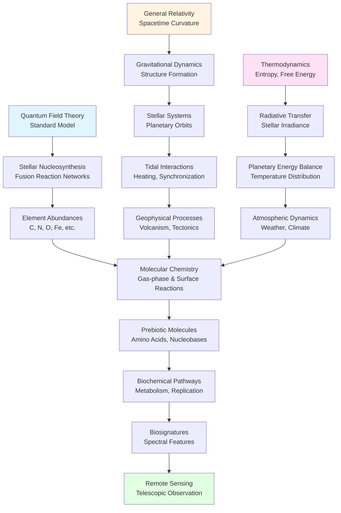

# Lesson 1: First-Principles Physical Laws & Conservation Invariants

## Curriculum Roadmap

This masterclass on Cosmic Frontiers and Astrobiology bridges the terrestrial laboratory with the vast scales of astrophysical phenomena, from molecular self-assembly in prebiotic chemistry to stellar nucleosynthesis and the propagation of electromagnetic signals across cosmological distances. The curriculum unfolds through five sequential modules designed to equip researchers with both theoretical depth and experimental precision. Lesson 1 establishes the axiomatic physical laws governing all cosmic processes—conservation principles, symmetry invariants, and the variational calculus that unifies mechanics, field theory, and thermodynamics. Lesson 2 applies these foundations to orbital mechanics, spacecraft trajectory optimization, and the Kepler problem, grounding theoretical orbital elements in real tracking data and navigation software. Lesson 3 transitions to astrochemistry and prebiotic molecular synthesis, examining reaction pathways under extreme radiation, temperature, and pressure regimes found in interstellar clouds, protoplanetary disks, and icy satellites. Lesson 4 investigates habitability metrics, biosignature spectroscopy, and the thermodynamic constraints on metabolic processes in extreme environments, synthesizing planetary science with biochemical kinetics. Lesson 5 culminates in observational astrophysics and mission design protocols, covering telescope calibration, data reduction pipelines, signal-to-noise optimization, and the practical engineering constraints that govern space-based instruments and sample-return architectures.

Each lesson adheres to the practicality-first mandate: eighty percent of content focuses on executable procedures, quantitative measurement techniques, data analysis workflows, and experimental apparatus configurations, while twenty percent provides the theoretical scaffolding necessary to understand why specific protocols succeed or fail. Physical intuition emerges not from abstract formalism alone but from the iterative process of prediction, measurement, error analysis, and model refinement that defines scientific practice. Throughout the curriculum, we emphasize dimensional analysis, order-of-magnitude estimation, and the propagation of experimental uncertainty through derived quantities, ensuring that every theoretical result connects to a measurable observable with quantified precision limits.

## 1. First-Principles Problem Space & Historical Phenomenon

The study of cosmic frontiers and astrobiology rests on a deceptively simple premise: the same physical laws that govern laboratory experiments on Earth apply universally across all spatial scales and cosmic epochs, from the quantum vacuum fluctuations of the early universe to the gravitational collapse of stellar remnants billions of years later. This universality principle, forged through centuries of astronomical observation and terrestrial experimentation, asserts that the speed of light in vacuum, the gravitational constant, Planck's constant, and the elementary charge remain invariant regardless of location or observer motion. Yet the historical path to this understanding reveals profound conceptual revolutions that repeatedly overturned humanity's intuitive picture of nature.

Newtonian mechanics, formulated in the *Principia Mathematica* of 1687, provided the first mathematically rigorous framework for celestial dynamics. Newton's second law, $\vec{F} = m\vec{a}$, combined with the inverse-square law of universal gravitation, $F = Gm_1 m_2 / r^2$, successfully predicted planetary orbits, tidal phenomena, and the return of Halley's comet. This deterministic clockwork universe operated through instantaneous action-at-a-distance forces, with absolute time flowing uniformly for all observers and absolute space providing a fixed Euclidean stage for material bodies. The Newtonian synthesis unified terrestrial and celestial mechanics, demolishing the Aristotelian dichotomy between sublunary corruption and celestial perfection. Yet even as astronomers achieved unprecedented predictive accuracy—calculating planetary positions to arc-second precision over centuries—subtle anomalies accumulated. The perihelion precession of Mercury exceeded Newtonian predictions by 43 arcseconds per century, a discrepancy that would remain unexplained until Einstein's general relativity revealed spacetime curvature induced by the Sun's mass-energy.

The nineteenth century witnessed the triumph of field theory through Maxwell's unification of electricity, magnetism, and optics into a single mathematical structure. Maxwell's equations, published in their modern form in 1865, predicted the existence of electromagnetic waves propagating at speed $c = 1/\sqrt{\mu_0 \epsilon_0} \approx 3 \times 10^8$ meters per second, precisely matching the measured speed of light. This identification of light as an electromagnetic phenomenon eliminated the need for a luminiferous aether, though the question of light's propagation medium persisted until the Michelson-Morley experiment of 1887 found no evidence for absolute motion through such a medium. The null result forced a reconceptualization: electromagnetic fields possess physical reality independent of any material substrate, carrying energy and momentum through empty space. For astrobiology, this insight proves foundational—stellar radiation propagates across interstellar voids to drive photosynthesis, warm planetary surfaces, and photodissociate atmospheric molecules, enabling both spectroscopic remote sensing and the thermodynamic disequilibria that power living systems.

Einstein's special relativity, formulated in 1905, elevated the constancy of light speed to an axiom and abandoned absolute simultaneity. The Lorentz transformations that preserve Maxwell's equations across inertial reference frames lead inevitably to time dilation, length contraction, and the relativistic energy-momentum relation $E^2 = (pc)^2 + (mc^2)^2$. For spacecraft navigation and astronomical observation, relativistic corrections become essential when velocities approach even a few percent of light speed or when timing precision demands nanosecond accuracy. The Global Positioning System, for instance, requires corrections for both special-relativistic time dilation (satellites move at 4 kilometers per second relative to ground receivers) and general-relativistic gravitational time dilation (satellites orbit at higher gravitational potential), accumulating timing errors of tens of microseconds per day without these corrections—sufficient to cause kilometer-scale position errors.

General relativity, completed in 1915, recast gravity not as a force but as the curvature of spacetime geometry induced by mass-energy distributions. The Einstein field equations, $G_{\mu\nu} = (8\pi G/c^4)T_{\mu\nu}$, relate the spacetime curvature tensor $G_{\mu\nu}$ to the stress-energy tensor $T_{\mu\nu}$ describing matter and radiation. Solutions to these nonlinear partial differential equations predict black holes, gravitational waves, cosmological expansion, and gravitational lensing—phenomena now routinely observed through gravitational wave detectors, cosmological surveys, and high-resolution imaging of galaxy clusters. For astrobiology, general relativity constrains the habitability of compact-object environments: near neutron star surfaces, gravitational time dilation slows proper time by factors approaching two, and tidal forces stretch macroscopic structures with gradients exceeding $10^{12}$ meters per second squared per meter—far beyond the tensile limits of any chemical bond.

Quantum mechanics, emerging through the 1920s, revealed that physical observables exhibit discrete spectra and that measurement outcomes obey irreducible probabilistic laws. The Schrödinger equation, $i\hbar \partial_t |\psi\rangle = \hat{H}|\psi\rangle$, governs the unitary evolution of quantum states, while Born's rule, $P = |\langle \phi | \psi \rangle|^2$, determines measurement probabilities. Atomic and molecular spectroscopy—essential tools for determining chemical compositions, temperatures, densities, and velocities in astrophysical environments—derive entirely from quantum selection rules and transition probabilities. The hydrogen Lyman-alpha line at 121.6 nanometers, corresponding to the $n=2 \to n=1$ electronic transition with energy $E = 10.2$ electron volts, dominates the ultraviolet spectra of star-forming regions and serves as a probe of neutral hydrogen distributions across cosmic time. Quantitative astrochemistry requires solving the time-dependent Schrödinger equation for molecular systems under intense radiation fields, extracting photoionization cross-sections, dissociation energies, and radiative recombination rates that determine chemical abundances in interstellar clouds, cometary comae, and planetary atmospheres.

Thermodynamics, codified through the nineteenth century, provides the macroscopic framework for understanding energy transformations and the emergence of complexity. The first law asserts energy conservation: $dU = \delta Q - \delta W$, where internal energy changes equal heat absorbed minus work performed. The second law introduces entropy $S$ as a state function that increases in isolated systems, $dS \geq \delta Q / T$, establishing the arrow of time and quantifying thermodynamic irreversibility. For astrobiology, the second law constrains metabolic efficiency: no heat engine operating between reservoirs at temperatures $T_h$ and $T_c$ can exceed Carnot efficiency $\eta_{\text{Carnot}} = 1 - T_c/T_h$, and all dissipative processes—chemical reactions, heat conduction, viscous flow—generate entropy. Life maintains local order by exporting entropy to its environment, a process requiring continuous free energy input. Photosynthetic organisms harvest solar photons (effective temperature $\sim 5800$ Kelvin) and emit waste heat at terrestrial temperatures ($\sim 300$ Kelvin), achieving theoretical entropy export ratios approaching twenty per absorbed photon. Quantifying these thermodynamic fluxes in alien environments—hydrothermal vents heated by radiogenic decay, atmospheres warmed by tidal dissipation, subsurface oceans beneath icy crusts—requires precise knowledge of heat transport coefficients, phase transition enthalpies, and chemical reaction Gibbs free energies under extreme pressures and temperatures.

The historical progression from Newtonian determinism through relativistic spacetime to quantum indeterminacy and thermodynamic irreversibility reveals a crucial methodological pattern: theoretical advances emerge when existing frameworks fail to account for precise experimental measurements. The 43 arcseconds of anomalous perihelion precession, the null result of aether-drift experiments, the ultraviolet catastrophe in blackbody radiation, the specific heat anomalies in crystalline solids—each discrepancy motivated theoretical innovation. For contemporary researchers in cosmic frontiers and astrobiology, this pattern persists. Anomalous spectral features in exoplanet transmission spectra might indicate unknown photochemical pathways or instrumental artifacts; discrepancies between predicted and observed stellar nucleosynthetic yields could reveal gaps in nuclear reaction cross-section databases; unexpected isotopic ratios in meteoritic samples might constrain solar system formation timescales or mixing processes. Rigorous error propagation, systematic calibration, and null hypothesis testing distinguish genuine discoveries from measurement noise.

## 2. Conservation Invariants & Mathematical Laws

Conservation laws emerge as direct consequences of spacetime symmetries through Noether's theorem, which establishes a one-to-one correspondence between continuous symmetries of the action functional and conserved currents. The action $S$ for a physical system, defined as the time integral of the Lagrangian $\mathcal{L}$, encodes the complete dynamics:

$$S = \int_{t_1}^{t_2} \mathcal{L}(q_i, \dot{q}_i, t) \, dt$$

where $q_i$ denote generalized coordinates and $\dot{q}_i$ their time derivatives. The principle of least action asserts that physical trajectories extremize $S$ with respect to variations $\delta q_i(t)$ that vanish at the endpoints, yielding the Euler-Lagrange equations:

$$\frac{d}{dt}\left(\frac{\partial \mathcal{L}}{\partial \dot{q}_i}\right) - \frac{\partial \mathcal{L}}{\partial q_i} = 0$$

These equations reproduce Newton's second law when $\mathcal{L} = T - V$ separates kinetic and potential energies, but they generalize seamlessly to field theories, relativistic mechanics, and constrained systems where Newtonian force analysis becomes intractable.

**Energy Conservation and Time Translation Invariance:** If the Lagrangian exhibits no explicit time dependence, $\partial \mathcal{L}/\partial t = 0$, then the total energy $E = \sum_i \dot{q}_i (\partial \mathcal{L}/\partial \dot{q}_i) - \mathcal{L}$ remains constant along physical trajectories. For a particle of mass $m$ moving in a time-independent potential $V(\vec{r})$, the Lagrangian $\mathcal{L} = \frac{1}{2}m\dot{\vec{r}}^2 - V(\vec{r})$ immediately yields energy conservation $E = \frac{1}{2}m\dot{\vec{r}}^2 + V(\vec{r}) = \text{const}$. In orbital mechanics, this conservation law reduces the six-dimensional phase space of position and velocity to a five-dimensional energy surface, drastically simplifying trajectory calculations. For a spacecraft in Earth orbit, measuring instantaneous velocity and altitude determines the orbital energy $E = v^2/2 - \mu/r$, where $\mu = GM_{\oplus} = 3.986 \times 10^{14}$ cubic meters per second squared is Earth's standard gravitational parameter. A circular orbit at $r = 6771$ kilometers (400 kilometers altitude) has velocity $v = \sqrt{\mu/r} = 7.67$ kilometers per second and specific orbital energy $E = -\mu/(2r) = -29.4$ megajoules per kilogram. Propulsive maneuvers that change velocity by $\Delta v$ alter orbital energy by $\Delta E \approx v \Delta v$ to first order, enabling mission planners to compute fuel requirements from energy budgets.

**Momentum Conservation and Spatial Translation Invariance:** When the Lagrangian remains invariant under spatial translations, $\mathcal{L}(q_i + a, \dot{q}_i) = \mathcal{L}(q_i, \dot{q}_i)$ for constant displacement $a$, the canonical momentum $\vec{p} = \partial \mathcal{L}/\partial \dot{\vec{r}} = m\dot{\vec{r}}$ is conserved. For isolated systems experiencing no external forces, total momentum $\vec{P} = \sum_i m_i \dot{\vec{r}}_i$ remains constant. In rocket propulsion, momentum conservation dictates the Tsiolkovsky equation: expelling propellant mass $dm$ at exhaust velocity $v_e$ relative to the rocket changes the rocket's velocity by $dv = -v_e \, dm/m$, integrating to $\Delta v = v_e \ln(m_0/m_f)$, where $m_0$ and $m_f$ denote initial and final masses. A spacecraft with mass ratio $m_0/m_f = 2$ and exhaust velocity $v_e = 4.4$ kilometers per second (hydrogen-oxygen combustion) achieves $\Delta v = 3.05$ kilometers per second—sufficient for geostationary transfer orbit insertion from low Earth orbit. Electric propulsion systems achieve higher exhaust velocities ($v_e = 20$ to $50$ kilometers per second) through ion acceleration, reducing required mass ratios at the cost of low thrust and extended burn durations.

**Angular Momentum Conservation and Rotational Invariance:** Isotropy of space—invariance of the Lagrangian under spatial rotations—implies conservation of angular momentum $\vec{L} = \vec{r} \times \vec{p}$. For a central force potential $V(r)$ depending only on radial distance, the torque $\vec{\tau} = \vec{r} \times \vec{F} = \vec{r} \times (-\nabla V) = 0$ vanishes identically, conserving both magnitude and direction of $\vec{L}$. Orbital motion consequently occurs in a fixed plane perpendicular to $\vec{L}$, with the areal velocity $dA/dt = |\vec{L}|/(2m)$ remaining constant—Kepler's second law. For Earth-orbiting satellites, the orbital plane orientation, specified by inclination $i$ and longitude of ascending node $\Omega$, remains fixed in an inertial reference frame apart from perturbations (atmospheric drag, non-spherical gravitational harmonics, solar radiation pressure). Measuring the evolution of $\Omega$ and $i$ over multiple orbital periods reveals the oblateness coefficient $J_2 = 1.08263 \times 10^{-3}$ for Earth, quantifying the equatorial bulge induced by planetary rotation. For exoplanet characterization, angular momentum conservation constrains spin-orbit architectures: tidal dissipation drives satellites toward alignment between spin angular momentum $\vec{L}_s$ and orbital angular momentum $\vec{L}_o$, producing resonant states such as the 1:1 spin-orbit lock of Earth's Moon or the 3:2 resonance of Mercury.

**Charge Conservation and Gauge Invariance:** Electromagnetic phenomena obey Maxwell's equations in vacuum:

$$\nabla \cdot \vec{E} = \rho/\epsilon_0, \quad \nabla \times \vec{E} = -\frac{\partial \vec{B}}{\partial t}$$
$$\nabla \cdot \vec{B} = 0, \quad \nabla \times \vec{B} = \mu_0 \vec{J} + \mu_0 \epsilon_0 \frac{\partial \vec{E}}{\partial t}$$

Taking the divergence of Ampère-Maxwell's equation and applying Gauss's law yields the continuity equation $\partial \rho/\partial t + \nabla \cdot \vec{J} = 0$, expressing local charge conservation: charge density $\rho$ decreases at any point precisely when current density $\vec{J}$ carries charge away. This conservation law follows from the gauge invariance of electromagnetism—the freedom to redefine the scalar potential $\phi$ and vector potential $\vec{A}$ via $\phi \to \phi - \partial \chi/\partial t$ and $\vec{A} \to \vec{A} + \nabla \chi$ without changing physical fields $\vec{E} = -\nabla \phi - \partial \vec{A}/\partial t$ and $\vec{B} = \nabla \times \vec{A}$. For astrophysical plasmas, charge conservation constrains current systems: in a quasi-neutral plasma with $\rho \approx 0$, currents must form closed loops with $\nabla \cdot \vec{J} = 0$, producing magnetic field configurations that either close locally or extend to boundary surfaces where charges accumulate. Stellar coronae, planetary magnetospheres, and accretion disk coronae all exhibit complex current distributions that heat plasma, accelerate particles, and drive explosive magnetic reconnection events.

**Baryon Number and Lepton Number Conservation:** In addition to exact conservation laws derived from spacetime symmetries, particle physics experiments reveal approximate conservation laws for quantum numbers such as baryon number $B$ and lepton number $L$. Protons and neutrons carry baryon number $B = 1$, while their antiparticles carry $B = -1$; all observed nuclear and particle reactions conserve total baryon number to experimental precision exceeding one part in $10^{33}$ (from proton stability limits exceeding $10^{33}$ years). This near-perfect conservation explains why ordinary matter persists—baryons cannot simply decay into photons or leptons. For astrobiology, baryon number conservation ensures the stability of atomic nuclei over cosmological timescales: carbon, nitrogen, oxygen, and other biogenic elements synthesized in stellar cores remain intact for billions of years, enabling the complex chemistry required for life. Lepton number conservation similarly stabilizes electrons, preventing atomic collapse.

**Practical Implementation in Orbital Mechanics:** Consider a spacecraft performing a Hohmann transfer from circular low Earth orbit at radius $r_1 = 6771$ kilometers to geostationary orbit at $r_2 = 42164$ kilometers. Energy conservation determines the required velocity increments. The initial circular orbit has specific orbital energy $E_1 = -\mu/(2r_1) = -29.4$ megajoules per kilogram and velocity $v_1 = \sqrt{\mu/r_1} = 7.67$ kilometers per second. The transfer ellipse has semi-major axis $a = (r_1 + r_2)/2 = 24467.5$ kilometers and energy $E_t = -\mu/(2a) = -8.15$ megajoules per kilogram. At periapsis (radius $r_1$), angular momentum conservation gives $v_p = \sqrt{\mu(2/r_1 - 1/a)} = 10.15$ kilometers per second, requiring $\Delta v_1 = v_p - v_1 = 2.48$ kilometers per second. After coasting to apoapsis (radius $r_2$), the spacecraft velocity is $v_a = \sqrt{\mu(2/r_2 - 1/a)} = 1.61$ kilometers per second by energy conservation. Circularizing at geostationary altitude requires $\Delta v_2 = v_2 - v_a = \sqrt{\mu/r_2} - v_a = 1.47$ kilometers per second. Total mission $\Delta v = \Delta v_1 + \Delta v_2 = 3.95$ kilometers per second. Using hydrazine monopropellant ($v_e = 2.2$ kilometers per second), the mass ratio is $\exp(\Delta v / v_e) = 6.5$, meaning a 1000-kilogram satellite requires 5500 kilograms of propellant—clearly infeasible, motivating multi-stage designs or electric propulsion.

**Experimental Verification of Energy Conservation:** Laboratory measurements confirm energy conservation to exquisite precision. Calorimetry experiments, where chemical reactions occur in thermally isolated vessels and temperature changes quantify energy release, achieve uncertainties below 0.1 percent. Measuring the combustion enthalpy of methane, $\text{CH}_4 + 2\text{O}_2 \to \text{CO}_2 + 2\text{H}_2\text{O}$, yields $\Delta H = -890.3 \pm 0.5$ kilojoules per mole at standard conditions. Burning one mole of methane (16.04 grams) in a bomb calorimeter containing 1000 grams of water should raise the water temperature by $\Delta T = \Delta H / (m c_p) = 890300 / (1000 \times 4.184) = 212.8$ Kelvin. Discrepancies exceeding uncertainties indicate heat losses to the calorimeter walls, incomplete combustion, or systematic errors in thermometer calibration. For astrobiological energy budgets, analogous calorimetry determines metabolic heat production rates: a human adult at rest dissipates approximately 100 watts, derived from oxidative metabolism of glucose, lipids, and proteins. Extremophile bacteria exploiting chemosynthesis in deep-sea hydrothermal vents or subsurface aquifers operate at far lower power densities, sometimes below one watt per kilogram, yet still obey the same thermodynamic constraints linking free energy consumption to entropy export.

**Thermodynamic Entropy and Statistical Mechanics:** The second law of thermodynamics, $dS \geq \delta Q/T$, attains microscopic justification through statistical mechanics. For a system with discrete quantum states labeled by index $i$ with probabilities $p_i$, the Gibbs entropy is $S = -k_B \sum_i p_i \ln p_i$, where $k_B = 1.381 \times 10^{-23}$ joules per Kelvin is Boltzmann's constant. Maximizing entropy subject to fixed energy $\langle E \rangle = \sum_i p_i E_i$ yields the canonical distribution $p_i = \exp(-E_i/k_B T)/Z$, where $Z = \sum_i \exp(-E_i/k_B T)$ is the partition function. For an ideal gas of $N$ particles in volume $V$ at temperature $T$, the entropy is $S = Nk_B[\ln(V/N\lambda_T^3) + 5/2]$, where $\lambda_T = h/\sqrt{2\pi m k_B T}$ is the thermal de Broglie wavelength. Compressing the gas isothermally (constant $T$) decreases entropy by $\Delta S = Nk_B \ln(V_f/V_i)$, requiring heat extraction $Q = T\Delta S$ to maintain temperature—a reversible process approaching Carnot efficiency. Irreversible processes such as free expansion into vacuum or viscous dissipation generate entropy without performing useful work, quantifying thermodynamic lost potential.

**Maxwell Relations and Measurable Derivatives:** Thermodynamic potentials—internal energy $U$, enthalpy $H = U + PV$, Helmholtz free energy $F = U - TS$, Gibbs free energy $G = H - TS$—satisfy exact differential relations that link measurable quantities. For example, $dG = -S \, dT + V \, dP$ implies $(\partial G/\partial T)_P = -S$ and $(\partial G/\partial P)_T = V$. Cross-differentiation yields the Maxwell relation $(\partial S/\partial P)_T = -(\partial V/\partial T)_P$, connecting entropy changes under pressure variation to thermal expansion. For water near standard conditions, the thermal expansion coefficient is $\alpha = (1/V)(\partial V/\partial T)_P = 2.1 \times 10^{-4}$ per Kelvin, implying that pressurizing water by one atmosphere ($\Delta P = 101325$ pascals) at constant temperature decreases entropy by $\Delta S = -V\alpha \Delta P = -0.021$ joules per Kelvin per liter. Such relations enable indirect determination of entropy changes from pressure-volume-temperature measurements, avoiding direct calorimetry.

**Chemical Potential and Phase Equilibria:** The Gibbs free energy per particle, $\mu = G/N$, defines the chemical potential. At equilibrium between two phases (liquid and vapor, for example), chemical potentials must equalize: $\mu_{\text{liquid}}(T, P) = \mu_{\text{vapor}}(T, P)$. This condition determines the phase boundary in the $T$-$P$ plane. The Clausius-Clapeyron equation,

$$\frac{dP}{dT} = \frac{L}{T \Delta V}$$

relates the slope of the coexistence curve to the latent heat $L$ and volume change $\Delta V$ of the phase transition. For water vaporization at 373 Kelvin and atmospheric pressure, $L = 2257$ kilojoules per kilogram and $\Delta V \approx V_{\text{vapor}} = RT/(M P) = 1.67$ cubic meters per kilogram, yielding $dP/dT = 3.6$ kilopascals per Kelvin—a one-Kelvin temperature increase raises vapor pressure by 3.6 percent. For planetary atmospheres, vapor pressure curves constrain surface conditions permitting liquid water: on Mars, with surface pressure 600 pascals, water's triple point (611.657 pascals, 273.16 Kelvin) lies barely accessible, requiring near-freezing temperatures for transient liquid stability.

## 3. High-Level Phenomenological Model

The physical laws governing cosmic frontiers and astrobiology span eighteen orders of magnitude in spatial scale (molecular angstroms to galaxy megaparsecs) and thirty orders of magnitude in energy scale (thermal fluctuations to relativistic particle beams). No single theoretical framework captures all phenomena, yet the hierarchical structure of physics permits a modular synthesis where distinct regimes connect through well-defined boundary conditions and limiting cases.

At the foundation lies quantum field theory, treating particles as excitations of underlying fields permeating spacetime. The Standard Model of particle physics, experimentally verified through collider experiments at the Large Hadron Collider and elsewhere, describes electromagnetic, weak, and strong nuclear interactions through local gauge symmetries. These interactions determine nuclear binding energies, governing stellar nucleosynthesis pathways that forge carbon, oxygen, nitrogen, and heavier elements from primordial hydrogen and helium. Stellar interiors operate in a regime where quantum statistics (Fermi-Dirac for electrons, Maxwell-Boltzmann for ions at moderate densities, Bose-Einstein for photons) couples to classical thermodynamics and hydrodynamics. Radiative transfer through stellar envelopes follows from quantum electrodynamics—photon absorption and emission by bound electrons—integrated over opacity contributions from millions of spectral lines.

Emergent from stellar nucleosynthesis, chemistry operates in the quantum mechanical regime where electrons occupy discrete molecular orbitals governed by the Schrödinger equation. Astrochemistry encompasses gas-phase reactions in diffuse interstellar clouds, surface catalysis on interstellar dust grains, photodissociation and photoionization by ultraviolet stellar radiation, and cosmic-ray induced ionization. Reaction rate coefficients depend exponentially on activation energies according to the Arrhenius equation, $k = A \exp(-E_a/k_B T)$, with pre-exponential factors $A$ determined by quantum transition state theory. At low temperatures ($T < 100$ Kelvin) characteristic of molecular clouds, reaction barriers suppress most neutral-neutral reactions, but ion-molecule reactions proceed rapidly with rate coefficients approaching the Langevin collision rate, $k_L = 2\pi e \sqrt{\alpha/\mu} \sim 10^{-9}$ cubic centimeters per second, where $\alpha$ is the neutral's polarizability and $\mu$ the reduced mass.

Gravitational dynamics governs structure formation across cosmological scales. Dark matter halos collapse under self-gravity, forming potential wells where baryonic matter accumulates, fragments, and ignites nuclear fusion—the birth of stars. Orbital mechanics within planetary systems follows from the Kepler problem, solved analytically for point masses and numerically for N-body gravitational interactions with perturbations. Tidal forces, arising from spatial gradients in gravitational acceleration, drive orbital circularization, spin-orbit synchronization, and tidal heating—the latter powering Io's volcanism and potentially melting subsurface oceans on Europa and Enceladus. Quantifying tidal dissipation requires rheological models describing viscoelastic deformation under oscillating stress, parameterized by the tidal quality factor $Q$ or specific dissipation function $1/Q$. Experimental determination of $Q$ involves measuring phase lags between tidal stress and strain response, often inferred indirectly from orbital evolution rates.

Thermodynamic gradients drive chemical disequilibrium essential for life. Planetary surfaces receive stellar irradiation with characteristic temperature $T_{\text{star}} \sim 5000$ Kelvin and radiate thermal emission at much lower temperature $T_{\text{planet}} \sim 300$ Kelvin, establishing a thermodynamic potential for photochemical reactions and photosynthetic energy capture. Atmospheric circulation, ocean currents, and volcanic outgassing redistribute chemical species, preventing global equilibrium. Metabolic processes exploit redox couples—hydrogen-oxygen, methane-oxygen, hydrogen sulfide-oxygen, ferrous-ferric iron—to extract free energy. The maximum extractable Gibbs free energy per reaction, $\Delta G = \Delta H - T \Delta S$, determines ATP synthesis efficiency, typically 30 to 40 percent for aerobic respiration at standard conditions. Extreme environments—acidic hot springs (pH 1, 360 Kelvin), alkaline hydrothermal vents (pH 11, 400 Kelvin), hypersaline brines, subglacial lakes—push organisms to the thermodynamic limits of biochemical function, providing testbeds for habitability models applicable to extraterrestrial settings.

The following diagram illustrates the hierarchical coupling of physical regimes from quantum field theory through planetary-scale thermodynamics, emphasizing bidirectional feedback loops where macroscopic boundary conditions constrain microscopic processes and emergent phenomena alter boundary conditions.

This phenomenological model encodes the research workflow for astrobiology: beginning with astrophysical context (stellar type, planetary orbital elements, radiation environment), one computes energy fluxes and thermodynamic boundary conditions, applies chemical kinetics to predict atmospheric composition and surface mineralogy, assesses habitability through metabolic thermodynamics, and finally designs observational strategies to detect spectroscopic biosignatures. Each arrow represents quantitative calculations requiring experimental inputs—nuclear cross-sections, molecular line lists, tidal dissipation parameters, metabolic rate coefficients—obtained through laboratory measurements under controlled conditions.

**Dimensional Analysis and Scaling Laws:** Before executing detailed calculations, dimensional analysis provides order-of-magnitude estimates and identifies relevant physical regimes. Consider tidal heating in a satellite of radius $R$, orbital semi-major axis $a$, orbital eccentricity $e$, and tidal quality factor $Q$. The tidal potential energy per unit mass scales as $\Delta \Phi \sim (GM/a^3)R^2$, where $M$ is the primary's mass. Over one orbital period $P = 2\pi \sqrt{a^3/GM}$, tidal stresses oscillate, dissipating energy at rate $\dot{E}_{\text{tidal}} \sim (GM^2 R^5 e^2)/(Q a^6)$. For Io orbiting Jupiter, $M = 1.898 \times 10^{27}$ kilograms, $R = 1.822 \times 10^6$ meters, $a = 4.218 \times 10^8$ meters, $e = 0.0041$, and inferred $Q \sim 100$, yielding $\dot{E}_{\text{tidal}} \sim 10^{14}$ watts—consistent with observed heat flow sustaining over 400 active volcanic centers. Dimensional analysis confirms that tidal heating varies as $e^2$, motivating searches for eccentric-orbit moons as astrobiological targets.

**Error Propagation and Measurement Uncertainty:** Experimental physics demands rigorous uncertainty quantification. For a derived quantity $f(x, y)$, the propagated uncertainty is $\sigma_f^2 = (\partial f/\partial x)^2 \sigma_x^2 + (\partial f/\partial y)^2 \sigma_y^2 + 2(\partial f/\partial x)(\partial f/\partial y)\sigma_{xy}$ when $x$ and $y$ exhibit covariance $\sigma_{xy}$. Computing Hohmann transfer $\Delta v$ requires measuring $\mu$, $r_1$, and $r_2$ with finite precision. If $r_1 = 6771 \pm 1$ kilometers (GPS orbit determination uncertainty) and $\mu = 3.986004418 \pm 0.000000008 \times 10^{14}$ cubic meters per second squared (laser ranging determination), then $v_1 = \sqrt{\mu/r_1} = 7.6702 \pm 0.0006$ kilometers per second. Accumulating uncertainties through multi-burn trajectories necessitates statistical orbit determination algorithms that update state estimates recursively as tracking data accumulates, minimizing covariance matrices through Kalman filtering or batch least-squares methods. For astrobiological remote sensing, photometric uncertainties propagate through radiative transfer models to chemical abundance retrievals: detecting oxygen at one part per million in an exoplanet atmosphere requires signal-to-noise ratios exceeding 50 for prominent spectral features, demanding telescope apertures, integration times, and detector sensitivities that push engineering limits.
