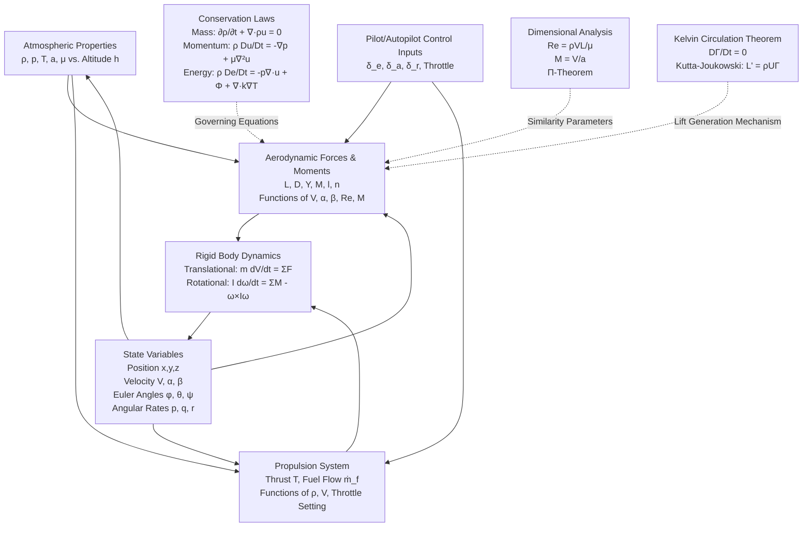

# Lesson 1: First-Principles Physical Laws & Conservation Invariants

## Curriculum Roadmap

This masterclass curriculum on flying and aviation begins where all rigorous aerospace science must: at the bedrock of conservation laws, Newtonian and Eulerian mechanics, and the fundamental field equations governing fluid motion through three-dimensional space. We construct a theoretical scaffold that will support every subsequent lesson on airfoil design, propulsion thermodynamics, atmospheric boundary layers, and orbital mechanics. The roadmap unfolds as follows: Lesson 1 establishes conservation invariants and the Navier-Stokes equations as the axiomatic foundation. Lesson 2 will derive the Bernoulli equation from first principles and dissect pressure fields around lifting bodies. Lesson 3 applies momentum theory to propeller and jet thrust generation. Lesson 4 examines compressible flow, shock waves, and transonic aerodynamics. Lesson 5 integrates orbital mechanics, the two-body problem, and the transition from atmospheric flight to spaceflight. Lesson 6 synthesizes experimental wind tunnel protocols, force balance calibration, and PIV flow visualization. By anchoring the entire curriculum in conservation laws and continuum mechanics, we ensure that every design heuristic, every empirical correlation, and every flight test measurement traces directly back to invariant physical principles that hold from subsonic gliders to hypersonic reentry vehicles.

## 1. First-Principles Problem Space & Historical Phenomenon

Flight—whether sustained atmospheric cruise or orbital trajectory—emerges from the interaction between a solid body and a surrounding fluid continuum. The historical evolution of aviation science reflects humanity's gradual recognition that intuition about terrestrial mechanics fails catastrophically when applied to fluid flows at high Reynolds numbers. Early pioneers, from Leonardo da Vinci's ornithopter sketches to Otto Lilienthal's glider experiments, relied on empirical trial and fatal error because they lacked a mathematical framework for predicting aerodynamic forces. The turning point arrived when Ludwig Prandtl formulated boundary layer theory in 1904, partitioning the flow field into a viscous layer adhering to the surface and an inviscid outer region governed by potential flow. Prandtl's insight transformed aeronautics from an artisanal craft into a predictive science grounded in the Navier-Stokes equations, which themselves descend from three inviolable conservation laws: mass, momentum, and energy.

The problem space for aviation physics spans six orders of magnitude in characteristic length scale, from the molecular mean free path in rarefied hypersonic flow ($\lambda \sim 10^{-7}$ m) to the planetary boundary layer depth ($\delta \sim 10^3$ m), and eight orders of magnitude in Reynolds number, from low-speed insect flight ($Re \sim 10^2$) to supersonic transport ($Re \sim 10^8$). Each regime demands regime-specific approximations—laminar versus turbulent boundary layers, incompressible versus compressible thermodynamics, inviscid Euler equations versus full viscous Navier-Stokes—but all regimes obey the same foundational conservation principles. The central challenge in aviation science is not discovering new physics but rather selecting the minimal set of approximations that capture the dominant physical mechanisms while remaining computationally tractable and experimentally verifiable.

Newton's second law, $\vec{F} = m\vec{a}$, provides the global force balance for the aircraft as a rigid body, but it offers no insight into how the surrounding air generates lift, drag, and pitching moment. To predict aerodynamic forces from first principles, we must abandon the discrete-particle worldview and adopt the continuum hypothesis: air is modeled as a continuous field of density $\rho(\vec{x}, t)$, velocity $\vec{u}(\vec{x}, t)$, pressure $p(\vec{x}, t)$, and temperature $T(\vec{x}, t)$. This hypothesis holds whenever the Knudsen number $Kn = \lambda / L \ll 1$, where $\lambda$ is the molecular mean free path and $L$ is the characteristic body dimension. For a commercial airliner at cruise altitude, $\lambda \sim 10^{-7}$ m and $L \sim 60$ m, yielding $Kn \sim 10^{-9}$, validating the continuum approximation with overwhelming margin. Only in rarefied hypersonic flight above 100 km altitude does the continuum model break down, requiring statistical methods from kinetic theory.

The transition from ballistic trajectories to powered, controlled flight introduced thermodynamic coupling between chemical combustion and fluid momentum. A piston engine or turbofan converts the enthalpy of hydrocarbon fuel into mechanical shaft work, which drives a propeller or compressor. The propeller imparts momentum to the surrounding air, generating thrust by Newton's third law. This momentum transfer obeys the integral momentum theorem, derived by applying Reynolds transport theorem to the momentum conservation equation over a control volume enclosing the propulsion system. The thrust $T$ equals the rate of momentum outflow minus inflow, $T = \dot{m} (u_e - u_\infty)$, where $\dot{m}$ is the mass flow rate, $u_e$ is the exhaust velocity, and $u_\infty$ is the freestream velocity. Maximizing thrust efficiency—defined as thrust power divided by total power input—requires balancing exhaust velocity against mass flow rate, a tradeoff that differentiates propeller-driven aircraft (high $\dot{m}$, low $u_e$) from jet engines (lower $\dot{m}$, high $u_e$) and rocket motors (very low $\dot{m}$, very high $u_e$).

Orbital mechanics represents the asymptotic limit of flight as atmospheric density vanishes and gravitational potential energy dominates kinetic energy. A spacecraft in low Earth orbit obeys the two-body problem, where gravitational acceleration $\vec{g} = -\mu \vec{r} / r^3$ (with $\mu = GM$ the standard gravitational parameter) produces a closed elliptical trajectory satisfying Kepler's laws. The vis-viva equation, $v^2 = \mu(2/r - 1/a)$, relates orbital velocity $v$ to radial distance $r$ and semimajor axis $a$, revealing that circular orbital velocity at radius $r$ is $v_c = \sqrt{\mu/r} \approx 7.8$ km/s at low Earth orbit altitude. The energy cost to reach orbit, measured by the characteristic velocity $\Delta v \approx 9.4$ km/s, vastly exceeds the energy required for atmospheric cruise, explaining why spaceflight remained impossible until chemical rocket engines achieved exhaust velocities approaching 4 km/s.

## 2. Conservation Invariants & Mathematical Laws

All of classical fluid mechanics and aerodynamics descends from three conservation principles encoded in partial differential equations: conservation of mass (continuity equation), conservation of momentum (Navier-Stokes equations), and conservation of energy (first law of thermodynamics for open systems). These equations govern the evolution of the flow field $(\rho, \vec{u}, p, T)$ in space and time, subject to boundary conditions imposed by solid surfaces and initial conditions set by the upstream flow state.

The continuity equation expresses mass conservation in differential form. For an arbitrary control volume fixed in space, the rate of mass accumulation equals the net mass inflow. Applying the divergence theorem to the surface integral yields

$$\frac{\partial \rho}{\partial t} + \nabla \cdot (\rho \vec{u}) = 0.$$

Expanding the divergence term produces the alternative form

$$\frac{\partial \rho}{\partial t} + \vec{u} \cdot \nabla \rho + \rho \nabla \cdot \vec{u} = 0.$$

The material derivative $D/Dt = \partial/\partial t + \vec{u} \cdot \nabla$ tracks the time rate of change following a fluid parcel, allowing the continuity equation to be written compactly as

$$\frac{D\rho}{Dt} + \rho \nabla \cdot \vec{u} = 0.$$

For incompressible flow, where density variations are negligible ($D\rho/Dt \approx 0$), the continuity equation simplifies to the divergence-free condition

$$\nabla \cdot \vec{u} = 0,$$

which states that the velocity field is solenoidal. This approximation holds for airspeeds below Mach 0.3, covering most general aviation and subsonic transport regimes.

Conservation of momentum, Newton's second law applied to a continuum, yields the Navier-Stokes equations. The momentum per unit volume is $\rho \vec{u}$, and its rate of change following a fluid parcel equals the sum of body forces (gravity $\rho \vec{g}$) and surface forces (pressure $p$ and viscous stress $\boldsymbol{\tau}$). The momentum equation in conservative form reads

$$\frac{\partial (\rho \vec{u})}{\partial t} + \nabla \cdot (\rho \vec{u} \vec{u}) = -\nabla p + \nabla \cdot \boldsymbol{\tau} + \rho \vec{g}.$$

For a Newtonian fluid, the viscous stress tensor is proportional to the strain rate tensor,

$$\boldsymbol{\tau} = \mu \left( \nabla \vec{u} + (\nabla \vec{u})^T - \frac{2}{3} (\nabla \cdot \vec{u}) \mathbf{I} \right),$$

where $\mu$ is the dynamic viscosity and $\mathbf{I}$ is the identity tensor. Substituting this constitutive relation into the momentum equation and simplifying yields the incompressible Navier-Stokes equation

$$\rho \left( \frac{\partial \vec{u}}{\partial t} + \vec{u} \cdot \nabla \vec{u} \right) = -\nabla p + \mu \nabla^2 \vec{u} + \rho \vec{g}.$$

The left-hand side represents inertial forces, while the right-hand side accounts for pressure gradients, viscous diffusion, and body forces. The ratio of inertial to viscous forces defines the Reynolds number,

$$Re = \frac{\rho U L}{\mu},$$

where $U$ is the characteristic velocity and $L$ is the characteristic length. High-Reynolds-number flows ($Re \gg 1$) are dominated by inertia and exhibit thin boundary layers, whereas low-Reynolds-number flows ($Re \ll 1$) are viscous-dominated and reversible (Stokes flow).

Conservation of energy accounts for kinetic energy, internal energy, heat transfer, and work done by pressure and viscous forces. The total energy per unit mass is $e + u^2/2$, where $e$ is the specific internal energy and $u^2/2$ is the specific kinetic energy. The energy equation in conservative form is

$$\frac{\partial}{\partial t} \left( \rho \left( e + \frac{u^2}{2} \right) \right) + \nabla \cdot \left( \rho \vec{u} \left( e + \frac{u^2}{2} \right) \right) = -\nabla \cdot (p \vec{u}) + \nabla \cdot (\boldsymbol{\tau} \cdot \vec{u}) + \nabla \cdot (k \nabla T) + \rho \vec{g} \cdot \vec{u},$$

where $k$ is the thermal conductivity. For an ideal gas, the internal energy relates to temperature via $e = c_v T$, and the pressure obeys the ideal gas law $p = \rho R T$, where $c_v$ is the specific heat at constant volume and $R$ is the specific gas constant. The enthalpy $h = e + p/\rho$ and the ratio of specific heats $\gamma = c_p / c_v$ appear frequently in compressible flow analysis.

The Bernoulli equation, a cornerstone of aerodynamic analysis, follows from integrating the momentum equation along a streamline for steady, inviscid, incompressible flow with no body forces. The result is

$$p + \frac{1}{2} \rho u^2 + \rho g z = \text{constant},$$

where $z$ is the elevation. For horizontal flow ($dz = 0$), this simplifies to

$$p + \frac{1}{2} \rho u^2 = p_0,$$

where $p_0$ is the total (stagnation) pressure. The dynamic pressure $q = \frac{1}{2} \rho u^2$ represents the kinetic energy per unit volume, and the static pressure $p$ represents the thermodynamic pressure measured by a sensor moving with the flow. The Bernoulli equation reveals the inverse relationship between velocity and pressure: accelerating flow experiences a pressure drop, while decelerating flow experiences a pressure rise. This principle underlies the generation of lift on an airfoil, where the upper surface accelerates the flow (low pressure) and the lower surface decelerates it (high pressure), producing a net upward force.

Dimensional analysis and the Buckingham Pi theorem provide a systematic method for reducing the parameter space of fluid mechanics problems. The aerodynamic force on a body depends on freestream velocity $U$, fluid density $\rho$, fluid viscosity $\mu$, speed of sound $a$, body length $L$, and body orientation (angle of attack $\alpha$). Dimensional analysis shows that the force coefficient, defined as

$$C_F = \frac{F}{\frac{1}{2} \rho U^2 L^2},$$

depends only on dimensionless groups: Reynolds number $Re = \rho U L / \mu$, Mach number $M = U / a$, and angle of attack $\alpha$. This reduction from six dimensional parameters to three dimensionless parameters enables experimental wind tunnel testing, where a subscale model at matched $Re$ and $M$ reproduces the full-scale aerodynamic forces.

Conservation of angular momentum leads to Kelvin's circulation theorem, which states that the circulation $\Gamma = \oint \vec{u} \cdot d\vec{l}$ around a closed material loop remains constant in inviscid, barotropic flow. This theorem underpins the concept of bound vorticity on a lifting wing: a starting vortex is shed during takeoff, and by conservation of circulation, an equal and opposite bound vortex remains attached to the wing, generating lift. The Kutta-Joukowski theorem quantifies this lift per unit span as

$$L' = \rho U \Gamma,$$

where $L'$ is the lift per unit span, $U$ is the freestream velocity, and $\Gamma$ is the bound circulation. This elegant result connects the abstract mathematical concept of circulation to the measurable physical quantity of lift, forming the theoretical foundation for thin airfoil theory and finite-wing lifting-line theory.

Noether's theorem, one of the most profound results in theoretical physics, establishes a correspondence between continuous symmetries and conservation laws. Time translation invariance (the laws of physics do not change over time) yields conservation of energy. Spatial translation invariance yields conservation of linear momentum. Rotational invariance yields conservation of angular momentum. These conservation principles are not independent postulates but rather necessary consequences of the underlying symmetry structure of spacetime. In fluid mechanics, symmetries manifest in simplified solutions: axisymmetric flows (rotational symmetry) reduce three-dimensional Navier-Stokes to two-dimensional equations in cylindrical coordinates, while homogeneous turbulence (statistical spatial invariance) enables spectral analysis via Fourier transforms.

The mechanical energy equation, obtained by taking the dot product of the velocity vector with the momentum equation, separates kinetic energy from internal energy and reveals the irreversible conversion of mechanical energy to thermal energy via viscous dissipation. The viscous dissipation function,

$$\Phi = \boldsymbol{\tau} : \nabla \vec{u},$$

represents the rate of mechanical energy conversion to heat per unit volume. In high-speed flows, viscous heating becomes significant in the boundary layer, raising the wall temperature above the freestream temperature even without external heat input. This aerodynamic heating effect dominates hypersonic vehicle design, where surface temperatures can exceed 1500 K, requiring ablative heat shields or active cooling systems.

## 3. High-Level Phenomenological Model

The phenomenological model for atmospheric flight integrates four coupled physical domains: aerodynamics (lift, drag, moment), propulsion (thrust, fuel flow), flight dynamics (translational and rotational motion of the rigid body), and atmospheric properties (density, temperature, pressure variation with altitude). These domains interact through nonlinear feedback loops: aerodynamic forces depend on velocity and altitude, thrust depends on air density and airspeed, and the resulting net force changes velocity and altitude, closing the loop.

The aircraft rigid body possesses six degrees of freedom: three translational coordinates $(x, y, z)$ in an inertial Earth-fixed frame and three Euler angles $(\phi, \theta, \psi)$ representing roll, pitch, and yaw. Newton's second law governs the translational dynamics,

$$m \frac{d\vec{V}}{dt} = \vec{F}_{\text{aero}} + \vec{F}_{\text{thrust}} + \vec{F}_{\text{gravity}},$$

where $m$ is the aircraft mass, $\vec{V}$ is the velocity vector in the inertial frame, and the forces are resolved into body-fixed or wind-fixed axes depending on the analysis. Euler's rotational equation governs the angular dynamics,

$$\mathbf{I} \frac{d\vec{\omega}}{dt} + \vec{\omega} \times (\mathbf{I} \vec{\omega}) = \vec{M}_{\text{aero}} + \vec{M}_{\text{thrust}},$$

where $\mathbf{I}$ is the inertia tensor, $\vec{\omega}$ is the angular velocity vector, and $\vec{M}$ represents the aerodynamic and thrust moments. The nonlinear gyroscopic term $\vec{\omega} \times (\mathbf{I} \vec{\omega})$ couples the three rotational degrees of freedom, producing phenomena such as adverse yaw during roll maneuvers and pitch-up during high-alpha flight.

Aerodynamic forces and moments are expressed as dimensionless coefficients multiplied by dynamic pressure $q = \frac{1}{2} \rho V^2$ and reference area $S$. Lift, drag, and side force coefficients $C_L$, $C_D$, and $C_Y$ scale the forces, while pitching moment $C_M$, rolling moment $C_l$, and yawing moment $C_n$ coefficients scale the moments. These coefficients depend on angle of attack $\alpha$, sideslip angle $\beta$, control surface deflections $(\delta_e, \delta_a, \delta_r)$, Reynolds number $Re$, and Mach number $M$. For example, the lift force is

$$L = C_L(\alpha, Re, M) \cdot \frac{1}{2} \rho V^2 S.$$

At low angles of attack in the linear regime, $C_L \approx C_{L\alpha} \alpha + C_{L0}$, where $C_{L\alpha}$ is the lift-curve slope (typically 0.1 per degree for conventional wings) and $C_{L0}$ is the zero-angle lift coefficient (nonzero for cambered airfoils). Beyond the stall angle, typically 15-20 degrees for subsonic wings, flow separation destroys lift and increases drag catastrophically.

The atmosphere itself is a stratified fluid with density, pressure, and temperature varying exponentially with altitude according to the barometric formula. The International Standard Atmosphere (ISA) model provides reference values: at sea level, $\rho_0 = 1.225$ kg/m³, $p_0 = 101325$ Pa, $T_0 = 288.15$ K. In the troposphere (0-11 km), temperature decreases linearly with altitude at the lapse rate $-6.5$ K/km. Above the tropopause, temperature remains constant at 216.65 K in the lower stratosphere. The pressure altitude relationship in the troposphere is

$$p = p_0 \left(1 - \frac{Lh}{T_0}\right)^{gM/RL},$$

where $h$ is altitude, $L = 0.0065$ K/m is the lapse rate, $g = 9.80665$ m/s² is gravitational acceleration, $M = 0.02896$ kg/mol is the molar mass of air, and $R = 8.314$ J/(mol·K) is the universal gas constant. Density follows from the ideal gas law $\rho = pM/(RT)$.

Propulsion systems convert chemical energy (fuel enthalpy) into kinetic energy (thrust). A propeller-driven aircraft accelerates a large mass of air by a small velocity increment, achieving high propulsive efficiency $\eta_p = 2/(1 + u_e/u_\infty)$ at moderate flight speeds. A turbojet accelerates a smaller mass of air by a large velocity increment, sacrificing efficiency for high thrust-to-weight ratio and supersonic capability. The thrust-specific fuel consumption (TSFC), measured in kg/(N·s) or lb/(lbf·hr), quantifies the fuel efficiency: lower TSFC means less fuel burned per unit thrust. Modern high-bypass turbofans achieve TSFC around 0.5 lb/(lbf·hr) at cruise, while turbojets exhibit TSFC near 1.0 lb/(lbf·hr).

The following Mermaid diagram synthesizes the coupled physical domains and their interdependencies in the atmospheric flight system. Each node represents a physical subsystem, and directed edges represent causal influences. The loop structure reveals that flight is an inherently dynamic equilibrium: steady cruise requires precise balance among lift, weight, thrust, drag, while any disturbance (gust, control input, thrust change) propagates through all subsystems, eventually reaching a new equilibrium or diverging into instability.

This phenomenological model exposes the central paradox of aviation: flight is possible only by continuously expending energy to overcome drag, yet the physical mechanism generating lift—circulation around the wing—is an inviscid phenomenon requiring zero energy in the idealized limit. The resolution lies in recognizing that viscosity, though negligible in the outer flow field, is essential in the thin boundary layer to satisfy the no-slip condition and establish circulation via the Kutta condition at the trailing edge. Without viscosity, potential flow theory predicts zero drag (d'Alembert's paradox), yet real aircraft experience substantial drag due to skin friction and flow separation. This duality between inviscid outer flow and viscous boundary layer, first articulated by Prandtl, remains the conceptual framework for all modern aerodynamic analysis.

The transition from subsonic to supersonic flight introduces compressibility effects that invalidate the incompressible Bernoulli equation. When the local Mach number exceeds unity, disturbances cannot propagate upstream, and shock waves form—discontinuities in pressure, density, and temperature satisfying the Rankine-Hugoniot jump conditions. Across a normal shock, the Mach number drops abruptly from supersonic to subsonic, total pressure decreases (entropy generation), and static pressure rises. The drag divergence Mach number, typically around 0.85-0.90 for transonic transport aircraft, marks the onset of significant wave drag due to local supersonic pockets and shock-induced separation. Supercritical airfoil design, employing careful contouring to delay shock formation and weaken shock strength, extends the drag divergence Mach number and improves cruise efficiency.

Orbital mechanics represents the limiting case where aerodynamic forces vanish and gravitational potential energy dominates. The two-body problem—a spacecraft orbiting a central gravitational body—admits closed-form solutions characterized by six orbital elements: semimajor axis $a$, eccentricity $e$, inclination $i$, right ascension of ascending node $\Omega$, argument of periapsis $\omega$, and true anomaly $\nu$. The vis-viva equation,

$$v^2 = \mu \left( \frac{2}{r} - \frac{1}{a} \right),$$

relates orbital velocity $v$ to radial distance $r$ and semimajor axis $a$, with $\mu = GM$ the standard gravitational parameter. For Earth, $\mu = 3.986 \times 10^{14}$ m³/s². Circular orbital velocity at radius $r$ is $v_c = \sqrt{\mu/r}$, yielding approximately 7.8 km/s at low Earth orbit altitude (400 km). The characteristic velocity required to reach orbit from the surface, accounting for gravity losses and atmospheric drag, totals approximately 9.4 km/s for a vertical ascent to LEO, reducing to 9.0 km/s for an optimized gravity-turn trajectory launching eastward from the equator to exploit Earth's rotational velocity (465 m/s).

The rocket equation, derived from conservation of momentum in the absence of external forces, governs the velocity increment achievable by ejecting mass,

$$\Delta v = v_e \ln \left( \frac{m_0}{m_f} \right),$$

where $v_e$ is the exhaust velocity, $m_0$ is the initial mass, and $m_f$ is the final mass. The mass ratio $m_0 / m_f$ grows exponentially with required $\Delta v$, imposing a tyrannical constraint on rocket design: reaching LEO with $\Delta v \approx 9.4$ km/s and $v_e = 4$ km/s (hydrogen-oxygen engine) demands a mass ratio of $e^{9.4/4} \approx 10$, meaning 90% of the initial mass must be propellant. This exponential relationship explains why single-stage-to-orbit vehicles remain impractical with chemical propulsion, necessitating staging to shed structural mass as propellant is consumed.

The physical laws and conservation invariants presented in this lesson—continuity, Navier-Stokes, energy conservation, Bernoulli's equation, Kelvin's circulation theorem, the rocket equation—form the irreducible theoretical core of aviation science. Every subsequent analysis, whether computing airfoil pressure distributions via panel methods, predicting turbulent skin friction via the log-law boundary layer, or optimizing ascent trajectories via Pontryagin's maximum principle, traces its logical ancestry to these first-principles equations. Mastery of flight demands not only empirical familiarity with force coefficients and performance charts but also the ability to return to these foundational equations, verify approximations, diagnose anomalies, and extend existing methods to novel flight regimes where empirical data does not yet exist. The conservation laws are invariant, universal, and eternal; the engineering challenge lies in solving them accurately, efficiently, and with sufficient physical insight to guide design decisions.
